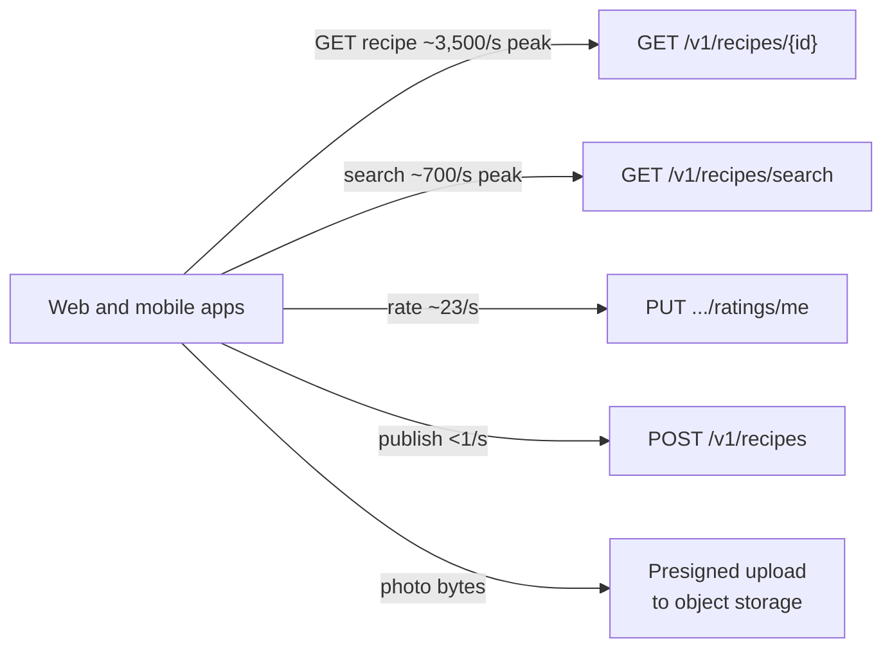

The API step turns each functional requirement into an endpoint: what the client sends, what it gets back, and the few details —
identity, pagination, idempotency — that show you've thought about real clients. Four minutes, a short list on the board, and a much
clearer design afterwards.

## What to do

1. **One endpoint (sometimes two) per functional requirement**, in the same order as the requirements list.
2. For each: **method and path**, the **important request fields**, the **response shape**, and the **status codes** that matter.
3. Cover three cross-cutting details in a sentence each:
   - **Identity** comes from the auth token, never from a user ID in the body or path.
   - **Lists are paginated** with cursors.
   - **Non-idempotent writes** that may be retried get an idempotency key (or are made idempotent by design, such as `PUT`).
4. **Don't over-detail.** Field-level schemas, every error code and headers for every endpoint belong in a design doc, not here.
5. **Check in**: "These are the endpoints I'll design against."

Background: [REST API design](lesson:rest-api-design), [pagination](lesson:pagination) and [idempotency](lesson:idempotent-apis).

## Questions to ask

Usually none — the requirements already say what the API must do. Ask only when the answer changes an endpoint:

- "Do clients upload photos directly, or through our API?" (it decides whether there's an upload-URL endpoint)
- "Is this API public (third-party developers) or only for our apps?" (versioning, API keys, rate limits)
- "Do clients need real-time updates, such as live rating counts?" (push vs polling)

## What to draw

A compact endpoint list, numbered to match the functional requirements:

```http
1. Publish
POST /v1/uploads                    -> 200 { uploadUrl, photoId }        presigned upload URL
POST /v1/recipes                    -> 201 { recipeId }                  Idempotency-Key header
     { title, ingredients[], steps[], photoIds[] }

2. View
GET  /v1/recipes/{recipeId}         -> 200 { recipe, photos[], rating: { avg, count } }

3. Search
GET  /v1/recipes/search?q=lemon&ingredients=chicken,garlic&cursor=...&limit=20
                                    -> 200 { items[], nextCursor }

4. Rate
PUT  /v1/recipes/{recipeId}/ratings/me   { stars: 1-5 }  -> 200 { avg, count }
```

Then say which client calls which endpoint, and which carry most of the traffic:



## What to say

- "Four endpoints, one per requirement. Identity comes from the bearer token in every request — no user IDs in bodies."
- "Photos don't flow through our API servers: the client asks for a presigned upload URL and sends the bytes straight to object storage;
  the recipe then references the photo IDs."
- "Publishing takes an idempotency key, so a retry after a timeout doesn't create two recipes."
- "Rating is a `PUT` on 'my rating for this recipe' — naturally idempotent, and it enforces one rating per user."
- "Search returns a cursor for pagination; I'll revisit what the cursor encodes when we talk about ranking."

### Status codes worth saying

You don't need every code, but a few show you've thought about clients:

| Endpoint | Codes to mention | Why |
|---|---|---|
| `POST /v1/recipes` | 201, 400/422, 409 (duplicate idempotency key with a different body) | Clients act differently on each |
| `GET /v1/recipes/{id}` | 200, 404 — also for private recipes the caller can't see | Avoid confirming hidden resources exist |
| `GET /v1/recipes/search` | 200, 400 for invalid filters | Bounded `limit`; unknown filters rejected |
| Any | 401, 403, 429 with `Retry-After` | Auth and rate limiting are cross-cutting |

## Common mistakes

- **Endpoints for things nobody required** — an admin API, analytics exports — while a required one is missing.
- **User ID in the request body** (`POST /rate { userId: 42 }`) — anyone could rate as anyone.
- **Unbounded lists**: `GET /recipes` returning everything.
- **Verbs in paths** (`/getRecipe`) and ignoring status codes.
- **Pushing large binaries through the API tier** when they could go directly to object storage.
- **Spending ten minutes** on field names and JSON formatting.

## Example conversation

> **Candidate:** Endpoints, one per requirement. Publishing has two parts: `POST /v1/uploads` returns a presigned URL so the app uploads
> each photo straight to object storage, then `POST /v1/recipes` with the title, ingredients, steps and photo IDs. It returns 201 with the
> recipe ID and accepts an idempotency key, since mobile clients retry.
>
> **Interviewer:** Why not upload photos through the API?
>
> **Candidate:** Bandwidth and cost — photos are tens of megabytes per recipe and would tie up API servers. Direct upload keeps the API tier
> small and stateless.
>
> **Candidate:** Viewing is `GET /v1/recipes/{id}`, returning the recipe, photo URLs on the CDN and the rating summary. Search is
> `GET /v1/recipes/search` with `q`, an ingredient list, and cursor pagination. Rating is `PUT /v1/recipes/{id}/ratings/me` with the
> stars — a `PUT` on the caller's own rating, so it's idempotent and there's at most one rating per user.
>
> **Interviewer:** How do you know who "me" is?
>
> **Candidate:** From the access token; the gateway verifies it and passes the user ID to the service.

## Key takeaways

- **One endpoint per functional requirement**, numbered to match; method, path, key fields, response, important status codes.
- **Identity from the token**, **cursor pagination** for lists, **idempotency** for retried writes.
- Send **large binaries directly to object storage** via presigned URLs.
- Keep it to **about four minutes**; detail belongs in later deep dives.

## Knowledge check

```quiz
? Which endpoint design for "rate a recipe" is best?
- `POST /rateRecipe { userId, recipeId, stars }`
! A verb in the path and a client-supplied user ID let anyone rate as anyone.
+ `PUT /v1/recipes/{id}/ratings/me { stars }`, with the user taken from the token
- `GET /v1/recipes/{id}/rate?stars=5`
! GET must be safe; it shouldn't change state.
- `DELETE /v1/recipes/{id}` with stars in a header
! DELETE removes resources; it doesn't rate them.
> A PUT on the caller's own rating is idempotent and enforces one rating per user.

? Why use presigned upload URLs for recipe photos?
+ Photo bytes go straight to object storage, keeping large uploads off the API servers
- Presigned URLs make photos public forever
! Presigned URLs are time-limited and scoped to one object.
- Because APIs can't accept binary data
! They can; it's just expensive and unnecessary here.
- To avoid needing a database
! Metadata about photos is still stored.
> Direct-to-storage uploads save bandwidth, memory and threads in the API tier.

? A list endpoint has no pagination. What is the risk?
- None, if the database is fast
! Responses grow without bound regardless of database speed.
+ Responses grow with the data — slow queries, huge payloads and timeouts as collections grow
- Clients will get 404 errors
! Missing pagination doesn't cause 404s.
- It makes the endpoint idempotent
! Pagination is unrelated to idempotency.
> Every list endpoint needs a bound, typically cursor pagination.

? How much detail should the API step contain in a 45-minute interview?
- Every field with types, validation rules and examples
! That consumes time needed for architecture and depth.
+ Method, path, key fields, response shape and the status codes that matter, plus auth, pagination and idempotency notes
- Only the number of endpoints
! Too little to reason about the design.
- No API at all; go straight to the diagram
! The API clarifies what the design must support.
> Enough to drive the design, no more.
```
