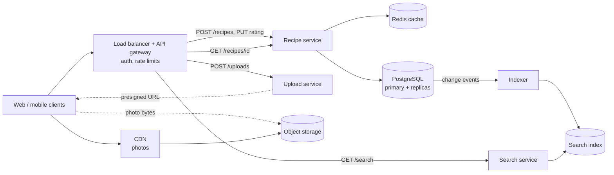
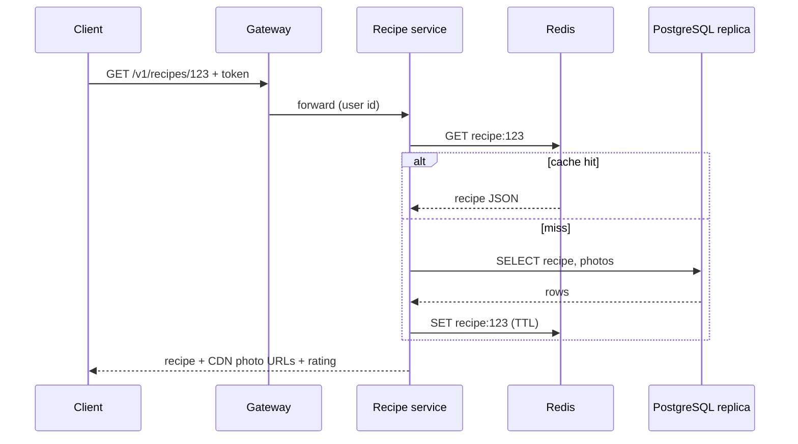

This is the step where the design appears. The goal is a **working** end-to-end architecture that satisfies every functional
requirement — built one requirement at a time, with the data flow narrated as you draw — not the most impressive diagram you can imagine.
Optimisations come later, in the deep dives.

## What to do

1. **Take the functional requirements in order.** For each, draw the path from the client to storage and back: which component receives
   the request, what it reads or writes, what it returns.
2. **Reuse components** across requirements where they belong together; split them when load, latency or failure isolation differ (as
   in the [URL shortener](problem:url-shortener), where redirects and link creation are separate services).
3. **Narrate the data flow** while drawing: "the request hits the load balancer, the gateway authenticates, the recipe service reads the
   cache…".
4. **Keep it simple first.** A load balancer, stateless services, a database, object storage. Add a cache, queue or search engine only when
   a requirement or estimate calls for it — and say which one.
5. **Mark where optimisations will go** ("cache here, revisit in deep dives") instead of designing them now.
6. **Walk every requirement through the finished diagram** as a check, then check in. About **ten minutes**.

## Questions to ask

Few — you are designing now. Useful checks:

- "Is it fine to assume an existing authentication service and API gateway?"
- "Should I treat moderation as a separate pipeline, or out of scope?"
- "Before I go deeper, is there a part you'd like me to focus on?" — asked once the first version is on the board.

## What to draw

Build it in layers. First the publish path, then view, then search, then rating:



Then trace the main requests:



## What to say

- "I'll build this one requirement at a time. **Publish:** the app gets presigned URLs from the upload service and sends photos straight to
  object storage, then posts the recipe; the recipe service writes the recipe, photo keys and ingredients to PostgreSQL in one transaction."
- "**View:** the recipe service reads from Redis, falling back to a replica; photo URLs point at the CDN, so photo bytes never touch our
  servers."
- "**Search:** a separate search service queries a search index. The index is fed from PostgreSQL's change stream by an indexer — that's
  how we meet 'searchable within a minute' without slowing down publishing."
- "**Rate:** the recipe service upserts the rating and updates the recipe's totals in one transaction, then deletes the cached recipe."
- "Every service is stateless behind the load balancer. Let me walk the four requirements through once more… Would you like me to go
  deeper anywhere first?"

## Common mistakes

- **Drawing everything at once** — twenty boxes, no data flow, and the interviewer can't tell which path serves which requirement.
- **A requirement no path satisfies** — discovered only when the interviewer asks.
- **Premature optimisation:** sharding, multi-region and Kafka before a single working path exists.
- **God services** that do everything, or the opposite: a microservice per table.
- **Silent drawing.** The narration is how the interviewer evaluates your reasoning.
- **Arrows without meaning.** Label the important ones with the operation or the data that flows.

## Example conversation

> **Candidate:** Starting with publishing. The client asks the upload service for presigned URLs and uploads photos directly to object
> storage. Then it calls `POST /v1/recipes` through the gateway; the recipe service writes the recipe, ingredients and photo keys to
> PostgreSQL in one transaction and returns the ID.
>
> **Interviewer:** What if the photo upload succeeds but the recipe is never posted?
>
> **Candidate:** Then we have orphaned photos. I'll mark that for the failure discussion — a lifecycle rule or a clean-up job can delete
> uploads that no recipe references after a day.
>
> **Candidate:** Viewing goes through the same recipe service: Redis first, then a read replica on a miss. For the author's own
> just-published recipe I'll read from the primary, to avoid replica lag. Search is a separate service over a search index, fed from
> PostgreSQL's change stream…
>
> **Interviewer:** Why a separate search service?
>
> **Candidate:** Different load and dependencies: if the search cluster struggles, recipe pages should keep working.

The candidate deferred the orphan problem to a later step rather than derailing the build — and kept a note so it wasn't forgotten.

## Key takeaways

- Build **one functional requirement at a time**, client to storage and back, and **narrate the data flow**.
- Start **simple**; add caches, queues and search only when a requirement or estimate calls for them — and say which.
- **Split components** where load, latency or failure isolation differ; label important arrows.
- **Walk every requirement through the diagram**, mark deep-dive spots, check in — about ten minutes.

## Knowledge check

```quiz
? What is the best way to build the high-level design?
- Draw every component you might need, then explain them
! A big unexplained diagram hides whether requirements are met.
+ Take each functional requirement in turn and draw its path from client to storage, narrating as you go
- Start with the deep dives and work outwards
! Without a working baseline, deep dives have nothing to attach to.
- Draw only the database
! The design must show every requirement's path.
> Building per requirement guarantees coverage and shows clear reasoning.

? When should a message queue appear in the initial design?
- Always, because every system needs one
! Unneeded components add complexity and questions.
+ When a requirement calls for asynchronous work, buffering or decoupling — and you say which one
- Never in the initial design
! Some requirements need asynchrony from the start.
- Only after the interviewer asks for it
! You should introduce components when the requirements justify them.
> Every component should trace back to a requirement or estimate.

? Why might search be a separate service from the recipe service?
+ Different load and dependencies — search problems shouldn't take recipe pages down
- Because two services are always better than one
! More services add network hops and operations; split for a reason.
- Because PostgreSQL can't be read by two services
! The split is about isolation and scaling, not database access.
- To avoid needing a search index
! The search service uses the index.
> Split where load, latency or failure isolation differ.

? Halfway through drawing, the interviewer asks about a failure you hadn't considered. What should you do?
- Stop and redesign everything around it
! That derails the build.
+ Answer briefly or note it for the failure step, then continue building the baseline
- Ignore the question
! Ignoring the interviewer is a red flag.
- Say it can't happen
! Most failures can happen; dismissing them is risky.
> Acknowledge, park it visibly, and come back in the failure-analysis step.
```
