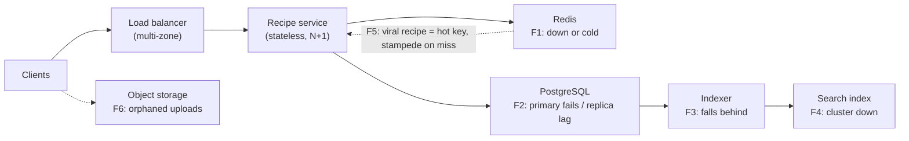

A design that only works when everything works is not a design. In this step you stress what you've drawn: what saturates first
as load grows, and what users experience when each component fails, slows down or loses data. Interviewers treat this as one of the
clearest separators between candidates who have run systems and candidates who have only drawn them.

## What to do

1. **Walk a checklist over your diagram**, component by component, rather than waiting for the interviewer to find gaps.
2. For each risk, give three things: **what happens**, **how you'd detect it**, and **the mitigation**.
3. **Prioritise** by likelihood × blast radius. A Redis failure that slows every page matters more than a moderation queue lagging.
4. **Distinguish bottlenecks from failures.** Bottlenecks appear under growth (the first thing to saturate); failures happen at any scale
   (a node dies, a dependency hangs).
5. Spend **about four minutes**; three or four well-chosen items beat a list of twenty.

### The checklist

| Category | Question to ask of your design |
|---|---|
| Single points of failure | Is there any component with one instance on the critical path? |
| Hot keys and partitions | Can one item, user or partition get a disproportionate share of traffic? |
| Cache failure | What happens when the cache is cold, empty or down — can the database take the misses? |
| Database | Primary failure and failover; replica lag and read-your-writes; connection limits |
| Queues and async work | What if consumers fall behind? What if a message is processed twice, or poisons the consumer? |
| Slow dependencies | Do timeouts, retries and circuit breakers stop one slow service taking down its callers? |
| Spikes | What does a 10× burst do — queue, shed load, or fall over? |
| Data integrity | Races, duplicates, lost writes, partial failures between two systems |
| Region or zone failure | What survives losing a zone? A region? |

## Questions to ask

- "What's more important when the cache is down — protecting the database, or serving every request even slowly?"
- "Is a brief period of stale search results acceptable during an outage?"
- "Do we need to survive a full region outage, or is zone redundancy enough?"

## What to draw

Mark the risks on the existing diagram rather than drawing a new one:



Then the table you talk through:

| # | Failure | Impact | Detection | Mitigation |
|---|---|---|---|---|
| F1 | Redis down or cold | Every view hits replicas: up to ~3,500/s at peak | Hit-ratio and latency alerts | Replicated Redis with failover; replicas sized for a degraded hit ratio; per-instance in-memory cache for the hottest recipes; shed load if needed |
| F2 | Primary fails | Publishing and rating fail briefly; views continue from cache and replicas | Health checks, failover events | Automated failover to a synchronous standby; clients retry idempotent writes |
| F2 | Replica lag | Author doesn't see their new recipe | Lag metric | Author's reads go to the primary for a short window after writing |
| F3 | Indexer falls behind | New recipes missing from search | Consumer lag on the change stream | Scale indexers; alert when lag exceeds the one-minute target |
| F4 | Search cluster down | Search fails | Error rate | Recipe pages unaffected; cached results for popular queries; rebuild from PostgreSQL |
| F5 | Viral recipe | One hot cache key; a miss sends thousands of identical queries | Per-key request rate | Request coalescing (one loader per key), early refresh before TTL expiry |
| F6 | Upload without a recipe | Orphaned photos cost storage | Storage reports | Uploads expire unless referenced; a clean-up job or lifecycle rule |

## What to say

- "Let me stress the design. The **first bottleneck** as traffic grows is the read path — the cache keeps it cheap, so the important
  question is what happens when the cache isn't there."
- "If Redis is down, all 3,500 views a second at peak reach the replicas. Two replicas sized for that, plus a small in-process cache for the
  hottest recipes, keep us up; if that's not enough, we shed low-priority traffic before the database melts."
- "A viral recipe is a hot key. On a cache miss I want **one** request to rebuild the entry while others wait or get the stale copy —
  request coalescing — otherwise a single expiry triggers a stampede."
- "Search is isolated: if it fails, recipe pages still load."
- "For publishing, a primary failover interrupts writes for seconds to a minute; clients retry with their idempotency keys, so no
  duplicates."

## Common mistakes

- **"We'll add redundancy everywhere"** — no specifics about what fails and what users see.
- **Ignoring the cold cache**: designing a database that only survives with a 95% hit ratio.
- **Retries without limits**, which turn a slow dependency into a retry storm.
- **Forgetting partial failures** between two systems — the photo uploaded, the recipe not saved.
- **Listing every possible failure** instead of the ones that matter most for this design.
- **Assuming the interviewer will ask.** Raising failures unprompted is the signal.

## Example conversation

> **Candidate:** Let me go through what breaks. The biggest risk is the cache: our database is sized for misses, not for every read. If
> Redis fails, replicas would see the full 3,500 views a second at peak. I'd run Redis replicated with automatic failover, size two
> replicas to take the full peak for a short time, and keep the top few thousand recipes in each service instance's memory.
>
> **Interviewer:** What about a recipe that goes viral?
>
> **Candidate:** Reads are fine while it's cached — one key in Redis handles tens of thousands of reads a second, and the in-process cache
> takes most of them. The danger is when that key expires: thousands of concurrent misses would all query the database. I'd use request
> coalescing so only one request rebuilds the entry, and refresh hot keys shortly before their TTL ends.
>
> **Interviewer:** And if the search cluster is down?
>
> **Candidate:** Recipe pages and publishing don't depend on it. Search returns cached results for popular queries or an error, and when
> the cluster recovers the indexer replays the change stream from where it stopped.

## Key takeaways

- Walk a **checklist** — SPOFs, hot keys, cache failure, database failover and lag, queue backlogs, slow dependencies, spikes, data races,
  zone loss.
- For each risk give **impact, detection and mitigation**, and **prioritise** by likelihood × blast radius.
- The **cold or failed cache** and **hot keys** are the most common breaking points in read-heavy designs.
- Raise failures **unprompted** and keep it to the few that matter.

## Knowledge check

```quiz
? A read-heavy design's database is sized assuming a 95% cache hit ratio. What failure must you address?
+ The cache failing or starting cold, sending far more reads to the database than it was sized for
- The CDN serving stale images
! A real concern but not the one implied by the sizing assumption.
- The load balancer using round robin
! Algorithm choice isn't the issue.
- Users rating too often
! Ratings are a small write load.
> Size for degraded hit ratios, add cache redundancy and shed load if needed.

? A popular cache key expires and 5,000 concurrent requests miss at once. What is this, and the fix?
- A replica lag problem; read from the primary
! It's a stampede on a hot key, not lag.
+ A cache stampede; coalesce requests so one request rebuilds the entry (and refresh hot keys before expiry)
- A dirty read; use serializable isolation
! Isolation levels don't stop concurrent cache misses.
- A DNS issue; lower TTLs
! DNS isn't involved.
> One loader per key turns 5,000 database queries into one.

? How should you present a failure in this step?
- Name the component that could fail and move on
! Without impact and mitigation, it's not analysis.
+ State what users experience, how you'd detect it, and how the design mitigates it
- Promise that it will never happen
! Everything fails eventually.
- Ask the interviewer how they would fix it
! You should propose the mitigation.
> Impact, detection, mitigation — prioritised.

? Which statement distinguishes a bottleneck from a failure?
+ A bottleneck is what saturates first as load grows; a failure is a component breaking or slowing at any load
- They are the same thing
! They need different mitigations: capacity versus redundancy and isolation.
- Bottlenecks only occur in databases
! Any component can be the first to saturate.
- Failures only occur at high load
! Nodes die and dependencies hang at any load.
> Growth planning and failure planning are both part of this step.
```
