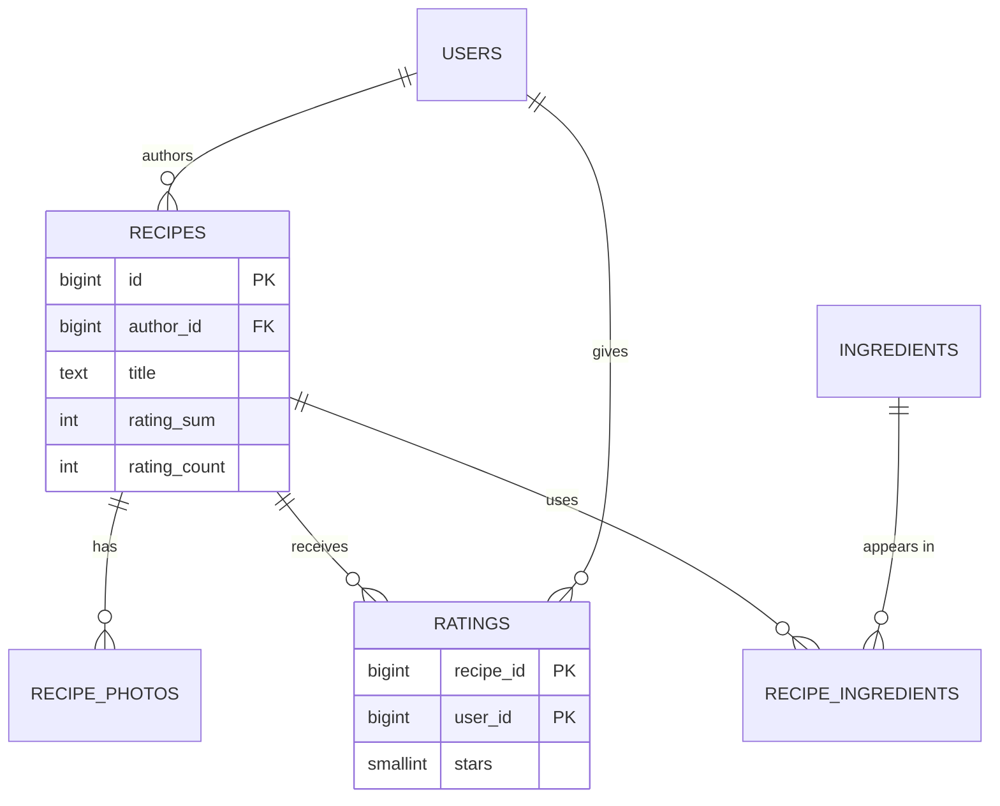

The data-model step names the entities your API reads and writes, how they relate, where each one lives and how it will be
found. In an interview it's a short list — but the keys, stores and indexes you choose here are what the architecture and the deep dives
will depend on.

## What to do

1. **List the core entities** — the nouns in your requirements and API: users, recipes, photos, ingredients, ratings.
2. **Give each a key and its important fields.** Not every column; the ones that matter for queries, constraints and size.
3. **Name the relationships** (1:N, M:N) and where the foreign key or join table goes.
4. **Write the access patterns** next to each entity: how it's read and written, and how often (use your estimates).
5. **Choose a store per entity** from its access pattern — not one store for everything by habit, and not five stores for fun.
6. **Name the indexes and partition keys** the hot access patterns need.
7. **Check in.** About **four minutes**.

Background: [relational vs NoSQL](lesson:sql-vs-nosql), [relational modeling](lesson:relational-modeling), [indexing](lesson:indexing)
and [partition keys](lesson:partition-keys-retention).

## Questions to ask

Mostly decisions rather than questions. Ask only when a rule is unclear:

- "Can a user rate a recipe more than once, or change their rating?" (a unique key, and upsert semantics)
- "Do recipes get edited after publishing, and do we need the history?" (versioning)
- "Can a recipe be deleted? What happens to its ratings and photos?" (cascades, soft deletes, clean-up)

## What to draw

The entity list with keys, stores and access patterns:

```text title="Data model on the board"
users             (id PK, name, ...)                                   PostgreSQL (auth-owned)
recipes           (id PK, author_id FK, title, ingredients jsonb,
                   steps jsonb, rating_sum, rating_count, created_at)  PostgreSQL
                   idx: author_id, created_at
recipe_photos     (recipe_id FK, position, storage_key)                PostgreSQL (bytes: S3)
                   PK (recipe_id, position)
ratings           (recipe_id, user_id, stars, updated_at)              PostgreSQL
                   PK (recipe_id, user_id)
ingredients       (id PK, name UNIQUE)                                 PostgreSQL
recipe_ingredients(recipe_id, ingredient_id)  PK both                  PostgreSQL
search documents  (recipe_id, title, ingredient names, rating, ...)    Search index (derived)
recipe page cache recipe:{id} -> rendered JSON                         Redis (derived)
```

| Access pattern | Rate (peak) | Served by |
|---|---|---|
| Get recipe by ID with photos and rating | ~3,500/s | Redis, falling back to PostgreSQL replicas (primary-key lookups) |
| Search by keywords + ingredients, ranked | ~700/s | Search index |
| Publish recipe | <1/s | PostgreSQL primary (one transaction) |
| Upsert my rating, update totals | ~23/s | PostgreSQL primary (one transaction) |



## What to say

- "The system of record is PostgreSQL: the write rate is tiny, the data is relational, and I want transactions for publishing and for
  rating plus totals."
- "Photo bytes go to object storage; the database stores only their keys."
- "Ingredient search needs an inverted index, so recipes are **also** indexed in a search engine. The search index is derived data —
  rebuilt from PostgreSQL if needed — not the source of truth."
- "Ratings have a composite primary key `(recipe_id, user_id)`: one rating per user, upserted. I keep a denormalised `rating_sum` and
  `rating_count` on the recipe so the page doesn't aggregate on every view."
- "Everything hot is a primary-key lookup, which is exactly what the cache will absorb."
- "If the data outgrew one primary, `recipe_id` would be the partition key — every hot query includes it."

## Common mistakes

- **Choosing the database first** ("I'll use MongoDB") and fitting the data to it.
- **No keys or constraints**, so uniqueness rules ("one rating per user") aren't enforced.
- **Blobs in the database.**
- **Making the search index or cache the system of record.**
- **A partition key nobody queries by**, or one that creates hot spots (time, country).
- **Twenty tables** on the board — the interviewer wanted the five that matter.

## Example conversation

> **Candidate:** The core entities are users, recipes, photos, ratings and ingredients. Recipes, photos' metadata and ratings go in
> PostgreSQL: it's relational, the write rate is under a few dozen a second, and publishing and rating each need a transaction.
>
> **Interviewer:** Why not a document store? A recipe looks like a document.
>
> **Candidate:** It does, and the recipe body — ingredients and steps — is stored as JSON in a `jsonb` column, so it reads as one
> document. But ratings and ingredient relationships are relational, and I want the uniqueness constraint on ratings. A document store
> would also work for recipes alone; at this scale PostgreSQL covers both needs with one system.
>
> **Interviewer:** And search?
>
> **Candidate:** A search index holds a document per recipe — title, ingredient names, rating — fed asynchronously from PostgreSQL. That
> matches the one-minute freshness requirement. Photos live in object storage, referenced by key.

## Key takeaways

- List **entities, keys, relationships and access patterns** — with rates from your estimates.
- Choose a **store per entity by access pattern**; keep one **system of record**, and treat caches and search indexes as **derived**.
- Enforce rules with **constraints** (composite keys for "one per user"); denormalise counters for hot reads.
- Name the **indexes and partition key** the hot paths need, then check in.

## Knowledge check

```quiz
? Where should recipe photos' bytes be stored?
- In a PostgreSQL BYTEA column on the recipes table
! Tens of terabytes a year of blobs would bloat the database, backups and replicas.
+ In object storage, with keys stored in a photos table
- In Redis
! Memory is far too expensive for photo bytes.
- In the search index
! Search indexes hold searchable text, not images.
> Blobs in object storage; metadata in the database.

? What enforces "each user rates a recipe at most once"?
+ A composite primary key on `(recipe_id, user_id)` with upsert semantics
- A check in the API code before inserting
! Concurrent requests can both pass an application check.
- An index on `stars`
! It doesn't enforce uniqueness per user.
- Storing ratings in the cache
! Caches don't enforce constraints and can lose data.
> The database constraint makes uniqueness atomic.

? Why is the search index described as "derived data"?
- It is updated synchronously in every request
! Derived data is usually updated asynchronously.
+ It is built from the system of record and can be rebuilt from it, so it is never the source of truth
- It stores only photos
! It stores searchable recipe fields.
- It doesn't need to be kept up to date
! It must be kept fresh to meet the freshness requirement.
> Keeping one source of truth makes recovery and consistency reasoning simple.

? The data must be partitioned some day. Which key fits this design's hot queries best?
- `created_at`
! New recipes would all land in one partition, and lookups by ID would need to search every partition.
+ `recipe_id`
- `author_id`
! Recipe views and ratings are by recipe, not by author.
- `stars`
! Five values: low cardinality and meaningless for routing.
> Every hot query includes the recipe ID.
```
