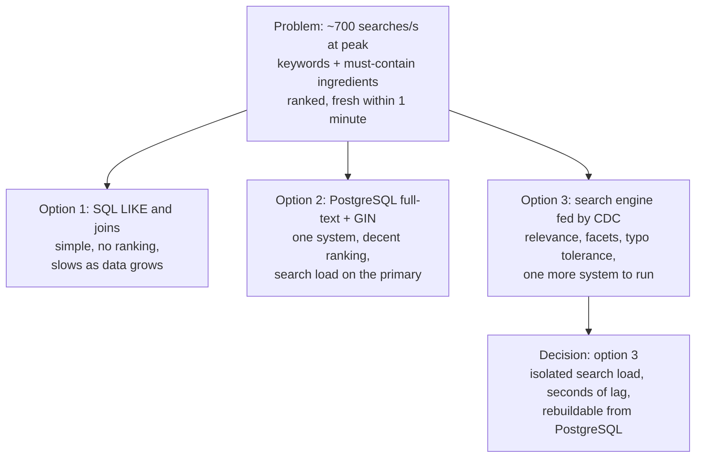

Deep dives are where interviews are won. A working design shows competence; going deep on the two or three hardest parts — with
real options, honest trade-offs and a clear decision — shows the judgement interviewers hire for, especially at senior level.

## What to do

1. **Choose the deep dives from the non-functional requirements.** Each demanding NFR points at a hard part: "p99 under 200 ms at
   3,500 views/s" → the read path; "searchable within a minute" → the indexing pipeline; "one rating per user, accurate totals" →
   concurrency on counters.
2. **Propose them and let the interviewer choose:** "I'd like to go deeper on ingredient search and on the hot read path — or is there
   something you'd rather see?" Many interviewers have a deep dive in mind; give them the opening.
3. **Run each deep dive with the same shape:**
   - **The problem**, stated precisely, with the number that makes it hard.
   - **Options**, from simplest to most sophisticated — usually two or three.
   - **Trade-offs** of each, in concrete terms (latency, cost, complexity, failure modes).
   - **A decision** for *this* system, and what would change it.
4. **Update the diagram** with the outcome.
5. **Watch the clock.** Ten minutes in a 45-minute interview — usually two deep dives, sometimes three short ones.

## Questions to ask

- "Which part would you like me to focus on?" — once, at the start.
- "Is approximate acceptable here, or must this be exact?" — when the options differ on accuracy.
- "How much staleness can this tolerate?" — when choosing between caching strategies.

## What to draw

Show the options side by side, then mark the choice. For the recipe platform's ingredient search:



## What to say

A deep dive narrated well sounds like a short design review:

- **Problem:** "Search is a core feature: about 700 queries a second at peak, combining keywords with 'must contain these ingredients',
  ranked by relevance and rating, and new recipes must appear within a minute."
- **Option 1:** "The naive version is SQL `LIKE` and joins on the ingredients table. It works for a few thousand recipes but can't rank by
  relevance and degrades as data grows."
- **Option 2:** "PostgreSQL full-text search with a GIN index gets surprisingly far and keeps one system — but it puts search load on the
  same database as our writes, and features like typo tolerance and faceting are limited."
- **Option 3:** "A dedicated search engine, indexed from PostgreSQL's change stream. It gives relevance ranking, facets and fuzzy matching,
  and isolates search load. The costs are another system to operate and index freshness measured in seconds."
- **Decision:** "Given search is a key feature and the one-minute freshness target, option 3. If the product were small, I'd start with
  option 2 and migrate later."

Then a second deep dive, more briefly — for example the **hot read path**: cache-aside in Redis keyed by recipe ID, TTL plus explicit
invalidation on edit or rating, request coalescing so a viral recipe's cache miss doesn't send thousands of identical queries to the
database, and the CDN for photos.

### What depth looks like at different levels

| Level | Typical deep-dive behaviour |
|---|---|
| SDE-2 | Goes deep on one or two areas when the interviewer points at them; explains a sound option and its main trade-off |
| Senior | Identifies the hard parts unprompted; compares several options with numbers; anticipates failure modes and operational cost |
| Staff | Also weighs organisational and evolution concerns: migration paths, ownership boundaries, what to build now versus later |

## Common mistakes

- **Deep-diving the easy part** (the user table) while the hard part (search, hot keys, contention) gets a sentence.
- **One option only** — "we'll use Elasticsearch" — with no alternatives or trade-offs.
- **Name-dropping technology** instead of explaining the mechanism ("Kafka makes it scalable").
- **Going so deep on one topic** that nothing else gets covered.
- **Ignoring the interviewer's choice** of deep dive.
- **No decision** at the end — a list of options isn't a design.

## Example conversation

> **Candidate:** The baseline is on the board. For deep dives I'd suggest ingredient search, since it's a core feature, and the hot read
> path for recipe pages, since that's our latency target. Do you have a preference?
>
> **Interviewer:** Let's start with search. Why not just use PostgreSQL?
>
> **Candidate:** PostgreSQL with full-text search and a GIN index on ingredient IDs would actually work at a few hundred queries a second,
> and it keeps one system. Two things push me to a search engine: ranking quality — combining text relevance, ingredient matches and
> ratings with typo tolerance — and isolation, because search queries are more expensive than primary-key lookups and I don't want them
> competing with writes on the primary. With a search engine indexed from the change stream, search lag is typically seconds, inside our
> one-minute target.
>
> **Interviewer:** What happens if the search cluster goes down?
>
> **Candidate:** Recipe pages keep working because they don't depend on it. Search degrades: I'd return a cached result for popular queries
> or a simple fallback from PostgreSQL for ingredient-only filters, and the indexer catches up from the change stream when the cluster
> recovers.

## Key takeaways

- Pick deep dives from the **non-functional requirements** — the hard parts — and **offer the interviewer a choice**.
- Structure each: **problem with numbers → options from simple to sophisticated → trade-offs → decision**.
- Explain **mechanisms**, not brand names; **update the diagram** with each decision.
- **Two solid deep dives** beat five shallow ones; manage the clock.

## Knowledge check

```quiz
? How should you choose which parts to deep-dive into?
- Pick the technologies you know best
! Depth should follow the problem's difficulty, not your comfort.
+ Pick the parts stressed by the non-functional requirements, and offer the interviewer a choice
- Always deep-dive the database schema first
! Sometimes the hard part is elsewhere — search, fan-out, contention.
- Deep-dive every component equally
! Equal shallow coverage gives little signal.
> NFRs reveal the hard parts; interviewers often have one in mind.

? Which deep-dive answer is strongest?
- "We'll use Elasticsearch because it's scalable."
! A brand name isn't a reason; no options or trade-offs.
+ "Option 1 is SQL joins (no ranking, slows with growth); option 2 is PostgreSQL full-text (one system, loads the primary); option 3 is a search engine fed by CDC (ranking and isolation, extra system). For our latency and ranking needs, option 3."
- "Search is easy; any database works."
! It dismisses a core, hard requirement.
- "Let's discuss search later."
! Deferring a core deep dive indefinitely loses signal.
> Problem, options, trade-offs, decision.

? At senior level, what distinguishes deep dives from SDE-2 level?
+ Identifying hard parts unprompted and comparing several options with numbers and failure modes
- Using more boxes in the diagram
! Diagram size isn't depth.
- Knowing more product names
! Mechanisms and trade-offs matter more than names.
- Speaking faster
! Pace isn't the signal.
> Seniority shows in judgement and ownership of the hard problems.

? Ten minutes into a single deep dive, you still have the failure analysis and wrap-up to do in a 45-minute interview. What should you do?
- Keep going until the interviewer stops you
! You risk ending without covering failures or summarising.
+ Conclude with a decision, update the diagram, and move to the next topic
- Abandon the deep dive without a conclusion
! Leaving it unresolved wastes the time spent.
- Start a third deep dive
! There isn't time for it.
> Close each deep dive with a decision and manage the clock.
```
