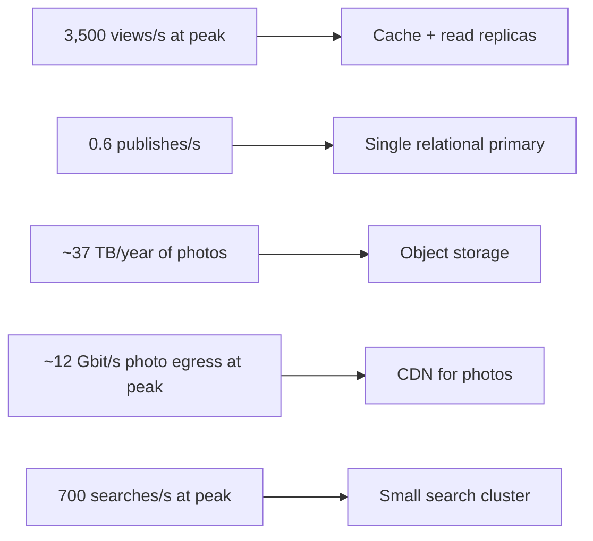

In the interview, estimation is a two-to-three-minute step with one job: produce the few numbers that will justify decisions in
the design, and say what each implies. Stage 4 taught the arithmetic ([estimation workshop](lesson:estimation-workshop)); this lesson is
about choosing what to estimate and delivering it well.

## What to do

1. **Pick the numbers that matter for this problem** — usually two to four from: peak read and write rates, storage over retention,
   bandwidth, cache size, concurrent connections, load on the hottest key.
2. **Compute them out loud** with rounded powers of ten, writing each line on the board.
3. **End every number with its consequence:** "…so one primary handles writes", "…so photos need a CDN".
4. **Skip what doesn't matter** and say so: "Ratings are 23 per second — negligible; I won't size them further."
5. **Move on** within about three minutes. You'll come back to specific numbers during deep dives.

Some interviewers prefer you to skip upfront estimation and compute numbers only when a decision needs one. If they say so, do exactly
that — the skill being tested is the link between numbers and decisions, not the ritual.

## Questions to ask

Usually you already have scale from steps 1–2. Ask only what is missing for the numbers you chose:

- "How many photos per recipe, and roughly how large?" — for storage and bandwidth.
- "What share of views come from mobile?" — only if payload size or CDN strategy depends on it.
- "Is there a predictable peak, like dinner time or holidays?" — for the peak factor.

If the interviewer wants you to decide, assume and move on.

## What to draw

Write the estimate as a short column of lines, each ending in a decision:

```text title="Estimate on the board"
Views     100M/day ÷ 10^5   ≈ 1,000-1,200/s   x3 peak ≈ 3,500/s  -> cache + replicas
Search     20M/day          ≈ 230/s           peak ≈ 700/s       -> search engine, modest size
Publish    50K/day          ≈ 0.6/s                              -> one primary is plenty
Ratings     2M/day          ≈ 23/s                               -> negligible
Photos     50K x 4 x 500 KB ≈ 100 GB/day ≈ 37 TB/year            -> object storage
Photo egress 100M views x 3 x 150 KB ≈ 45 TB/day ≈ 4 Gbit/s avg  -> CDN (~12 Gbit/s at peak)
Hot cache  ~1M recipes x 10 KB ≈ 10 GB                           -> one Redis node + replica
```



## What to say

- **Announce the plan:** "I'll estimate peak reads and writes, photo storage and photo bandwidth — those drive the design. I'll round
  heavily."
- **Narrate the arithmetic:** "100 million views a day; divide by about 100,000 seconds — roughly 1,000 a second, call it 3,500 at dinner
  time."
- **State consequences immediately:** "That's read-heavy and very cacheable, so a cache in front of replicas."
- **Flag the surprising number:** "The interesting one is photo bandwidth — about 4 Gbit/s on average. That's why photos go through a CDN,
  not our servers."
- **Close:** "Writes are tiny, reads and bandwidth are the challenge. Moving on to the API."

## Common mistakes

- **Estimating everything** — requests, storage, bandwidth, memory, servers — for five minutes, with no decisions attached.
- **False precision:** "1,157.4 requests per second".
- **Skipping peaks** and designing for the average.
- **Missing the dominant resource.** For a photo-heavy product the headline is bandwidth, not requests per second.
- **Arithmetic in silence**, then announcing a number the interviewer can't verify.
- **Never using the numbers again.** If no later decision cites an estimate, it wasn't needed.

## Example conversation

> **Candidate:** Quick estimate of the numbers that matter. Views: 100 million a day is about 1,000–1,200 a second, and with a dinner peak
> around three times that, 3,500 a second. That's very read-heavy and cacheable — a cache and read replicas.
>
> **Interviewer:** And writes?
>
> **Candidate:** 50,000 new recipes a day is under one per second; ratings are about 23 a second. A single relational primary handles both
> easily, so I won't shard anything.
>
> **Candidate:** The bigger numbers are photos. Four photos per recipe at about 500 KB is 100 GB a day — around 37 terabytes a year, so
> object storage. And each view shows about three resized photos at 150 KB: 45 terabytes a day of egress, roughly 4 gigabits per second
> on average and 12 at peak. Photos must come from a CDN.
>
> **Interviewer:** How big a cache?
>
> **Candidate:** If about a million recipes are hot at 10 KB each, that's 10 GB — one Redis node with a replica. I'll revisit if we cache
> search results too.

Three minutes, five numbers, five decisions — and the interviewer's follow-up was answered with the same method.

## Key takeaways

- Estimate **only the numbers that change the design**, out loud, in about **three minutes**.
- Use **rounded powers of ten**; peak, not just average.
- **End every number with a decision**; flag the dominant resource (often bandwidth or a hot key).
- Follow the interviewer's preference — some want numbers only when a decision needs them.

## Knowledge check

```quiz
? For a photo-heavy product, which estimate is most likely to change the architecture?
- The number of API servers to the nearest unit
! Precision here rarely changes the design.
+ Photo egress bandwidth, which points to a CDN
- The size of a rating row
! Ratings are tiny and few.
- Seconds per day
! That's a conversion, not an estimate.
> The dominant resource decides the architecture; for media, it's bandwidth.

? You compute 0.6 writes per second. What should you say?
- Nothing; move on silently
! Say the consequence so the interviewer hears the reasoning.
+ "That's tiny — one relational primary handles it, so no sharding is needed for writes."
- "We need to shard writes across ten databases."
! The number argues against sharding.
- "We should use a NoSQL database for writes."
! The write rate doesn't justify a store change.
> Every number should end in a decision, including "this needs nothing special".

? The interviewer says, "Skip the estimates for now." What is the best response?
+ Agree, and bring in specific numbers later when a decision needs them
- Insist on estimating everything first
! Ignoring the interviewer's steer is a red flag.
- Never mention numbers in the interview
! Numbers are still needed to justify scaling decisions later.
- Ask why they don't like estimates
! Unnecessary; adapt and continue.
> The underlying skill is linking numbers to decisions, whenever they appear.

? Average views are 1,200/s and the dinner peak is 3×. Which figure should size the cache-miss path to the database?
- 1,200/s
! The average underestimates the busiest hour.
+ About 3,500/s at peak, multiplied by the expected miss ratio
- 100M/day
! Daily totals don't size per-second capacity.
- 3,500/s regardless of caching
! With a cache, only misses reach the database (plan for a degraded hit ratio too).
> Capacity follows peak load; caching scales it by the miss ratio.
```
