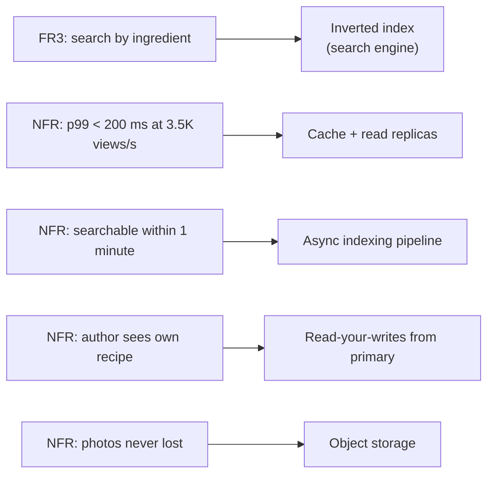

Requirements are the contract for the rest of the interview: every endpoint, table and box you draw should trace back to one of
them, and every deep dive should defend one of them. This step writes them down — three to five functional requirements and a handful
of non-functional ones with numbers attached.

## What to do

1. **Write the functional requirements** (FRs) as user-facing capabilities: "Users can …". Three to five, in priority order. Each will
   become at least one API endpoint.
2. **Write the non-functional requirements** (NFRs) as qualities with numbers: scale, latency, availability, consistency, durability,
   freshness. "Fast" and "scalable" are not requirements; "p99 page load under 200 ms at 3,500 views/s" is.
3. **Differentiate by operation.** Different actions deserve different guarantees: reading a recipe must be highly available; a rating
   count may lag; publishing must never lose a recipe.
4. **Mark priorities.** Which requirement must be excellent, which merely good? This tells you where to spend the deep-dive time.
5. **Check in**, then move on — about **four minutes** in total.

The background is in [functional and non-functional requirements](lesson:requirements); this lesson is about doing it fast and well in an
interview.

## Questions to ask

Most questions were asked in step 1. Now ask the ones that **quantify** the NFRs:

- "What's an acceptable delay between publishing a recipe and it appearing in search?" → a **freshness** target.
- "Do ratings need to be exact the instant someone rates, or can the average lag a little?" → **consistency** per operation.
- "Is it worse to show a slightly stale recipe or to show an error?" → **availability vs consistency** preference.
- "What latency should a recipe page load within?" → a **latency** target, ideally as a percentile.
- "Is there a launch or seasonal peak — holiday cooking?" → the **peak factor**.

If the interviewer has no preference, propose a number and its reason: "I'll target p99 under 200 ms for recipe pages, since they're the
core journey."

## What to draw

Write two short lists on the board and leave them there; you'll point at them later.

```text title="Requirements on the board"
Functional (priority order)
 1. Publish a recipe (title, ingredients, steps, up to 10 photos)
 2. View a recipe
 3. Search recipes by keywords and ingredients
 4. Rate a recipe (1-5) and see its average

Non-functional
 - Scale: 5M DAU; ~100M recipe views/day; 50K new recipes/day; dinner peak ~3x
 - Latency: recipe page p99 < 200 ms; search p99 < 500 ms
 - Availability: reads 99.9%+ (prefer stale over error); publishing 99.9%
 - Freshness: new recipes searchable within ~1 minute
 - Consistency: ratings average may lag seconds; an author sees their own recipe immediately
 - Durability: published recipes and photos are never lost
```

Then connect each requirement to the part of the design it will drive:



## What to say

- "I'll keep the functional scope to four requirements; publishing and search are the most important."
- "For non-functional requirements I want numbers, because they decide the architecture: I'm assuming 5 million daily users…"
- "Different operations get different guarantees: recipe pages favour availability; ratings can be eventually consistent; publishing must
  be durable."
- "Does this match what you had in mind, or would you like to change a priority?"

## Common mistakes

- **Vague NFRs**: "highly scalable, low latency, highly available" with no numbers.
- **One guarantee for everything**: demanding strong consistency for ratings, or eventual consistency for publishing.
- **Too many FRs**: ten features means none gets designed properly. Cut or mark as lower priority.
- **Implementation in requirements**: "Use Elasticsearch for search" is a design choice; the requirement is "search by ingredient within
  500 ms".
- **Forgetting the author's view**: read-your-writes is a requirement users notice immediately when it's broken.

## Example conversation

> **Candidate:** Functional requirements, in priority order: publish a recipe with photos, view a recipe, search by keywords and
> ingredients, and rate a recipe and see its average. I'll treat rating as lowest priority.
>
> **Interviewer:** Fine.
>
> **Candidate:** For non-functional ones: 5 million daily users and about 100 million recipe views a day, with a dinner-time peak around
> three times average. Recipe pages should load with p99 under 200 milliseconds — that's the core journey. Search can be a bit slower,
> p99 under half a second. How quickly should a new recipe show up in search?
>
> **Interviewer:** Within a minute or so is fine.
>
> **Candidate:** Then search can be updated asynchronously. For availability, I'd rather show a slightly stale recipe than an error, so
> reads favour availability; ratings can lag by seconds. Publishing must never lose a recipe, and an author should see their own recipe
> immediately after publishing. Anything you'd change?
>
> **Interviewer:** No, that's good. What about moderation?
>
> **Candidate:** I'll keep a simple "report recipe" flag in scope as a low priority and leave automated moderation out.

The "within a minute" answer already decided part of the architecture (asynchronous indexing), and the "author sees their own recipe"
requirement flagged a replica-lag issue to handle later.

## Key takeaways

- Write **3–5 functional requirements** as user capabilities, in **priority order**; each becomes an endpoint.
- Write **non-functional requirements with numbers**: scale, latency percentiles, availability, freshness, consistency, durability.
- **Differentiate guarantees by operation** — it's one of the clearest senior signals.
- Keep requirements **free of implementation**, keep them **visible**, and check in.

## Knowledge check

```quiz
? Which is a well-formed non-functional requirement?
- "The system should be fast."
! No number, no percentile, no operation.
+ "Recipe pages load with p99 under 200 ms at 3,500 views/s."
- "Use Redis for caching."
! That's a design decision, not a requirement.
- "Users can rate recipes."
! That's a functional requirement.
> NFRs need an operation, a metric and a target.

? Why should ratings and publishing have different consistency requirements?
+ A slightly stale rating average harms no one, but losing or hiding a just-published recipe breaks trust — so each gets the cheapest guarantee that is acceptable
- Because ratings are stored in a different database
! The storage choice follows from the requirement, not the reverse.
- They shouldn't; everything should be strongly consistent
! Strong consistency everywhere costs latency and availability for no benefit.
- Because interviewers expect at least two consistency levels
! The reason is the user impact, not a quota.
> Per-operation guarantees let the design be strict only where it matters.

? The interviewer says new recipes may take up to a minute to appear in search. What does that allow?
- Search can be skipped
! Search is still a functional requirement.
+ Indexing can be asynchronous — the search index is updated by a pipeline rather than inside the publish request
- Recipes can be lost for a minute
! Durability is a separate requirement.
- The search index must be the system of record
! The index can lag precisely because it isn't the source of truth.
> Freshness targets decide whether work can move off the request path.

? You've listed nine functional requirements. What should you do?
- Design all nine equally
! There isn't time; nothing gets designed well.
+ Prioritise, keep three to five, and mark the rest as out of scope or later
- Ask the interviewer to pick one
! You should drive prioritisation and confirm it.
- Merge them into one requirement
! Merged requirements are harder to trace to endpoints.
> Focus is a senior signal; scope can grow if time allows.
```
