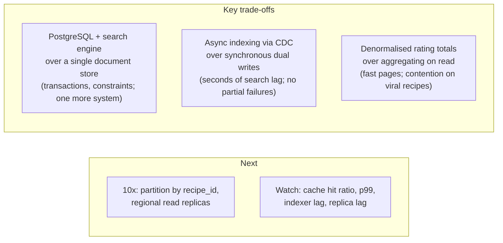

The last few minutes shape the interviewer's final impression. A clear wrap-up — the design in thirty seconds, the decisions that
could have gone the other way, what you'd watch in production and what you'd build next — turns a collection of boxes into a design that
someone owns.

## What to do

1. **Summarise the design in about thirty seconds**: the main components and how a request flows, tied to the requirements.
2. **Name the key trade-offs**: two or three decisions where you chose one option over another, what you gave up, and why it was right
   here.
3. **Say what you'd monitor** — the handful of signals that tell you the design is healthy or about to break.
4. **Say what you'd build next** or how the design evolves at 10× scale, and **name the biggest open risk**.
5. **Leave space for questions.** Stop talking before the time runs out.

About **three minutes** in a 45-minute interview. If time is short, the summary alone is worth more than another component.

## Questions to ask

- "Is there anything you'd like me to revisit before we finish?"
- "Would you like me to talk about how this changes at 10× scale, or about operations?"

These hand the interviewer one last chance to probe what they care about — often the area where they were still undecided.

## What to draw

Nothing new. Point at the existing diagram while summarising, and optionally jot a small "trade-offs" box:



## What to say

A model summary for the running example:

> "To summarise: clients upload photos directly to object storage and publish recipes through a stateless recipe service that writes to
> PostgreSQL in one transaction. Recipe pages are served from Redis with replicas behind it and photos from the CDN, which meets the
> 200 ms p99 at our dinner-time peak. Search runs on a separate search engine indexed from PostgreSQL's change stream within seconds,
> which meets the one-minute freshness target and isolates search load. Ratings are upserted with a composite key and the totals are
> denormalised on the recipe."

Then the trade-offs:

- "I chose PostgreSQL plus a search engine over a single document store: I get transactions and uniqueness constraints for ratings, at the
  cost of operating a second system and accepting a few seconds of search lag."
- "Indexing is asynchronous rather than writing to both stores in the request — so a search outage can't fail a publish, and there's no
  window where one write succeeded and the other didn't."
- "Rating totals are denormalised for fast pages; on an extremely viral recipe that row becomes contended, and I'd batch rating updates
  through a queue."

Then operations and evolution:

- "I'd watch the cache hit ratio, p99 page latency, replica lag and the indexer's lag behind the change stream."
- "At ten times the scale, the first change is partitioning PostgreSQL by recipe ID and adding regional read replicas and caches; the
  biggest open risk today is cache dependence — I'd load-test the database at a degraded hit ratio."

## Common mistakes

- **Ending mid-deep-dive** when time runs out, with no summary.
- **Repeating every component** instead of summarising the flow and the reasons.
- **"No trade-offs, this design is optimal."** Every design gives something up; not naming it suggests you don't see it.
- **Introducing a brand-new component** in the last two minutes.
- **Defensiveness** when the interviewer challenges a decision in the wrap-up. Acknowledge the alternative and the condition under which
  you'd switch.

## Example conversation

> **Interviewer:** We have about four minutes left.
>
> **Candidate:** Let me summarise, then I'd love to hear if you want anything revisited. Photos go straight to object storage and out
> through the CDN; recipes are written to PostgreSQL by a stateless service and read through Redis and replicas; search is a separate
> engine fed from the change stream; ratings are upserted with denormalised totals.
>
> **Candidate:** The main trade-offs: a relational system of record plus a search engine instead of one document store — constraints and
> transactions, at the cost of an extra system and seconds of search lag; and asynchronous indexing instead of dual writes. In production
> I'd watch hit ratio, p99, replica lag and indexer lag. At ten times the scale I'd partition by recipe ID first.
>
> **Interviewer:** Would you still choose PostgreSQL if ratings had to be visible to everyone instantly?
>
> **Candidate:** Yes — that's actually easier in PostgreSQL than in most alternatives. I'd drop the cached rating summary from the recipe
> page cache, or invalidate it synchronously on each rating, and accept slightly more load on the replicas. What would push me away from
> PostgreSQL is write volume far beyond one primary, not rating freshness.

The final answer acknowledged the new requirement, adjusted the design specifically, and named the real condition for changing course.

## Key takeaways

- Finish with a **30-second summary** tied to the requirements, **two or three trade-offs** with what you gave up, **what you'd
  monitor**, and **what's next at 10×**.
- **Name the biggest open risk** — it shows ownership.
- **Stop in time** for the interviewer's questions; never end mid-sentence.
- Respond to late challenges by stating **the condition under which you'd change the decision**.

## Knowledge check

```quiz
? What should a 30-second summary contain?
- A list of every component's name
! Names without flow and reasons don't summarise the design.
+ The main request flows and how they meet the key requirements
- The full estimate, recalculated
! The numbers were covered; cite them only where they justify a decision.
- Apologies for what you didn't cover
! Focus on what the design does; mention open risks constructively.
> Summarise the design as flows tied to requirements.

? Which wrap-up statement shows the strongest trade-off reasoning?
- "This design is optimal and has no downsides."
! Every design gives something up.
+ "I chose async indexing over dual writes: search can lag by seconds, but a search outage can't fail a publish and there are no partial writes."
- "I used Kafka because it's industry standard."
! Popularity isn't a trade-off argument.
- "I could have used any database."
! It sidesteps the decision.
> Name the alternative, what you gave up, and why it's right here.

? Three minutes remain and you're mid-way through a third deep dive. What should you do?
- Finish the deep dive regardless
! You'd likely end without a summary.
+ Close it with a one-line decision and move to the summary and trade-offs
- Start drawing a multi-region version
! New material at the end adds risk and no summary.
- Ask for five more minutes
! Interviews run on fixed schedules; manage your own time.
> The wrap-up is worth more than the last few minutes of any single deep dive.

? In the wrap-up the interviewer challenges a decision. What is the best response?
- Defend it without acknowledging alternatives
! Defensiveness is a red flag.
- Immediately switch to the interviewer's suggestion
! Switching without reasoning suggests you didn't believe your own choice.
+ Acknowledge the alternative, explain your reasoning, and state the condition under which you'd switch
- Say it doesn't matter
! Dismissing the question loses signal.
> Good engineers hold opinions loosely and with reasons.
```
