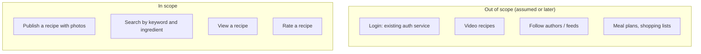

The first three minutes decide which system you design. Prompts are deliberately vague — "design a recipe-sharing site" could
mean a weekend project or a global platform — and the interviewer expects you to find out which before drawing anything. This step
turns a one-line prompt into a clear use case, a set of users and an explicit boundary.

All the step lessons use one running example: **a recipe-sharing platform** where home cooks post recipes with photos and others find,
read and rate them.

## What to do

1. **Restate the prompt in your own words** to confirm the core use case: "So people publish recipes, and other people find and cook
   them."
2. **Identify the actors.** Who uses the system, and how? For recipes: authors who publish, readers who browse and search (most users), and
   perhaps moderators.
3. **Find the core user journey** — the one flow that must work brilliantly. Here: *search for a recipe → open it → cook from it*.
4. **Ask the questions that change the design** (below) — not every question you can think of.
5. **Draw the boundary**: say what is out of scope and what you'll assume exists (authentication, payments, a notification service).
6. **Check in** and move to requirements.

Aim for **three to four minutes**. You're not writing requirements yet — you're deciding which problem you're solving.

## Questions to ask

Ask questions in roughly this order, because each category changes the design more than the next:

| Category | Example for the recipe platform | Why it changes the design |
|---|---|---|
| **Core features** | "Is search by ingredient essential, or just by title?" | Ingredient search needs an inverted index, not a `LIKE` query |
| **Scale** | "Roughly how many users and recipe views a day? How many new recipes?" | Decides caching, replicas, partitioning |
| **Content** | "Photos? Videos? How big?" | Photos → object storage + CDN; video adds transcoding and streaming |
| **Freshness and consistency** | "How quickly must a new recipe be searchable? Must ratings be exact?" | Synchronous indexing vs asynchronous; counters |
| **Clients and geography** | "Mobile and web? Global?" | CDN placement, payload sizes, multi-region |
| **Social features** | "Can users follow authors and get a feed?" | A feed is a whole extra design problem (fan-out) |
| **Constraints** | "Any latency targets or existing systems to integrate with?" | Sets the budget and boundaries |

Good questions are **specific and closed** enough to answer in a sentence. "What are the requirements?" hands the work back to the
interviewer; "Is ingredient search in scope?" shows you already know what matters.

When the interviewer says "you decide", **make a reasonable assumption and state it**: "I'll assume 5 million daily users and photos but no
video."

## What to draw

Not architecture yet. Write a small **scope box** in a corner of the board and keep it visible for the rest of the interview:



The list of actors can sit beside it: *authors, readers, moderators (light)*.

## What to say

- **Open with a restatement:** "Let me make sure I understand: people publish recipes with photos, and others search for and read them —
  the main journey is finding a recipe and cooking from it. Is that right?"
- **Explain why you ask:** "I'm asking about video because it changes the storage and delivery design a lot."
- **State assumptions explicitly:** "I'll assume authentication already exists and we just receive a user ID."
- **Close the step:** "So: publishing, search, viewing and ratings are in; feeds, video and meal planning are out. I'll write that as
  requirements next."

## Common mistakes

- **Drawing before asking.** The most common way to design the wrong system.
- **Interrogating.** Fifteen questions in a row, including ones that don't change anything ("What colour is the logo?").
- **Asking only about scale.** Features and consistency needs change the design as much as traffic does.
- **Not recording the answers.** Five minutes later you won't remember whether ratings had to be exact.
- **Accepting unlimited scope.** If the interviewer agrees to everything, *you* must cut: "To keep this focused, I'll leave feeds out
  unless you'd like them."

## Example conversation

> **Interviewer:** Design a recipe-sharing platform.
>
> **Candidate:** To check I've got it: home cooks publish recipes, and other people search for them, read them and maybe rate them. The
> main journey is "find a recipe and cook from it". Is that the core?
>
> **Interviewer:** Yes.
>
> **Candidate:** A few questions that will shape the design. Do recipes have photos or videos?
>
> **Interviewer:** Photos, usually a few per recipe. No video for now.
>
> **Candidate:** Is searching by ingredient important — "what can I make with chicken and lemon"?
>
> **Interviewer:** Yes, that's a key feature.
>
> **Candidate:** Roughly what scale? Users, recipe views, new recipes per day?
>
> **Interviewer:** You decide.
>
> **Candidate:** I'll assume about 20 million monthly users, 5 million daily, roughly 100 million recipe views and 50,000 new recipes a day.
> Do users follow authors and get a personalised feed?
>
> **Interviewer:** Let's leave that out.
>
> **Candidate:** Great. So in scope: publishing with photos, keyword and ingredient search, viewing, and ratings. Out of scope: feeds,
> video and meal planning; I'll assume an existing auth service. I'll turn that into requirements now.

Notice what the candidate did *not* ask: nothing about databases or programming languages. Those are design choices, not requirements.

## Key takeaways

- Spend **three to four minutes**: restate, identify actors and the **core journey**, ask what changes the design, draw the boundary.
- Ask about **features, scale, content, freshness and consistency, clients and constraints** — in that order of impact.
- When told "you decide", **assume and state** it.
- Keep a visible **scope box** with explicit exclusions, and check in before moving on.

## Knowledge check

```quiz
? Which clarifying question is most valuable early in "design a recipe-sharing platform"?
- "Which database should I use?"
! That's a design decision you make later, not a requirement to ask about.
+ "Is searching by ingredient a core feature?"
- "What programming language do you use?"
! Language choice rarely affects a high-level design.
- "Should the logo be on every page?"
! It doesn't change the design.
> Ingredient search requires an inverted index and changes the architecture.

? The interviewer answers "you decide" to a scale question. What should you do?
- Refuse to continue without numbers
! That stalls the interview.
+ Make a reasonable assumption, say it out loud, and continue
- Assume the largest possible scale to be safe
! Over-engineering for an imaginary scale wastes time and adds complexity.
- Skip scale entirely
! Scale drives most later decisions.
> Stated assumptions keep you moving and can be corrected instantly.

? Why write an explicit "out of scope" list?
+ It keeps the design focused, shows judgement and stops the interviewer expecting features you won't design
- To avoid hard parts of the problem
! Exclusions should be agreed and sensible, not a way to dodge the core.
- Because interviewers require exactly four exclusions
! There is no fixed number.
- To fill time at the start
! It should take seconds, not minutes.
> Scope control is a senior-level signal.

? How long should step 1 usually take in a 45-minute interview?
- 15 minutes
! That leaves too little time for design and depth.
+ About 3–4 minutes
- 30 seconds
! Too short to uncover the questions that change the design.
- As long as it takes to answer every possible question
! Ask what changes the design; assume the rest.
> Short, targeted scoping leaves time for the parts that carry the most signal.
```
