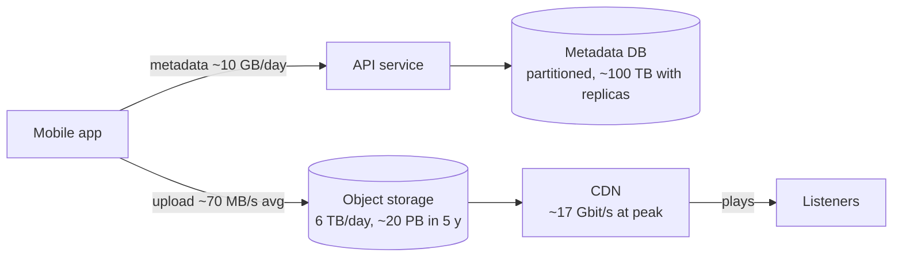

Storage estimation answers "how much data, for how long, and where does it live?" Bandwidth estimation answers "how many bytes
per second move in and out?" For text-heavy systems storage usually decides the database design; for media, bandwidth usually decides
everything else.

## The question it answers

- Will the data fit **one database**, or does it need partitioning, archiving or a different kind of store?
- Should it live in a **database at all** — or in object storage with only metadata in the database?
- How much data **moves per second**, and does that require a CDN or uploads that bypass your servers?
- How do **retention, replication and growth** multiply the raw number?

## Formula

```text title="Formula"
bytes per record   = sum of field sizes + per-row overhead (+ indexes, often × 1.5-2 in a database)
storage per day    = writes per day × bytes per record
storage retained   = storage per day × 365 × retention years          (flat traffic)
                   = storage per year × (1 + g + g² + … )               (growing g per year)
raw disk           = storage retained × copies (replicas, backups)
ingress (bytes/s)  = writes/s × bytes per write
egress (bytes/s)   = reads/s × bytes per read          (× peak factor; × 8 for bits/s)
```

### Sizing a record

List the fields and their sizes, then add overhead:

| Field | Size |
|---|---|
| `id` (bigint) | 8 B |
| `user_id` (bigint) | 8 B |
| `created_at` (timestamp) | 8 B |
| `duration_ms`, `codec`, flags | ~10 B |
| `storage_key` (text, ~60 chars) | ~60 B |
| `caption` (text, average) | ~100 B |
| Row header and alignment (PostgreSQL ~24 B) | ~30 B |
| **Row total** | **~225 B** |
| Two or three indexes | roughly +50–100% |

Round to **~500 bytes per metadata row** including indexes. Blobs (audio, images, video) are counted separately, at their compressed size.

### Retention, replication and growth

- **Retention** multiplies by the number of days kept. Ask: forever, a year, 30 days? Many datasets (logs, events, expired content) have
  natural limits.
- **Replication** multiplies database storage by the number of copies — typically 3 (a primary and two replicas), plus backups. Managed
  object storage stores data redundantly for you and bills for the logical bytes, so you don't multiply by 3 there.
- **Growth** compounds. At 30% a year, five years of data is **9× one year's volume**, not 5× — growth nearly doubles the total.

## Worked example

A voice-notes app: people record short audio messages that others play.

- **20M notes recorded a day**, average **300 KB** (about 2–3 minutes of compressed speech).
- Each note is **played 10 times** on average.
- Metadata per note: ~500 bytes including indexes (above). Keep everything **5 years**; traffic grows **30% a year**.
- Evening peak: 3× average.

**Audio storage:** 20M × 300 KB = **6 TB a day** → 2.2 PB a year → about **11 PB over five years flat**, or roughly **20 PB with 30%
growth** (2.2 PB × 9.04). This is unambiguously **object storage** — no database stores petabytes of blobs sensibly.

**Metadata:** 20M × 500 B = **10 GB a day** → 3.7 TB a year → ~18 TB over five years at today's rate, **~33 TB with 30% growth** —
about 100 TB of database disk with three copies. That is well past a comfortable single node: partition by `user_id` or time, or use a
horizontally scaling store, and archive old metadata.

**Ingress:** 6 TB a day ÷ 86,400 ≈ **70 MB/s** (~0.56 Gbit/s) on average — fine, but uploads should still go straight to object storage
rather than through API servers.

**Egress:** 200M plays × 300 KB = **60 TB a day** ≈ **690 MB/s ≈ 5.6 Gbit/s** on average and **~17 Gbit/s at peak**. That is more than a
handful of servers' network cards, and it is mostly repeated reads of popular notes: **a CDN** is required.



## Try it

```estimator title="Voice notes"
requestsPerDay = 220M
readsPerWrite = 10
writeBytes = 300 KB
readBytes = 300 KB
retentionYears = 5
growthPercent = 30
peakFactor = 3
replication = 1
cachePercent = 10
serverRps = 2000
targetUtilization = 70
```

Replication is set to 1 because object storage handles redundancy internally. Try `growthPercent = 0`, then 50, to see how much growth
dominates a five-year estimate.

```drill
? 50M records a day at 2 KB each, kept for one year. How much storage before replication?
= 36.5 TB
~ 1.3
> 50 × 10⁶ × 2 × 10³ B = 10¹¹ B = 100 GB/day; × 365 ≈ 36.5 TB.

? Downloads run at 5,000 per second, 2 MB each. What egress is that in Gbit/s?
= 80
~ 1.25
> 5,000 × 2 MB = 10 GB/s; × 8 = 80 Gbit/s — CDN territory.

? A dataset is 1 TB in its first year and grows 50% a year. Roughly how much is stored after three years (all years kept)?
= 4.75 TB
~ 1.2
> 1 + 1.5 + 2.25 = 4.75 TB — versus 3 TB if traffic were flat.
```

## How it changes the design

| Storage or bandwidth finding | Design response |
|---|---|
| Blobs larger than a few KB, in large numbers | Object storage for content; database for metadata only |
| Metadata under ~1–2 TB | One relational primary (with replicas) |
| Metadata in tens of TB or more | Partitioning, a horizontally scaling store, archival of old rows |
| Data with natural expiry | TTLs and time-partitioned tables (see [retention](lesson:partition-keys-retention)) |
| Egress in Gbit/s for shared content | CDN; cache-friendly URLs |
| Large uploads | Direct-to-object-storage uploads (presigned URLs), multipart for big files |
| Cold data rarely read | Tiered storage classes and lifecycle rules |

## Common mistakes

- **Forgetting overhead and indexes** — raw field sizes undercount database storage by half or more.
- **Storing blobs in the database** because the arithmetic was never done.
- **Multiplying object storage by 3** as if you manage its replicas, or forgetting replicas for the database.
- **Ignoring growth** in multi-year estimates.
- **Bits vs bytes in bandwidth** — network capacity is quoted in bits per second.
- **Estimating storage and never bandwidth** for media products, where bandwidth is the larger cost.

## Key takeaways

- Storage = **writes/day × bytes/record × days retained × copies**, with **growth compounding** over years.
- Size records **field by field, then add overhead and indexes**; count blobs separately.
- **Blobs → object storage + CDN; metadata → database.**
- For media, **egress bandwidth** (in Gbit/s) is often the deciding number.

## Knowledge check

```quiz
? A service stores 5M images a day at 1 MB each. Where should the image bytes live?
- In the main relational database as BLOB columns
! At ~5 TB a day, blobs would bloat the database, its backups and its replicas.
+ In object storage, with metadata (owner, key, size) in the database
- In Redis
! Memory is far too expensive for terabytes of images.
- On the application servers' local disks
! Local disks are lost with instances and not shared.
> Blobs belong in object storage; the database keeps small, queryable metadata.

? One year of data is 10 TB and traffic grows 30% a year. Roughly how much will five years of data be?
- 50 TB
! That ignores growth.
+ About 90 TB
- About 130 TB
! That over-compounds.
- 10 TB
! Data accumulates over five years.
> 10 × (1 + 1.3 + 1.69 + 2.2 + 2.86) ≈ 10 × 9.04 ≈ 90 TB.

? Average egress is 400 MB/s. In network terms, roughly how much is that?
- 400 Mbit/s
! Network capacity is in bits; multiply bytes by 8.
+ About 3.2 Gbit/s
- About 50 Mbit/s
! That divides by 8 instead of multiplying.
- About 32 Gbit/s
! That multiplies by 80.
> 400 MB/s × 8 bits per byte = 3,200 Mbit/s ≈ 3.2 Gbit/s.

? Why multiply database storage by about 3 but not object storage?
+ You run the database's primary and replicas yourself; object storage replicates internally and bills logical bytes
- Object storage doesn't keep any redundant copies
! It stores data redundantly; you just don't manage or pay per copy explicitly.
- Databases always compress by 3×
! Compression would reduce, not multiply, storage.
- Object storage is only for backups
! It is a primary store for blobs.
> Count the copies you provision; managed services abstract theirs.
```
