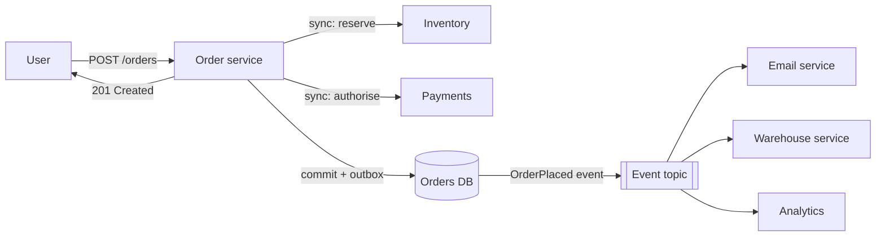

When one service needs another to do something, it can **call and wait** (synchronous) or **send a message and move on**
(asynchronous). The choice decides how fast a user gets a response, how failures spread between services, and how the system behaves under
load. Most good designs are synchronous on the critical path and asynchronous everywhere else.

## Why it matters

Interviewers watch for two opposite mistakes: chains of synchronous calls where one slow service makes everything slow, and "put a queue
everywhere" where users never learn whether their action worked. The skill is deciding, step by step, what must happen before you reply to
the user and what can happen afterwards — and how the user learns the result of the asynchronous part.

## How it works

### Synchronous calls

The caller sends a request (HTTP, gRPC) and blocks until it gets a response or times out.

- **Simple**: request in, answer out; errors are immediate; easy to reason about and debug.
- **Coupled in time**: the caller's latency includes every downstream call; the caller's availability is roughly the product of its
  dependencies' availabilities (three dependencies at 99.9% each give about 99.7%).
- **Failure spreads**: a slow dependency ties up the caller's threads and connections, and the slowness travels upstream unless you have
  timeouts, circuit breakers and bulkheads ([timeouts and retries](lesson:timeouts-retries)).

### Asynchronous messaging

The caller puts a message on a queue or topic and returns; one or more consumers process it later.

- **Decoupled in time**: the producer doesn't wait; the consumer can be down, slow or busy, and the messages wait in the broker.
- **Load levelling**: bursts are buffered and processed at the consumer's pace (see [backpressure](lesson:backpressure)).
- **Fan-out**: one event can trigger many independent reactions without the producer knowing about them (see
  [queues and pub/sub](lesson:queues-pubsub)).
- **Costs**: eventual consistency (the effect isn't visible immediately), at-least-once delivery and duplicates, ordering questions, more
  infrastructure, and harder debugging across services (trace IDs in messages help).

### Deciding what must be synchronous

Ask, for each step of a user action: **does the user need this result in the response?**

| Step of "place an order" | Synchronous? | Why |
|---|---|---|
| Validate the cart and price | Yes | The user must know immediately if something is wrong |
| Reserve stock | Yes | "Order placed" must not be a lie |
| Authorise the payment | Yes (usually) | The response depends on it |
| Send confirmation email | No | Can happen seconds later |
| Update recommendations, analytics | No | Nobody waits for it |
| Notify the warehouse | No | Can be retried until it succeeds |

A common rule: **commit the essential state change synchronously, then emit an event; everything else reacts to the event.**

### Reporting asynchronous results

When work takes too long for a request — a video transcode, a report, a long payment flow — accept it with **202 Accepted** and a job ID,
then let the client learn the outcome:

- **Polling** a status endpoint (`GET /jobs/123`) — simple, works everywhere, wastes some requests.
- **Push** over WebSockets or Server-Sent Events while the user is on the page ([real-time transport](lesson:realtime-transport)).
- **Webhooks** to another system's endpoint ([webhooks](lesson:webhooks)).
- **Notifications** (email, push) for results that arrive much later.

## Architecture



## Failure scenarios

- **Synchronous chain collapse**: service A calls B calls C; C slows down, B's threads fill, then A's — a cascading failure. Timeouts,
  circuit breakers, and moving non-essential calls off the path.
- **Lost events**: the order commits but the event is never published (crash between the two writes) — use the
  [transactional outbox](lesson:outbox-cdc).
- **Silent failure of async work**: the email consumer has been failing for a day and nobody noticed. Monitor consumer lag and
  dead-letter queues.
- **User left in limbo**: an async step fails and the user never learns. Model the states (pending, failed) and surface them.
- **Duplicates**: at-least-once delivery runs a consumer twice; consumers must be idempotent ([deduplication](lesson:dedup)).

## Trade-offs

| Aspect | Synchronous | Asynchronous |
|---|---|---|
| Latency to the user | Sum of the chain | Only the synchronous part |
| Coupling | Caller depends on callee being up | Broker absorbs outages |
| Consistency | Immediate | Eventual |
| Error handling | Immediate errors | Retries, DLQs, compensations |
| Debuggability | Straightforward | Needs tracing and good monitoring |
| Best for | Results the user needs now | Side effects, fan-out, slow or bursty work |

## In real systems

- E-commerce platforms confirm orders synchronously and then publish order events that drive fulfilment, emails and analytics.
- Video platforms accept uploads, return immediately and transcode asynchronously, notifying when processing completes.
- Microservice architectures commonly combine REST or gRPC for queries and commands that need answers with Kafka, SQS or RabbitMQ for
  events.

## Common mistakes

- **Long synchronous chains** for work the user doesn't wait for.
- **Making everything asynchronous**, including the result the user needs right now.
- **No status model** for async work, so users can't tell pending from failed.
- **Dual writes** (database then broker) without an outbox.
- **No monitoring of consumer lag** and dead letters.

## In the interview

````question title="Which parts of placing an order would you make synchronous, and which asynchronous?"
Synchronous: everything the response depends on — validating the cart and prices, reserving stock and authorising payment — ending with a
committed order in the database, so "order placed" is true when we say it. That commit also writes an OrderPlaced event to an outbox table in
the same transaction. Asynchronous: everything that reacts to the order — confirmation email, warehouse notification, loyalty points,
analytics and recommendations — consumes the event from a topic, with idempotent consumers, retries and a dead-letter queue. The user gets a
fast response, and a slow email provider can't make checkout slow.
````

````question title="How does a client learn the result of an asynchronous job, such as generating a large report?"
The API accepts the request with 202 Accepted and returns a job ID and a status URL. The client can poll that URL with backoff, which is
simple and works everywhere; if the user is on the page, the server can push status updates over Server-Sent Events or WebSockets; another
system can register a webhook to be called on completion; and if it takes minutes or more, an email or push notification with a link to the
finished report is best. The job itself has explicit states — queued, running, succeeded, failed — stored durably.
````

## Key takeaways

- **Synchronous** = simple and immediate, but latency and failures **chain** through dependencies.
- **Asynchronous** = decoupled, buffered and fan-out-friendly, at the cost of **eventual consistency, duplicates and harder debugging**.
- Make **synchronous only what the response needs**; commit, emit an event, and let everything else react.
- Report async results with **202 + job IDs**, polling, push, webhooks or notifications.

## Knowledge check

```quiz
? A checkout calls five services synchronously, including email and analytics. One is slow and checkout times out. What is the best change?
- Increase the checkout timeout
! It hides the problem and makes checkout slower.
+ Keep only the calls the response needs synchronous; publish an event for email and analytics
- Retry all five calls
! Retries add load to the slow service.
- Add more checkout instances
! The bottleneck is the slow dependency.
> Move non-essential work off the critical path.

? Three synchronous dependencies each have 99.9% availability. Roughly what is the caller's availability if it needs all three?
- 99.9%
! Dependencies multiply.
+ About 99.7%
- 99.99%
! Adding dependencies can't increase availability.
- 97%
! Far too low for three nines each.
> 0.999³ ≈ 0.997.

? A user requests a report that takes five minutes to build. What should the API return?
- 200 OK after five minutes
! Connections and proxies will time out, and the user waits blindly.
+ 202 Accepted with a job ID and a status URL, then notify or let the client poll
- 500 Internal Server Error
! Nothing failed.
- 204 No Content
! The client needs a way to get the result.
> Accept long work asynchronously and expose its status.

? What is the main risk of updating the database and then publishing an event as two separate steps?
+ A crash between them leaves the database updated but the event never published (or vice versa)
- The event is always duplicated
! Duplication isn't guaranteed; loss is the risk here.
- The database becomes eventually consistent
! The database commit is immediate.
- Consumers become synchronous
! Unrelated.
> The transactional outbox makes state change and event atomic.
```
