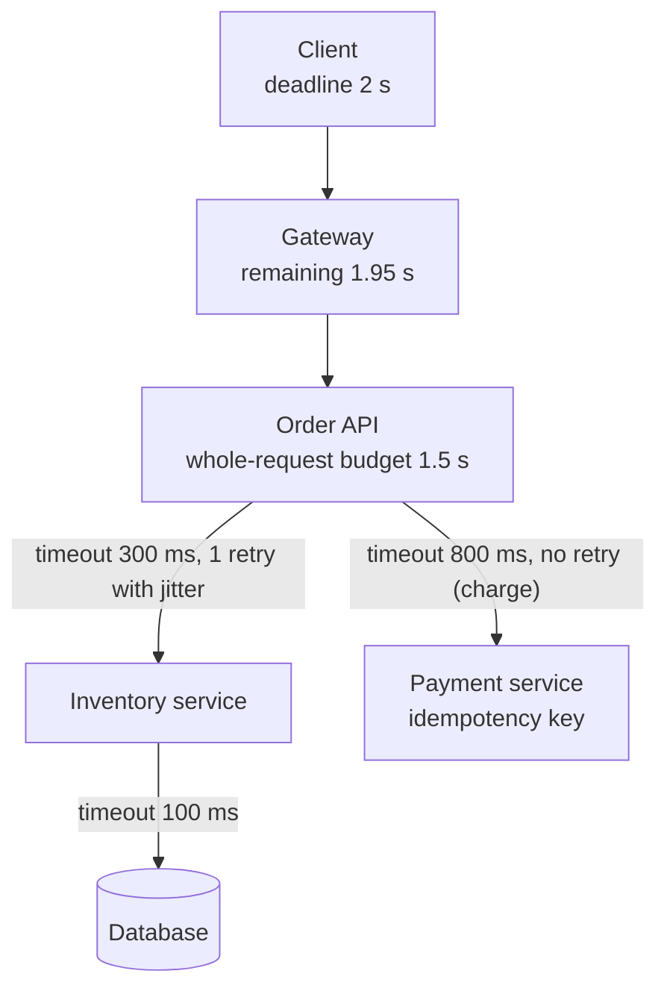
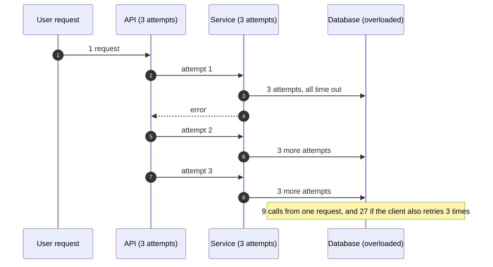

Every remote call can be slow or fail. **Timeouts** bound how long you wait; **retries** recover from transient failures. Used carelessly,
both make outages worse: missing timeouts let one slow dependency exhaust every thread, and naive retries multiply load on a service that is
already struggling — a **retry storm**. This lesson sets timeouts from latency budgets, retries only what is safe, and keeps retries from
turning blips into outages.

## The problem

Three things go wrong in production again and again:

- **No timeout (or a huge default)**: a dependency hangs, request threads pile up waiting, the connection pool and thread pool exhaust, and
  the caller fails too — a **cascading failure**.
- **Timeouts that don't fit together**: the caller gives up after 1 s, but the callee keeps working for 5 s on a request nobody will read.
- **Unbounded or layered retries**: a 2-second blip in the database becomes ten minutes of overload because every layer retries every
  failure several times, synchronised.

```drill
? A service receives 2,000 requests/s. Its dependency starts failing every call, and the service tries each call up to 3 times. How many calls/s hit the dependency?
= 6000
~ 1.05
> 2,000 × 3 attempts = 6,000 calls/s — triple the load on the component that is already failing.

? Same failure, but retries are limited by a budget of 10% of normal requests. How many calls/s reach the dependency now?
= 2200
~ 1.05
> 2,000 first attempts + at most 200 retries = 2,200 calls/s.
```

## Architecture



**Timeouts:**

- **Set them from measured latency**: a little above the dependency's p99 or p99.9 under normal load, not a round number like 30 s.
  Separate **connect** timeouts (milliseconds) from **request** timeouts.
- **Budget from the top down**: the user-facing deadline is split across hops, and inner timeouts are shorter than outer ones; a callee
  should never work longer than its caller waits.
- **Propagate deadlines**: pass the remaining time downstream (gRPC deadlines do this natively; HTTP services can use a header) so each
  service can skip work that can't finish in time.
- **Bound everything**: connection pool waits, queue waits, lock waits — a timeout on the network call alone isn't enough
  ([connection management](lesson:connection-management)).

**Retries:**

- **Only transient failures**: timeouts, connection resets, `503`, `429` with `Retry-After`. Never `400`, `401`, `404` or validation
  errors.
- **Only safe operations**: idempotent methods (`GET`, `PUT`, `DELETE`) or calls carrying an **idempotency key**
  ([idempotent APIs](lesson:idempotent-apis)).
- **Few attempts**: usually 2–3 in total, within the deadline.
- **Exponential backoff with jitter**: wait base × 2ⁿ, capped, with randomness so clients don't retry in lockstep.
- **Retry budgets**: cap retries at a fraction (say 10%) of requests per client or per dependency, so retries can't multiply load during
  an outage.
- **One layer retries**: usually the one closest to the user or the one with the most context; inner layers fail fast.
- **Hedged requests** for tail latency: for idempotent reads, send a second request if the first hasn't answered by roughly the p95, and
  use whichever returns first — at the cost of a few percent extra load.

## Request and data flow

How retries multiply across layers, and how jitter spreads them:



## Advantages

- **Timeouts contain failures**: slow dependencies cost a bounded amount of time and resources.
- **Retries hide transient faults**: brief network glitches, failovers and deploys become invisible to users.
- **Deadlines save work**: services stop processing requests whose callers have already given up.
- **Jitter and budgets** keep recovery smooth instead of spiky.

## Disadvantages

- **Timeouts too short** cause failures under normal load spikes; **too long** fail to protect resources.
- **Retries add latency** for the unlucky requests and **load** for the dependency.
- **Duplicates**: retried non-idempotent operations can apply twice.
- **Tuning is ongoing**: latency distributions change as systems evolve.

## Failure scenarios

| Failure | What happens | Mitigation |
|---|---|---|
| Dependency hangs, no timeout | Threads and connections exhausted; caller fails | Timeouts on calls, pool waits and queues |
| Layered retries during an outage | Load multiplied 9–27× on a failing service | Retry at one layer; retry budgets; circuit breakers |
| Synchronised retries | Spikes after each backoff interval | Jitter |
| Retried payment without a key | Double charge | Idempotency keys; don't retry non-idempotent calls |
| Callee works after caller gave up | Wasted capacity during overload | Deadline propagation; cancellation |
| Timeout below normal p99 | Constant spurious failures and retries | Set from measured percentiles; review after changes |

## Alternatives

- **Circuit breakers** stop calling a dependency that is clearly failing, instead of retrying it ([circuit breakers and
  bulkheads](lesson:circuit-breakers-bulkheads)).
- **Asynchronous processing with queues**: work that can wait is retried later from a queue with a dead-letter path, off the request
  path ([retries and DLQs](lesson:retries-dlq)).
- **Fallbacks**: serve cached or default data instead of retrying ([graceful degradation](lesson:graceful-degradation)).
- **Client-side load balancing with outlier detection**: route around a slow instance instead of retrying against it.

## Where it shows up in interviews

Payment flows (retries with idempotency keys), API gateways (timeouts and retry policies per route), microservice call chains, and every
"what happens when the database is slow?" follow-up. Give numbers: the end-to-end deadline, per-hop timeouts, which calls retry, how many
times, with what backoff — and why non-idempotent calls don't.

````question title="How do you choose a timeout for a downstream call?"
Start from the caller's overall deadline and split it across the calls it must make, then check each share against the dependency's measured
latency — typically a bit above its p99 or p99.9 under normal load. Use a short connect timeout and a separate request timeout, make inner
timeouts shorter than outer ones, and propagate the remaining deadline so the dependency can stop early. Revisit the values when latency
distributions change.
````

````question title="When is it safe to retry a failed request?"
When the failure is likely transient (a timeout, connection reset, 503, or 429 with Retry-After) and repeating the operation can't cause a
duplicate effect — it's a read, it's naturally idempotent like PUT or DELETE, or it carries an idempotency key the server deduplicates on.
Even then, retry a small number of times with exponential backoff and jitter, within the request's deadline, under a retry budget, and at
only one layer of the call chain.
````

## Java and Spring Boot example

Two effects in one plain-Java simulation: how retries multiply across layers, and what jitter does to 1,000 clients that all failed at the
same moment (each retries four times with exponential backoff from 100 ms; a seeded random generator makes the output repeatable).

```java file="RetryStorm.java"
import java.util.Random;
import java.util.function.LongUnaryOperator;

// Why retries need limits and jitter: amplification across layers, and how 1,000 clients that
// failed at the same instant retry with plain exponential backoff versus jittered backoff.
public class RetryStorm {
    static final int CLIENTS = 1_000, RETRIES = 4, SPAN_MS = 6_000;
    static final long BASE_MS = 100, CAP_MS = 2_000;

    static long backoff(int attempt) {                       // 100, 200, 400, 800 ms (cap 2 s)
        return Math.min(CAP_MS, BASE_MS << attempt);
    }

    // Returns the number of retries that land in each 1 ms slot.
    static int[] arrivals(String strategy, Random random) {
        int[] perMs = new int[SPAN_MS];
        for (int c = 0; c < CLIENTS; c++) {
            long t = 0;
            for (int attempt = 0; attempt < RETRIES; attempt++) {
                long w = backoff(attempt);
                t += switch (strategy) {
                    case "none" -> w;                                    // everyone in lockstep
                    case "full" -> (long) (random.nextDouble() * w);     // uniform in [0, w)
                    default -> w / 2 + (long) (random.nextDouble() * w / 2);  // "equal" jitter
                };
                perMs[(int) t]++;
            }
        }
        return perMs;
    }

    static int busiest(int[] perMs, int windowMs) {
        int best = 0, sum = 0;
        for (int i = 0; i < perMs.length; i++) {
            sum += perMs[i];
            if (i >= windowMs) sum -= perMs[i - windowMs];
            best = Math.max(best, sum);
        }
        return best;
    }

    static int busyMillis(int[] perMs) {                     // milliseconds with any retry
        int n = 0;
        for (int count : perMs) if (count > 0) n++;
        return n;
    }

    public static void main(String[] args) {
        int attempts = 3, layers = 3;
        System.out.printf("3 layers x %d attempts each: up to %d calls reach the bottom%n%n",
                attempts, (int) Math.pow(attempts, layers));

        System.out.println("1,000 clients fail at t=0 and retry 4 times each (4,000 retries)");
        System.out.printf("%-14s%15s%16s%18s%n", "backoff", "busiest 1 ms", "busiest 10 ms",
                "ms with retries");
        for (String s : new String[] {"none", "equal", "full"}) {
            int[] perMs = arrivals(s, new Random(7));
            String label = s.equals("none") ? "no jitter" : s + " jitter";
            System.out.printf("%-14s%,15d%,16d%,18d%n",
                    label, busiest(perMs, 1), busiest(perMs, 10), busyMillis(perMs));
        }
    }
}
```

```text title="Output" output="RetryStorm.java"
3 layers x 3 attempts each: up to 27 calls reach the bottom

1,000 clients fail at t=0 and retry 4 times each (4,000 retries)
backoff          busiest 1 ms   busiest 10 ms   ms with retries
no jitter               1,000           1,000                 4
equal jitter               33             228               912
full jitter                24             162             1,013
```

Without jitter, all 4,000 retries land in **four milliseconds** — four synchronised waves of 1,000. With jitter, the busiest millisecond has
a few dozen. Note that full jitter can also retry *sooner* than plain backoff (it picks anywhere between zero and the backoff), which is
why it's paired with attempt limits and retry budgets.

## Common mistakes

- **Default timeouts** (infinite, or tens of seconds) on network calls and pool waits.
- **Inner timeouts longer than outer ones.**
- **Retrying everything**, including 4xx errors and non-idempotent writes.
- **Retries at every layer**, multiplying load.
- **Fixed backoff without jitter.**
- **Ignoring `Retry-After`.**

## Key takeaways

- **Timeouts everywhere**, set from measured percentiles and a **top-down deadline**; inner < outer; **propagate** deadlines.
- **Retry only transient failures on idempotent operations**, a few times, with **exponential backoff and jitter**.
- **Retry budgets** and **one retrying layer** prevent storms: layered retries multiply load as attemptsᴸᵃʸᵉʳˢ.
- Prefer **circuit breakers, queues and fallbacks** over retrying a dependency that is clearly down.

## Knowledge check

```quiz
? A gateway times out after 2 s, but the service behind it uses a 10 s timeout for its database calls. What is the problem?
+ The service keeps working (and holding resources) up to 8 s after the gateway has given up, wasting capacity during slowdowns
- The gateway will retry forever
! Retries aren't implied.
- The database rejects long queries
! Not inherently.
- Nothing; inner timeouts should be longer
! The reverse: inner timeouts should be shorter.
> Budget top-down and propagate deadlines.

? Which failure should NOT be retried automatically?
- 503 Service Unavailable
! Usually transient.
- Connection reset
! Transient.
+ 400 Bad Request
- 429 with Retry-After: 2
! Retry after the indicated delay.
> Client errors won't succeed on retry.

? Four layers each make up to 2 attempts. In the worst case, how many calls reach the bottom layer for one user request?
- 8
! That's 2 × 4.
+ 16
- 4
! Ignores retries.
- 2
! Ignores layering.
> 2⁴ = 16.

? Why add jitter to exponential backoff?
- To make retries faster on average
! That's not its purpose (though full jitter can retry sooner).
+ To spread retries from many clients over time instead of having them arrive in synchronised waves
- To reduce the number of retries
! The number stays the same; the timing changes.
- To satisfy HTTP specifications
! No such requirement.
> Lockstep retries create spikes; randomness smooths them.
```
