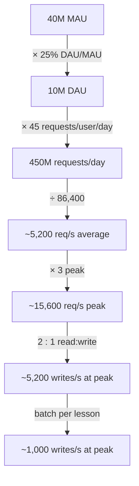

Traffic estimation turns "how many users?" into "how many requests per second, of which kind, at the worst moment of the day?"
That one number — split into reads and writes, at peak — decides server counts, whether the database needs help and where caching
pays off.

## The question it answers

- **How many requests per second** must the system handle on average and at peak?
- **What kind**: how many are reads and how many writes — because they scale in completely different ways?
- **How many users are connected at once** — the number that matters for WebSockets, sessions and connection-holding servers?

## Formula

### Users to requests

```text title="Formula"
DAU                 = MAU × (DAU / MAU ratio)
requests per day    = DAU × requests per user per day
average requests/s  = requests per day ÷ 86,400
peak requests/s     = average × peak factor
```

- **MAU vs DAU.** Monthly active users count anyone active in a month; daily active users, anyone active in a day. The ratio
  ("stickiness") is typically 10–25% for occasional-use products and 50% or more for daily habits like messaging. If the interviewer gives
  MAU, ask or assume a ratio.
- **Requests per user** must include *every* request the client makes: opening the app may fire five API calls. Count actions, then
  multiply by calls per action.

### Peak factor

Traffic is never flat. The peak factor is peak ÷ average:

| Source of peaks | Typical effect |
|---|---|
| Daily cycle (single country or time zone) | Evening peak 2–5× the daily average |
| Global audience across time zones | Flatter: often ~1.5–2× |
| Weekly cycle | Weekdays vs weekends (or the reverse for leisure apps) |
| Synchronised triggers | A push notification to everyone at 8 pm, a TV ad, a ticket on-sale: 10–100× for minutes |
| Viral content | One item or key gets a huge share of traffic |

Use 2–3× when nothing special is known; ask about events when the product has them.

### Read/write split

```text title="Formula"
writes per day = requests per day ÷ (reads per write + 1)
reads per day  = requests per day − writes per day
```

Reads and writes scale differently: reads can be cached and served from replicas; writes must reach the primary (or be partitioned). A
100:1 read-heavy system and a 1:1 system with the same total traffic need very different designs.

### Concurrent users

For connection-holding designs, use Little's law (from [scalability and performance](lesson:scalability-performance)):

```text title="Formula"
concurrent users ≈ sessions per day × average session length (s) ÷ 86,400     (× peak factor)
```

## Worked example

A language-learning app. Assumptions, stated out loud:

- **40M MAU** with a DAU/MAU ratio of **25%** → **10M DAU**.
- Each active user completes about three short lessons a day. Per day, a user's app makes about **30 read requests** (fetch lessons,
  exercises, progress) and **15 write requests** (submitting answers one at a time).
- Evening peak: **3×** average. Sessions average 10 minutes, 1.5 per user per day.

**Requests:** 10M × 45 = 450M a day ≈ **5,200 requests/s** on average, **~15,600/s** at peak.

**Split:** 30 reads to 15 writes is only **2:1**. Writes: 150M a day ≈ **1,700/s** on average, **~5,200/s** at peak. Reads ≈ 3,500/s on
average, ~10,400/s at peak.

**Concurrent users:** 10M × 1.5 × 600 s ÷ 86,400 ≈ **104,000** on average, ~310,000 at peak.

**What the numbers say:** 5,200 small writes per second at peak is uncomfortable for a single relational primary. But look at *why* there
are so many writes: the client submits each answer separately. Submitting **once per completed lesson** (with the answers in one request)
cuts writes from 15 to 3 per user per day — ~350/s average, ~1,000/s peak — and turns a scaling problem into a non-problem. Estimation
just changed the API.



## Try it

```estimator title="Language-learning app"
dau = 10M
requestsPerUser = 45
readsPerWrite = 2
writeBytes = 200 B
readBytes = 3 KB
retentionYears = 2
peakFactor = 3
replication = 3
cachePercent = 20
serverRps = 1500
targetUtilization = 70
```

Change `requestsPerUser` to 33 and `readsPerWrite` to 10 (answers batched per lesson) and watch the write rate drop.

```drill
? A product has 200M MAU with a DAU/MAU ratio of 30%. Each daily user makes 12 requests. What is the average request rate?
= 8333
~ 1.3
> 200M × 0.3 = 60M DAU; × 12 = 720M requests/day; ÷ 86,400 ≈ 8,300/s.

? Average traffic is 6,000 requests/s and a nightly push notification produces a 10× spike for a few minutes. What should the system absorb during the spike?
= 60000
~ 1.2
> 6,000 × 10 = 60,000/s — or spread the notification over several minutes to flatten the spike.

? 8M daily users each have 2 sessions of 15 minutes a day. About how many users are connected at once on average?
= 166667
~ 1.3
> 8M × 2 × 900 s ÷ 86,400 ≈ 167,000 concurrent users.
```

## How it changes the design

| Traffic finding | Design response |
|---|---|
| Peak requests/s | Server count (see [server counts and latency budgets](lesson:servers-latency)); auto-scaling bounds |
| High read:write ratio | Cache, read replicas, CDN for shared content |
| High write rate | Batch or coalesce writes; queue them; partition the write path |
| Synchronised spikes | Queue and smooth (send notifications in waves), pre-scale, shed load |
| Many concurrent users | Connection-tier sizing for WebSockets/SSE; per-connection memory |
| Writes caused by chatty clients | Change the API: batch, debounce, send deltas |

## Common mistakes

- **Using MAU as DAU** — a 4–10× overestimate.
- **Counting user actions instead of API calls** — one screen often triggers several requests.
- **Average only.** Designing for 5,000/s when 8 pm brings 15,000/s.
- **Ignoring synchronised events** such as notifications, live events and on-sales.
- **Not separating reads from writes**, so caching and partitioning decisions have no basis.

## Key takeaways

- **DAU × requests per user ÷ 86,400** gives average requests/s; multiply by a **peak factor** (2–3× default, far more for events).
- **Split reads and writes** — they scale differently, and the split points to caching or write-path work.
- Use **Little's law** for concurrent users in connection-holding designs.
- Estimates can change the **API**: batching chatty writes is often cheaper than scaling for them.

## Knowledge check

```quiz
? An interviewer says "50M monthly users". What should you do before computing requests per second?
- Use 50M as the daily user count
! Using MAU as DAU overestimates daily traffic several times.
+ Ask or assume a DAU/MAU ratio, e.g. 20% → 10M daily users
- Ignore users and assume 1,000 requests/s
! Assumptions should come from the stated scale.
- Divide 50M by 30 and treat it as requests per day
! That confuses users with requests.
> Daily traffic depends on daily users; stickiness ratios vary widely by product.

? Total traffic is 12,000 requests/s with a 3:1 read:write ratio. How many writes per second is that?
- 4,000
! That divides by 3 instead of by 3 + 1.
+ 3,000
- 9,000
! That's the read rate.
- 36,000
! That multiplies instead of dividing.
> Writes are 1 of every 4 requests: 12,000 ÷ 4 = 3,000/s.

? A chat app needs WebSocket servers. Which traffic figure matters most for sizing them?
- Total messages per day
! Message volume matters, but connection servers are sized mainly by open connections.
+ Peak concurrent connections
- Monthly active users
! MAU doesn't say how many are connected at once.
- Storage per message
! Storage sizes the database, not the connection tier.
> Persistent connections consume memory and file descriptors per connected user.

? A client sends one write per keystroke in a notes app, producing 20,000 writes/s at peak. What is usually the best first fix?
+ Debounce or batch edits on the client (e.g. save every few seconds), cutting the write rate
- Shard the database 20 ways immediately
! Sharding adds lasting complexity for a problem the API can remove.
- Add read replicas
! Replicas don't absorb writes.
- Use a CDN
! CDNs cache reads.
> Estimation often reveals that the API, not the database, should change.
```
