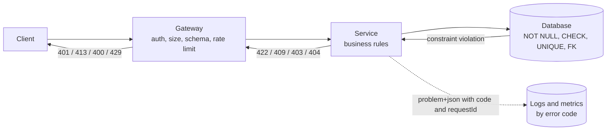

Most requests that fail, fail because of the request: a missing field, a value out of range, an expired token, too many calls. How
an API validates input and reports those failures decides whether clients can fix problems themselves — and whether bad data ever
reaches your database.

## Why it matters

Validation is a security and reliability control, not a nicety. Unvalidated input causes injection attacks, corrupt data, crashes on
unexpected types and expensive queries on absurd parameters. Error responses are an interface too: a client that receives
`{"code": "rating_out_of_range", "field": "rating"}` can show a helpful message; a client that receives `500 Internal Server Error` can
only retry and fail again. In interviews, this shows up as "what happens when the input is invalid?" and in API design rounds.

## How it works

### Validate in layers

Each layer checks what it is best placed to check — and nothing downstream assumes an upstream layer did its job perfectly.

| Layer | Checks | Rejects with |
|---|---|---|
| Edge / gateway | Authentication, body size limits, content type, JSON well-formedness, schema shape (required fields, types), rate limits | 401, 413, 415, 400, 429 |
| Service | Business rules: rating 1–5, course is published, user is enrolled, dates in order, references exist | 400 / 422, 403, 404, 409 |
| Database | Constraints as the final guard: `NOT NULL`, `CHECK`, `UNIQUE`, foreign keys | Constraint violation → mapped to 409 / 422 |

The database constraints matter even when the service validates, because two concurrent requests can both pass a service check ("not
yet enrolled") and only a `UNIQUE` constraint stops the second insert.

```sql
CREATE TABLE reviews (
  id          bigint GENERATED ALWAYS AS IDENTITY PRIMARY KEY,
  course_id   bigint NOT NULL,
  user_id     bigint NOT NULL,
  rating      smallint NOT NULL CHECK (rating BETWEEN 1 AND 5),
  body        text CHECK (char_length(body) <= 5000),
  created_at  timestamptz NOT NULL DEFAULT now(),
  UNIQUE (course_id, user_id)          -- one review per user per course
);
```

```sql
-- expect error
-- A rating of 9 is rejected by the CHECK constraint even if a buggy service let it through.
INSERT INTO reviews (course_id, user_id, rating) VALUES (42, 7, 9);
```

### Validation principles

- **Allow-list, don't block-list.** Accept known-good shapes and values; reject everything else.
- **Validate types and ranges early,** before any expensive work or downstream calls.
- **Bound everything:** string lengths, array sizes, page sizes, numeric ranges, nesting depth, upload sizes.
- **Parameterise queries** — validation is not a substitute for prepared statements against SQL injection.
- **Normalise before comparing** (trim whitespace, canonical email case, Unicode normalisation) so duplicates are detected.
- **Report all field errors at once** when possible, so clients don't fix one error per round trip.

### A consistent error format

RFC 9457 (Problem Details for HTTP APIs, which replaced RFC 7807) defines a standard JSON error body served as
`application/problem+json`, with members `type` (a URI identifying the problem type), `title`, `status`, `detail` and `instance`, plus any
extension members you need:

```http
HTTP/1.1 422 Unprocessable Content
Content-Type: application/problem+json

{
  "type": "https://api.example.com/problems/validation-failed",
  "title": "Your request has invalid fields",
  "status": 422,
  "detail": "2 fields failed validation",
  "instance": "/courses/42/reviews",
  "requestId": "req_7Kq2v9",
  "errors": [
    { "field": "rating", "code": "out_of_range", "message": "Must be between 1 and 5" },
    { "field": "body", "code": "too_long", "message": "At most 5000 characters" }
  ]
}
```

Guidelines:

- **Machine-readable codes** (`out_of_range`, `already_enrolled`) are the contract; human messages may change and be translated.
- **A request ID** in every error response (and in logs) lets support find the exact failing request.
- **Don't leak internals:** no stack traces, SQL, hostnames or "user exists" hints that help attackers enumerate accounts.
- **Be consistent across services** — a shared error library or gateway mapping keeps one format.

### Communicating rate limits

When a client is throttled (see [rate limiting](lesson:rate-limiting)), respond with **429 Too Many Requests** and a `Retry-After`
header — either seconds or an HTTP date. Many APIs also expose the quota so clients can pace themselves: historically with vendor headers
such as `X-RateLimit-Limit`, `X-RateLimit-Remaining` and `X-RateLimit-Reset`, and increasingly with the `RateLimit-Policy` and `RateLimit`
fields being standardised by the IETF (an Internet-Draft as of 2026):

```http
HTTP/1.1 429 Too Many Requests
Retry-After: 30
RateLimit-Policy: "per-minute";q=100;w=60
Content-Type: application/problem+json

{ "type": "https://api.example.com/problems/rate-limited", "title": "Too many requests",
  "status": 429, "detail": "Limit of 100 requests per minute exceeded", "requestId": "req_9Xd3" }
```

### Which errors may clients retry?

| Status | Retry? |
|---|---|
| 400, 401, 403, 404, 409, 413, 415, 422 | No — change the request (or credentials) first |
| 408, 429, 503 | Yes, after `Retry-After` or backoff |
| 500, 502, 504 | Yes for idempotent requests (or with an idempotency key), with backoff and a cap |

## Architecture



## Failure scenarios

- **Validation only in the client.** Anyone can call the API directly; client checks are for user experience, not protection.
- **Validation only in the service, not the database.** Concurrent requests, a second service writing the same table, or a bug bypass it.
- **Unbounded inputs.** A 50 MB JSON body, a `limit=1000000` page size or a 10,000-element array exhausts memory or the database.
- **500 for client errors.** Monitoring fills with false alarms, clients retry pointless requests and on-call engineers chase noise.
- **Inconsistent errors across services.** Clients need a different parser per endpoint; mobile apps show "Something went wrong" for
  everything.

## Trade-offs

- **Strict vs lenient parsing.** Rejecting unknown fields catches client mistakes but makes additive changes harder for clients sending
  newer fields to older servers; most public APIs ignore unknown request fields and validate known ones strictly.
- **Gateway vs service validation.** Schema validation at the gateway stops junk early and protects services, but duplicates the contract;
  generate both from one OpenAPI schema.
- **Detailed vs safe errors.** More detail helps legitimate clients and helps attackers; be precise about the *client's* mistake and vague
  about the *server's* internals.

## In real systems

- Many frameworks support RFC 9457 out of the box — Spring Framework's `ProblemDetail` type, for example.
- Stripe returns errors with a `type`, a machine-readable `code`, the failing `param` and a `request_id`-style identifier.
- API gateways (Kong, AWS API Gateway) can validate request bodies against JSON Schema or OpenAPI models before they reach services.

## Common mistakes

- **Trusting the client** to validate.
- **Returning 200 with `"success": false`.**
- **One error at a time** for forms with many fields.
- **Leaking stack traces** or database errors.
- **Retrying 4xx errors** automatically.

## In the interview

````question title="How does your API handle invalid input?"
In layers. The gateway rejects unauthenticated requests, oversized bodies, wrong content types and bodies that don't match the schema,
and applies rate limits. The service validates business rules — ranges, state transitions, ownership — and returns all field errors at
once. Database constraints (NOT NULL, CHECK, UNIQUE, foreign keys) are the final guard against races and bugs, and the service maps
violations to 409 or 422. Errors use one format — problem details with a machine-readable code per field and a request ID — and never
include internals. 4xx tells clients to fix the request; 429 and 5xx with Retry-After tell them to back off and retry.
````

````question title="Why keep database constraints if the service already validates?"
Because service-level checks can't see concurrent requests: two requests can both check "this user hasn't reviewed the course" and both
insert. A UNIQUE constraint makes the second fail atomically. Constraints also protect against bugs, other services or scripts writing
to the same table, and future code paths that forget a check. They are cheap insurance that keeps the data correct, and the service
simply translates the violation into a meaningful error for the client.
````

## Key takeaways

- Validate in **layers**: gateway (shape, size, auth, limits), service (business rules), database (constraints as the last guard).
- **Bound every input** and allow-list values; parameterise queries.
- Return a **consistent, machine-readable error format** (RFC 9457 problem details) with a request ID and no internals.
- Communicate throttling with **429 + Retry-After**; clients retry only 429/5xx, never other 4xx.

## Knowledge check

```quiz
? Two simultaneous requests both pass the service check "user has not reviewed this course" and both insert a review. What prevents the duplicate?
- A faster service
! Speed doesn't remove the race.
+ A UNIQUE constraint on (course_id, user_id)
- Client-side validation
! Clients can't see each other's requests.
- Returning 200 for both
! That accepts the duplicate.
> Database constraints are atomic and catch races that application checks miss.

? Which error response is most useful to a client app?
- 500 with an HTML error page
! 500 implies a server fault, and HTML can't be parsed reliably.
- 200 with `{ "success": false }`
! Tools and clients treat 200 as success.
+ 422 with `application/problem+json`, a code per invalid field, and a request ID
- 400 with the SQL error message
! Leaking SQL helps attackers and confuses clients.
> Structured, machine-readable errors let clients fix the request and support find it.

? A client receives `413 Payload Too Large`. What should it do?
+ Reduce the request size, for example by uploading in parts; retrying unchanged won't help
- Retry immediately
! The same oversized request will fail the same way.
- Retry after Retry-After seconds
! 413 isn't a temporary condition like 429 or 503.
- Switch to GET
! The method doesn't change the size limit.
> 4xx errors require changing the request before retrying.

? What is the main purpose of returning a request ID in every error body?
- To let clients cache the error
! Errors are rarely cached; that isn't the purpose.
+ To correlate a client-reported error with server logs and traces
- To make the response larger
! Size isn't the goal.
- To replace authentication
! A request ID proves nothing about identity.
> Support and engineers can find the exact failing request in logs and traces.
```
