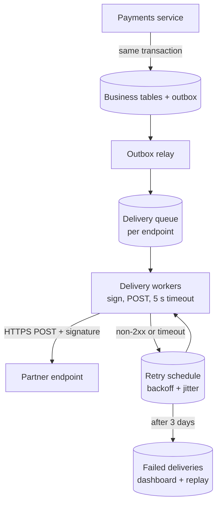
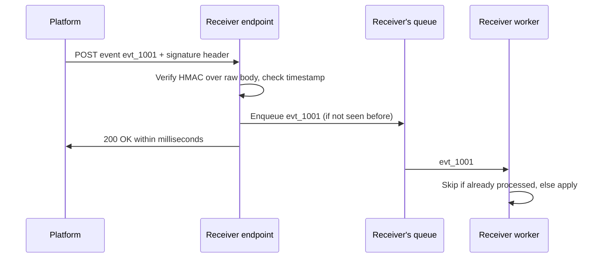

A webhook is an HTTP request your system sends to someone else's server when something happens — "payment succeeded",
"course published", "file uploaded". It turns polling inside out: instead of integrators asking "anything new?" every minute, you tell
them the moment there is. The design work is in making that delivery secure, reliable and safe to receive twice.

## Why it matters

Webhooks are how platforms integrate: payment providers notify merchants, Git hosts trigger CI builds, chat platforms call bots. They
appear in interview problems wherever an external party must react to your events (payments, notifications) — and they are a compact
test of distributed-systems instincts, because every classic failure appears: timeouts, retries, duplicates, reordering, forged requests
and slow consumers.

## How it works

### The delivery contract

1. The integrator **registers an endpoint** (`https://partner.example/hooks/learnly`) and chooses which **event types** to receive.
   The platform generates a **signing secret** for that endpoint.
2. When an event occurs, the platform **records it durably** (an event table or log), then a delivery worker sends
   `POST` with a JSON body describing the event: an **event ID**, **type**, **creation time** and either the resource data or just its ID.
3. The receiver **verifies the signature**, records the event ID, **acknowledges quickly** with a 2xx, and processes the event
   asynchronously.
4. Any non-2xx response, connection failure or timeout means "not delivered": the platform **retries with exponential backoff** for a
   bounded period, then marks the delivery failed and alerts the integrator.

### Signing: proving the sender

Anyone on the internet can POST to a public URL, so receivers must verify each request came from you and wasn't modified:

- The sender computes **HMAC-SHA256** over `timestamp + "." + raw body` with the endpoint's secret and sends the timestamp and signature
  in a header.
- The receiver recomputes the HMAC over the **raw bytes** it received (not re-serialised JSON), compares in **constant time**, and rejects
  timestamps outside a tolerance window (commonly five minutes) to stop **replays**.
- Secrets are rotated with an overlap period during which both old and new secrets sign deliveries.

### Retries, duplicates and ordering

- **At-least-once delivery.** A receiver may process an event and time out before responding; the platform retries. Every receiver must
  therefore be **idempotent** — record processed event IDs and skip repeats (see [idempotency](lesson:idempotent-apis)).
- **No ordering guarantee.** Retries and parallel workers mean `invoice.paid` can arrive before `invoice.created`. Receivers should
  compare versions or timestamps on the resource, or fetch the current state from the API rather than trusting event order.
- **Thin vs fat events.** A *fat* event carries the full resource; a *thin* event carries only IDs, and the receiver fetches the current
  state. Thin events avoid stale data and leaking fields to endpoints that shouldn't see them, at the cost of an extra API call.

### Delivery infrastructure

- **Outbox:** write the event in the same transaction as the business change, so an event is never lost or invented (see
  [outbox and CDC](lesson:outbox-cdc)).
- **Queue per endpoint (or per tenant):** one slow or failing endpoint must not delay deliveries to everyone else.
- **Timeouts:** short (a few seconds) — receivers should acknowledge first and process later.
- **Retry schedule:** exponential backoff with jitter, for example 1 min, 5 min, 30 min, 2 h, 6 h… for up to a few days; then a
  dead-letter state, a dashboard and manual replay.
- **Automatic disabling:** endpoints failing for days are disabled with a notification.
- **Security of outbound calls:** endpoints are user-supplied URLs, so block requests to private and metadata IP ranges (SSRF), require
  HTTPS and don't follow redirects blindly.

### Choosing webhooks, polling or streaming

| | Webhooks | Polling an API | Streaming (SSE, WebSockets, managed event bus) |
|---|---|---|---|
| Latency | Seconds | Polling interval | Sub-second |
| Receiver needs | A public HTTPS endpoint | Nothing special | A long-lived client connection |
| Missed events | Retries, then replay | Never missed, just late | Needs resume/catch-up |
| Best for | Server-to-server integrations | Simple clients, firewalled receivers, reconciliation | High-volume, low-latency internal or partner feeds |

Robust integrations combine them: webhooks for speed, plus a periodic **reconciliation poll** (or an events list API) to catch anything
missed.

## Architecture





## Java and Spring Boot example

Signing and verification in plain Java (`javax.crypto`), following the common scheme: HMAC-SHA256 over `timestamp.body`, a constant-time
comparison and a five-minute replay window. The clock is passed in so the output is deterministic:

```java file="WebhookSignature.java"
import java.nio.charset.StandardCharsets;
import java.security.GeneralSecurityException;
import java.security.MessageDigest;
import java.util.HexFormat;
import javax.crypto.Mac;
import javax.crypto.spec.SecretKeySpec;

// Signing and verifying a webhook: the sender computes HMAC-SHA256 over "timestamp.body" with a
// secret shared only with this receiver; the receiver recomputes it and checks the timestamp.
public class WebhookSignature {

    static final long TOLERANCE_SECONDS = 300; // reject deliveries older than 5 minutes

    static String sign(String secret, long timestamp, String body) throws GeneralSecurityException {
        Mac mac = Mac.getInstance("HmacSHA256");
        mac.init(new SecretKeySpec(secret.getBytes(StandardCharsets.UTF_8), "HmacSHA256"));
        byte[] digest = mac.doFinal((timestamp + "." + body).getBytes(StandardCharsets.UTF_8));
        return HexFormat.of().formatHex(digest);
    }

    static String verify(String secret, long timestamp, String body, String signature, long now)
            throws GeneralSecurityException {
        byte[] expected = sign(secret, timestamp, body).getBytes(StandardCharsets.UTF_8);
        byte[] received = signature.getBytes(StandardCharsets.UTF_8);
        if (!MessageDigest.isEqual(expected, received)) { // constant-time comparison
            return "rejected: signature mismatch";
        }
        if (Math.abs(now - timestamp) > TOLERANCE_SECONDS) {
            return "rejected: timestamp outside tolerance (possible replay)";
        }
        return "accepted";
    }

    public static void main(String[] args) throws GeneralSecurityException {
        String secret = "whsec_demo_only";
        long sentAt = 1_767_225_600L; // 2026-01-01T00:00:00Z
        String body = "{\"id\":\"evt_1001\",\"type\":\"invoice.paid\",\"amount\":4999}";
        String sig = sign(secret, sentAt, body);
        String shortSig = sig.substring(0, 16) + "...";
        System.out.println("header: Signature: t=" + sentAt + ",v1=" + shortSig);

        String tampered = body.replace("4999", "1");
        long soon = sentAt + 2;
        print("genuine delivery", verify(secret, sentAt, body, sig, soon));
        print("body changed in flight", verify(secret, sentAt, tampered, sig, soon));
        print("signed with another key", verify("whsec_guess", sentAt, body, sig, soon));
        print("replayed an hour later", verify(secret, sentAt, body, sig, sentAt + 3600));
    }

    static void print(String label, String result) {
        System.out.printf("%-24s -> %s%n", label, result);
    }
}
```

```text title="Output" output="WebhookSignature.java"
header: Signature: t=1767225600,v1=1ca631c782bb19ca...
genuine delivery         -> accepted
body changed in flight   -> rejected: signature mismatch
signed with another key  -> rejected: signature mismatch
replayed an hour later   -> rejected: timestamp outside tolerance (possible replay)
```

Because the timestamp is inside the signed string, an attacker can't refresh it without the secret. In a Spring controller, read the body
as raw bytes (`@RequestBody byte[]`) for verification — deserialising and re-serialising JSON changes whitespace and breaks the signature.

## Failure scenarios

- **Receiver slow or down.** Deliveries queue for that endpoint only; retries continue with backoff; after the retry window the events go
  to a failed state for replay. Other endpoints are unaffected.
- **Receiver processes but times out.** The platform retries; an idempotent receiver ignores the duplicate.
- **Out-of-order events.** A late `course.updated` overwrites a newer state. Receivers compare resource versions or re-fetch.
- **Forged webhooks.** An attacker posts a fake `payment.succeeded`. Signature verification rejects it.
- **Monthly spikes.** Thousands of subscriptions renew at midnight; receivers that process synchronously fall over. Acknowledge fast and
  queue work.
- **SSRF.** A malicious integrator registers `http://169.254.169.254/...` to make your servers call internal endpoints. Validate and
  restrict destinations.

## Trade-offs

- **Fat vs thin payloads.** Fat events save the receiver an API call; thin events are always fresh and leak less.
- **Retry duration.** Longer retries reduce data loss but delay failure detection; a few days with backoff is typical.
- **Ordering vs throughput.** Delivering one event at a time per endpoint preserves order but limits throughput; most platforms deliver in
  parallel and tell receivers not to rely on order.
- **Webhooks vs event streams.** Webhooks fit many small external integrators; high-volume partners may be better served by a streaming
  API or a managed event bus integration.

## In real systems

- Stripe signs webhooks with HMAC-SHA256 in a `Stripe-Signature` header containing `t=` (timestamp) and `v1=` (signature) values; its
  libraries default to a five-minute tolerance, and live-mode deliveries are retried with exponential backoff for up to three days. Stripe
  documents that events may arrive out of order and occasionally more than once, and recommends recording processed event IDs.
- GitHub signs deliveries with HMAC-SHA256 in `X-Hub-Signature-256`.
- The Standard Webhooks initiative publishes a common specification for headers, signing and retries.

## Common mistakes

- **No signature verification**, or verification over re-serialised JSON.
- **Non-idempotent receivers** that double-process retries.
- **Processing synchronously** before acknowledging, causing timeouts and retry storms.
- **One shared queue** where one failing endpoint delays everyone.
- **Sending events outside the business transaction**, so events are lost or sent for changes that rolled back.

## In the interview

````question title="Design webhook delivery for a payments platform."
The payments service writes each event to an outbox table in the same transaction as the payment change, so events are never lost or
invented. A relay moves outbox rows onto per-endpoint delivery queues. Workers sign each delivery with HMAC-SHA256 over the timestamp and
raw body using the endpoint's secret, POST with a short timeout, and treat any non-2xx or timeout as a failure to retry with exponential
backoff and jitter for up to about three days, after which the delivery is marked failed, shown in a dashboard and replayable. Delivery
is at least once and unordered, so I'd document that receivers must verify signatures, dedupe by event ID, acknowledge quickly and
fetch current state when order matters. Outbound requests are restricted to public HTTPS destinations to prevent SSRF.
````

````question title="How should a receiver handle webhooks safely?"
Verify the signature over the raw request body using the shared secret and a constant-time comparison, and reject stale timestamps to
prevent replays. Record the event ID and skip events already processed, because delivery is at least once. Acknowledge with 2xx quickly
and do the work asynchronously from a queue, so slow processing doesn't trigger retries. Don't assume ordering: compare the resource's
version or re-fetch it from the API. And run a periodic reconciliation against the provider's API to catch anything missed during
outages.
````

## Key takeaways

- Webhooks are **at-least-once, unordered HTTP callbacks**: receivers must be **idempotent** and order-tolerant.
- **Sign** deliveries (HMAC over timestamp + raw body), verify in **constant time**, and reject **stale timestamps**.
- Deliver from an **outbox** through **per-endpoint queues**, short timeouts and **backoff retries** with a failed-delivery path.
- Receivers **acknowledge fast, process async**, and reconcile periodically.

## Knowledge check

```quiz
? Why must the signed string include a timestamp?
- To let receivers sort events
! Signature timestamps aren't for ordering, and sorting by them isn't reliable.
+ So a captured request can't be replayed later — the timestamp is protected by the signature and checked against a tolerance
- Because HMAC requires a timestamp
! HMAC works on any message; including the timestamp is a design choice.
- To compress the payload
! Timestamps don't compress anything.
> Signing the timestamp lets receivers reject old deliveries without trusting the sender's clock blindly.

? A receiver takes 40 seconds to process each webhook before returning 200, and the platform times out after 10 seconds. What happens?
- The platform waits patiently
! The platform's timeout is 10 seconds.
+ The platform treats every delivery as failed and retries, so the receiver processes duplicates and falls further behind
- The event is lost
! Retries continue; the problem is duplicates and load.
- The signature becomes invalid
! The signature is unaffected by processing time.
> Acknowledge quickly and process asynchronously; dedupe by event ID.

? The receiver gets `subscription.updated` (version 7) and then `subscription.updated` (version 6) because of a retry. What should it do?
+ Ignore the older version (or re-fetch the subscription) instead of overwriting newer state
- Apply both in arrival order
! That leaves the subscription in the older state.
- Reject the second with 500 so it is retried
! Retrying doesn't make it newer.
- Return 400 forever
! The event is valid; it's just stale.
> Webhooks aren't ordered; compare versions or fetch current state.

? Why use a separate delivery queue per endpoint (or per tenant)?
- To guarantee exactly-once delivery
! Separate queues don't change at-least-once semantics.
+ So one slow or failing endpoint doesn't delay deliveries to everyone else
- Because HTTP can't send to two endpoints at once
! Workers can deliver to many endpoints in parallel.
- To avoid signing payloads
! Every delivery is still signed.
> Isolation keeps one bad receiver from becoming everyone's outage.
```
