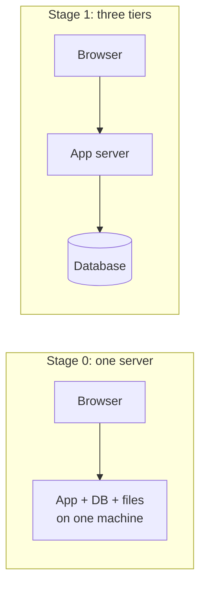
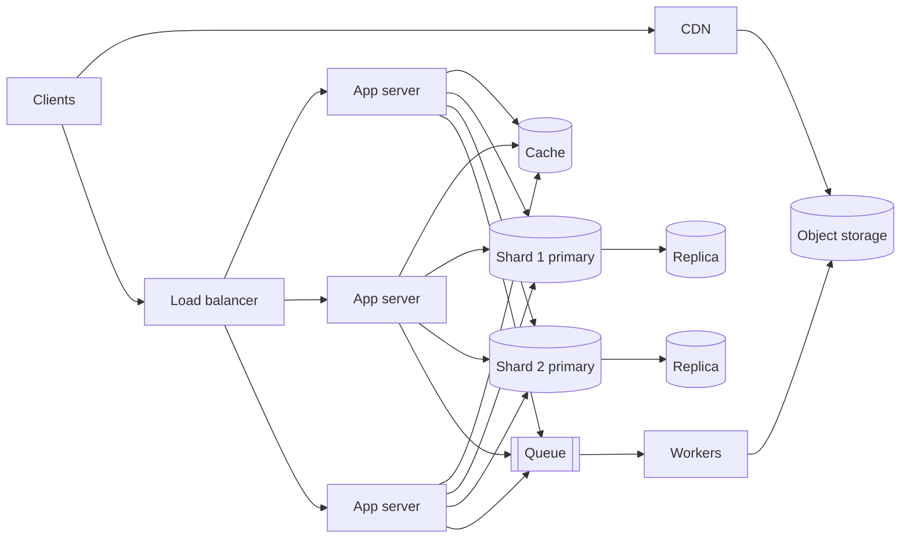

A program that works on your laptop and a product that serves ten million people are built from the same code, but not the same
system. Between the two sit decisions about machines, networks, data stores and failure — and those decisions are what **system
design** is.

## Why it matters

System design is the practice of choosing **which components a system needs, what each is responsible for, how they communicate
and where the data lives** — under constraints you can name: how many users, how fast, how reliable, how correct, how cheap, and how
easy for a team to change.

Three things make it different from writing code:

- **Every choice is a trade-off.** A cache makes reads fast and introduces stale data. A second database copy survives a disk
  failure and can return old values. There is rarely a right answer — there is an answer that fits the requirements.
- **The unit of failure changes.** In one process, a function either returns or throws. Across machines, a request can be lost,
  delayed, duplicated or half-applied, and you often cannot tell which.
- **Scale changes the problem.** Ten requests a second and a hundred thousand requests a second need different architectures, not
  the same one with more effort.

Interviews test system design from SDE-2 upwards because that is when engineers start making these decisions for real: choosing a
database for a new service, deciding whether work should be synchronous, sizing a cache, or explaining why an outage happened. The
interview is a compressed design review — and this track teaches you to run one.

> [!NOTE] HLD and LLD
> This track covers **high-level design**: the boxes and arrows of a whole system. The design of the code *inside* one box — its
> classes, interfaces and patterns — is **low-level design**, covered in the [LLD track](#system-design/lld). The next lesson
> compares them.

## How it works

The easiest way to see what system design is for is to watch a system grow. Imagine a photo-sharing app, and follow what each stage
of growth forces you to add.

### Stage 0: one server

The app, its database and the uploaded photos all live on one machine. It is simple, cheap and perfectly adequate for a few hundred
users. Deploys are a single copy; debugging is reading one log file.

### Stage 1: separate the database

The application and database compete for CPU, memory and disk. Moving the database to its own machine lets each be sized for its
work (the database wants memory and fast disks; the app wants CPU) and lets you restart the app without touching the data. This is the
classic **three-tier architecture**: client, application, data.

### Stage 2: more application servers behind a load balancer

One application server can only handle so many requests. Instead of buying an ever-bigger machine, you run several identical servers
and put a **load balancer** in front to spread requests. This only works if the servers are **stateless** — any server can handle
any request because nothing about the user lives in one server's memory. You now also survive one server dying.

### Stage 3: cache and read replicas

Most requests are reads ("show me this feed"), and the single database becomes the bottleneck. A **cache** (such as Redis) serves
hot data from memory; **read replicas** — copies of the database that apply the primary's changes — take read queries. Writes still
go to the primary. You have just accepted that some reads may be slightly out of date.

### Stage 4: move heavy content and slow work out of the request path

Photos are large and mostly read. They move to **object storage** (such as Amazon S3) and are served by a **CDN** from locations
close to users. Work that doesn't need to finish before you respond — generating thumbnails, sending notifications — goes onto a
**message queue** and is done by background **workers**.

### Stage 5: partition the data

Eventually even the primary database cannot absorb the writes or hold the data. You **shard**: split the data across several
databases by a key such as the user ID. Each shard is smaller and handles a fraction of the load; queries that span users get harder.

Nothing in this story is mandatory. Each step was taken *because a number crossed a threshold*: requests per second, data size,
read/write ratio, latency. That is the core habit of system design: **add a component only when a requirement or a number demands
it, and know what it costs.**

### The questions every design answers

| Question | What it decides | Typical numbers |
|---|---|---|
| What does it do? | The components and APIs | 3–5 core features |
| How much? | Horizontal scaling, partitioning | requests/second, data size, growth |
| How fast? | Caching, data placement, async work | p99 latency in ms |
| How reliably? | Redundancy, replication, backups | availability %, durability nines |
| How correct? | Consistency model, transactions | "may a read be stale?" |
| At what cost? | Simplicity, managed services | money, team size, operational load |

## Architecture

The first two shapes — the single server and the three-tier split:



And the same app after the growth stages above. Every component is there because a requirement or a number asked for it:



Reading the diagram as a request flow is the skill interviews reward. A photo upload goes client → load balancer → app server, which
stores metadata in the user's shard and the bytes in object storage, then enqueues a "make thumbnails" job; a worker picks it up later.
A feed read goes client → load balancer → app server → cache (and, on a miss, a replica); the images themselves come from the CDN.

## Failure scenarios

Each stage removes one failure mode and introduces others. Knowing both halves is what separates design from box-drawing.

| Change | Failure it removes | Failure it introduces |
|---|---|---|
| Separate DB server | App bugs or load taking the database down with them | Network calls between app and DB can be slow or fail |
| Load balancer + several app servers | One app server crash takes the site down | The load balancer itself must not be a single point of failure |
| Cache | Database overload on hot reads | Stale data; a cold or failed cache sends all traffic to the DB at once |
| Read replicas | Read overload on the primary | Replication lag: a user may not see their own write |
| Queue + workers | Slow work making requests slow or time out | Backlogs, duplicate processing, jobs that fail silently |
| Sharding | One database's size and write limit | Cross-shard queries, uneven (hot) shards, harder transactions |

A useful exercise for any diagram: point at each box and ask *"what happens if this is slow? What if it is gone?"* — you will do
exactly that in Step 8 of the [interview framework](lesson:interview-framework).

## Trade-offs

- **Simplicity vs headroom.** The single server is the easiest system to build, run and reason about. Every box you add costs money,
  adds latency (a network hop is roughly half a millisecond inside a datacenter) and adds a failure mode. Design for the scale you
  have been given, with a clear path to roughly ten times more — not for a hypothetical billion users.
- **Latency vs correctness.** Caches and replicas make reads faster by serving copies, and copies can be old. Whether that is
  acceptable depends on the feature: a like count can lag; a bank balance after a transfer should not.
- **Build vs buy.** Managed services (a hosted database, a cloud queue) trade cost and some control for far less operational work.
  In interviews it is fine — usually good — to say "I'd use a managed queue such as SQS here" and move on.

## In real systems

Real architectures follow the same logic, and are often simpler than people expect:

- **Stack Overflow** has written about serving one of the busiest sites on the web from a modest number of large, well-tuned servers
  for years, scaling *up* before scaling *out*. It is a good reminder that a few powerful machines can go a long way.
- **Instagram's early stack** (as described by its engineers) was a familiar list: load balancers, stateless Django app servers,
  PostgreSQL that was later sharded by user, Redis and Memcached, and object storage for photos — essentially the Stage 5 diagram.
- **Most companies** sit somewhere between Stage 2 and Stage 4 for most services; only the largest-scale parts of a product need sharding
  or multiple regions.

The pattern to notice: each step was a response to a measured problem, not a starting point.

## Common mistakes

- **Starting with the most complex architecture.** Kafka, microservices and five databases for a system that serves a hundred
  requests a second is a red flag in interviews, not a strength.
- **Designing without requirements.** Without knowing the scale and what matters most, every choice is a guess. Ask first.
- **Boxes without arrows.** A diagram is only meaningful when you can walk a request through it and say what each component does.
- **Ignoring failure.** A design that only describes the happy path hasn't been designed yet.
- **Adding components without saying why.** "I'll add a cache" is weak; "reads outnumber writes 100 to 1 and most reads hit the same
  1% of items, so a cache absorbs most of the load" is strong.

## In the interview

When you hear "Design X", the interviewer is not asking for one correct diagram. They want to see you turn an ambiguous prompt into
requirements, propose a design that works, find its weak points and justify the trade-offs — while explaining your thinking clearly.

````question title="Walk me through how a single-server web app evolves as it grows to millions of users."
Start with everything on one machine, then add components only when a bottleneck appears:

1. **Separate the database** so the app and data tiers scale and fail independently.
2. **Run several stateless app servers behind a load balancer** for capacity and to survive a server failure (move session state
   out of the servers first).
3. **Add a cache and read replicas** when reads dominate and the database becomes the bottleneck — accepting some staleness.
4. **Move static and large content to object storage and a CDN**, and **move slow work to a queue** with background workers.
5. **Shard the database** when one primary can no longer handle the writes or hold the data.

For each step, say what problem it solves and what it costs — for example, replicas add replication lag, and sharding makes
cross-user queries and transactions harder.
````

````question title="What is the difference between system design and low-level design?"
System design (HLD) decides **which components exist and how they interact**: services, databases, caches, queues, load
balancers, and the data flow between them, with attention to scale, latency, availability and consistency. Low-level design decides
**how the code inside one component is structured**: classes, interfaces, relationships and patterns. They are two zoom levels of
the same system — an HLD box such as "Payment Service" is designed internally with LLD.
````

````question title="Why not design for a billion users from day one?"
Because every component adds cost, latency, operational work and failure modes. A design built for a billion users is harder to build,
slower to change and more expensive to run than a team with today's traffic needs. The better approach is to design for the stated
scale with a clear path to roughly ten times more, and to know which component would become the bottleneck next.
````

## Key takeaways

- System design is choosing components, responsibilities, communication and data placement **under explicit constraints**.
- Systems grow in steps — separate database, stateless app tier behind a load balancer, cache and replicas, CDN and queues, then
  shards — and **each step answers a measured bottleneck**.
- Every component removes one failure mode and introduces another; always know both.
- Strong designs start simple, are driven by requirements and numbers, and explain the trade-off of every addition.

## Knowledge check

```quiz
? A startup's app runs on one server and handles 50 requests per second comfortably. What is the best next step?
- Split it into microservices so it can scale later
! Microservices add network calls, deployment complexity and failure modes without solving any current problem.
- Shard the database by user ID
! Sharding solves write throughput or data size limits — neither has been reached at 50 requests per second.
+ Keep it simple, monitor it, and note which component would become the bottleneck first
- Add Kafka between every component
! A message broker is for decoupling and absorbing bursts; adding it everywhere only adds latency and operational load.
> Design for the scale you have with a path to about ten times more. Nothing here is under pressure yet.

? Why must application servers be stateless before you put several of them behind a load balancer?
+ So any server can handle any request — no user data lives in one server's memory
- Because load balancers cannot connect to stateful servers
! Load balancers can route to any server; the problem is that a user's state would be stranded on whichever server holds it.
- To make each server faster
! Statelessness is about interchangeability and failure, not per-request speed.
- Because stateful servers cannot use a database
! Stateful servers can use databases; the issue is state kept in their own memory.
> If a user's session lives in server A's memory, requests routed to server B lose it — and the session disappears if A crashes.

? Adding read replicas to a read-heavy system introduces which new problem?
- Writes can no longer reach the database
! Writes still go to the primary; replicas only take reads.
+ Replication lag: a read from a replica may not include the latest write
- The cache becomes useless
! Caches and replicas complement each other; replicas don't make caching redundant.
- The load balancer must become stateful
! Replica routing happens between the app and the database tier and doesn't change the load balancer.
> Replicas apply the primary's changes a little later, so a user can write something and then read an older copy.

? An interviewer asks "why did you add a cache?". Which answer is strongest?
- "Caches always make systems faster."
! True in general but unjustified: it doesn't say why *this* system needs one or what it costs.
- "Big companies use Redis."
! Appeal to popularity, not reasoning tied to the requirements.
+ "Reads outnumber writes about 100 to 1 and a small set of items gets most reads, so a cache can absorb most database load; the cost is that a cached item can be up to its TTL out of date."
- "So I don't need a database."
! A cache is a copy of data, not the system of record; losing it must not lose data.
> Strong answers tie the component to a requirement or number and name the trade-off it introduces.
```
