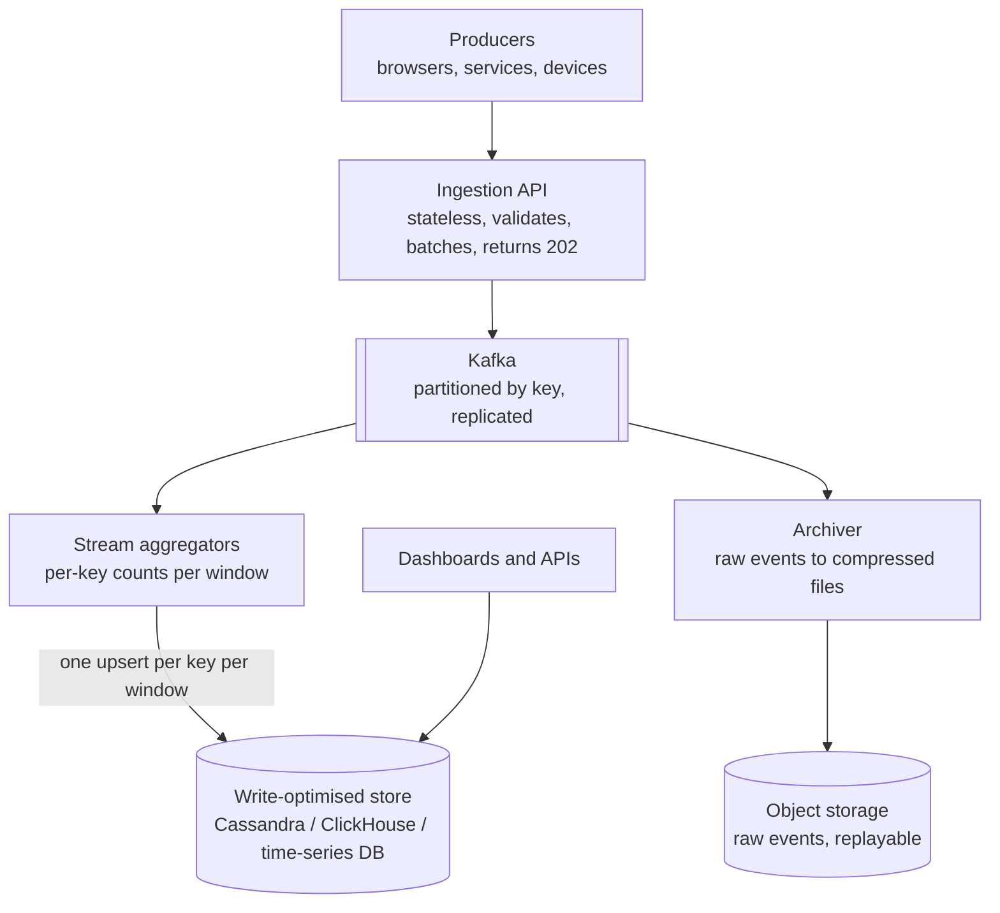
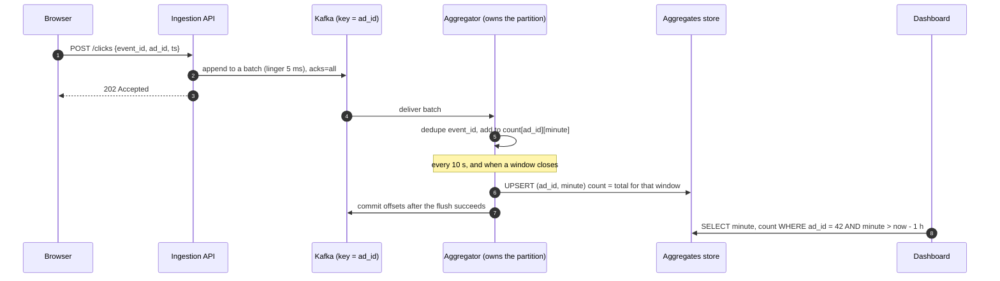

Some systems are defined by their writes: ad clicks, metrics, logs, sensor readings, chat messages, likes and views. Hundreds of thousands
of events arrive every second and must not be lost, while reads are usually summaries — counts per minute, latest values, dashboards. The
pattern is to **absorb, batch, partition and pre-aggregate**, so the expensive storage layer sees far fewer, larger writes.

## The problem

Signals that a problem is write-heavy:

- **Writes per second in the tens of thousands or more**, often far above reads.
- **Append-mostly data**: events are rarely updated; old data expires.
- **Bursty traffic**: a live event, a marketing campaign or an incident multiplies the rate in seconds.
- **Reads are aggregates**: "clicks per ad per minute", "p99 latency per service", "unique viewers today".

A relational primary handles **thousands to tens of thousands of small writes per second**; each committed transaction costs a log flush,
and each index multiplies the work ([numbers to know](lesson:numbers-to-know), [scaling writes](lesson:scaling-writes)). Two million
events per second needs a different shape.

## Architecture



The techniques, roughly in order of impact:

1. **Accept fast, process later**: the ingestion tier validates and appends to a durable log, answering `202 Accepted`; nothing on the
   request path waits for the database ([sync vs async](lesson:sync-vs-async)).
2. **Buffer in a partitioned log**: Kafka absorbs bursts and lets consumers fall behind and catch up ([Kafka](lesson:kafka),
   [backpressure](lesson:backpressure)).
3. **Batch**: write hundreds of rows per statement or request. Measured on PostgreSQL 18 in an earlier lesson, 500-row multi-row inserts
   ran about 20 times faster than one commit per row.
4. **Pre-aggregate**: count in memory per key per time window and flush one row per key per window, instead of one row per event.
5. **Use a write-optimised store**: LSM-based stores (Cassandra, ScyllaDB, RocksDB-backed systems) turn random writes into sequential
   appends; columnar stores (ClickHouse) ingest large batches efficiently ([Cassandra](lesson:cassandra)).
6. **Spread writes evenly**: partition by a high-cardinality key; **salt** hot keys (`ad42#0`..`ad42#7`) and sum on read
   ([hot keys](lesson:hot-keys)).
7. **Write less**: fewer indexes on hot tables, sampling of low-value data, compression, and keeping raw events in cheap object storage.

## Request and data flow



Writing the **window's total** (not "+1") makes the flush **idempotent**: if the aggregator crashes after writing but before committing
offsets, replaying the batch recomputes the same totals and overwrites them ([dedup](lesson:dedup)).

The arithmetic that justifies pre-aggregation:

```drill
? 2,000,000 click events/s spread over 50,000 active ads. An aggregator flushes one row per active ad every 5 seconds. How many writes/s reach the store?
= 10000
~ 1.1
> 50,000 rows per flush ÷ 5 s = 10,000 writes/s — a 200× reduction from 2M events/s.

? A Kafka partition sustains about 10 MB/s of writes in your cluster. Events are 500 bytes and peak at 2M/s. How many partitions, at minimum?
= 100
~ 1.25
> 2M × 500 B = 1 GB/s ÷ 10 MB/s = 100 partitions; add headroom (say 1.5–2×) and enough partitions for the consumers you need.
```

## Advantages

- **Throughput scales horizontally**: more partitions, more ingestion nodes, more aggregators.
- **Bursts are absorbed** by the log instead of overwhelming the database.
- **Storage writes drop by orders of magnitude** through batching and pre-aggregation.
- **Raw events are kept** (in the log and object storage) so aggregates can be recomputed after bugs or for new metrics.

## Disadvantages

- **Freshness lag**: dashboards trail events by seconds (the flush interval plus consumer lag).
- **Complexity**: logs, stream processors, windowing, dedup and replay all need to be operated and monitored.
- **Approximate or eventually exact results**: late events, retries and duplicates need explicit handling.
- **Limited ad-hoc querying** on write-optimised stores; detailed queries go to the raw archive with batch tools.

## Failure scenarios

| Failure | What happens | Mitigation |
|---|---|---|
| Aggregator crashes mid-window | In-memory counts lost | Commit offsets only after flushing; replay recomputes the window |
| Duplicate events (client retries) | Overcounting | Event IDs; dedupe within a window or with a short-lived set |
| Hot key (one viral ad) | One partition and one aggregator saturate | Salt the key across partitions; aggregate per salt, sum on read |
| Late events | Arrive after the window was flushed | Watermarks and allowed lateness; re-flush corrected totals |
| Consumer lag grows | Dashboards stale, retention at risk | Autoscale consumers, alert on lag, size Kafka retention for recovery |
| Storage compaction falls behind | Read latency rises, disk fills | Right compaction strategy (time-window for time series), capacity headroom |

## Alternatives

- **Batching into a relational database**: for thousands of writes per second, batching plus partitioning may be all you need.
- **Sharded relational databases**: when writes need transactions and spread well by key (per tenant, per user).
- **Managed streaming and analytics**: Kinesis or Pub/Sub into BigQuery, Snowflake or ClickHouse Cloud, trading control for less
  operations.
- **Approximate structures**: HyperLogLog, count-min sketches and sampling when exact counts aren't required.

## Where it shows up in interviews

Ad click aggregators, metrics and monitoring, centralised logging, IoT telemetry, view and like counters, chat message storage and analytics
pipelines. Lead with the write rate and its peak, then the ingestion log, the partition key, what gets pre-aggregated, and how duplicates
and crashes are handled.

````question title="How would you count likes on posts when a viral post receives 100,000 likes per second?"
Don't increment one database row per like. Append like events to a log partitioned by post ID; consumers aggregate counts in memory per post
and flush totals every few seconds, so the database sees one write per post per interval. For a single viral post, salt the key across
several partitions or counters (post#0..post#15) and sum them when reading. Deduplicate by (user, post) so retries and double taps don't
inflate counts, and show an approximate, slightly delayed count in the UI.
````

````question title="How do you avoid losing or double-counting events if an aggregator crashes?"
Keep the log as the source of truth and commit consumer offsets only after the aggregates for those events are durably written. On restart,
the consumer replays from the last committed offset, recomputes the same windows and overwrites totals with idempotent upserts keyed by
(key, window), so replays don't double count. Use event IDs to drop client-side duplicates, and handle late events with watermarks.
````

## Common mistakes

- **One database write per event** at high rates.
- **Synchronous processing on the request path** instead of accept-then-process.
- **A partition key with skew** (`country`, `event_type`, the date) that funnels traffic to one partition.
- **Incremental "+1" updates on replay**, turning at-least-once delivery into double counting.
- **No raw-event archive**, so a bug in aggregation can't be fixed retroactively.

## Key takeaways

- Write-heavy designs **absorb** (fast ingestion + durable log), **batch**, **partition evenly** and **pre-aggregate**.
- Pre-aggregation turns **events/s into keys/flush-interval** — often a 100× or larger reduction.
- Use **write-optimised stores** (LSM, columnar) and keep **raw events** for replay.
- Make flushes **idempotent** and commit offsets **after** writing, so crashes cause replays, not loss or double counts.

## Knowledge check

```quiz
? 500,000 events/s arrive for 10,000 keys. Aggregators flush each active key every 2 seconds. Roughly how many writes/s hit storage?
- 500,000
! That's without pre-aggregation.
+ 5,000
- 250,000
! That's per-event writes halved.
- 20,000
! 10,000 keys every 2 s is 5,000/s.
> Keys ÷ flush interval.

? An aggregator writes `count = count + n` to the database, then commits Kafka offsets. It crashes between the two steps. What happens on restart?
+ The batch is replayed and added again: double counting
- Nothing; Kafka deduplicates
! Kafka redelivers uncommitted records.
- The events are lost
! They weren't committed, so they're replayed.
- The database rolls back the increment
! It was committed.
> Write window totals (idempotent upserts) instead of increments.

? Which partition key best spreads click events across Kafka partitions?
- event_type (click, view, conversion)
! Three values, so at most three busy partitions.
- country
! Heavily skewed.
+ ad_id (salted for the hottest ads)
- the current minute
! Every event in a minute goes to one partition.
> High cardinality, even spread, and salting for hot keys.

? Why keep raw events in object storage when you already store aggregates?
- Aggregates are not durable
! They are stored durably.
+ To recompute aggregates after a bug or for new metrics, and to answer detailed questions the aggregates can't
- Object storage is faster to query than the aggregate store
! It's slower for point queries.
- Kafka can't hold events
! It can, but usually only for days.
> Raw data makes the pipeline correctable.
```
