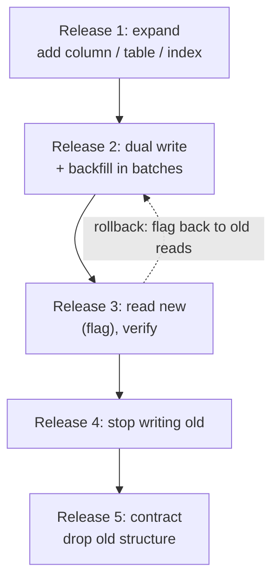
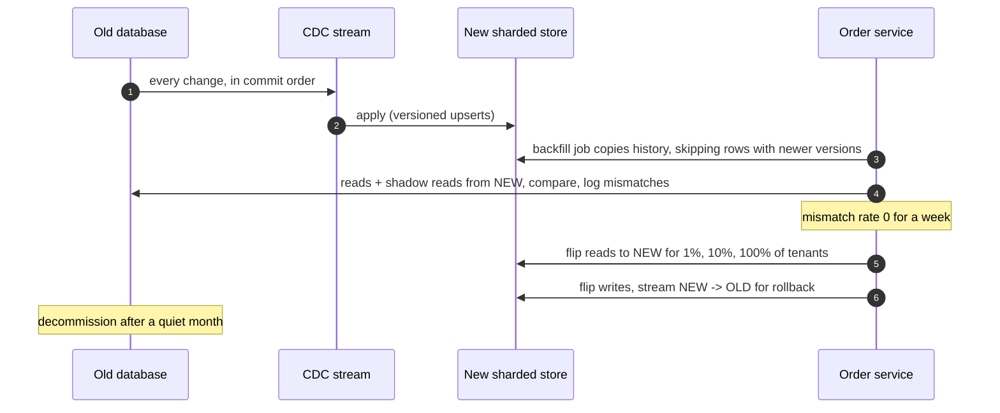

Sooner or later every system must change its data while serving traffic: rename a column, split a table, add a constraint, move from one
database to another, re-shard. Doing it with a maintenance window is easy; doing it with **zero downtime** means every step must work with
both the old and the new code running, must not lock busy tables, and must be reversible. The core technique is **expand and contract**.

## Why it matters

- During deployments, old and new versions run side by side ([deployment strategies](lesson:deployment-strategies)) — a schema change
  that breaks the old version breaks production mid-rollout.
- Some DDL takes locks that block reads or writes on a busy table, and even a brief lock can queue thousands of requests behind it.
- Data migrations between stores (PostgreSQL to a sharded cluster, monolith tables to a new service) are long projects that must keep
  data correct the whole time.
- Interviewers ask "how would you migrate this?" for sharding, re-keying and schema evolution questions ([sharding](lesson:sharding)).

## How it works

### Expand and contract

Split every breaking change into backward-compatible steps, each deployable and reversible on its own:

1. **Expand**: add the new structure (a column, table or index) alongside the old one. Nothing uses it yet.
2. **Dual write**: application code writes both old and new structures.
3. **Backfill**: copy existing data into the new structure in small batches.
4. **Switch reads** to the new structure (behind a flag), verify.
5. **Stop writing** the old structure.
6. **Contract**: drop the old structure once nothing reads it — usually a release or more later.

Renaming `email` to a normalised `email_normalized`, step by step (every statement verified on PostgreSQL 18):

```sql title="Expand: add the new column without blocking traffic"
CREATE TABLE users (id bigint PRIMARY KEY, email text NOT NULL);

SET lock_timeout = '2s';            -- fail fast rather than queue behind a long transaction
ALTER TABLE users ADD COLUMN email_normalized text;    -- metadata-only: no table rewrite
```

```sql title="Backfill one batch at a time (run repeatedly with the next ID range)"
UPDATE users
SET email_normalized = lower(email)
WHERE id > $1 AND id <= $2 AND email_normalized IS NULL;
```

```sql title="Enforce NOT NULL without a long blocking scan"
ALTER TABLE users ADD CONSTRAINT users_email_normalized_nn
  CHECK (email_normalized IS NOT NULL) NOT VALID;      -- applies to new writes immediately
ALTER TABLE users VALIDATE CONSTRAINT users_email_normalized_nn;  -- checks old rows, lighter lock
```

```sql title="Build the unique index without blocking writes"
CREATE UNIQUE INDEX CONCURRENTLY users_email_normalized_key ON users (email_normalized);
```

```sql title="Contract: only after no deployed code reads or writes the old column"
ALTER TABLE users DROP COLUMN email;
```

Details that matter:

- **Lock timeouts**: DDL waits for a lock, and everything queues behind the waiting DDL. A short `lock_timeout` plus retries prevents a
  migration from freezing the table.
- **Batches with pauses** keep replication lag and load under control; check replica lag between batches.
- **Metadata-only changes**: adding a nullable column (or one with a constant default, in PostgreSQL 11+) is instant; rewriting changes
  like altering a column type are not — use a new column instead.
- **MySQL** has online DDL for many operations, and tools such as gh-ost and pt-online-schema-change copy a table in the background and
  swap it in for the rest.

### Moving data between stores

Migrating a table to a new database or service follows the same shape at larger scale:

1. **Dual write or stream**: keep the new store updated — either the application writes both (risk: the two writes can diverge on partial
  failure) or, more robustly, **CDC** streams every change from the old store ([outbox and CDC](lesson:outbox-cdc)).
2. **Backfill** history from a snapshot, merged carefully with the live stream (use versions or timestamps so a stale backfill row never
  overwrites a newer streamed change).
3. **Verify**: compare counts and checksums; run **shadow reads** that read both stores and log mismatches.
4. **Cut over reads** gradually (by percentage or tenant) behind a flag.
5. **Cut over writes**: make the new store the source of truth; keep syncing back to the old one for a while so rollback stays possible.
6. **Decommission** the old store.

## Architecture





## Failure scenarios

| Failure | What happens | Prevention |
|---|---|---|
| Breaking DDL deployed with new code | Old instances fail during rollout | Expand first, release code later, contract last |
| DDL waits for a lock | All queries on the table queue; outage | `lock_timeout`, retries, run at low traffic |
| Backfill too aggressive | Replica lag, primary overloaded | Small batches, throttling, lag checks |
| Dual writes diverge | Old and new stores disagree silently | CDC instead of dual writes, verification, versions |
| Stale backfill overwrites new data | Lost updates in the new store | Version or timestamp checks on every upsert |
| Contract too early | Some old code path still reads the column | Wait a release; search code; monitor column usage |

## Trade-offs

| Choice | Gain | Cost |
|---|---|---|
| Expand-contract | No downtime, every step reversible | Several releases; temporary code paths |
| Maintenance window | Simple | Downtime; risky if the window overruns |
| Application dual writes | Simple to start | Divergence on partial failures |
| CDC-based sync | Ordered, complete, decoupled | Pipeline to run; replication lag during cutover |
| Shadow reads | Catches mismatches before users do | Extra load during the migration |

## In real systems

- GitHub built **gh-ost** for online MySQL schema changes using the binary log instead of triggers; Percona's **pt-online-schema-change**
  uses triggers. Both copy rows into a new table and swap it in.
- Stripe has written about its four-step pattern for online data migrations: dual writing, changing reads, changing writes, removing old
  data.
- Tools like Liquibase and Flyway version schema changes; expand-contract is a discipline on top of them, not a feature of them.

## Common mistakes

- **Renaming or retyping a column in place** while old code is still running.
- **Running long DDL without a lock timeout.**
- **One giant backfill transaction.**
- **Dual writes without verification.**
- **Dropping the old structure in the same release** that stops using it.
- **No rollback plan** for each step.

## In the interview

When a design needs re-sharding or a schema change, say: *"Expand-contract: add the new structure, stream changes with CDC, backfill in
throttled batches with version checks, verify with shadow reads, cut reads then writes over behind flags, keep reverse sync for rollback, and
only then drop the old structure."*

````question title="How would you rename a heavily used column with zero downtime?"
Don't rename it in place. Add a new column (a metadata-only change), deploy code that writes both columns, backfill old rows in small
batches, and enforce constraints with NOT VALID followed by VALIDATE. Then switch reads to the new column behind a flag, verify, stop
writing the old one, and drop it a release later. Every step works with both old and new application versions and can be rolled back.
````

````question title="How would you migrate a large table from PostgreSQL to a new sharded database without downtime?"
Stream every change from PostgreSQL with CDC into the new store, applying versioned upserts so order is preserved. Backfill historical rows
from a snapshot, skipping any row the stream has already updated. Verify with counts, checksums and shadow reads that compare both stores.
Move reads over gradually by tenant, then make the new store the source of truth for writes while streaming back to PostgreSQL for a
rollback window, and decommission the old table once everything has been quiet.
````

## Key takeaways

- **Expand → dual write → backfill → switch reads → stop old writes → contract**, each step deployable and reversible.
- Avoid long locks: **lock timeouts**, metadata-only changes, `NOT VALID` + `VALIDATE`, `CREATE INDEX CONCURRENTLY`, batched backfills.
- For store migrations prefer **CDC + versioned backfill + shadow reads + gradual cutover** over raw dual writes.
- **Contract last**, a release after nothing uses the old structure.

## Knowledge check

```quiz
? A release renames a column with ALTER TABLE ... RENAME during a rolling deploy. What happens?
+ Instances still running the old code query the old column name and fail until the rollout finishes
- Nothing; renames are instant and transparent
! Instant, but the old code still uses the old name.
- The database rejects the rename
! It accepts it.
- Only new instances fail
! Old instances fail.
> Expand-contract avoids breaking the version still running.

? Why add a CHECK constraint as NOT VALID and validate it separately?
- NOT VALID constraints are never enforced
! They're enforced for new and updated rows.
+ Adding it is quick and enforces new writes immediately; VALIDATE then checks existing rows without blocking writes for the whole scan
- VALIDATE is faster than a normal constraint
! It's about locking, not speed.
- It's required for CHECK constraints
! It's optional.
> Split the long scan from the lock-heavy step.

? A backfill copies snapshot rows into a new store while CDC applies live changes. How do you stop a stale snapshot row overwriting a newer change?
- Run the backfill after CDC stops
! Writes would be lost meanwhile.
+ Apply writes as versioned upserts that only replace a row with an older version
- Make the backfill faster
! Speed doesn't remove the race.
- Use eventual consistency
! That doesn't decide which write wins.
> Versions make the merge order-independent.

? When is it safe to drop the old column in an expand-contract migration?
- Immediately after the backfill
! Code may still read it.
- In the same release that stops writing it
! Old instances may still be running during that rollout.
+ After a release in which no deployed code reads or writes it, confirmed by monitoring
- Never
! Old structures should be cleaned up.
> Contract last.
```
