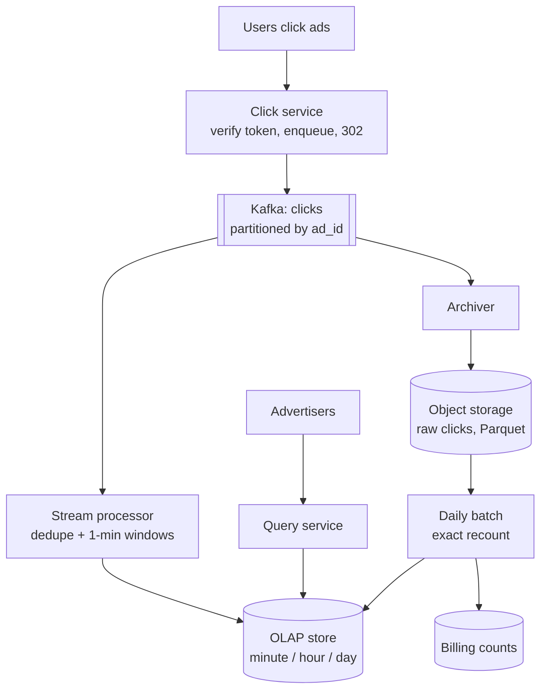
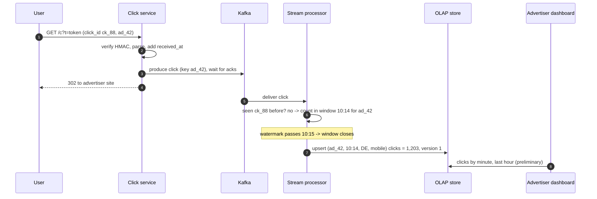
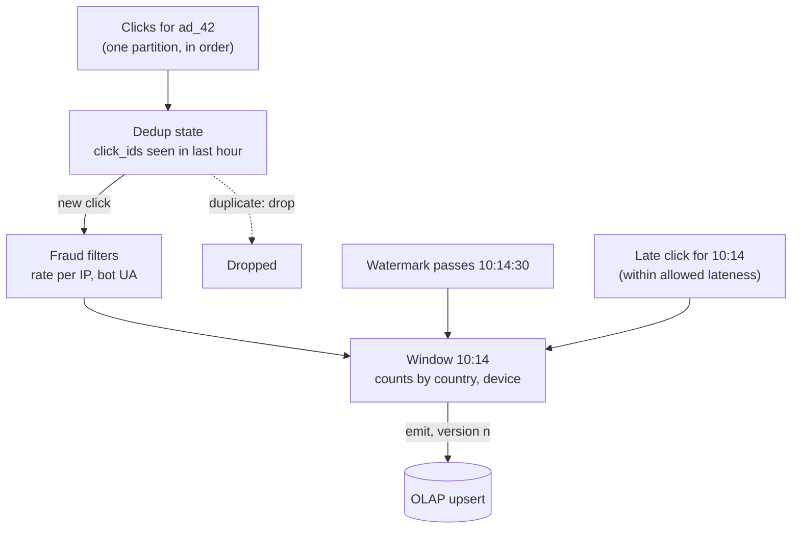
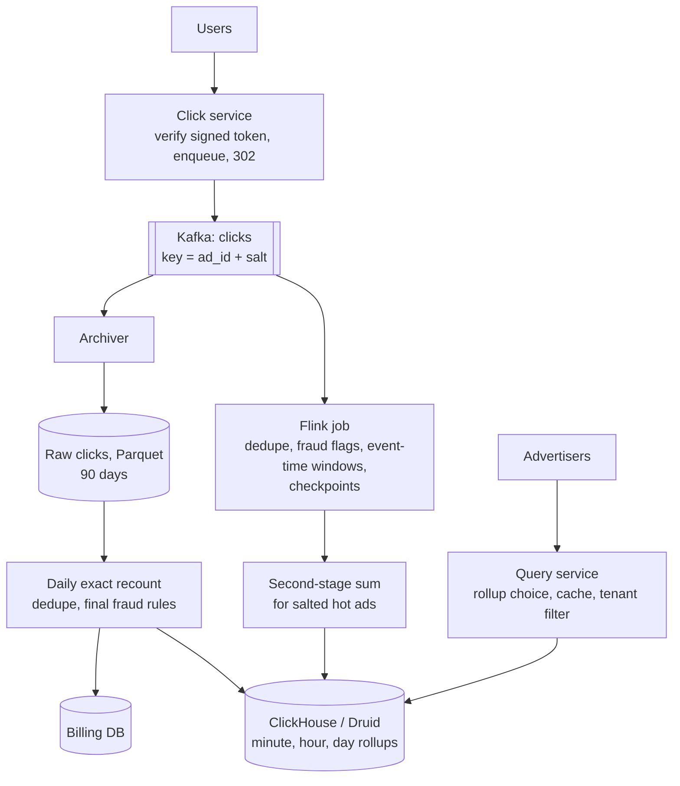

## Problem statement

Design an ad click aggregator: when a user clicks an ad, the system records the click and redirects them to the advertiser's site; advertisers
see clicks per ad, campaign and dimension (country, device) on dashboards updated within a minute; and the platform bills advertisers from
the same data, which must be exact — every valid click counted once, duplicates and fraud excluded.

**Interview format:** 45–60 minutes · **Difficulty:** advanced · **Main themes:** write-heavy ingestion, stream aggregation with windows and
watermarks, deduplication, exactly-once results, batch reconciliation, OLAP storage.

> [!TIP] Try it first
> Before scrolling, spend three minutes writing the questions you would ask the interviewer. Then compare with the list below — or
> practise this whole problem as a [timed mock interview](#system-design/hld/interview/ad-click-aggregator).

## Clarifying questions

The answers below are the interviewer's. Questions that change the design come first.

- **Q:** What is in scope? <!-- match: scope, features, what do we build, in scope, functionality -->
  - **A:** Capturing clicks and redirecting users, aggregating clicks for advertiser dashboards, and producing billing-grade counts.
    Impression tracking, ad serving and bidding are out of scope.
- **Q:** How many clicks? <!-- match: scale, how many, clicks per day, traffic, volume, qps -->
  - **A:** About 1 billion clicks a day, with peaks of around 5× average.
- **Q:** How fresh must dashboards be? <!-- match: fresh, freshness, real time, latency, dashboard, delay -->
  - **A:** Within about a minute.
- **Q:** What queries do advertisers run? <!-- match: queries, query, dashboard, dimensions, filter, group by, granularity -->
  - **A:** Clicks per ad, campaign or advertiser over time ranges, at minute, hour and day granularity, filtered or grouped by country and
    device.
- **Q:** How accurate must counts be? <!-- match: accuracy, accurate, exact, billing, approximate, correct -->
  - **A:** Dashboards may be slightly approximate in real time, but billing must be exact: each valid click counted exactly once.
- **Q:** What about duplicate or fraudulent clicks? <!-- match: duplicate, duplicates, fraud, bots, double click, dedupe -->
  - **A:** Duplicate submissions of the same click must count once; obvious bot traffic must be excluded from billing.
- **Q:** How long do we keep data? <!-- match: retention, keep, how long, history, storage -->
  - **A:** Raw clicks for 90 days (for audits and reprocessing); aggregates for several years.
- **Q:** How fast must the redirect be? <!-- match: redirect, latency of redirect, user experience, fast -->
  - **A:** The user should reach the advertiser's site with well under 100 ms of added delay.

## Functional requirements

> [!TIP] Try it first
> Write three or four functional requirements before reading on.

- **Record each click and redirect** the user to the advertiser. <!-- match: record, redirect, click -->
- **Aggregate clicks** per ad over minutes, hours and days, by country and device. <!-- match: aggregate, aggregation, per ad -->
- Advertisers **query dashboards** with about one minute of freshness. <!-- match: query, dashboard, dashboards -->
- Produce **exact, deduplicated billing counts**. <!-- match: billing, exact, deduplicated -->

````hint title="Hint: two consumers of the same data"
Dashboards want fast, approximate answers; billing wants slow, exact ones. Can one pipeline serve both, or do you need two paths?
````

## Non-functional requirements

- **High write throughput**: ~12,000 clicks/s average, ~58,000/s at peak. <!-- match: throughput, write heavy, clicks per second -->
- **Low redirect latency** and **high availability** of click capture. <!-- match: latency, availability, redirect -->
- **Exactly-once counting** for billing, with deduplication. <!-- match: exactly once, deduplication, exact -->
- **Freshness**: dashboards within ~1 minute. <!-- match: freshness, minute, fresh -->
- **Fast analytical queries** over long time ranges. <!-- match: fast queries, analytical, query latency -->

````hint title="Hint: never lose a click"
The redirect must be fast, but a lost click is lost revenue. What does the click service do before redirecting, and what must it not wait for?
````

## Scope and exclusions

In scope: click capture and redirect, event pipeline, deduplication, stream aggregation, OLAP storage and queries, raw archive, batch
reconciliation for billing, basic fraud filtering.

Out of scope: ad serving and auctions, impression logging (assume impressions issue click tokens), advanced fraud models, invoicing.

## Capacity estimation

> [!TIP] Try it first
> Estimate clicks per second, ingest bandwidth, raw storage and the shape of aggregate storage.

- **Clicks:** 1B/day ≈ **11,600/s** average, ~**58,000/s** at peak.
- **Bandwidth:** ~500-byte events → ~6 MB/s average, ~30 MB/s peak — modest for Kafka.
- **Raw storage:** 500 GB/day → **~45 TB for 90 days** (before replication); ~180 TB/year if archived longer.
- **Aggregates:** at most one row per ad per minute per dimension combination with clicks; rolled up to hours and days, which shrinks older
  data dramatically.

```estimator title="Ad click aggregator (clicks and dashboard queries)"
requestsPerDay = 1.01B
readsPerWrite = 0.01
writeBytes = 500 B
readBytes = 5 KB
retentionYears = 0.25
peakFactor = 5
replication = 3
cachePercent = 0
serverRps = 5000
targetUtilization = 60
```

Writes are click events (retained raw for about 90 days with three replicas); reads are dashboard queries — about 10 million a day, far fewer
than clicks.

**What the numbers mean for the design:**

- **Write-heavy, append-only**: a log plus stream processing, not row-per-click database updates ([write-heavy systems](lesson:write-heavy)).
- **Pre-aggregate**: dashboards read rollups, never billions of raw rows.
- **Raw data is kept** so aggregates can be recomputed exactly.

````hint title="Hint: per-click database writes"
What would 58,000 UPDATE ... SET clicks = clicks + 1 per second do to a relational database, especially for a viral ad?
````

## API design

> [!TIP] Try it first
> Define the click endpoint and the dashboard query. What is in the click URL, and why?

```text title="API"
Click URL (generated at impression time, signed):
  GET https://clk.example.com/c?t=<click_token>
  click_token = base64(ad_id, campaign_id, impression_id, click_id, ts, dest_url) + HMAC signature
  -> 302 Location: <advertiser URL>     (after the click is durably queued)

Dashboard query:
  GET /v1/stats?advertiser=adv_7&campaign=c_3&from=...&to=...&granularity=hour
                &group_by=country,device&metric=clicks
  -> { "rows": [ { "time": "...", "country": "DE", "device": "mobile", "clicks": 1824 }, ... ],
       "freshness": "2026-11-07T10:14:00Z", "final": false }
```

- The **signed token** prevents forged clicks and carries a unique `click_id` for deduplication.
- Query responses say whether numbers are **final** (reconciled for billing) or **preliminary** (real-time).

````hint title="Hint: where does click_id come from?"
If the same user double-clicks, or the browser retries, how do you know two requests are the same click?
````

## Data model

> [!TIP] Try it first
> What does a click event contain, and how are aggregates keyed?

```text title="Schema"
Click event (Kafka, keyed by ad_id with a salt for hot ads)
  click_id, ad_id, campaign_id, advertiser_id, ts (event time), received_at, country, device,
  ip_hash, user_agent_class, fraud_flags

Aggregates (OLAP store: ClickHouse / Druid / Pinot)
  clicks_minute (advertiser_id, campaign_id, ad_id, minute, country, device, clicks, version)
  clicks_hour, clicks_day   rollups; minute data kept 7-30 days, hours and days for years

Raw archive (object storage, Parquet): date=/hour=/ partitions, 90 days+
Billing (relational): billable_clicks_day (advertiser_id, campaign_id, day, clicks, reconciled_at)
```

- **Event time vs processing time**: windows use the click's timestamp, so late events land in the right minute.
- **Aggregates carry a version** so recomputed results replace earlier ones idempotently.

````hint title="Hint: why both minute and day tables?"
A query for "clicks per day over the last year" against minute rows touches how many rows per ad?
````

## Initial high-level architecture

Build the design one requirement at a time.

### Step 1: capture and redirect

The **click service** verifies the token's signature, writes the click event to **Kafka** (acks from replicas), and returns the redirect. It
never touches a database ([Kafka](lesson:kafka)).

### Step 2: aggregate in a stream

A **stream processor** (Flink-style) reads clicks keyed by ad, deduplicates by `click_id` within a time window, and counts clicks in one-minute
**tumbling windows** by event time, writing results to the OLAP store every minute.

### Step 3: serve dashboards

The **query service** reads minute, hour or day rollups from the OLAP store, depending on the time range.

### Step 4: reconcile for billing

Raw clicks are archived to object storage; a daily **batch job** recomputes exact, deduplicated, fraud-filtered counts per advertiser and
campaign, which become the billing numbers and replace the real-time ones.

````hint title="Hint: late events"
A click from a phone that was offline arrives 20 minutes late. Which minute does it belong to, and what happens to a window that's already
been written?
````

## Architecture diagram



## Request and data flow



## Component responsibilities

| Component | Responsibility | Scales with |
|---|---|---|
| Click service | Verify tokens, enqueue clicks, redirect | Clicks/s |
| Kafka | Durable, partitioned click log; replay | Bytes/s, retention |
| Stream processor | Dedup, fraud flags, windowed counts, idempotent writes | Clicks/s, state size |
| OLAP store | Fast aggregate queries by time and dimension | Aggregate rows, query rate |
| Archiver + object storage | Raw clicks for 90 days, Parquet | Bytes/day |
| Batch reconciliation | Exact daily counts for billing | Daily raw volume |
| Query service | Choose rollup level, enforce advertiser access | Dashboard queries |

## Database and technology choices

| Need | Choice | Why | Alternative |
|---|---|---|---|
| Click log | Kafka (replication factor 3, `acks=all`) | Durable buffer, replay, partitioned consumers | Kinesis |
| Stream aggregation | Flink with checkpoints and event-time windows | Exactly-once state, watermarks | Spark Structured Streaming |
| Aggregates | ClickHouse, Druid or Pinot | Fast group-by over time and dimensions | Cassandra with precomputed keys (less flexible) |
| Raw archive | Object storage, Parquet partitioned by hour | Cheap, scannable by batch engines | HDFS |
| Batch recount | Spark / warehouse SQL over Parquet | Exact, auditable | Re-running the stream job over archived data |
| Billing | PostgreSQL | Transactions, invoices | — |

## Scaling strategy

### How are duplicates removed?

Every click carries a `click_id` minted at impression time and signed. The stream processor keeps the IDs it has seen in keyed state for a
deduplication window (say 1 hour, covering browser retries and double clicks) — RocksDB-backed state handles hundreds of millions of keys —
and drops repeats. The daily batch deduplicates over the whole day exactly. Signed tokens also stop clicks from being fabricated with random
IDs ([dedup](lesson:dedup)).

### How do windows, event time and late events work?

Clicks are counted in one-minute tumbling windows by **event time**. A **watermark** — "we've probably seen everything before 10:14" —
closes windows a short time after the minute ends (for example, 30 seconds). Late events within an allowed lateness (say 10 minutes) update the
window and re-emit a corrected count with a higher version; later ones go to a side output and are counted by the batch job.



### How is exactly-once achieved?

Two pieces: the stream processor's **checkpoints** snapshot its state (dedup set, open windows) together with its Kafka offsets, so after a
crash it resumes exactly where its state says; and its **output is idempotent** — upserts keyed by (ad, minute, dimensions) with a version, so
replaying a window rewrites the same row instead of adding to it ([delivery semantics](lesson:delivery-semantics)). Even so, billing doesn't
rely on the stream: the batch recount over raw data is the source of truth.

### How are hot ads handled?

A viral ad can send most clicks to one Kafka partition and one processing task. Salting the key (`ad_42#0`..`ad_42#7`) spreads it across
partitions; each processes its share and a second, tiny aggregation step sums the salted partial counts ([hot keys](lesson:hot-keys)).
Deduplication still works because the salt is derived from the `click_id`, so a duplicate always lands in the same partition.

### Why a batch path as well?

The stream gives fast, nearly exact numbers; the batch recount gives exact, auditable ones, with complete deduplication, final fraud
decisions and every late event. Reprocessing after a bug is also just re-running the batch over raw data. This dual path is often called a
lambda architecture; a kappa architecture would instead replay archived events through the same stream job.

## Caching strategy

### What should be cached?

Dashboard queries for recent time ranges change every minute, so cache them for 30–60 seconds per (advertiser, query); older ranges are
immutable once reconciled and can be cached for hours. The click service caches token-verification keys in memory. Nothing caches counts on
the write path ([caching basics](lesson:caching-basics)).

## Messaging strategy

### Why Kafka between click capture and aggregation?

It decouples the latency-sensitive redirect from processing, absorbs peaks, lets several consumers (stream processor, archiver, fraud
analysis) read the same clicks independently, and allows replay after bugs. Producers use `acks=all` and idempotent producers so
acknowledged clicks aren't lost or duplicated by the log itself ([backpressure](lesson:backpressure)).

## Failure scenarios

| Failure | Impact | Mitigation |
|---|---|---|
| Kafka briefly unavailable | Clicks can't be enqueued | Click service buffers locally briefly, then redirects anyway and logs to a fallback; alert |
| Stream processor crash | Dashboards pause | Restore from checkpoint; idempotent upserts on replay |
| Late or out-of-order events | Window counts change | Watermarks, allowed lateness, versioned re-emits, batch recount |
| Hot ad | One partition lags | Key salting with a second-stage sum |
| Bug in aggregation logic | Wrong counts | Fix and recompute from raw archive; batch is the billing source |
| OLAP node failure | Slower or partial queries | Replicated segments; rebuild from Kafka or archive |

## Bottleneck analysis

- **Click service** must never block on anything slower than Kafka.
- **Stream state** (dedup sets) grows with traffic and window length — RocksDB state backends, TTLs on keys.
- **Hot partitions** from viral ads — salting.
- **OLAP query load** over long ranges — rollups and caching of reconciled periods.

## Consistency and availability trade-offs

- **Real-time numbers are preliminary**; billing uses reconciled daily numbers — and the UI says which is which.
- **Click capture favours availability**: the redirect proceeds even if parts of the pipeline are degraded.
- **Exactly-once outputs** via checkpointed state plus idempotent, versioned upserts.
- **Eventual consistency** between real-time and batch numbers, converging daily.

## Security considerations

- Signed click tokens (HMAC with rotated keys) so clicks can't be forged or tampered with; reject expired tokens.
- Hash IPs and limit stored personal data; honour privacy regulations in retention.
- Advertisers can query only their own data; enforce tenant filters in the query service.
- Fraud filtering: per-IP and per-device rate thresholds, known bot signatures, and later, model-based scoring.

## Monitoring and observability

- Click capture rate, redirect latency, Kafka produce errors.
- Consumer lag per partition (hot ads), checkpoint duration and failures.
- Late-event and duplicate rates; fraud-filtered share.
- Real-time vs reconciled count difference per day (should be small and stable).
- OLAP query latency and freshness of the newest window.

## Final architecture

Open this after you have drawn your own.

````solution title="Final architecture"


**In one breath:** the click service verifies a signed click token, writes the click to Kafka and redirects without waiting on anything else;
a checkpointed Flink job deduplicates by click ID, flags fraud and counts clicks in event-time minute windows with watermarks and allowed
lateness, salting hot ads and summing partials, and upserts versioned rows into an OLAP store that dashboards query at minute, hour or day
granularity; raw clicks are archived to object storage, and a daily batch recount produces exact, deduplicated billing numbers that replace
the preliminary ones.
````

## Alternative designs and trade-offs

| Alternative | Gains | Costs | When to choose it |
|---|---|---|---|
| Increment counters in a database per click | Simple | Write bottleneck, hot rows, no replay | Tiny volume |
| Stream only (kappa), no batch recount | One code path | Billing depends on streaming correctness; replays needed for fixes | Mature streaming teams |
| Batch only | Simple, exact | Dashboards hours stale | No real-time requirement |
| Approximate counts (sketches) | Less state | Not billable | Analytics-only dashboards |
| Query raw events directly in an OLAP store | Flexible ad-hoc queries | Higher cost at 1B events/day | When dimensions change often |

## Interviewer follow-up questions

````question title="How would you guarantee a click is counted exactly once?"
Give each click a unique, signed ID at impression time so duplicates are identifiable and forgeries rejected. In the stream, deduplicate by
click ID in keyed state, checkpoint that state together with Kafka offsets so recovery neither loses nor repeats work, and write window
results as versioned upserts so replays overwrite rather than add. For billing, recompute daily from the raw archive with a full-day
deduplication, which is the definitive count.
````

````question title="An event arrives 2 hours late. What happens to it?"
It's past the stream's allowed lateness, so the stream routes it to a late-events side output instead of reopening a long-closed window;
dashboards don't change. The daily batch job reads all raw events, including late ones, by event time, so the reconciled count for that day —
and the billing number — includes it. If it arrives after the day's billing has been finalised, it's either applied as an adjustment in the
next cycle or discarded by policy.
````

````question title="How would you support a new dimension, such as operating system?"
Add the field to the click event (it's already in the user agent), add it as a dimension column to the aggregate tables, and deploy the stream
job with the new grouping. For history, rerun the batch recount over the raw archive for the period you want to backfill. Watch cardinality:
each new dimension multiplies aggregate rows, so add only what advertisers query.
````

````question title="What happens if Kafka is down for a minute?"
The click service must still redirect users — a slow or failed redirect costs the advertiser more than a lost count. It can buffer events
briefly in memory or on local disk and retry, and if that fills, write to a fallback (another cluster or a local log shipped later) and
alert. With replicated Kafka across zones this should be rare; the key is that click capture degrades gracefully rather than breaking the
user's navigation.
````

````question title="How do you query 'clicks per day for the last 12 months' quickly?"
Read the day rollup table, not minute rows: one row per day per ad and dimension combination, about 365 rows per series. The query service
picks the coarsest granularity that satisfies the request, and results for fully reconciled past periods can be cached for hours because
they no longer change.
````

## Common mistakes

- **Updating a database counter per click.**
- **Waiting on aggregation before redirecting the user.**
- **No click IDs**, so duplicates can't be detected.
- **Processing-time windows**, which put late events in the wrong minute.
- **Non-idempotent outputs** (`count = count + n`) under at-least-once delivery.
- **Billing from the real-time stream** without a reconciliation path.

## Evaluation checklist

```checklist title="Evaluation checklist"
- Asked about volume, freshness, query dimensions, billing accuracy, duplicates and retention
- Estimated clicks/s, bandwidth, raw storage and aggregate shape
- Captured clicks fast (signed token, enqueue to Kafka, redirect)
- Deduplicated by a unique click ID in the stream and in batch
- Aggregated with event-time windows, watermarks and allowed lateness
- Achieved exactly-once results with checkpoints and idempotent, versioned upserts
- Handled hot ads with key salting and a second-stage sum
- Stored rollups in an OLAP store at several granularities
- Kept raw data and recomputed exact billing counts in batch
- Discussed fraud filtering and tenant isolation for queries
```
