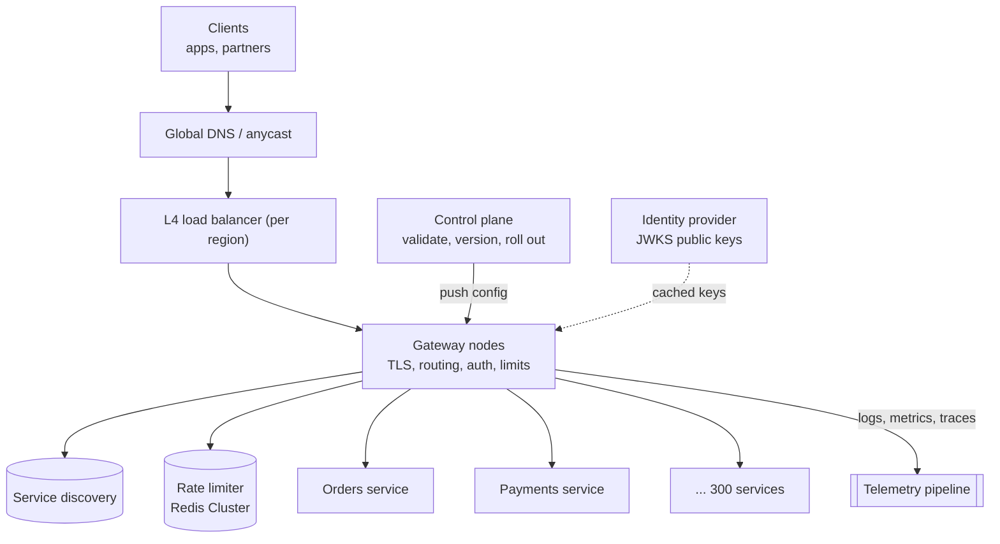
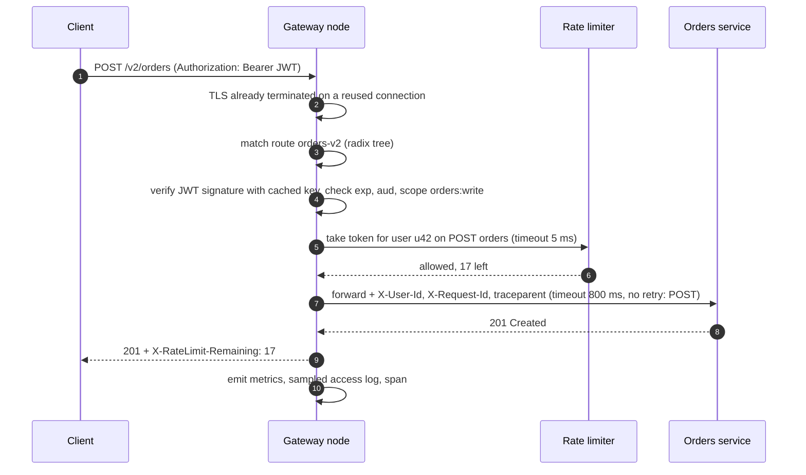
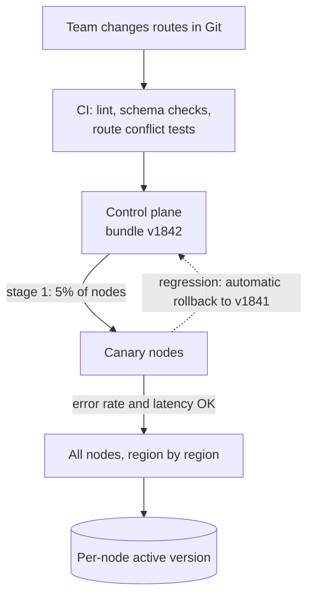
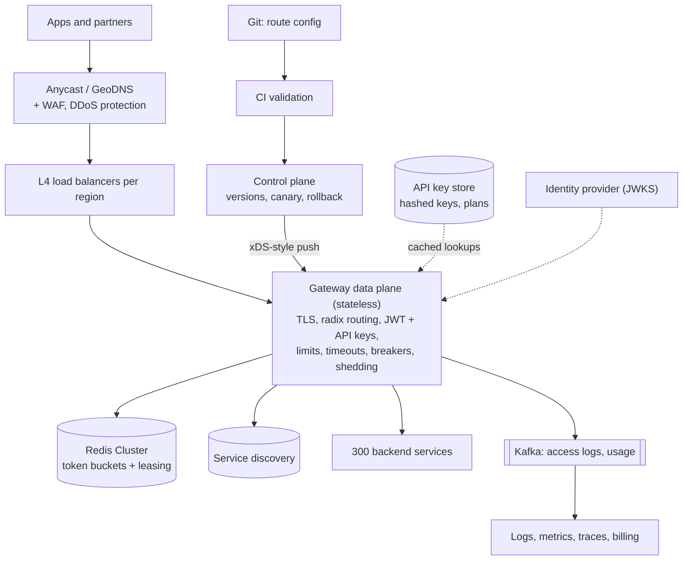

## Problem statement

Design the API gateway for a company with hundreds of microservices: every external request — from mobile apps, web apps and partner
integrations — enters through it. The gateway terminates TLS, authenticates callers, applies rate limits per client and plan, routes to the
right service, protects services from failures and overload, and records what happened — while adding only a few milliseconds of latency
and never becoming the outage itself.

**Interview format:** 45–60 minutes · **Difficulty:** intermediate · **Main themes:** data plane vs control plane, edge authentication,
distributed rate limiting, resilience to backend failures, configuration rollout, observability.

> [!TIP] Try it first
> Before scrolling, spend three minutes writing the questions you would ask the interviewer. Then compare with the list below — or
> practise this whole problem as a [timed mock interview](#system-design/hld/interview/api-gateway).

## Clarifying questions

The answers below are the interviewer's. Questions that change the design come first.

- **Q:** Which responsibilities belong to the gateway? <!-- match: responsibilities, scope, features, what does it do, functionality -->
  - **A:** TLS termination, routing, authentication, rate limiting, request validation basics, timeouts and retries, and logging/metrics.
    Business logic and response aggregation stay in services or backend-for-frontend layers.
- **Q:** How much traffic? <!-- match: traffic, scale, rps, qps, requests per second, volume, how many -->
  - **A:** About 500,000 requests per second on average, 1.5 million at peak, across 300 backend services.
- **Q:** How much latency may the gateway add? <!-- match: latency, overhead, ms, fast, added latency -->
  - **A:** Under 10 ms at p99, excluding backend time.
- **Q:** Who are the clients and how do they authenticate? <!-- match: clients, authentication, auth, api keys, tokens, oauth, jwt, partners -->
  - **A:** First-party apps use OAuth 2.0 access tokens (JWTs); partners use API keys tied to plans with quotas.
- **Q:** What rate limits are needed? <!-- match: rate limits, rate limiting, quotas, plans, throttling, limits -->
  - **A:** Per API key and plan (for example 1,000 requests per minute), per user for some endpoints, and global protection per service.
- **Q:** How often does routing configuration change? <!-- match: config, configuration, routes change, deploy, how often, dynamic -->
  - **A:** Teams add or change routes many times a day; changes must apply within a minute without restarting the gateway.
- **Q:** Which protocols? <!-- match: protocols, grpc, websockets, http2, streaming -->
  - **A:** HTTPS (HTTP/1.1 and HTTP/2), gRPC, and some WebSocket endpoints.
- **Q:** What availability is expected, and where are users? <!-- match: availability, regions, global, uptime, sla -->
  - **A:** 99.99%, with users worldwide served from three regions.

## Functional requirements

> [!TIP] Try it first
> Write three or four functional requirements before reading on.

- **Route** each request to the right service and version based on host, path and headers. <!-- match: route, routing -->
- **Authenticate** callers (JWTs and API keys) and enforce coarse **authorisation** (scopes). <!-- match: authenticate, auth, authorisation -->
- **Rate-limit** by key, plan, user and service. <!-- match: rate limit, rate-limit, quota -->
- **Protect backends** with timeouts, retries, circuit breakers and load shedding. <!-- match: protect, timeouts, circuit breakers, resilience -->
- **Observe** every request: logs, metrics and tracing. <!-- match: observe, logs, metrics, tracing -->

````hint title="Hint: per-request work"
List everything the gateway must do for each request. Which of those steps need a network call, and which can be done from local memory?
````

## Non-functional requirements

- **Low overhead**: under 10 ms p99 added. <!-- match: latency, overhead, 10 ms -->
- **High availability**: 99.99%; the gateway must not be a single point of failure. <!-- match: availability, 99.99, single point -->
- **Scale**: 1.5M requests/s at peak, horizontally. <!-- match: scale, peak, horizontally -->
- **Safe, fast configuration changes** without restarts. <!-- match: configuration, config, without restarts -->
- **Security**: TLS everywhere, no unauthenticated access to protected routes. <!-- match: security, tls, secure -->

````hint title="Hint: blast radius"
Every request passes through the gateway. What does that imply for how you deploy changes to it?
````

## Scope and exclusions

In scope: edge load balancing, gateway data plane, control plane and config distribution, authentication, rate limiting, resilience,
observability, multi-region.

Out of scope: the identity provider itself (issuing tokens), internal service-to-service traffic (a service mesh), business-level response
aggregation (BFFs), WAF rule authoring.

## Capacity estimation

> [!TIP] Try it first
> Estimate gateway nodes, rate-limiter operations and log volume.

- **Nodes:** with TLS, JWT validation and routing, a node handles on the order of 20,000 requests/s; at 60% target utilisation, 1.5M ÷
  12,000 ≈ **125 nodes** across three regions, plus headroom to lose a region (another ~60).
- **Rate limiting:** a central check per request is **1.5M operations/s** on the limiter store; leasing tokens in batches of 20 cuts that to
  ~75,000/s ([distributed rate limiting](lesson:distributed-rate-limiting)).
- **TLS:** most connections are long-lived (HTTP/2, keep-alive), so handshakes are a small fraction of requests; session resumption keeps
  them cheap.
- **Logs:** 1.5M requests/s × ~1 KB ≈ **1.5 GB/s** of access logs (130 TB/day) — sample successful requests, keep all errors.
- **Config:** ~300 services × tens of routes = thousands of routes and plugins; a few MB of config per node.

```estimator title="API gateway (requests)"
requestsPerDay = 43.2B
readsPerWrite = 0
writeBytes = 1 KB
readBytes = 1 KB
retentionYears = 0.04
peakFactor = 3
replication = 2
cachePercent = 0
serverRps = 20000
targetUtilization = 60
```

Each request is modelled as one write of ~1 KB of access log (storage reflects about two weeks of logs with two copies, before sampling).
The server count is the gateway fleet before regional headroom.

**What the numbers mean for the design:**

- **Every per-request network call matters**: auth and routing must be local; rate limiting needs leasing or a very fast store.
- **The fleet is large and stateless**: configuration must reach 200 nodes consistently and quickly.
- **Logs are a big data pipeline of their own**: sample and ship asynchronously ([logging system](problem:logging-system)).

````hint title="Hint: auth without a network call"
How can a node verify a JWT for 1.5M requests per second without asking the identity provider each time?
````

## API design

> [!TIP] Try it first
> The gateway's "API" is its configuration. Define a route and the admin operations around it.

```text title="API"
Route configuration (declarative, versioned in Git, applied through the control plane)
  route: orders-v2
    match:     host api.example.com, path prefix /v2/orders, methods GET POST
    upstream:  orders-service (discovered), timeout 800 ms, retries 1 (GET only), circuit breaker
    auth:      jwt (issuer https://id.example.com, scopes orders:read | orders:write) OR api_key
    limits:    per api_key by plan (free 60/min, pro 1,000/min), per user 20/s on POST
    transform: strip internal headers, add X-Request-Id, traceparent

Admin API (control plane)
  POST   /admin/v1/config/validate     { bundle }          -> errors / warnings
  POST   /admin/v1/config/rollouts     { bundle_version, strategy: canary 5% -> 100% }
  GET    /admin/v1/config/rollouts/{id}                    -> per-node versions, error rates
  POST   /admin/v1/config/rollouts/{id}/rollback
  POST   /admin/v1/api-keys            { partner_id, plan }  -> key shown once (stored hashed)
```

- Clients see only the public API; responses carry `X-RateLimit-*` headers, `Retry-After` on 429, and a request ID for support.

````hint title="Hint: config is code"
A bad route rule could send all traffic to the wrong service. How do you validate, roll out and roll back configuration?
````

## Data model

> [!TIP] Try it first
> What state does a gateway node need, and where does it come from?

```text title="Schema"
Control plane (source of truth)
  config_bundles  (version PK, routes, upstreams, plugins, created_by, created_at, status)
  api_keys        (key_hash PK, partner_id, plan, scopes, status, created_at)
  plans           (plan PK, limits per route group)
  rollouts        (rollout_id, bundle_version, stage, started_at, status)

Gateway node (in memory)
  active config version + compiled route table (trie / radix tree on host+path)
  JWKS signing keys (cached, refreshed on rotation)
  API key cache: key_hash -> plan, scopes (TTL ~60 s, negative caching for unknown keys)
  token buckets (leased) for the hottest keys

Rate limiter store: Redis Cluster, buckets keyed by {api_key}:{route_group}
```

- Nodes hold **everything needed per request in memory**; the control plane is off the request path.
- API keys are stored **hashed**, like passwords ([authentication](lesson:auth)).

````hint title="Hint: control plane outage"
If the control plane is down for an hour, should the gateway stop serving traffic?
````

## Initial high-level architecture

Build the design one requirement at a time.

### Step 1: route traffic

Global DNS or anycast sends users to the nearest region; a layer-4 load balancer spreads connections over a fleet of **stateless gateway
nodes** (an Envoy-style proxy). Each node matches the request against a compiled route table and forwards it to a healthy instance of the
target service found through service discovery ([load balancers](lesson:load-balancers), [aggregation and discovery](lesson:aggregation-discovery)).

### Step 2: authenticate at the edge

JWTs are verified locally with the identity provider's public keys (cached and refreshed on rotation) — signature, expiry, issuer, audience
and scopes. API keys are hashed and looked up in a local cache backed by the key store. The gateway forwards a verified identity to
services in trusted headers.

### Step 3: rate-limit

Limits from the client's plan are enforced with token buckets in a Redis cluster, with local token leasing for hot keys and a short
timeout so the limiter can't slow the gateway.

### Step 4: control plane

A **control plane** validates configuration bundles, stores them with versions, and pushes them to nodes, which apply new versions
atomically without restarting; rollouts go canary-first.

````hint title="Hint: atomic config"
What happens if a node applies half of a new route table?
````

## Architecture diagram



## Request and data flow



## Component responsibilities

| Component | Responsibility | Scales with |
|---|---|---|
| Global DNS / anycast | Send users to a healthy, nearby region | Regions |
| L4 load balancer | Spread TCP/TLS connections over gateway nodes | Connections |
| Gateway node (data plane) | TLS, routing, auth, limits, resilience, telemetry | Requests/s |
| Control plane | Validate, version, distribute and roll back configuration | Config changes |
| Rate limiter store | Token buckets per key and route group | Limit checks/s |
| Key store / identity provider | API keys (hashed), JWKS signing keys | Clients |
| Telemetry pipeline | Logs, metrics, traces to storage and dashboards | Requests/s |

## Database and technology choices

| Need | Choice | Why | Alternative |
|---|---|---|---|
| Data plane | Envoy-based proxy (or NGINX/Kong, Spring Cloud Gateway) | High performance, dynamic config, HTTP/2, gRPC, WebSockets | Managed gateways (AWS API Gateway) |
| Config distribution | Control plane pushing versioned config (xDS-style) | Fast, consistent, no restarts | Polling a config store |
| Config source of truth | Git + database of approved bundles | Review, history, rollback | Database only |
| Rate limiting | Redis Cluster + Lua token buckets, local leasing | Shared limits at high rate | Envoy global rate-limit service |
| API keys | Relational store, hashed keys, cached at nodes | Strong consistency for revocation | Key-value store |
| Telemetry | Metrics system, tracing (OpenTelemetry), logs via Kafka | Standard pipeline | Vendor APM |

## Scaling strategy

### Why separate the data plane from the control plane?

The **data plane** (gateway nodes) handles every request and must be fast, simple and independent; the **control plane** handles
configuration, which changes rarely by comparison. Nodes keep serving with their last good configuration if the control plane is down — a
control-plane outage only blocks changes, never traffic. Data-plane nodes are stateless and scale horizontally behind the L4 load balancer.



### How does authentication stay fast?

JWT verification is local CPU work: validate the signature with cached public keys (refetched when an unknown key ID appears, which is how
key rotation is picked up), and check expiry, issuer, audience and scopes. Short token lifetimes (minutes) limit the damage of stolen
tokens without needing a revocation check per request. API keys are hashed and cached for about a minute; revoking a key invalidates its
cache entry via a broadcast, so revocation takes effect within seconds.

### How is rate limiting done at 1.5M requests/s?

Token buckets live in a Redis cluster keyed by `{api_key}:{route_group}` and are updated atomically by a Lua script. For hot keys, nodes
lease small batches of tokens and spend them locally, cutting limiter traffic by an order of magnitude while bounding over-admission. The
limiter call has a ~5 ms timeout; if it fails, ordinary quotas fail open and security-sensitive limits (login, OTP) fail closed.

### How does the gateway protect backends?

Per route: timeouts from latency budgets, retries only for idempotent methods with jitter and a retry budget, circuit breakers and
outlier ejection per upstream, concurrency limits per upstream, and priority-based load shedding when the fleet itself is overloaded
([timeouts and retries](lesson:timeouts-retries), [circuit breakers](lesson:circuit-breakers-bulkheads),
[graceful degradation](lesson:graceful-degradation)).

### How are long-lived connections handled?

HTTP/2 and gRPC multiplex many requests per connection; WebSockets pin a connection to a node for its lifetime. Nodes are drained gracefully
on deploys (stop accepting new connections, let existing ones finish or ask clients to reconnect), and the L4 balancer spreads new
connections by least connections rather than round robin.

## Caching strategy

### What does the gateway cache?

- **Configuration** (compiled route tables) and **JWKS keys** in memory.
- **API key lookups** with short TTLs and negative caching for invalid keys (stops brute-force attempts hammering the key store).
- **Optional response caching** for explicitly cacheable public GETs, honouring `Cache-Control` — most caching belongs to the CDN and
  services, not the gateway.

## Messaging strategy

### Where are queues used?

Off the request path only: access logs and audit events flow to Kafka for the logging pipeline and billing (usage per API key per plan);
configuration changes publish events so dashboards and on-call channels see rollouts. Usage metering for partner billing aggregates from
the same log stream ([write-heavy systems](lesson:write-heavy)).

## Failure scenarios

| Failure | Impact | Mitigation |
|---|---|---|
| Gateway node crash | Its connections drop | L4 health checks remove it; clients reconnect; spare capacity |
| Bad configuration pushed | Wrong routing or rejected traffic | Validation, canary rollout, automatic rollback on error-rate rise |
| Control plane down | No config changes | Nodes keep last good config; changes wait |
| Rate limiter (Redis) down | Limit checks fail | Timeouts; fail open for quotas, closed for security limits |
| Identity provider down | New logins fail | Existing JWTs still verify locally with cached keys |
| Backend service failing | Errors and slow responses | Timeouts, circuit breaker, fallback error, no retry storms |
| Region outage | Traffic for the region lost | DNS/anycast failover to other regions with headroom ([failover](lesson:failover)) |

## Bottleneck analysis

- **CPU for TLS and JSON/JWT work** on gateway nodes — horizontal scaling, connection reuse, session resumption.
- **Rate-limiter round trips** — leasing and local pre-checks.
- **Configuration size and churn** — incremental config updates instead of full bundles.
- **Telemetry volume** — sampling and asynchronous shipping.

## Consistency and availability trade-offs

- **Availability over strict limits**: limits fail open (except security ones) and leasing tolerates small over-admission.
- **Eventually consistent configuration**: different nodes can briefly run different config versions during rollout; versions are
  tracked per node.
- **Revocation within seconds**, not instantly, for cached API keys; short-lived tokens bound exposure for JWTs.
- **The gateway stays thin**: no business logic, so its correctness concerns stay narrow.

## Security considerations

- TLS 1.2+ (prefer 1.3) at the edge, mTLS or private networking to services; HSTS for browsers.
- Validate JWT signature, algorithm (reject `none` and unexpected algorithms), issuer, audience, expiry and scopes.
- Strip client-supplied identity headers before adding verified ones, so callers can't impersonate users.
- Request size limits, header limits and basic schema validation; WAF and bot protection in front for abuse.
- API keys hashed at rest, shown once, scoped and rotatable; audit all admin actions.

## Monitoring and observability

- Per route and upstream: request rate, error rate, latency (gateway overhead separately from upstream time).
- Rate-limit decisions by key and plan; auth failures by reason.
- Config version per node; rollout progress and rollback events.
- Circuit breaker states; connection counts; TLS handshake rates.
- Distributed traces starting at the gateway with a request ID returned to clients.

## Final architecture

Open this after you have drawn your own.

````solution title="Final architecture"


**In one breath:** anycast or GeoDNS sends clients to the nearest region, where L4 load balancers spread connections over a stateless
gateway fleet; each node terminates TLS, matches routes in an in-memory radix tree, verifies JWTs locally with cached keys and API keys
from a hashed, cached store, takes tokens from a Redis-based limiter with local leasing and fail-open rules, and forwards with per-route
timeouts, retries only for idempotent calls, circuit breakers and load shedding; a separate control plane validates configuration from Git
and rolls it out canary-first with automatic rollback, nodes keep running on their last good config if it fails, and telemetry flows
asynchronously through Kafka.
````

## Alternative designs and trade-offs

| Alternative | Gains | Costs | When to choose it |
|---|---|---|---|
| Managed API gateway (cloud) | No fleet to run, built-in keys and plans | Cost per request at high volume, limits, less control | Low to moderate traffic |
| Gateway per team / domain | Independent ownership and blast radius | Duplicated cross-cutting logic | Large organisations |
| Service mesh only | Uniform internal policies | Not designed as a public edge | Internal traffic |
| Aggregation in the gateway | Fewer client calls | Business logic at the edge, bigger blast radius | Small systems; otherwise use BFFs |
| Opaque tokens with introspection | Instant revocation | Network call per request (cache it) | High-security APIs |

## Interviewer follow-up questions

````question title="How do you roll out a configuration change safely to 200 gateway nodes?"
Treat configuration as code: changes go through review and CI validation (schema, route conflicts, upstream existence). The control plane
creates an immutable versioned bundle and pushes it to a small canary slice of nodes first, compares error rates and latency against the
rest, then proceeds region by region. Nodes swap configuration atomically and report their active version. Any regression triggers an
automatic rollback to the previous version, which is just another push.
````

````question title="The identity provider is down. What still works?"
Requests with valid, unexpired JWTs keep working, because the gateway verifies signatures locally using cached public keys. New logins and
token refreshes fail until the provider recovers, so users whose tokens expire are affected gradually. API-key traffic is unaffected since
keys are cached locally and backed by the gateway's own key store. Short token lifetimes are the trade-off: safer, but more dependent on the
provider being up.
````

````question title="How would you add per-tenant usage billing?"
Every request already produces an access log with the API key, route and status. Stream those logs through Kafka into an aggregator that
counts billable requests per key per hour, idempotently, and writes totals to a billing store. The gateway itself only tags requests; the
pipeline is asynchronous so billing never adds latency or blocks traffic, and raw logs allow recomputation.
````

````question title="One partner sends 50 times its normal traffic. What protects everyone else?"
Its API key's token bucket rejects the excess with 429 and Retry-After at the gateway, before any backend sees it; leasing keeps those
checks cheap. If it's an attack rather than a bug, edge protections (WAF, IP limits) drop traffic even earlier. Per-upstream concurrency
limits and load shedding protect services from any remaining spike, and alerts tell the partner's account team.
````

````question title="Should the gateway retry failed backend calls?"
Only safely: for idempotent methods, on transient errors, at most once, with jitter, within the route's timeout and under a retry budget —
and only if the services behind it don't also retry, to avoid multiplying load. POSTs are retried only if they carry an idempotency key the
service honours. Circuit breakers stop retries altogether when an upstream is clearly failing.
````

## Common mistakes

- **Putting business logic** or response aggregation in the gateway.
- **Calling the identity provider on every request** instead of verifying tokens locally.
- **Making the control plane a runtime dependency** of every request.
- **Pushing config to all nodes at once** without validation or rollback.
- **Retrying everything** at the gateway.
- **Synchronous logging** on the request path.

## Evaluation checklist

```checklist title="Evaluation checklist"
- Asked about responsibilities, traffic, latency budget, auth methods, limits, config churn and protocols
- Sized the gateway fleet, limiter operations and log volume
- Separated a stateless data plane from a control plane
- Verified JWTs locally with cached keys; hashed and cached API keys
- Designed distributed rate limiting with fail-open/fail-closed rules
- Protected backends with timeouts, safe retries, circuit breakers and shedding
- Rolled out configuration with validation, canaries and automatic rollback
- Planned multi-region routing and graceful draining of long-lived connections
- Shipped telemetry asynchronously with sampling
- Kept the gateway thin and explained its security responsibilities
```
