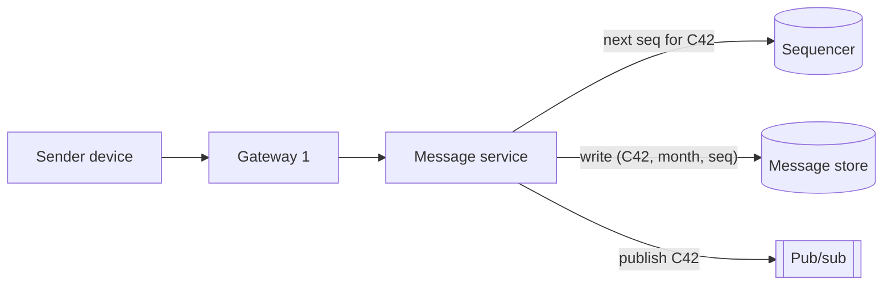
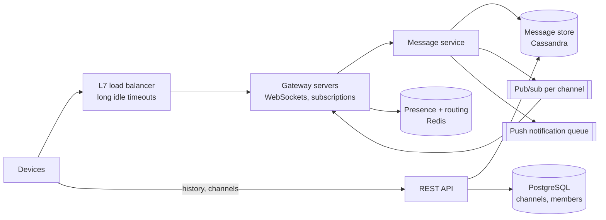
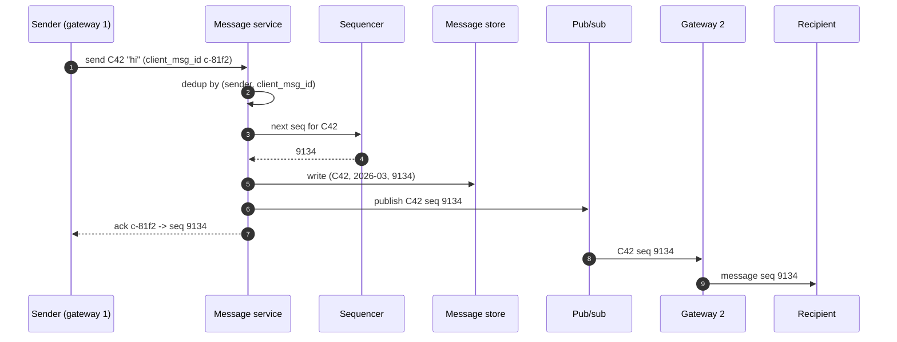
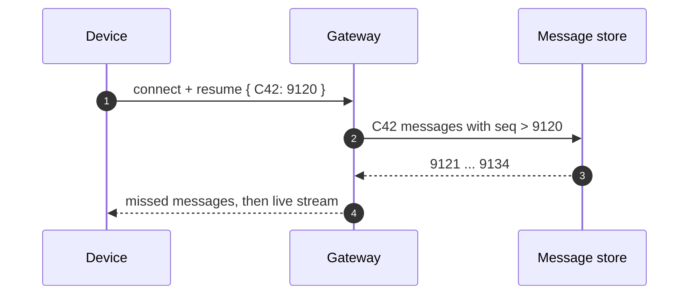
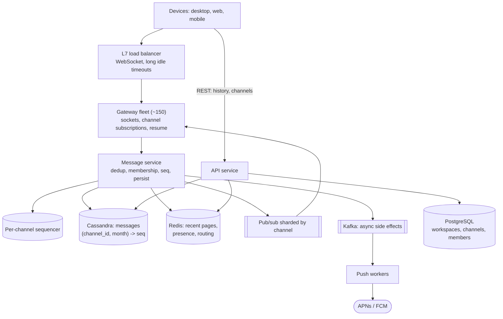

## Problem statement

Design a workplace chat application like Slack. People in a workspace send messages in channels (and direct messages), see new messages
in real time on all their devices, scroll back through history, and see who is online and how many unread messages each channel has.

**Interview format:** 45–60 minutes · **Difficulty:** intermediate · **Main themes:** a stateful connection tier, pub/sub fan-out,
per-channel ordering, partitioned message storage, presence and unread counts.

> [!TIP] Try it first
> Before scrolling, spend three minutes writing the questions you would ask the interviewer. Then compare with the list below — or
> practise this whole problem as a [timed mock interview](#system-design/hld/interview/chat-application).

## Clarifying questions

The answers below are the interviewer's. Questions that change the design come first.

- **Q:** What scale are we designing for? <!-- match: scale, users, how many, traffic, volume, dau, messages per day -->
  - **A:** About 20 million daily active users across many workspaces, each sending around 40 messages a day. Usage follows the working day.
- **Q:** How big can a channel get? <!-- match: channel size, members, large channel, how big, group size -->
  - **A:** Most channels have tens of members; some company-wide channels have up to 100,000 members.
- **Q:** How fast must messages arrive? <!-- match: latency, real time, fast, delay, how quickly -->
  - **A:** Recipients who are online should see a message within about half a second.
- **Q:** Must messages appear in the same order for everyone? <!-- match: order, ordering, sequence, same order -->
  - **A:** Yes, within a channel everyone must see the same order, and nothing may be lost or duplicated.
- **Q:** How long is history kept, and must it be searchable? <!-- match: history, retention, keep, search, scroll back, archive -->
  - **A:** Kept indefinitely and scrollable. Full-text search is out of scope today.
- **Q:** Multiple devices per user? <!-- match: devices, multiple devices, phone, desktop, sync, multi-device -->
  - **A:** Yes — desktop, web and mobile at the same time; read state syncs across them.
- **Q:** Do we need presence and typing indicators? <!-- match: presence, online, typing, status, away -->
  - **A:** Online/away presence, yes. Typing indicators are nice to have.
- **Q:** What about unread counts and notifications? <!-- match: unread, badge, count, notifications, push, mentions -->
  - **A:** Show unread counts per channel; mobile push notifications for direct messages and mentions when the app isn't open.
- **Q:** Threads, reactions, file uploads? <!-- match: threads, reactions, files, attachments, images, edit -->
  - **A:** Reactions and edits are nice to have; threads and files are out of scope (assume files go to object storage elsewhere).

## Functional requirements

> [!TIP] Try it first
> Write three or four functional requirements before reading on.

- Users can **send messages** to channels and direct conversations. <!-- match: send, message, post -->
- Online members **receive new messages in real time** on all their devices. <!-- match: receive, real time, deliver, live -->
- Users can **load channel history**, newest first, scrolling back. <!-- match: history, scroll, load, previous -->
- Users see **unread counts** and **presence**. <!-- match: unread, presence, online -->

````hint title="Hint: what makes this different from a request/response app?"
The server must push messages to clients that didn't ask for them, and every connected client is attached to one particular server. How do
messages find the right servers?
````

## Non-functional requirements

- **Low latency**: delivered to online recipients within ~500 ms. <!-- match: latency, 500 ms, real time -->
- **Ordering**: one consistent order per channel; **no loss, no duplicates** visible to users. <!-- match: order, ordering, no loss, duplicates -->
- **Scale**: 20M DAU, ~800M messages a day, channels up to 100K members, millions of concurrent connections. <!-- match: scale, million, concurrent -->
- **Durability**: a message acknowledged to the sender is never lost. <!-- match: durable, durability, never lost -->
- **High availability** for sending and receiving (99.95%+). <!-- match: availability, available, uptime -->

````hint title="Hint: what does 'nothing lost' require on the client?"
Connections drop all the time on mobile. After reconnecting, how does a client know which messages it missed?
````

## Scope and exclusions

In scope: channels and direct messages, real-time delivery, history, multi-device sync, unread counts, presence, push notifications for
mentions and DMs.

Out of scope: full-text search, threads, file storage (assume a separate upload service), voice and video, enterprise compliance exports.

## Capacity estimation

> [!TIP] Try it first
> Estimate messages per second, deliveries per second, concurrent connections and storage per year.

- **Messages:** 20M × 40 = 800M a day ≈ **9,300/s** average, **~28,000/s** at the working-day peak.
- **Deliveries:** if an average message reaches ~15 online recipients (devices), ~140,000 deliveries/s average, **~420,000/s** at peak.
- **Concurrent connections:** users keep the app open through the working day — roughly 20M × 9/24 ≈ **7.5M** on average, ~12M at peak.
  At ~100,000 connections per gateway server, ~120 servers at peak (plus headroom).
- **Storage:** ~500 bytes per message (text + metadata) → 400 GB/day → **~146 TB a year** before replication.
- **History reads:** each user opens ~50 channels a day → 1B page loads a day ≈ **11,600/s** average.

```estimator title="Group chat"
requestsPerDay = 1.8B
readsPerWrite = 1.25
writeBytes = 500 B
readBytes = 25 KB
retentionYears = 5
peakFactor = 3
replication = 3
cachePercent = 10
serverRps = 2000
targetUtilization = 60
```

Writes are messages (800M/day); reads are history pages of ~50 messages (1B/day). Real-time deliveries aren't requests in this model —
they flow over open connections.

**What the numbers mean for the design:**

- **~28K writes/s with indefinite retention** → a partitioned, write-friendly message store (wide-column), not one relational primary.
- **~420K deliveries/s over ~12M connections** → a dedicated connection (gateway) tier, with pub/sub to route messages to the right servers.
- **100K-member channels** → fan-out must target only servers that have members online, not every member.

````hint title="Hint: storage per year"
800M messages × 500 bytes a day, kept forever. Does that fit comfortably on one database primary for five years?
````

## API design

> [!TIP] Try it first
> Which operations are request/response, and which flow over the persistent connection?

```text title="API"
WebSocket  wss://chat.example/connect?token=...      (one per device)
  client -> server
    { "type": "send", "client_msg_id": "c-81f2", "channel_id": "C42", "text": "hi" }
    { "type": "ack_read", "channel_id": "C42", "seq": 9134 }
    { "type": "resume", "cursors": { "C42": 9120, "C77": 551 } }   after reconnecting
  server -> client
    { "type": "message", "channel_id": "C42", "seq": 9134,
      "msg_id": "m-...", "user": "U7", "text": "hi" }
    { "type": "ack", "client_msg_id": "c-81f2", "seq": 9134 }
    { "type": "presence", "user": "U9", "status": "online" }

REST
GET  /v1/channels/{id}/messages?before_seq=9120&limit=50     -> history page, newest first
GET  /v1/users/me/channels                                  -> channels with unread counts
POST /v1/channels/{id}/messages                             -> send (fallback when no socket)
```

- `client_msg_id` makes **sending idempotent**: a resend after a dropped ack returns the same `seq` instead of a duplicate.
- Per-channel **`seq`** (sequence number) defines the order and lets clients detect gaps and **resume** from their last seen `seq`.

````hint title="Hint: why a per-channel sequence number?"
Timestamps from different servers don't give a reliable order. What gives every message in a channel a position that all clients agree on,
and makes gaps obvious?
````

## Data model

> [!TIP] Try it first
> What is written most, what is read most, and which key keeps a channel's messages together and in order?

```text title="Schema"
messages  (Cassandra / ScyllaDB)
  partition key: (channel_id, bucket)        bucket = month, bounds partition size
  clustering:    seq DESC
  columns:       msg_id, sender_id, text, created_at, edited_at, deleted

channels, memberships, workspaces  (PostgreSQL)
  channels     (channel_id PK, workspace_id, name, type, last_seq)
  memberships  (channel_id, user_id, role, joined_at)   PK (channel_id, user_id), index on user_id

read state  (key-value)
  read_cursor[user_id][channel_id] = last_read_seq

presence  (Redis, TTL)
  presence:{user_id} = online|away   expires 60 s unless heartbeats renew it

routing  (Redis)
  channel:{channel_id}:servers = set of gateway servers with members online
```

- **Unread count** = `channel.last_seq − read_cursor` — no per-user counters to update on every message.
- Messages are partitioned by **channel and month**, ordered by `seq`, so "latest 50" and "50 before seq X" are single-partition reads.

````hint title="Hint: unread counts without a write per recipient"
With 100,000 members, incrementing an unread counter per member per message is 100,000 writes. What two numbers give the unread count
instead?
````

## Initial high-level architecture

Build the design one requirement at a time.

### Step 1: connect

Each device opens a WebSocket to a **gateway server** through an L7 load balancer. The gateway authenticates the token, registers which
channels this connection's user belongs to, and subscribes to those channels' pub/sub topics.

### Step 2: send a message

The client sends `send` over its socket. The gateway forwards it to the **message service**, which checks membership, assigns the next
**per-channel sequence number**, writes the message to the store, and publishes it to the channel's topic. It then acks the sender with the
`seq`.



### Step 3: deliver in real time

Every gateway with members of `C42` online is subscribed to `C42`; it receives the message and pushes it to its connected members' sockets.

### Step 4: history, unread and presence

History is a REST call reading the message store by `(channel_id, bucket)` and `seq`. Unread counts compare `last_seq` with read cursors.
Presence is heartbeats into Redis with a TTL, broadcast to interested gateways.

````hint title="Hint: how does a message reach the right gateways?"
Gateways subscribe to the channels of the users connected to them. Publishing to a channel then reaches exactly the gateways that have
members online.
````

## Architecture diagram



## Request and data flow

Sending and delivering a message:



Reconnecting after a drop:



## Component responsibilities

| Component | Responsibility | Scales with |
|---|---|---|
| L7 load balancer | TLS, WebSocket upgrade, long idle timeouts | Connections |
| Gateway servers | Hold sockets, authenticate, subscribe to channels, push messages, heartbeats | Concurrent connections (~12M) |
| Message service | Membership check, dedup, sequence, persist, publish, trigger push | Messages/s (~28K peak) |
| Sequencer | Monotonic per-channel `seq` | Messages/s; partitioned by channel |
| Message store | Durable history partitioned by channel and month | Writes and storage (~146 TB/year) |
| Pub/sub | Route channel messages to subscribed gateways | Deliveries/s |
| Presence + routing (Redis) | Online status with TTL; channel → gateways map | Connected users |
| PostgreSQL | Workspaces, channels, memberships | Metadata size |
| Push workers | Mobile notifications for offline users (DMs, mentions) | Notification volume |

## Database and technology choices

| Need | Choice | Why | Alternative |
|---|---|---|---|
| Message history | Cassandra / ScyllaDB | Write-heavy, partition by channel+month, ordered by seq, scales horizontally | Sharded PostgreSQL by channel_id |
| Channels, members | PostgreSQL | Relational, modest size, transactional membership changes | — |
| Sequencing | Per-channel counter in a partitioned store (or the channel's partition owner) | Total order per channel, cheap | Timestamps (unsafe) |
| Pub/sub | Redis pub/sub cluster or a NATS-style broker, sharded by channel | Low-latency fan-out to gateways | Kafka (higher latency per hop, great for durability) |
| Presence | Redis with TTLs | Ephemeral, high write rate | Gossip among gateways |
| Transport | WebSockets | Two-way, low overhead; clients send often | SSE + REST (simpler, one-way push) |

## Scaling strategy

### How do messages reach the right connections?

A gateway holds ~100,000 sockets; a channel's online members are spread across many gateways. Options:

- **Broadcast every message to every gateway**: simple; at 28K messages/s × 120 gateways it wastes most work, and it gets worse as the fleet
  grows.
- **Per-user routing** (look up each recipient's gateway): precise, but a 100K-member channel means 100K lookups per message.
- **Per-channel subscriptions (chosen)**: each gateway subscribes to the channels its connected users belong to; a publish reaches only those
  gateways, which push to their local members. A 100K-member channel with members on 120 gateways costs 120 deliveries, not 100,000.

Shard the pub/sub layer by channel ID so no single node carries all traffic. When a user connects, the gateway subscribes to any of their
channels it isn't already subscribed to; when the last member disconnects, it unsubscribes.

### How is per-channel ordering guaranteed?

Every message gets the next integer `seq` for its channel from a single owner per channel — e.g. an atomic counter on the channel row in a
partitioned store, or the message service instance that owns that channel's partition (routing by `hash(channel_id)`). Messages are stored
and delivered with `seq`; clients render by `seq`, buffer out-of-order arrivals briefly, and fetch gaps from history. Different channels are
sequenced independently, so throughput scales with the number of channels.

### How does delivery survive disconnects without loss or duplicates?

- **Sender side:** the client retries `send` until it receives an ack; `client_msg_id` deduplicates retries, returning the original `seq`.
- **Receiver side:** clients store the last `seq` they've seen per channel and send `resume` on reconnect; the gateway replays everything
  after it from the store, then switches to live delivery. Live messages with `seq` ≤ the last seen are ignored.
- **Durability:** the message is written to the replicated store **before** it's acknowledged or published, so a published message can
  always be re-read.

### How do we scale storage and history reads?

Partition by `(channel_id, month)` so partitions stay bounded even for channels with years of history, and "the latest 50 messages" is a
single-partition read in `seq` order. Very busy channels (company-wide) still fit: 100K members don't increase writes — only messages do.
Cache the latest page of busy channels in Redis to absorb the burst when everyone opens the channel after an announcement.

## Caching strategy

### What do we cache?

- **Recent messages per channel** (the latest one or two pages) in Redis, appended on publish and trimmed — most history loads hit only the
  latest page.
- **Membership and channel metadata** in each gateway and message service instance, invalidated on membership changes, so permission checks
  don't hit PostgreSQL on every message.
- **Presence** lives only in Redis with TTLs — it's cache-shaped data by nature.
- Unread counts are **computed**, not cached per user: `last_seq` per channel is tiny and hot; read cursors are per user.

## Messaging strategy

### What is synchronous, what is asynchronous?

- **Synchronous** on the send path: dedup, sequence, durable write, then ack — the sender must know the message is saved.
- **Real-time fan-out** through pub/sub is fire-and-forget: if a gateway misses a publish (restart, blip), clients recover via `resume`, so
  pub/sub doesn't need to be durable.
- **Asynchronous** side effects via a durable queue (Kafka or SQS): push notifications for offline users, mention processing, analytics,
  and (later) search indexing. These can lag and retry without affecting chat.

### How do push notifications work for offline users?

When a message mentions a user or is a DM, the message service enqueues a notification job. A worker checks presence (skip if any device is
online), preferences and muting, then sends via APNs/FCM. Notification jobs are idempotent by `(user, msg_id)`.

## Failure scenarios

| Failure | Impact | Mitigation |
|---|---|---|
| A gateway server crashes | Its ~100K connections drop | Clients reconnect with jittered backoff to other gateways and resume by `seq` |
| Pub/sub node fails | Some channels' live delivery pauses | Sharded, replicated pub/sub; clients detect gaps by `seq` and fetch history |
| Message store node fails | Writes for some partitions slow | Replication factor 3, quorum writes |
| Sequencer for a channel unavailable | Sends to that channel fail briefly | Fail over the owner; clients retry with the same `client_msg_id` |
| Reconnect storm after a deploy | Millions reconnect at once | Drain gateways gradually; jittered reconnect backoff |
| A 100K-member channel announcement | Burst of history reads | Recent-page cache per channel; delivery via subscribed gateways only |

## Bottleneck analysis

- **Connections** (~12M) dominate gateway capacity: memory per socket and heartbeat traffic.
- **Fan-out** to gateways scales with channels × gateways with members, not members — the per-channel subscription design is what keeps it
  tractable.
- **Sequencing** is per channel; a single very busy channel's sequence owner is its throughput limit (fine at chat rates).
- **Storage growth** (~146 TB/year) needs a horizontally scalable store and cold-tiering of old partitions.

## Consistency and availability trade-offs

- **Per-channel total order** via sequence numbers — strong where users notice it; no global order across channels (not needed).
- **Durable before visible**: messages are acknowledged and published only after the replicated write.
- **Real-time delivery is best-effort; completeness comes from resume**: availability of the live path doesn't compromise correctness.
- **Presence and unread counts** are eventually consistent — a few seconds of lag is fine.

## Security considerations

- Authenticate every WebSocket with short-lived tokens; re-check membership when subscribing to channels and on every send.
- Authorise history reads by membership; private channels must never leak through shared caches or pub/sub topics.
- Rate-limit sends per user and per channel to stop spam floods.
- Encrypt in transit (TLS) and at rest; enterprise customers may require data residency per workspace.

## Monitoring and observability

- End-to-end delivery latency (send → recipient receive) p50/p99 — the core SLO.
- Concurrent connections per gateway; connect/reconnect rates; resume volume (spikes reveal delivery gaps).
- Message write latency and error rate; pub/sub publish-to-receive lag.
- History read latency; cache hit ratio for recent pages.
- Push notification queue depth and delivery failures.

## Final architecture

Open this after you have drawn your own.

````solution title="Final architecture"


**In one breath:** devices hold WebSockets to a gateway fleet that subscribes to the channels of its connected users; the message service
deduplicates by client message ID, assigns a per-channel sequence number, persists to Cassandra partitioned by channel and month, then
publishes to a channel-sharded pub/sub that reaches only gateways with members online; clients resume from their last sequence number after
any disconnect; unread counts are `last_seq − read_cursor`; presence lives in Redis with TTLs; push notifications and other side effects
flow asynchronously through Kafka.
````

## Alternative designs and trade-offs

| Alternative | Gains | Costs | When to choose it |
|---|---|---|---|
| Broadcast every message to every gateway | Very simple routing | Wasted work grows with fleet × traffic | Small deployments |
| Kafka for real-time fan-out | Durable, replayable | Higher latency; gateways consuming many partitions | When delivery must be replayed from the broker itself |
| Sharded PostgreSQL for messages | Familiar, transactional | Write scaling and retention need careful partitioning | Smaller scale or strong SQL needs |
| SSE + REST instead of WebSockets | Plain HTTP, simpler infra | Separate send path; less efficient for chatty clients | One-way-heavy clients |
| Per-user inbox fan-out on write | Simple per-user reads | 100K writes per big-channel message | DM-only or small-group products |

## Interviewer follow-up questions

````question title="How would you add full-text search over message history?"
Index asynchronously: the message service publishes stored messages to Kafka, and an indexer writes them to a search cluster (OpenSearch or
Elasticsearch) partitioned by workspace, with channel IDs and permissions as filters. Queries are restricted to channels the user is a member
of, applied at query time from the membership service. Edits and deletes flow through the same pipeline. Search lags by seconds, which is
acceptable; the source of truth stays the message store.
````

````question title="A company-wide channel has 100,000 members and someone posts. What happens?"
The write path is unchanged — one sequenced, durable write and one publish. Fan-out goes only to gateways subscribed to that channel — at
most the size of the gateway fleet, not 100,000 — and each gateway pushes to its local members. Push notifications go only to mentioned or
DM'd users, not the whole channel. The real spike is history reads when everyone opens the channel, absorbed by caching the latest page.
Unread counts need no per-member writes because they're derived from the channel's last sequence number.
````

````question title="How do read states sync across a user's devices?"
Read cursors are stored per user and channel on the server. When any device marks a channel read up to seq N, the server updates the cursor
(monotonically — never moving it backwards) and publishes a read-state event on a per-user topic that all of that user's connected devices
subscribe to, so badges clear everywhere. Offline devices fetch cursors when they reconnect.
````

````question title="How would you support editing and deleting messages?"
Edits and deletes don't change a message's seq. The message service writes the new text or a tombstone to the same row and publishes an
'edited' or 'deleted' event with the message's seq; clients update it in place. Clients that were offline see the new state when they fetch
history; the recent-page cache is updated the same way. Audit requirements may need the edit history kept separately.
````

````question title="How do you handle typing indicators at scale?"
They're ephemeral and lossy by nature, so they never touch storage. A typing event is sent over the socket to the gateway, published on the
channel's topic with a short TTL, and rate-limited per user (say one event every few seconds). For very large channels, typing indicators are
disabled or only shown within threads or small channels, because 100K-member channels would generate huge fan-out for little value.
````

## Common mistakes

- **Ordering by timestamps** from different servers.
- **Writing an unread counter per member per message.**
- **Fanning out to every member** of a huge channel instead of to gateways.
- **No resume protocol**, so messages sent during a reconnect are lost.
- **Acknowledging before the message is durable.**
- **Storing messages in one relational primary** without considering ~150 TB a year of growth.

## Evaluation checklist

```checklist title="Evaluation checklist"
- Asked about scale, channel sizes, latency, ordering, history and multi-device behaviour
- Estimated messages/s, deliveries/s, concurrent connections and storage growth
- Separated a stateful gateway tier holding WebSockets from stateless services
- Routed messages to gateways via per-channel pub/sub subscriptions
- Guaranteed per-channel order with sequence numbers rather than timestamps
- Made sends idempotent with client message IDs and persisted before acknowledging
- Designed reconnect/resume by last sequence number so nothing is lost
- Partitioned message storage by channel and time bucket in a write-scalable store
- Derived unread counts from sequence numbers and read cursors instead of per-member counters
- Handled presence with TTLs and push notifications asynchronously
- Discussed gateway failures, reconnect storms and huge channels
```
