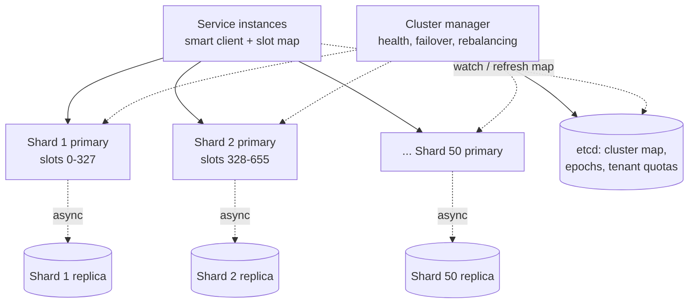
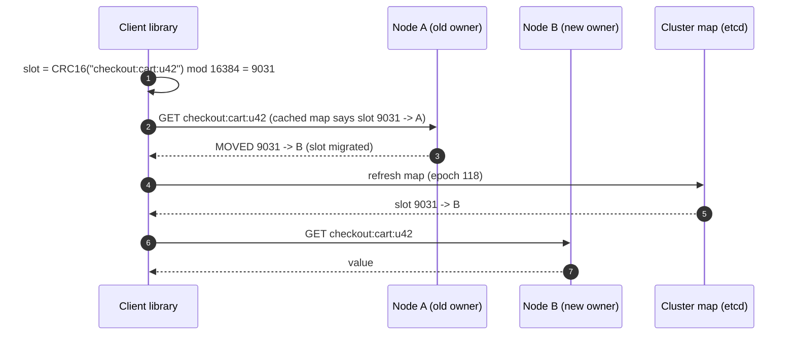
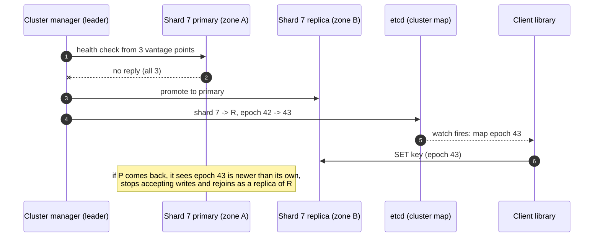
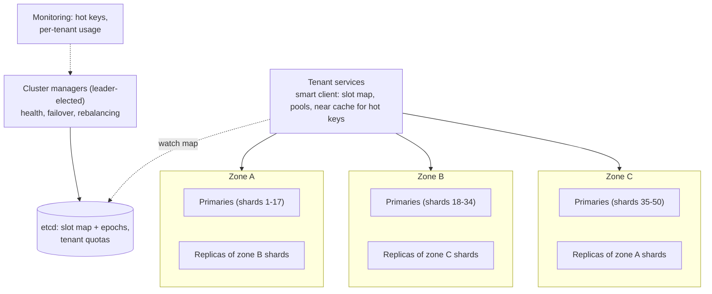

## Problem statement

Design a distributed in-memory cache — the kind of service Redis Cluster or a Memcached fleet provides — that many internal services share.
Clients get, set and delete keys with TTLs at sub-millisecond latency; the cluster holds terabytes in memory across many nodes, survives node
failures, rebalances as it grows, and copes with hot keys.

**Interview format:** 45–60 minutes · **Difficulty:** intermediate · **Main themes:** partitioning (hash slots / consistent hashing),
replication and failover, eviction, hot keys, cluster membership and rebalancing.

> [!TIP] Try it first
> Before scrolling, spend three minutes writing the questions you would ask the interviewer. Then compare with the list below — or
> practise this whole problem as a [timed mock interview](#system-design/hld/interview/distributed-cache).

## Clarifying questions

The answers below are the interviewer's. Questions that change the design come first.

- **Q:** What operations must the cache support? <!-- match: operations, api, commands, get, set, data types, features -->
  - **A:** Get, set (with TTL), delete, multi-get, and atomic increment. Simple string/binary values; rich data structures are out of scope.
- **Q:** How much data and how much traffic? <!-- match: scale, how much, data size, traffic, ops, qps, throughput, terabytes -->
  - **A:** About 10 TB of cached data in total, and up to 10 million operations a second at peak, about 90% reads.
- **Q:** What latency is expected? <!-- match: latency, fast, p99, milliseconds, sub-millisecond -->
  - **A:** p99 under 1 ms for clients in the same availability zone, excluding the network beyond the zone.
- **Q:** Is the cache a source of truth? Can data be lost? <!-- match: durable, durability, lose, lost, persistence, source of truth, loss, data loss, node dies -->
  - **A:** No. It's a cache in front of databases: losing data on a node failure is acceptable, but a node failure must not take the cache
    down or flood databases.
- **Q:** How consistent must reads be? <!-- match: consistency, consistent, stale, read your writes, replicas -->
  - **A:** A client that writes a key should normally read its own write. Briefly stale reads after a failover are acceptable.
- **Q:** How big are keys and values? <!-- match: size, value size, key size, large values, objects -->
  - **A:** Keys up to 250 bytes; values usually under 10 KB, up to 1 MB.
- **Q:** Who uses it — one service or many? <!-- match: tenants, multi-tenant, services, teams, isolation, many services -->
  - **A:** Many teams' services, each with its own namespace and expected size. One team's misbehaviour mustn't hurt others.
- **Q:** What should happen when memory is full? <!-- match: eviction, memory full, full, evict, lru, policy -->
  - **A:** Evict — least recently used is fine as a default.
- **Q:** Do we need to grow the cluster without downtime? <!-- match: grow, scale out, add nodes, rebalance, resharding, elastic -->
  - **A:** Yes, nodes are added and replaced regularly without interrupting clients.

## Functional requirements

> [!TIP] Try it first
> Write three or four functional requirements before reading on.

- Clients can **get, set (with TTL), delete, multi-get and increment** keys. <!-- match: get, set, delete, ttl, increment -->
- The cluster **evicts** entries when memory is full. <!-- match: evict, eviction, memory -->
- The cluster **scales out and rebalances** online, and **survives node failures**. <!-- match: scale, rebalance, failover, survive -->
- Each tenant gets a **namespace and quota**. <!-- match: tenant, namespace, quota -->

````hint title="Hint: where does routing logic live?"
A client must find the node holding a key in one hop. Is that knowledge in the client, in a proxy, or in the nodes themselves?
````

## Non-functional requirements

- **Low latency**: p99 under 1 ms in-zone. <!-- match: latency, p99, 1 ms -->
- **Scale**: 10 TB in memory, 10M ops/s at peak. <!-- match: scale, terabytes, million ops -->
- **High availability**: a node failure must not make keys unavailable for long or overload backends. <!-- match: availability, available, failure -->
- **Isolation** between tenants and resilience to **hot keys**. <!-- match: isolation, tenants, hot keys -->
- **Read-your-writes** in normal operation; brief staleness after failover is acceptable. <!-- match: read your writes, consistency, stale -->

````hint title="Hint: what does losing a node cost?"
Even if data loss is acceptable, what happens to the databases behind the cache when a node with 200 GB of hot data disappears?
````

## Scope and exclusions

In scope: client API, partitioning, replication and failover, eviction, rebalancing, multi-tenancy, hot keys, monitoring.

Out of scope: persistence to disk as a durability guarantee, rich data structures, cross-region replication (one cluster per region), and
transactions across keys.

## Capacity estimation

> [!TIP] Try it first
> How many nodes for memory, how many for throughput, and how much network?

- **Memory:** 10 TB of data. With ~256 GB nodes using ~200 GB for data (headroom for fragmentation, replication buffers and overhead),
  **~50 primary shards**.
- **Throughput:** 10M ops/s. At on the order of 200,000 simple operations/s per node, **~50 primaries** also cover the peak — memory and
  throughput point to the same size. Reads can also be served by replicas, adding capacity.
- **Replication:** one replica per primary → **~100 nodes** in total, spread over three availability zones.
- **Network:** 10M ops × ~1 KB ≈ 10 GB/s ≈ 80 Gbit/s across the cluster — ~1.6 Gbit/s per node over 50 primaries; fine for 10–25 Gbit/s
  NICs.
- **Per-key overhead:** with small values, tens of bytes of bookkeeping per key matter — 10 billion small keys would carry hundreds of GB of
  overhead alone.

```estimator title="Distributed cache (operations)"
requestsPerDay = 864B
readsPerWrite = 9
writeBytes = 1 KB
readBytes = 1 KB
retentionYears = 0
peakFactor = 1.5
replication = 2
cachePercent = 0
serverRps = 200000
targetUtilization = 60
```

The calculator's server count uses 200K operations/s per node at 60% target utilisation; memory sizing (10 TB) is separate because a cache's
size is set by capacity, not by retention.

**What the numbers mean for the design:**

- **~50 primaries plus replicas**: routing a key to the right node in one hop matters more than anything else.
- **Losing one node** drops ~2% of the cache; its misses must not overload backends.
- **Balance** matters: an uneven key distribution or one hot key can saturate a node while others idle.

````hint title="Hint: memory or throughput?"
Compute node counts both ways. If they disagree, the larger number wins — and the other resource has headroom.
````

## API design

> [!TIP] Try it first
> Define the client operations and what the client library does beyond sending commands.

```text title="API"
Client library (per language), speaking a binary protocol over persistent pooled TCP connections

get(key)                         -> value | miss
mget(keys[])                     -> map of hits   (split by shard, sent in parallel, merged)
set(key, value, ttl_seconds, [if_absent | if_version=v])
delete(key)
incr(key, delta, ttl_seconds)    -> new value

Keys are namespaced per tenant:  "{tenant}:{app_key}"   e.g. "checkout:cart:u42"
Errors: MOVED <slot> <node>  (client refreshes its slot map)
        OVERLOADED (back off), TOO_LARGE (> 1 MB)
```

- The **client library** holds the slot map, routes each key to its node, pools connections, splits multi-gets by shard, applies timeouts,
  and optionally keeps a tiny local cache for hot keys.

````hint title="Hint: smart client or proxy?"
A smart client routes in one hop but must be implemented in every language. A proxy works for any client but adds a hop. Which suits a
sub-millisecond target?
````

## Data model

> [!TIP] Try it first
> How is the key space divided, and where is the map of which node owns what?

```text title="Schema"
Key space: CRC16(key) mod 16384 -> hash slot   (like Redis Cluster)

Cluster map (etcd / ZooKeeper, versioned with an epoch)
  slot range -> shard id
  shard id   -> { primary: node, replicas: [nodes], epoch }
  tenants    -> { namespace, memory quota, ops quota }

On each node (in memory)
  hash table: key -> entry { value, expires_at, lru/lfu metadata, version }
  slab or jemalloc-managed memory; per-tenant usage counters
```

- **Fixed slots** decouple keys from nodes: rebalancing moves slots, not every key's hash
  ([consistent hashing](lesson:consistent-hashing)).
- The **cluster map** is small, consistent and versioned; clients cache it and refresh on `MOVED` or a newer epoch.

````hint title="Hint: why a fixed number of slots?"
If keys were mapped directly with hash mod N, what fraction would move when N changes from 50 to 51?
````

## Initial high-level architecture

Build the design one requirement at a time.

### Step 1: route and serve

A **smart client** hashes each key to a slot, finds the slot's primary in its cached cluster map, and sends the command over a pooled
connection. Each **cache node** stores entries in an in-memory hash table and serves requests from an event loop (with I/O threads for
networking).

### Step 2: replicate and fail over

Each shard has a primary and a replica in another zone; the primary streams writes asynchronously. A **cluster manager** watches health; on
primary failure it promotes the replica, bumps the shard's **epoch** in the consensus-backed map, and clients refresh their maps.

### Step 3: evict and expire

When a node reaches its memory limit, it evicts using approximate LRU (sampling); expired keys are removed lazily on access and by a
background sweep.

### Step 4: rebalance

Adding nodes moves slots: the source node streams a slot's keys to the target, then the map flips the slot's owner; during migration, the
source answers `MOVED`/`ASK` for keys already moved.

````hint title="Hint: who decides a node is dead?"
If clients each decided on their own, different clients would disagree about which replica is primary. Where should that decision be made?
````

## Architecture diagram



## Request and data flow



## Component responsibilities

| Component | Responsibility | Scales with |
|---|---|---|
| Client library | Hashing, routing, pooling, multi-get splitting, timeouts, retries, optional near cache | Client instances |
| Cache nodes | In-memory storage, TTLs, eviction, replication, slot migration | Memory and ops/s |
| Cluster manager | Health checks, failover decisions, rebalancing plans | Cluster size |
| Coordination store (etcd) | Authoritative cluster map with epochs; tenant quotas | Small, consistent data |
| Monitoring | Per-node, per-slot, per-tenant metrics; hot-key detection | Metrics volume |

## Database and technology choices

| Need | Choice | Why | Alternative |
|---|---|---|---|
| Node engine | Event loop + I/O threads, in-memory hash table | Simple, fast single-key operations | Multi-threaded engine with striped locks (Memcached-style) |
| Partitioning | 16,384 fixed hash slots | Rebalance by moving slots; small explicit map | Consistent-hash ring with virtual nodes |
| Membership and map | Consensus store (etcd/ZooKeeper) | One authoritative view with epochs | Gossip between nodes (Redis Cluster style) |
| Replication | Async primary → replica, cross-zone | Low write latency; loss acceptable | Sync (unnecessary for a cache) |
| Memory management | jemalloc / slab classes | Limit fragmentation | Default malloc (fragmentation risk) |

## Scaling strategy

### How are keys partitioned and found in one hop?

Keys map to one of 16,384 slots (`CRC16(key) mod 16384`), and slots map to shards in the cluster map. Smart clients cache the map, so every
request goes straight to the owning node — no proxy hop, which matters at a sub-millisecond budget. Hash tags (`{user42}:cart`,
`{user42}:prefs`) let a client force related keys into one slot for multi-key operations. A proxy tier (like Twemproxy or Envoy's Redis
proxy) remains an option for clients that can't run a smart library, at the cost of an extra hop.

### How does failover work without split brain?

The cluster manager (several instances, leader-elected via etcd) health-checks every node from multiple vantage points. When a primary is
confirmed down, it promotes the shard's replica and writes the new primary with an **incremented epoch** to etcd. Clients and nodes reject
commands tagged with an older epoch, so a partitioned old primary can't keep accepting writes from clients that switched. Writes acknowledged
by the old primary but not yet replicated are lost — acceptable for a cache, and documented.



### How do we rebalance online?

To move slot 9031 from A to B: B is marked "importing", A "migrating"; A streams the slot's keys to B in batches; during migration, a key A
no longer has gets an `ASK` redirect to B; when done, the map is updated (new epoch) and A answers `MOVED`. Moving a few slots at a time limits
extra load. Planned capacity changes are spread over hours.

### How do we handle hot keys?

One key (a viral product, a global config) can saturate its node. Defences:

- **Client-side near cache** for keys flagged hot (short TTL, small size) — removes most reads before the network.
- **Read from replicas** for hot slots, if the tenant accepts slightly stale reads.
- **Key replication**: store the value under `key#0..key#7` on different slots and read a random copy.
- **Detection**: nodes sample commands into a top-K sketch and report hot keys to monitoring and to clients.

### How is multi-tenancy enforced?

Namespaces prefix every key; nodes count memory and ops per tenant and enforce quotas (evict a tenant's own keys first when it exceeds its
memory share; throttle over-quota ops). The biggest tenants get **dedicated clusters** — the strongest isolation for noisy neighbours.

## Caching strategy

### What happens when memory is full, and how do keys expire?

Each node has a `maxmemory` below physical RAM (headroom for fragmentation, replication buffers and connection memory). When it's reached,
the node evicts using **approximate LRU**: sample a handful of keys and evict the least recently used among them (LFU as an option for
tenants with scan-heavy traffic). Expiry is **lazy** (checked on access) plus an **active sweep** that samples keys with TTLs and deletes expired
ones, keeping memory from filling with dead entries. See [eviction](lesson:eviction).

### Can clients cache locally too?

Yes, for hot keys only: the client library can keep a small near cache with a TTL of a second or two, optionally invalidated by node-sent
notifications (similar to Redis's client tracking). It's opt-in per namespace because it trades consistency for latency.

## Messaging strategy

### Does the cache need a message bus?

Not on the data path. Internally: replication streams flow primary → replica; cluster-map changes propagate through etcd watches; nodes may
publish invalidation notifications to clients that use near caches. Tenants who want cache invalidation driven by database changes run a
CDC consumer that issues deletes ([cache invalidation](lesson:cache-invalidation)) — the cache itself stays simple.

## Failure scenarios

| Failure | Impact | Mitigation |
|---|---|---|
| Primary node dies | Its slots unavailable until promotion (seconds) | Replica promotion with epochs; clients retry after map refresh |
| Node and its replica both lost | ~2% of keys gone; misses go to databases | Replicas in different zones; clients rate-limit misses; tenants' backends sized for degraded hit ratios |
| Network partition isolates a primary | Old primary may accept writes | Epoch checks reject stale owners; majority-based failover decisions |
| Hot key saturates a node | High latency for all keys on that node | Near cache, replica reads, key replication |
| Memory fragmentation | Node evicts early or OOMs | jemalloc, active defragmentation, headroom |
| Tenant floods a cluster | Others' latency rises | Per-tenant quotas, throttling, dedicated clusters |

## Bottleneck analysis

- **Per-node CPU and network** for small operations — pipelining and multi-get batching reduce per-request overhead.
- **Hot keys and slots** — the most common real bottleneck; detection and mitigation must be built in.
- **Memory overhead per key** for tiny values — encourage tenants to batch small values into hashes or larger values.
- **Rebalancing traffic** competes with live traffic — throttle migrations.

## Consistency and availability trade-offs

- **Availability over durability**: asynchronous replication; acknowledged writes can be lost on failover — acceptable for a cache.
- **Read-your-writes** by reading from primaries by default; replica reads are opt-in for stale-tolerant tenants.
- **Single authoritative map** with epochs avoids two owners for one slot, even though data replication is asynchronous.
- **Per-key atomicity** only; no cross-key transactions (except within a slot via hash tags).

## Security considerations

- Authenticate clients (mTLS or tokens) and authorise them per namespace; a tenant can't read another's keys.
- Encrypt traffic in transit; most cache data is a copy of sensitive database data.
- Disable dangerous commands for tenants (flush-all, key enumeration) and rate-limit administrative operations.
- Never store secrets in a shared cache without encryption at the application level.

## Monitoring and observability

- Latency p50/p99 per node and per tenant; error and timeout rates.
- Hit ratio per tenant (reported by clients); evictions and expirations per node.
- Memory used, fragmentation ratio, connection counts.
- Hot keys and per-slot operation rates.
- Replication lag, failover events, migration progress.

## Final architecture

Open this after you have drawn your own.

````solution title="Final architecture"


**In one breath:** keys hash into 16,384 slots mapped to ~50 primary shards (each with a replica in another zone); smart clients cache the
versioned slot map from etcd and route each request in one hop, splitting multi-gets by shard; nodes evict with approximate LRU and expire
lazily plus by sampling; cluster managers fail over by promoting replicas and bumping epochs so stale owners are rejected, and rebalance
online by migrating slots with redirects; hot keys are absorbed by client near caches, replica reads or key replication; tenants are isolated
by namespaces, quotas and, for the largest, dedicated clusters.
````

## Alternative designs and trade-offs

| Alternative | Gains | Costs | When to choose it |
|---|---|---|---|
| Proxy tier instead of smart clients | Any client works; central routing | Extra hop, proxy fleet to scale | Many languages, simple clients |
| Gossip-based membership (no etcd) | No external dependency | Slower convergence, harder reasoning about map versions | Self-contained clusters (Redis Cluster) |
| Consistent-hash ring instead of slots | No slot table | Rebalancing less explicit | Client-side sharding of Memcached |
| No replicas (pure cache) | Half the nodes | A node loss drops its keys entirely, hitting backends | Cheap caches with robust backends |
| Synchronous replication | No loss on failover | Higher write latency | Cache used as a primary store (then reconsider the design) |

## Interviewer follow-up questions

````question title="How would you support a tenant that needs 100 TB?"
Give it a dedicated cluster rather than growing the shared one: about ten times the shards, sized by memory and throughput, with its own
slot map. Check whether 100 TB is really hot data — often the working set is a fraction, and the right answer is caching less with a better
eviction policy. If values are large and rarely read, a cache on SSD-backed nodes (flash tiering) can be far cheaper than RAM.
````

````question title="What happens to the databases behind the cache when a shard and its replica are both lost?"
About 1/50 of the key space misses at once. Those keys' tenants send their reads to their databases until the slots are reassigned to healthy
nodes and refilled. To avoid a stampede, the client library coalesces concurrent misses per key and can cap concurrent backend fetches;
tenants size their backends for a degraded hit ratio. Placing a shard's replica in a different zone makes losing both rare.
````

````question title="How does a client know the cluster map changed?"
It caches the map with its epoch and watches etcd (or polls) for newer epochs. Nodes also tell it directly: a node that doesn't own a slot
answers MOVED with the new owner, and the client refreshes its map. Commands carry the epoch the client believes in, so a node can reject a
request based on an outdated view.
````

````question title="Why not use synchronous replication to avoid losing writes on failover?"
Because the cache isn't the source of truth: a lost entry is a miss that refills from the database, while synchronous replication would add a
cross-zone round trip to every write and reduce availability whenever a replica is slow. If a tenant truly can't lose data, it should write to
a durable store and cache from it, not turn the cache into a database.
````

````question title="How do you implement multi-get efficiently across 50 shards?"
The client library groups the requested keys by slot owner, sends one batched request per node in parallel, and merges the results, with a
per-request timeout so one slow node doesn't stall the whole call (missing keys are treated as misses). Callers who multi-get related keys can
use hash tags so they land on the same shard.
````

## Common mistakes

- **`hash mod N` routing**, reshuffling almost everything when nodes change.
- **Clients deciding failover independently**, causing split-brain routing.
- **No memory headroom**, so nodes run out of memory during replication bursts or fragmentation.
- **Ignoring hot keys** and assuming balanced key counts mean balanced load.
- **Treating the cache as durable**, or making it synchronous to compensate.
- **No tenant isolation** in a shared cluster.

## Evaluation checklist

```checklist title="Evaluation checklist"
- Asked about operations, data size, throughput, latency, durability expectations and tenancy
- Sized the cluster by both memory and throughput, including replicas and headroom
- Partitioned keys with fixed slots or consistent hashing, not hash mod N
- Routed requests in one hop with smart clients (or justified a proxy)
- Replicated shards across zones and explained async replication's loss window
- Designed failover through a consistent cluster map with epochs to avoid split brain
- Rebalanced online by migrating slots with redirects
- Chose an eviction policy and explained expiry (lazy plus active)
- Handled hot keys (near cache, replica reads, key replication) and detected them
- Isolated tenants with namespaces, quotas or dedicated clusters
- Discussed the impact of losing a shard on backend databases
```
