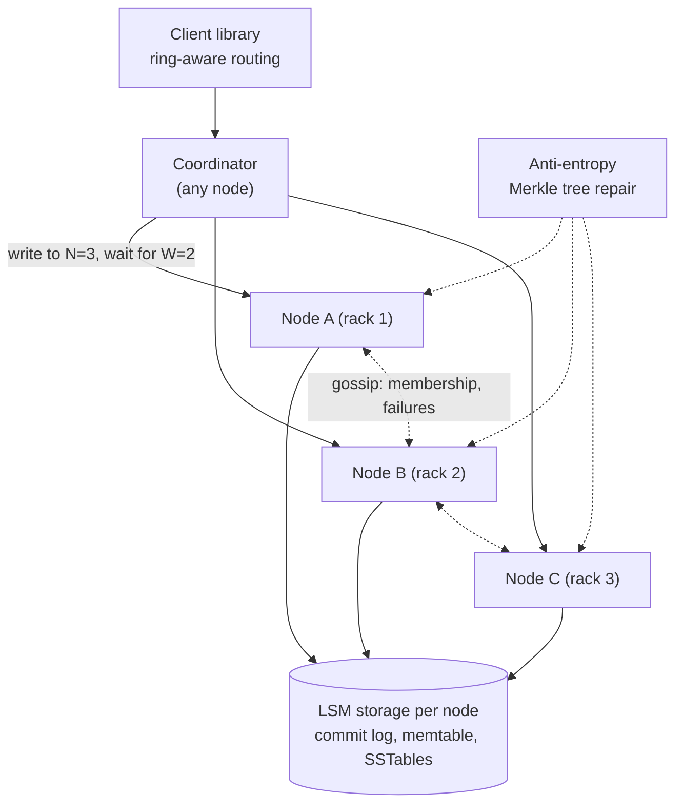
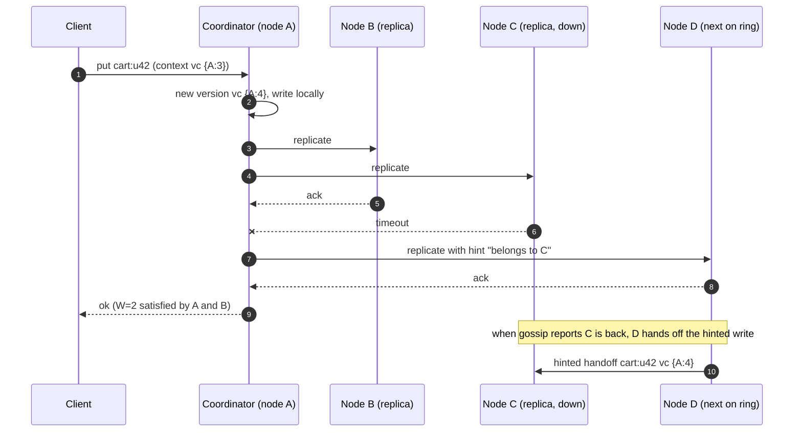
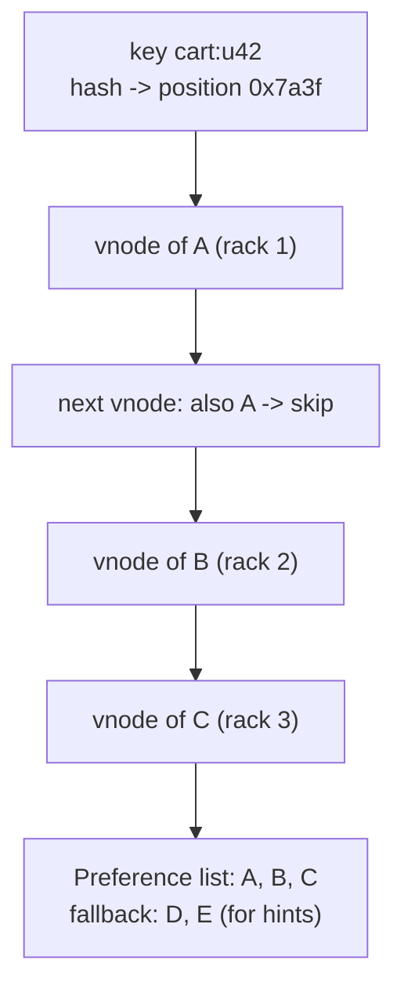
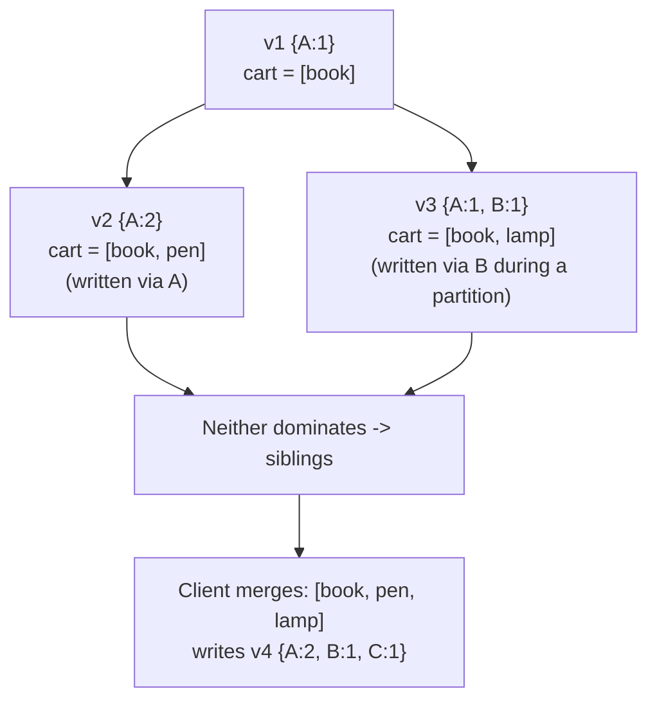
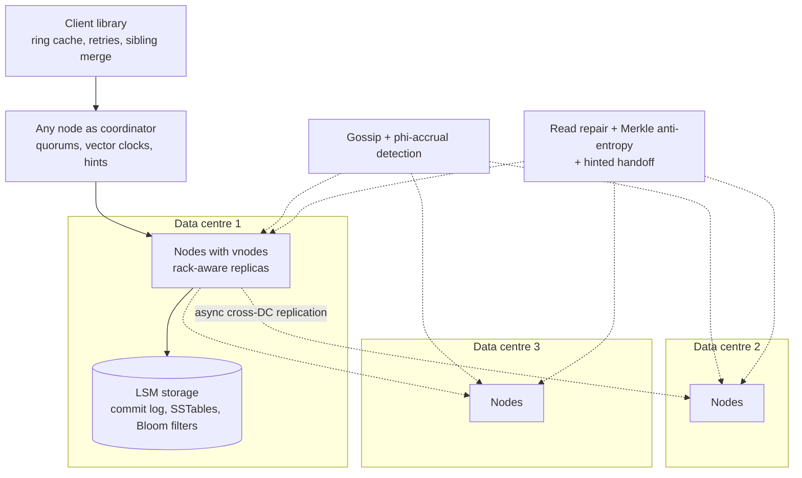

## Problem statement

Design a highly available, distributed key-value store in the style of Amazon's Dynamo (and the systems it inspired, such as Cassandra and
Riak): clients get and put values by key; data is partitioned across hundreds of nodes and replicated; the store stays writable even when
nodes fail or the network partitions; consistency is tunable per request; and concurrent conflicting writes are detected and resolved.

**Interview format:** 45–60 minutes · **Difficulty:** advanced · **Main themes:** consistent hashing with virtual nodes, replication and
quorums, sloppy quorums and hinted handoff, versioning with vector clocks, anti-entropy with Merkle trees, gossip membership, LSM storage.

> [!TIP] Try it first
> Before scrolling, spend three minutes writing the questions you would ask the interviewer. Then compare with the list below — or
> practise this whole problem as a [timed mock interview](#system-design/hld/interview/distributed-kv-store).

## Clarifying questions

The answers below are the interviewer's. Questions that change the design come first.

- **Q:** What operations does the store support? <!-- match: operations, api, features, get, put, scope, what do we build -->
  - **A:** `get(key)`, `put(key, value)` and `delete(key)`. Values are opaque blobs up to 1 MB. No range queries or transactions.
- **Q:** What scale? <!-- match: scale, how much data, how many, ops per second, throughput, traffic, size -->
  - **A:** About 100 TB of data and 1 million operations per second, roughly 70% reads.
- **Q:** Which matters more, availability or consistency? <!-- match: availability, consistency, cap, partition, trade-off, writable -->
  - **A:** Availability: writes must succeed even during node failures and network partitions. Clients can ask for stronger consistency per
    request when they need it.
- **Q:** What latency? <!-- match: latency, fast, p99, milliseconds -->
  - **A:** p99 under 10 ms within a data centre.
- **Q:** How should conflicting concurrent writes be handled? <!-- match: conflict, conflicts, concurrent writes, resolution, versions -->
  - **A:** Detect them. Some applications want both versions returned to merge (like a shopping cart); others accept last-writer-wins.
- **Q:** How many replicas, and across what? <!-- match: replicas, replication, durability, data centres, racks, zones -->
  - **A:** Three replicas per key, on different racks or zones; the store spans three data centres.
- **Q:** Must the cluster grow and shrink online? <!-- match: grow, add nodes, elastic, rebalance, scale out -->
  - **A:** Yes, without downtime and with minimal data movement.
- **Q:** Is there a central coordinator? <!-- match: coordinator, leader, master, central, single point -->
  - **A:** Prefer not: no single point of failure; every node should be able to serve requests.

## Functional requirements

> [!TIP] Try it first
> Write three or four functional requirements before reading on.

- Clients can **get, put and delete** values by key. <!-- match: get, put, delete -->
- Clients can choose **consistency per request** (R and W). <!-- match: consistency per request, tunable, quorum -->
- The store **detects conflicting versions** and returns them for resolution, or applies last-writer-wins. <!-- match: conflicting, versions, resolution -->
- Nodes can be **added and removed online**. <!-- match: added, removed, online, rebalance -->

````hint title="Hint: where does a key live?"
With 150 nodes, how does any node know which three hold key "cart:u42" — without asking a central server — and how many keys move when a
node joins?
````

## Non-functional requirements

- **High availability**: always writable, even during partitions. <!-- match: availability, writable, partitions -->
- **Durability**: three replicas on independent racks or zones. <!-- match: durable, durability, replicas -->
- **Low latency**: p99 < 10 ms. <!-- match: latency, 10 ms -->
- **Horizontal scalability** to 1M ops/s and beyond. <!-- match: scalability, scale, horizontal -->
- **Decentralisation**: no single point of failure. <!-- match: decentralised, no single point, symmetric -->

````hint title="Hint: R + W > N"
With three replicas, which combinations of read and write quorum sizes guarantee that a read sees the latest successful write?
````

## Scope and exclusions

In scope: partitioning, replication, quorums, sloppy quorums and hinted handoff, versioning and conflicts, read repair and anti-entropy,
membership and failure detection, storage engine, multi-DC replication, client routing.

Out of scope: secondary indexes, range scans, transactions, query languages, cross-DC strong consistency (follow-up).

## Capacity estimation

> [!TIP] Try it first
> Estimate total stored data with replication, node count, and per-node request load.

- **Stored data:** 100 TB × 3 replicas = **300 TB**. At ~2 TB of usable data per node (leaving room for compaction), **~150 nodes**.
- **Operations:** 1M/s; with R = 2 for reads and W-sends to 3 replicas for writes, about **2.3M replica operations/s** — ~15,000 per node.
- **Network:** with ~1 KB average values, a few GB/s cluster-wide, spread evenly.
- **Daily volume:** 86 billion operations.

```estimator title="Distributed KV store (operations)"
requestsPerDay = 86.4B
readsPerWrite = 2.33
writeBytes = 1 KB
readBytes = 1 KB
retentionYears = 0
peakFactor = 1.5
replication = 3
cachePercent = 5
serverRps = 15000
targetUtilization = 60
```

The calculator's server count reflects request load; the ~150-node size comes from storage (100 TB × 3 replicas at 2 TB per node). Retention
is zero because stored data doesn't accumulate with traffic — it's the 100 TB data set.

**What the numbers mean for the design:**

- **Storage drives node count**, so even placement of data matters as much as of requests.
- **Per-node load is moderate**; latency targets depend on local storage and avoiding cross-DC round trips.
- **At 150 nodes, failures are routine** — something is always down or recovering.

````hint title="Hint: routine failure"
With 150 nodes and an annual failure rate per node of a few percent, how often does a node fail? What must happen automatically?
````

## API design

> [!TIP] Try it first
> Define get and put, including how versions travel between client and server.

```text title="API"
get(key, consistency = ONE | QUORUM | LOCAL_QUORUM | ALL)
  -> { "values": [ { "value": <bytes>, "context": <opaque version vector> } ] }
     (more than one value = concurrent versions the client should merge)

put(key, value, context = <version from a previous get>, consistency = ...)
  -> ok | error(insufficient replicas)

delete(key, context)          -> writes a tombstone

Client library: hashes keys onto the ring, sends requests to a replica (the coordinator),
retries on another replica on failure, and merges siblings with an app-supplied function.
```

- The **context** carries the version (vector clock) the client last read, so the server can tell whether a write supersedes or conflicts with
  existing versions.

````hint title="Hint: blind writes"
If a client writes without a context, the store can't know whether it saw the current value. What can go wrong?
````

## Data model

> [!TIP] Try it first
> What does each node store per key, and what metadata describes the cluster?

```text title="Schema"
Ring metadata (gossiped to every node)
  node -> { tokens (virtual nodes), data centre, rack, status, generation }
Per key on each replica (LSM storage engine)
  key -> [ { value, vector clock { node: counter, ... }, timestamp, tombstone? } ]
Commit log (append-only) + memtable + SSTables with Bloom filters
Hints (on the node that accepted a write for a down replica)
  target_node -> [ (key, value, version) ] replayed when it returns
Merkle trees per token range (built during anti-entropy repair)
```

- **Versions travel with values**: a key may temporarily hold several concurrent versions ("siblings").
- **Storage is an LSM tree**: fast appends, compaction merges versions and purges tombstones after a grace period
  ([Cassandra](lesson:cassandra)).

````hint title="Hint: deleting in a replicated store"
A replica that was down misses a delete. When it returns, anti-entropy compares it with others. Why must deletes be tombstones rather than
removals?
````

## Initial high-level architecture

Build the design one requirement at a time.

### Step 1: partition

Place nodes on a **consistent-hashing ring** with many **virtual nodes** each; a key's hash picks a position, and the next N distinct
physical nodes clockwise (skipping same-rack nodes) form its **preference list** ([consistent hashing](lesson:consistent-hashing)).

### Step 2: replicate with quorums

Any node can **coordinate** a request: it sends the write to all N replicas and acknowledges after W respond; reads ask R replicas and return
the newest version(s). R + W > N gives read-your-writes in the absence of failures ([leaderless quorums](lesson:leaderless-quorums)).

### Step 3: stay writable during failures

If a preferred replica is unreachable, the coordinator writes to the next healthy node on the ring with a **hint** ("this belongs to node
X") — a **sloppy quorum** — and that node hands the data back when X returns (**hinted handoff**).

### Step 4: converge

Versions carry **vector clocks**; concurrent versions are kept as siblings and returned for merging. **Read repair** fixes stale replicas seen
during reads, and periodic **anti-entropy** compares replicas with Merkle trees to fix the rest. **Gossip** spreads membership and failure
information ([partitions and failure detection](lesson:partitions-failure-detection)).

````hint title="Hint: sloppy vs strict quorum"
With a sloppy quorum, W = 2 might be satisfied by two nodes that aren't in the key's preference list. Does R + W > N still guarantee fresh reads?
````

## Architecture diagram



## Request and data flow



## Component responsibilities

| Component | Responsibility | Scales with |
|---|---|---|
| Client library | Ring-aware routing, retries, sibling merging | Clients |
| Coordinator (any node) | Fan out to replicas, apply quorums, versioning, hints | Requests |
| Storage engine | Durable LSM storage, compaction, tombstones | Data per node |
| Gossip and failure detector | Membership, token ownership, liveness | Cluster size |
| Hinted handoff | Hold and replay writes for temporarily down nodes | Failure duration |
| Anti-entropy | Merkle-tree comparison and repair of ranges | Data size |

## Database and technology choices

| Need | Choice | Why | Alternative |
|---|---|---|---|
| Partitioning | Consistent hashing with virtual nodes | Small movement on membership changes, even load | Fixed hash slots with a coordinator |
| Replication | Leaderless, N = 3 with tunable R and W | Availability, no failover pauses | Leader-based per partition (stronger, less available) |
| Versioning | Vector clocks (or hybrid logical clock timestamps for LWW) | Detect concurrency | Wall-clock LWW (silent loss) |
| Storage | LSM tree (RocksDB-style) | Write-optimised, compression | B-tree engine |
| Membership | Gossip + phi-accrual failure detector | Decentralised, adaptive | ZooKeeper (central dependency) |
| Repair | Merkle trees per range | Compare replicas with little data transfer | Full scans |

## Scaling strategy

### How are keys partitioned and rebalanced?

Each physical node owns many virtual nodes (tokens) on the ring, so load spreads evenly and a new node takes small slices from many existing
nodes instead of half of one neighbour's data. Joins and departures move only the affected ranges, streamed in the background while the old
owners keep serving. Placement is rack- and zone-aware, so a key's three replicas never share a failure domain ([sharding](lesson:sharding)).



### How do quorums and tunable consistency work?

With N = 3: **W = 2, R = 2** gives read-your-writes when the preferred replicas are healthy (2 + 2 > 3); **W = 1, R = 1** gives the lowest
latency and highest availability with possibly stale reads; **W = 3** or **R = 3** maximises consistency but fails if any replica is down.
Multi-DC deployments use **local quorums** so requests don't wait for remote data centres, and replicate across DCs asynchronously
([CAP and PACELC](lesson:cap-pacelc)).

### How are conflicting writes detected and resolved?

Every version carries a **vector clock** — a counter per coordinating node. If one clock dominates another, the newer version replaces the
older; if neither dominates, the writes were concurrent and both are kept as **siblings**. A `get` returns all siblings with a combined
context; the client merges them (a shopping cart takes the union of items) and writes back with that context, collapsing them. Applications
that prefer simplicity choose **last-writer-wins** using hybrid logical clock timestamps, accepting that one of two concurrent writes is
dropped ([clocks](lesson:clocks)).



### How do replicas converge?

Three mechanisms at different speeds: **hinted handoff** replays writes a down node missed (seconds to hours); **read repair** updates stale
replicas the coordinator notices during reads; **anti-entropy** periodically builds Merkle trees (hash trees over key ranges) on replicas and
compares them top-down, transferring only the ranges whose hashes differ. Tombstones are kept until repair has run across all replicas, so
deleted data isn't resurrected.

### How are failures detected without a coordinator?

Nodes gossip membership, token ownership and heartbeats to a few random peers every second; information spreads to the whole cluster in
O(log n) rounds. A **phi-accrual failure detector** turns heartbeat inter-arrival times into a suspicion level, adapting to network
conditions. Temporary unavailability triggers hints, not data movement; only an operator (or a long timeout) declares a node permanently gone
and reassigns its ranges.

## Caching strategy

### What is cached?

Each node's storage engine caches hot keys and SSTable blocks in memory, with Bloom filters avoiding disk reads for keys not in an SSTable.
Clients and coordinators cache the ring metadata. An application-level cache in front of the store is optional for very hot keys; the store
itself avoids caching values across nodes to keep consistency semantics simple ([hot keys](lesson:hot-keys)).

## Messaging strategy

### Is there any messaging inside the store?

Not a message broker: nodes communicate through request/response RPCs for reads and writes, gossip for membership, and streaming for range
transfers and repair. Cross-DC replication is an asynchronous stream of mutations per range. A change feed (like DynamoDB Streams) can be
offered by exposing each node's commit log per range, for applications that need CDC ([outbox and CDC](lesson:outbox-cdc)).

## Failure scenarios

| Failure | Impact | Mitigation |
|---|---|---|
| One replica down | Writes still meet W via other nodes | Sloppy quorum + hinted handoff |
| Network partition | Both sides accept writes | Vector clocks detect conflicts; siblings or LWW |
| Node permanently lost | One replica of its ranges missing | Reassign ranges; stream from remaining replicas |
| Replica divergence | Stale reads at low consistency levels | Read repair, anti-entropy, higher R or W where needed |
| Deleted data reappears | Missed delete purged too early elsewhere | Tombstones kept for a grace period longer than repair intervals |
| Hot key | One replica set overloaded | Client-side caching, splitting the key, application changes |

## Bottleneck analysis

- **Hot keys** — a key lives on N nodes no matter how big the cluster is.
- **Compaction** and **repair** I/O competing with foreground traffic — throttle them.
- **Large sibling sets** from heavy concurrent writing — encourage merges; cap siblings.
- **Cross-DC latency** — local quorums with asynchronous remote replication.

## Consistency and availability trade-offs

- **AP by default**: always writable; concurrent writes are detected and resolved later.
- **Tunable per request**: R + W > N for stronger reads when healthy; sloppy quorums weaken that guarantee during failures.
- **Eventual convergence** through hints, read repair and anti-entropy.
- **No multi-key transactions**; single-key compare-and-set could be added with a consensus round (like Cassandra's lightweight
  transactions) at a latency cost ([consistency models](lesson:consistency-models)).

## Security considerations

- Authenticate clients; authorise per keyspace or tenant.
- TLS between clients and nodes and between nodes (gossip, replication, repair).
- Encryption at rest per node; secure handling of hints and repair streams.
- Rate limits per tenant to prevent one workload from saturating shared nodes.

## Monitoring and observability

- Request latency per consistency level; failed quorums.
- Hints stored and replayed; read-repair rates; repair progress and Merkle mismatches.
- Sibling counts per key and conflict rates.
- Compaction backlog, SSTable counts, disk usage per node; ring balance.
- Gossip state: suspected and down nodes.

## Final architecture

Open this after you have drawn your own.

````solution title="Final architecture"


**In one breath:** keys hash onto a consistent-hashing ring of virtual nodes, and each key's preference list is the next three rack-distinct
physical nodes; any node coordinates a request, writing to N replicas and acknowledging after W, reading from R, with local quorums per data
centre and asynchronous replication between them; unreachable replicas are covered by sloppy quorums and hinted handoff; vector clocks detect
concurrent writes, returned as siblings for client merging or resolved by last-writer-wins; read repair, Merkle-tree anti-entropy and
tombstones with a grace period keep replicas convergent; gossip with a phi-accrual detector manages membership; and each node stores data in an
LSM engine.
````

## Alternative designs and trade-offs

| Alternative | Gains | Costs | When to choose it |
|---|---|---|---|
| Leader per partition (Raft) | Linearizable per key | Unavailable during leader elections; less write availability | Strong consistency needs (etcd, TiKV) |
| Fixed hash slots + central coordinator | Simpler ownership | Coordinator dependency | Redis Cluster-like systems |
| Last-writer-wins only | Simple clients | Silent loss of concurrent writes | Idempotent overwrites, caches |
| CRDT values | Automatic merges | Only for CRDT-friendly data types | Counters, sets, collaborative state |
| Managed service (DynamoDB) | No operations | Less control, provider limits | Most applications |

## Interviewer follow-up questions

````question title="With N = 3, W = 2, R = 2, can a read still return stale data?"
In normal operation no: any two replicas read overlap with the two that acknowledged the write. But with sloppy quorums, a write may have been
acknowledged by nodes outside the key's preference list (holding hints), so a read from two preferred replicas might miss it until hinted
handoff completes. Stale reads also occur if a write failed to reach W replicas but partially applied. Strict quorums, read repair and
waiting for handoff narrow these windows.
````

````question title="How does adding a node affect the cluster?"
The new node takes a set of tokens spread around the ring, so it receives small ranges from many existing nodes. Those ranges stream to it in
the background while the old owners keep serving; once caught up, gossip announces the new ownership and coordinators start using it. Only
roughly 1/(n+1) of the data moves, and no single node bears the whole transfer.
````

````question title="Two clients update the same shopping cart during a network partition. What happens?"
Each side accepts its write, producing versions with vector clocks that neither dominates. After the partition heals, replication and repair
bring both versions to all replicas as siblings. The next get returns both with a merged context; the application merges them — for a cart,
the union of items — and writes the result, which supersedes both. This is the classic Dynamo example; the trade-off is that removed items can
reappear unless removals are tracked explicitly.
````

````question title="Why use Merkle trees for anti-entropy?"
Comparing two replicas of a range key by key would transfer the whole range. A Merkle tree hashes ranges hierarchically, so replicas exchange
the root hash first and descend only into subtrees whose hashes differ, quickly isolating the few keys that diverged and transferring just
those. It makes regular full repairs cheap enough to run continuously.
````

````question title="How would you offer strongly consistent compare-and-set on single keys?"
Add a consensus round per operation among the key's replicas — a Paxos round as in Cassandra's lightweight transactions — so the replicas agree
on whether the condition holds and which value wins. It costs several round trips, so it's used only for operations that need it (unique
usernames, counters with invariants), while ordinary reads and writes keep using quorums.
````

## Common mistakes

- **Plain `hash(key) mod N`** placement, moving almost everything on membership changes.
- **Replicas in the same rack or zone.**
- **Wall-clock last-writer-wins** without acknowledging silent data loss.
- **Deleting data instead of writing tombstones** in a replicated store.
- **A central coordinator** that becomes the single point of failure.
- **Claiming strong consistency** from quorums during failures with sloppy quorums.

## Evaluation checklist

```checklist title="Evaluation checklist"
- Asked about API, scale, availability vs consistency, latency, conflicts, replication and elasticity
- Sized storage-driven node count and per-node request load
- Partitioned with consistent hashing and virtual nodes, rack-aware preference lists
- Replicated with N, R and W, explaining R + W > N and its limits
- Kept writes available with sloppy quorums and hinted handoff
- Versioned values with vector clocks and resolved siblings (or chose LWW knowingly)
- Converged replicas with read repair and Merkle-tree anti-entropy, using tombstones
- Managed membership with gossip and an adaptive failure detector
- Used an LSM storage engine with commit log, compaction and Bloom filters
- Discussed multi-DC local quorums and optional compare-and-set
```
