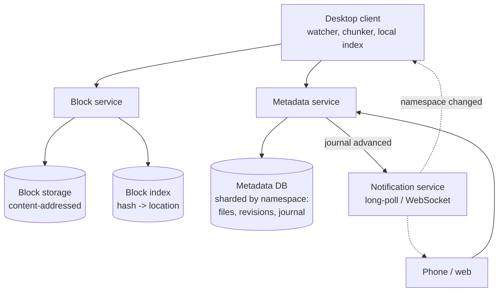
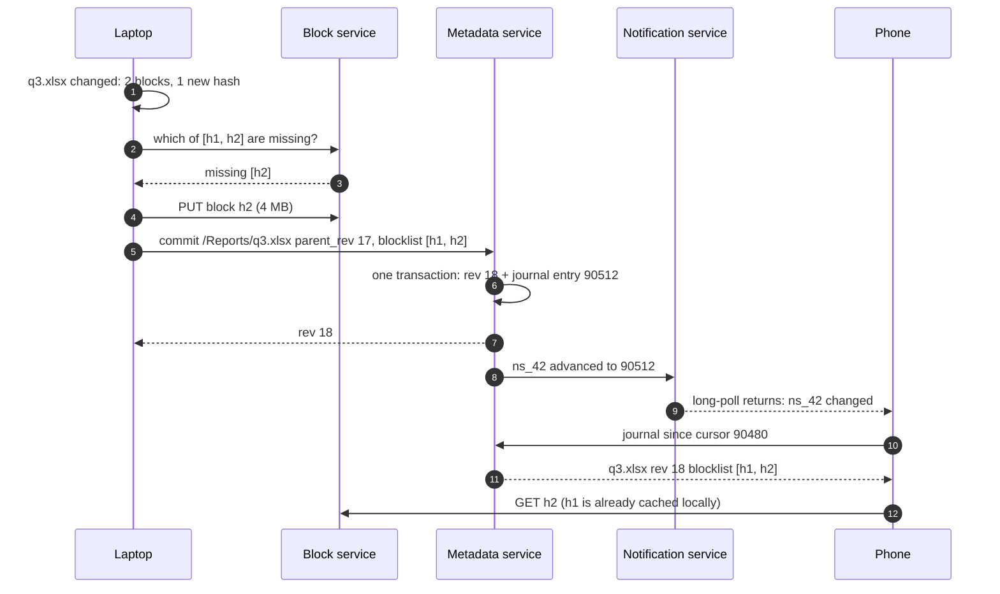
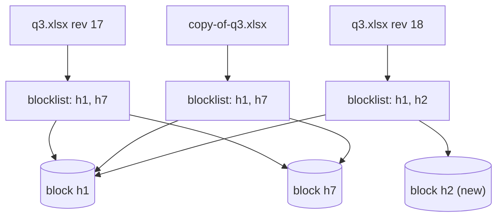
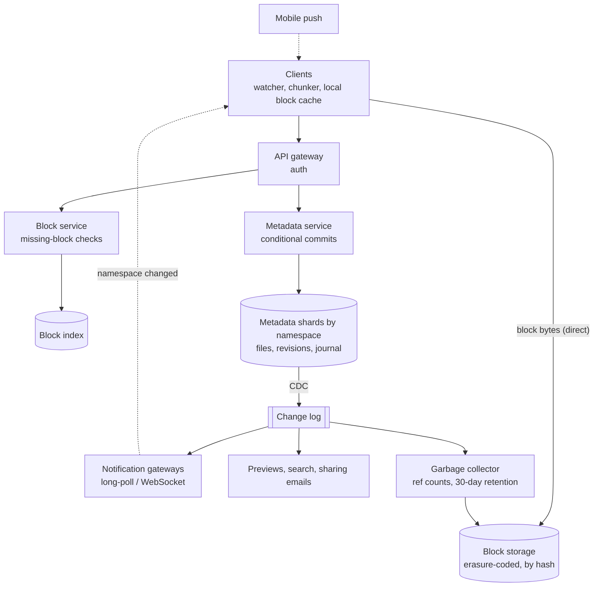

## Problem statement

Design a file-sync service like Dropbox: each user has a folder that stays in sync across their laptop, phone and the web. Edits on one
device appear on the others within seconds, large files sync efficiently even when only a small part changes, offline edits sync when the
device reconnects, and no file is ever lost — including when two devices edit the same file.

**Interview format:** 45–60 minutes · **Difficulty:** intermediate · **Main themes:** chunking and content-addressed storage, the
metadata/blob split, a change journal with cursors, sync notifications, conflict handling, versioning.

> [!TIP] Try it first
> Before scrolling, spend three minutes writing the questions you would ask the interviewer. Then compare with the list below — or
> practise this whole problem as a [timed mock interview](#system-design/hld/interview/dropbox).

## Clarifying questions

The answers below are the interviewer's. Questions that change the design come first.

- **Q:** Which features are in scope? <!-- match: features, scope, what do we build, functionality, sharing -->
  - **A:** Syncing a folder across a user's devices, uploads and downloads, file version history, and shared folders between users.
    Real-time collaborative editing (like Google Docs) is out of scope.
- **Q:** How many users and how much activity? <!-- match: scale, users, dau, how many, activity, traffic, volume -->
  - **A:** 500 million users, 100 million daily active; an active user changes about 10 files a day.
- **Q:** How big are files, and how much does each user store? <!-- match: file size, how big, storage, max size, maximum size, quota, store -->
  - **A:** Mostly small documents and photos, but files up to 50 GB. Average usage is about 2 GB per user.
- **Q:** How many devices per user? <!-- match: devices, multiple devices, phone, laptop, clients -->
  - **A:** Typically two or three: a desktop client, a phone and the web.
- **Q:** How quickly must changes sync? <!-- match: latency, how quickly, sync time, real time, propagate, delay -->
  - **A:** Within a few seconds for small files when both devices are online.
- **Q:** What happens with offline edits and conflicts? <!-- match: offline, conflict, conflicts, concurrent edits, same file -->
  - **A:** Devices can edit offline. If two devices change the same file, keep both versions — never silently lose one.
- **Q:** Do we keep old versions? <!-- match: versions, version history, history, restore, undelete -->
  - **A:** Yes, 30 days of version history, including deleted files.
- **Q:** Is bandwidth a concern? <!-- match: bandwidth, efficient, network, mobile data, delta, save, re-upload, whole file -->
  - **A:** Yes — editing a few bytes of a 2 GB file must not re-upload the whole file.

## Functional requirements

> [!TIP] Try it first
> Write three or four functional requirements before reading on.

- Users can **upload and download files** from any device. <!-- match: upload, download -->
- Changes **sync automatically** to all of a user's devices. <!-- match: sync, automatically, devices -->
- **Offline edits** sync later, and **conflicts keep both versions**. <!-- match: offline, conflict -->
- Users can **restore previous versions** and deleted files for 30 days. <!-- match: restore, versions, history -->
- Users can **share folders** with other users. <!-- match: share, shared folders -->

````hint title="Hint: what is a file, really?"
If a 2 GB file changes by a few bytes, what is the smallest unit you could re-upload, and how would the server know which units it already has?
````

## Non-functional requirements

- **Durability**: no acknowledged file version is ever lost. <!-- match: durable, durability, never lost -->
- **Sync latency**: seconds for small changes. <!-- match: latency, seconds, fast -->
- **Bandwidth efficiency**: transfer only changed data. <!-- match: bandwidth, efficient, delta -->
- **Consistency**: every device converges to the same state; no silent overwrites. <!-- match: consistency, converge, overwrite -->
- **Scale**: 1 billion file changes a day; about an exabyte stored. <!-- match: scale, exabyte, billion -->

````hint title="Hint: two kinds of data"
File contents are huge and immutable once written; file names, folders and versions are small and change constantly. Should they live in
the same store?
````

## Scope and exclusions

In scope: client sync engine (at a high level), chunked uploads, block storage, metadata, change journal, notifications, conflicts,
versions, shared folders.

Out of scope: real-time co-editing, full-text search of contents, previews and thumbnails (a separate pipeline), billing.

## Capacity estimation

> [!TIP] Try it first
> Estimate file changes per second, upload bandwidth, total storage, and the number of blocks to track.

- **Changes:** 100M × 10 = **1B file changes/day ≈ 11,600/s**, ~3× at peak.
- **Upload volume:** at ~1 MB per changed file, **~1 PB/day ≈ 93 Gbit/s**. Uploading only new blocks (deltas, deduplication) cuts this
  substantially — say to 40% → **~400 TB/day**.
- **Storage:** 500M users × 2 GB = **~1 EB** of logical data; deduplication and version retention move it up or down.
- **Blocks:** at 4 MB blocks, 1 EB is **~250 billion blocks**; at ~64 bytes of index entry each, **~16 TB** of block metadata.
- **Notifications:** ~300M connected devices holding long-poll or WebSocket connections.

```estimator title="Dropbox (file changes and syncs)"
requestsPerDay = 3B
readsPerWrite = 2
writeBytes = 400 KB
readBytes = 400 KB
retentionYears = 1
peakFactor = 3
replication = 1
cachePercent = 0
serverRps = 2000
targetUtilization = 60
```

The calculator treats each file change as a write (about 400 KB of new blocks after deduplication) that two other devices then download as
reads. Retention covers one year of new block data; the existing ~1 EB base is extra. Replication is left at 1 because the block store
uses erasure coding internally.

**What the numbers mean for the design:**

- **Metadata operations are frequent and small**; block transfers are fewer but huge — separate services and stores.
- **Hundreds of billions of blocks** need a content-addressed index, not a file-path index.
- **Hundreds of millions of devices** must learn about changes without polling constantly.

````hint title="Hint: what devices ask"
A device that was offline for a week asks the server one question when it reconnects. What is it, and what makes it cheap to answer?
````

## API design

> [!TIP] Try it first
> Design the calls a client makes to upload a changed file, and to learn what changed elsewhere.

```text title="API"
Block service (bytes)
POST /v1/blocks/missing   { "hashes": ["sha256:9f..", "sha256:1c.."] }  -> { "missing": [...] }
PUT  /v1/blocks/{hash}    (4 MB block body; server verifies the hash)       -> 201
GET  /v1/blocks/{hash}                                                      -> block bytes

Metadata service (names, versions)
POST /v1/files/commit
  { "namespace": "ns_42", "path": "/Reports/q3.xlsx", "parent_rev": 17,
    "blocklist": ["sha256:9f..", "sha256:1c..", ...], "size": 6291456 }
  -> 200 { "rev": 18, "journal_id": 90512 }
  -> 409 { "conflict": true, "current_rev": 18 }      (someone else committed first)

GET  /v1/journal?namespace=ns_42&cursor=90480&limit=1000
  -> { "entries": [ { "journal_id", "path", "rev", "blocklist" | "deleted" } ], "cursor": 90512 }
GET  /v1/notify/longpoll?cursors=ns_42:90512,ns_77:3310
  -> { "changed": ["ns_42"] }    (holds the request up to 60 s)
```

- **Blocks are addressed by their hash**: uploading the same content twice is a no-op, and the server can verify integrity.
- **Commits are conditional on `parent_rev`** (optimistic concurrency): a stale parent means a conflict.
- **The journal plus a cursor** answers "what changed since I last looked?" in one paginated call.

````hint title="Hint: why ask which blocks are missing?"
How many bytes does a client upload if 49 of a file's 50 blocks already exist on the server?
````

## Data model

> [!TIP] Try it first
> How do you represent a file version without storing its bytes in the database?

```text title="Schema"
namespaces   (ns_id PK, owner_id, kind: user_root | shared_folder)
mounts       (user_id, ns_id, mount_path, permission)     shared folders appear in users' trees
files        (ns_id, path, latest_rev, size, deleted, updated_at)   PK (ns_id, path)
file_revs    (ns_id, path, rev, blocklist[], size, device_id, created_at)  kept 30+ days
journal      (ns_id, journal_id, path, rev, op)                   append-only per namespace
blocks       (hash PK, size, storage_location, ref_count)         content-addressed index

Block storage: immutable 4 MB blocks keyed by SHA-256, erasure-coded across zones
```

- A **file version is a list of block hashes** (a blocklist); the bytes live once per unique block in block storage.
- Each **namespace** (a user's root or a shared folder) has its own **journal** with increasing IDs — the sync cursor.
- Metadata is **sharded by namespace**, so a commit and its journal entry are one local transaction ([transactions](lesson:transactions)).

````hint title="Hint: sharing"
If a shared folder belongs to several users, whose shard should it live on?
````

## Initial high-level architecture

Build the design one requirement at a time.

### Step 1: chunk and upload

The desktop client watches the folder; when a file changes it splits it into blocks (4 MB), hashes each block, asks the **block service**
which hashes are missing, and uploads only those, directly to block storage ([large blobs](lesson:large-blobs)).

### Step 2: commit metadata

The client commits the new version to the **metadata service** with the block list and the revision it started from. The commit, the new
file revision and a journal entry are written in one transaction on the namespace's shard.

### Step 3: notify and pull

A **notification service** holds long-poll (or WebSocket) connections from every device; when a namespace's journal advances, it tells the
devices subscribed to it. Each device then reads the journal from its cursor, downloads missing blocks, and assembles the files
([real-time at scale](lesson:realtime-at-scale)).

### Step 4: conflicts and versions

If a commit's `parent_rev` is stale, the server rejects it; the client saves its version as a **conflicted copy** next to the original.
Old revisions and their blocks are kept for 30 days.

````hint title="Hint: push or pull?"
Should the server send the changed file to each device, or just tell the device to come and look?
````

## Architecture diagram



## Request and data flow



## Component responsibilities

| Component | Responsibility | Scales with |
|---|---|---|
| Desktop/mobile client | Watch, chunk, hash, local index, upload, apply changes, detect conflicts | Users |
| Block service | Missing-block checks, verified uploads, downloads | Bytes transferred |
| Block storage | Durable, erasure-coded immutable blocks | Unique bytes stored |
| Metadata service | Commits, revisions, journals, sharing, permissions | File changes/s |
| Notification service | Long-lived connections, change signals | Connected devices |
| Garbage collector | Remove blocks no longer referenced after retention | Deletions |

## Database and technology choices

| Need | Choice | Why | Alternative |
|---|---|---|---|
| Metadata and journal | Sharded relational DB (MySQL/PostgreSQL), shard = namespace | Transactions per namespace, ordered journal | Spanner-like global DB |
| Block index | Distributed key-value store keyed by hash | Billions of point lookups | Wide-column store |
| Block storage | Object storage (or an in-house erasure-coded store at exabyte scale) | Cheap, durable, immutable blobs | — |
| Notifications | Long-poll / WebSocket gateways + pub/sub by namespace | Hundreds of millions of idle connections | Mobile push for backgrounded apps |
| Change pipeline | Journal in the metadata DB; CDC for downstream consumers | Exact ordering per namespace | Separate log store |

## Scaling strategy

### Why chunk files, and how big are the chunks?

Chunking gives **resumable uploads** (retry one block, not 50 GB), **delta sync** (upload only changed blocks), **deduplication**
(identical blocks stored once) and **parallel transfers**. Fixed 4 MB blocks are simple, but inserting one byte near the start of a file
shifts every later block boundary; **content-defined chunking** (cutting where a rolling hash matches a pattern) keeps boundaries stable
around edits, at the cost of variable block sizes ([dedup](lesson:dedup)).



Rev 18 reuses block h1, the copy reuses both of rev 17's blocks, and nothing is stored twice.

### How do devices learn about changes cheaply?

Each namespace's journal has increasing IDs; a device stores one cursor per namespace it can see. A long-poll call with all its cursors
returns as soon as any namespace advances (or after ~60 s), so idle devices cost one open connection and no repeated work. Reconnecting
after a week offline is the same call: "journal since cursor N", paginated. Mobile apps in the background rely on push notifications instead
of open connections.

### How is metadata sharded?

By **namespace**: a user's root folder is one namespace; each shared folder is its own namespace mounted into members' trees. A commit and
its journal entry stay on one shard, so ordering and atomicity are local. Very large namespaces (a company-wide shared folder) are the hot
spots to watch; they can be given dedicated shards ([sharding](lesson:sharding)).

### How are conflicts handled?

Commits carry `parent_rev`. If another device committed first, the server returns a conflict; the client downloads the current version and
saves its own as "q3 (Asha's laptop's conflicted copy).xlsx". Nothing is lost, and the user resolves it. Merging content automatically is
out of scope — it's file-type specific ([contention](lesson:contention)).

## Caching strategy

### What is cached?

- **Clients keep a local block cache and index**, so files that share blocks with existing files download almost nothing.
- **Metadata reads** (folder listings for the web client) are cached per namespace and invalidated by journal advances.
- **Hot blocks** (popular shared files) are cached in front of block storage; most blocks are read rarely, so a block cache is small
  relative to total storage.

## Messaging strategy

### How do downstream systems react to changes?

The journal is the ordered source of truth per namespace; CDC streams journal entries into a log for consumers that don't need to be in the
commit transaction: previews and thumbnails, search indexing, sharing notifications, and the garbage collector's reference counting
([outbox and CDC](lesson:outbox-cdc)). Notifications to devices are signals only ("namespace changed"); devices pull the details.

## Failure scenarios

| Failure | Impact | Mitigation |
|---|---|---|
| Upload interrupted | Some blocks uploaded | Next attempt asks for missing blocks and continues |
| Commit references a block that never arrived | Broken file version | Commit verifies all blocks exist before accepting |
| Two devices edit offline | Conflicting revisions | Conditional commit; conflicted copy; nothing overwritten |
| Notification connection drops | Device misses signals | Reconnect with cursors; journal read catches up |
| Metadata shard failover | Commits pause for its namespaces | Replicas with automatic failover; clients retry |
| GC deletes a block still referenced | Data loss | Reference counting plus a grace period; GC verifies before deleting |

## Bottleneck analysis

- **Metadata commits** for very active or very large shared namespaces.
- **Block index lookups** — hundreds of billions of entries; partitioned key-value store with caching.
- **Connections** — hundreds of millions of long-polls; efficient gateways and push for mobile.
- **Upload bandwidth at peaks** — deduplication and delta sync reduce it; resumable blocks smooth it.

## Consistency and availability trade-offs

- **Per-namespace strong consistency** for commits and journals (one shard, transactions, ordered IDs).
- **Eventual convergence** across devices: each catches up by reading the journal.
- **No silent loss**: optimistic concurrency produces conflicted copies rather than last-writer-wins.
- **Availability during outages**: clients work offline against their local copy and sync later.

## Security considerations

- Encrypt blocks at rest and all traffic in transit; per-tenant keys for business customers.
- **Cross-user deduplication leaks information** (an attacker can test whether a file exists by uploading it and seeing no transfer); limit
  dedup to within a user or namespace, or require proof of possession before skipping uploads.
- Permission checks on every journal read and block download (blocks are fetched only via a file the user can access).
- Shared links with expiry and optional passwords; audit logs for business accounts.

## Monitoring and observability

- Sync latency (commit to other device applied), journal lag per device.
- Commit rate and conflict rate; block upload/download throughput and failures.
- Deduplication ratio; storage growth; GC backlog.
- Connected devices per gateway; long-poll response distribution.

## Final architecture

Open this after you have drawn your own.

````solution title="Final architecture"


**In one breath:** clients split files into hashed blocks, upload only the blocks the server lacks directly to content-addressed,
erasure-coded block storage, and commit a new revision (a list of block hashes) conditionally on the revision they started from; each
namespace's metadata, revisions and journal live on one shard, so commits are atomic and ordered; devices hold long-polls with their journal
cursors, get a signal when a namespace advances, read the journal and fetch missing blocks; conflicts become conflicted copies, old
revisions are kept for 30 days, and a garbage collector removes unreferenced blocks.
````

## Alternative designs and trade-offs

| Alternative | Gains | Costs | When to choose it |
|---|---|---|---|
| Whole-file uploads | Simple | Re-uploads everything on every change | Small files only |
| Content-defined chunking | Stable blocks around insertions | Variable block sizes, more CPU | Large files edited in the middle |
| Last-writer-wins | No conflict UX | Silent data loss | Never for user files |
| Server pushes file contents | Fewer client requests | Wasted bandwidth for devices that don't need it | Tiny files, few devices |
| Global metadata database | Cross-namespace transactions | Latency and complexity | Strong global invariants |

## Interviewer follow-up questions

````question title="A user edits 10 bytes in the middle of a 2 GB file. What gets uploaded?"
With fixed 4 MB blocks, only the block containing the change gets a new hash, so the client uploads one 4 MB block plus a new blocklist —
unless the edit inserted bytes, which shifts later block boundaries and changes many hashes. Content-defined chunking avoids that by cutting
blocks where a rolling hash matches a pattern, so boundaries realign shortly after the edit and only one or two blocks change.
````

````question title="Two offline devices edit the same file and reconnect. What happens?"
Both started from revision 17. The first to reconnect commits revision 18. The second commits with parent_rev 17, which no longer matches,
so the server rejects it with a conflict. That client downloads revision 18 and saves its own changes as a conflicted copy next to the
original, so both versions exist and the user decides. No version is overwritten silently.
````

````question title="How does a phone that was offline for a week catch up?"
It sends its stored cursor for each namespace and reads the journal from there, page by page, applying entries in order — renames, deletes
and new revisions — and downloading only the blocks it doesn't already have. If the gap exceeds journal retention, it falls back to a full
listing of the namespace and reconciles with its local index.
````

````question title="How do you garbage-collect blocks safely?"
Track references from file revisions to blocks (reference counts or periodic mark-and-sweep over the revision tables). A block becomes a
candidate only when no revision within the retention window references it; the collector waits a grace period, re-checks, and only then
deletes it. Deletions are logged so mistakes can be detected, and uploads that commit after the check re-add references before the grace
period expires.
````

````question title="How would you support a shared folder used by 50,000 employees?"
Make it its own namespace on its own shard (or a dedicated shard), so its commit rate doesn't interfere with others, and mount it into each
member's tree. Notifications for that namespace fan out to many devices, so the notification layer subscribes gateways by namespace and
batches signals. Permissions are checked per member, and journal reads are paginated because the folder may be very large.
````

## Common mistakes

- **Storing file contents in the database**, or whole files as single objects.
- **Re-uploading whole files** on every change.
- **Polling the server** from every device for changes.
- **Last-writer-wins** on conflicting edits.
- **Sharding metadata by user** without handling shared folders.
- **Deleting blocks without reference tracking and a grace period.**

## Evaluation checklist

```checklist title="Evaluation checklist"
- Asked about scale, file sizes, devices, offline edits, conflicts, versions and bandwidth
- Estimated change rate, upload volume, total storage and block counts
- Split metadata (names, revisions) from content (blocks)
- Chunked files into hashed blocks and uploaded only missing ones
- Discussed fixed-size versus content-defined chunking and deduplication
- Committed revisions conditionally on the parent revision
- Used a per-namespace journal with cursors for sync
- Notified devices with long-polls or WebSockets, pulling details from the journal
- Kept conflicted copies instead of overwriting
- Retained versions and garbage-collected unreferenced blocks safely
```
