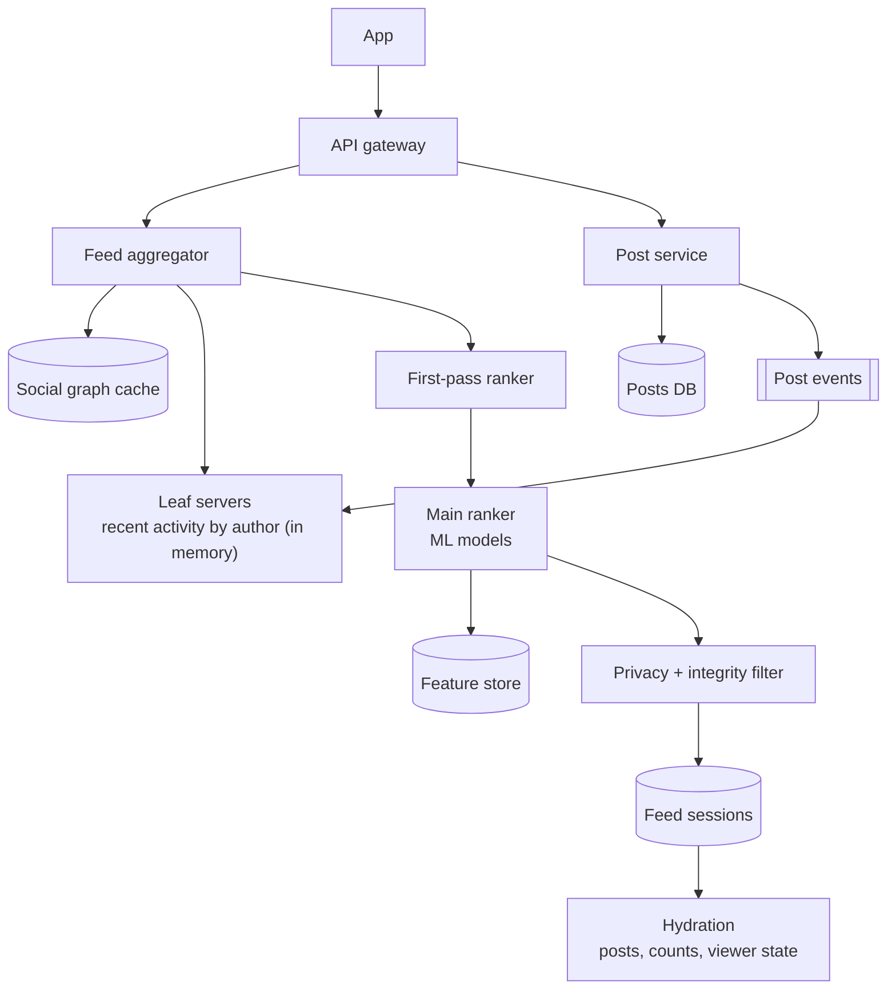
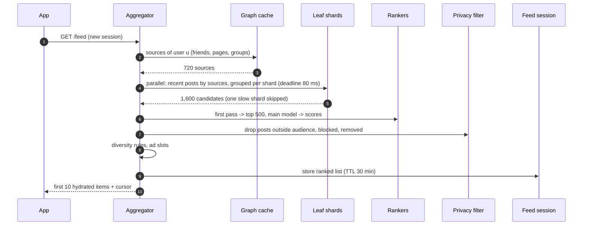
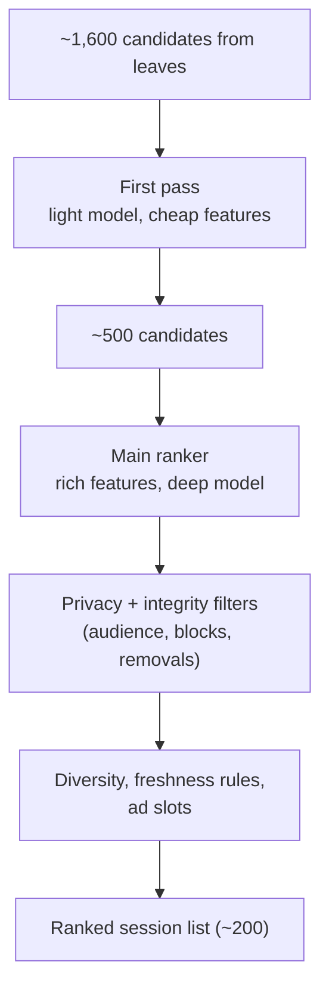
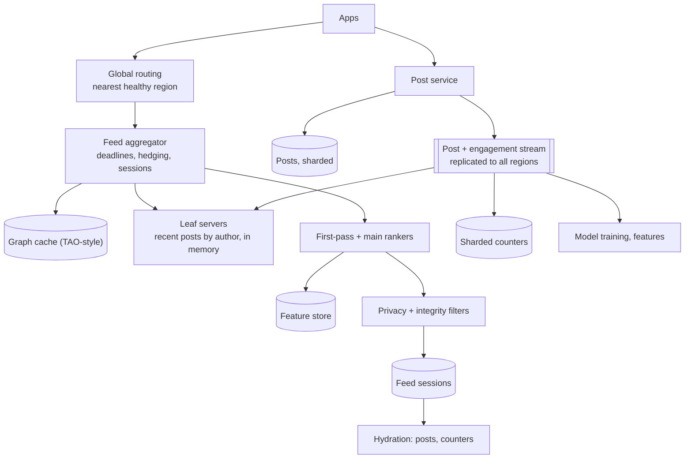

## Problem statement

Design the home feed of a large social network like Facebook: when a user opens the app, show a personalised, ranked feed of posts from their
friends, the pages they follow and the groups they're in — respecting each post's privacy setting — in under half a second, for a billion
daily users across several regions. Unlike a chronological timeline, ranking needs a broad set of fresh candidates at read time.

**Interview format:** 45–60 minutes · **Difficulty:** advanced · **Main themes:** fan-out on read with in-memory indexes, multi-stage
ranking, privacy filtering, feed sessions and pagination, multi-region reads and failover.

> [!TIP] Try it first
> Before scrolling, spend three minutes writing the questions you would ask the interviewer. Then compare with the list below — or
> practise this whole problem as a [timed mock interview](#system-design/hld/interview/facebook-news-feed).

## Clarifying questions

The answers below are the interviewer's. Questions that change the design come first.

- **Q:** What appears in the feed? <!-- match: what appears, sources, friends, pages, groups, content, scope -->
  - **A:** Posts from friends, followed pages and joined groups — text, photos and videos — with like and comment counts. Ads and
    "suggested" content are blended in by other systems; we leave slots for them.
- **Q:** How big is it? <!-- match: scale, users, dau, how many, traffic, volume -->
  - **A:** 1 billion daily active users opening the feed about 10 times a day; about 500 million new posts a day. A typical user has a few
    hundred friends and follows a few hundred pages and groups.
- **Q:** Chronological or ranked? <!-- match: ranking, ranked, chronological, order, algorithm, personalised -->
  - **A:** Ranked and personalised by predicted interest, with some diversity rules.
- **Q:** What latency? <!-- match: latency, fast, p99, load time -->
  - **A:** The first page within 500 ms at p99 on the server side.
- **Q:** How do privacy settings work? <!-- match: privacy, audience, visibility, who can see, friends only -->
  - **A:** Each post has an audience: public, friends, friends of friends, or a custom list. Users must never see posts they're not allowed
    to see, and blocks hide content both ways.
- **Q:** How fresh must the feed be? <!-- match: fresh, freshness, new posts, how quickly, real time -->
  - **A:** New posts should be eligible within a minute; the feed doesn't need to update live while open.
- **Q:** Where are users? <!-- match: regions, global, multi-region, datacenters, worldwide, failover -->
  - **A:** Worldwide, served from several regions; losing a region must not take the feed down.
- **Q:** What happens when a user scrolls a lot? <!-- match: scroll, pagination, infinite scroll, more posts, duplicates -->
  - **A:** Infinite scroll without duplicates or gaps during a session.

## Functional requirements

> [!TIP] Try it first
> Write three or four functional requirements before reading on.

- Users see a **ranked, personalised feed** from friends, pages and groups. <!-- match: ranked, personalised, feed -->
- Users can **scroll** through further pages without duplicates. <!-- match: scroll, pages, pagination -->
- Posts appear only to their **allowed audience**. <!-- match: audience, privacy, allowed -->
- Feeds show **engagement counts** (likes, comments) and support new posts within a minute. <!-- match: engagement, counts, new posts -->

````hint title="Hint: push or pull?"
Ranking wants to consider every recent post from a user's ~700 sources, scored with the latest signals at read time. Does precomputing a
feed per user at write time help or hurt here?
````

## Non-functional requirements

- **Low latency**: first page under 500 ms p99. <!-- match: latency, 500 ms, fast -->
- **Massive read scale**: ~116,000 feed requests/s on average. <!-- match: scale, read, requests per second -->
- **Privacy correctness**: never show a post outside its audience. <!-- match: privacy, correctness, never show -->
- **High availability** across regions. <!-- match: availability, regions -->
- **Freshness** within about a minute. <!-- match: freshness, minute -->

````hint title="Hint: where privacy is checked"
A post's audience can change after it's posted, and friendships end. When must the audience check happen?
````

## Scope and exclusions

In scope: post ingestion into feed indexes, candidate retrieval, multi-stage ranking, privacy and integrity filtering, feed sessions and
pagination, caching, multi-region serving.

Out of scope: ads auction, model training pipelines (we consume models), media storage and delivery (CDN), notifications, messenger.

## Capacity estimation

> [!TIP] Try it first
> Estimate feed requests per second, candidate lookups, ranking work and the memory for recent-activity indexes.

- **Feed requests:** 1B × 10 = 10B/day ≈ **116,000/s** average, ~230,000/s at peak.
- **Candidate retrieval:** ~1,000 sources per user → **~116M source lookups/s** — only feasible in memory and batched by shard.
- **Ranking:** scoring ~500 candidates per request ≈ **58M model evaluations/s** — a large inference fleet, hence multi-stage ranking.
- **Posts:** 500M/day ≈ 5,800/s; ~500 GB/day of post metadata.
- **Recent-activity index:** 3 days of posts × ~200 bytes of feed metadata ≈ **300 GB per region**, sharded across leaf servers.

```estimator title="News feed (feed requests and posts)"
requestsPerDay = 10.5B
readsPerWrite = 20
writeBytes = 1 KB
readBytes = 30 KB
retentionYears = 5
peakFactor = 2
replication = 3
cachePercent = 5
serverRps = 500
targetUtilization = 60
```

The per-server rate is low because each feed request fans out to many leaves and runs ranking — the expensive part is compute per request,
not bytes.

**What the numbers mean for the design:**

- **Fan-out on read** from in-memory indexes, because ranking needs fresh, broad candidates ([fan-out](lesson:fan-out)).
- **Multi-stage ranking**: a cheap first pass narrows thousands to hundreds before expensive models.
- **Cache per session**, not per post: a ranked list is reused as the user scrolls.

````hint title="Hint: why not precompute ranked feeds?"
How many feeds would you recompute when a post's like count changes, or when the ranking model is updated?
````

## API design

> [!TIP] Try it first
> Define the feed request and how pagination stays consistent during a session.

```text title="API"
GET /v1/feed?session=<feed_session_id>&cursor=<position>&count=10
  -> 200 { "items": [ { "type": "post", "post_id", "author", "content", "media",
                        "counts": { "likes", "comments" }, "viewer_state": { "liked": false },
                        "ranking_debug_id" },
                      { "type": "ad_slot", "slot_id" } ],
           "session": "fs_7f..", "next_cursor": "20" }

POST /v1/posts   { "text", "media_ids", "audience": "friends" | "public" | { "custom": [...] } }
POST /v1/feed/seen   { "session", "post_ids": [...] }     (impressions, batched)
```

- A **feed session** freezes the ranked list for a scroll session, so the cursor is a position in that list — no duplicates or gaps as
  ranking changes ([pagination](lesson:pagination)).
- **Seen events** feed ranking (don't repeat what was already shown).

````hint title="Hint: a stable list"
If the feed is re-ranked on every page request, what happens to posts near the page boundary?
````

## Data model

> [!TIP] Try it first
> Which stores hold the social graph, posts, recent-activity indexes and feed sessions?

```text title="Schema"
Social graph (TAO-style objects and associations, sharded, cached)
  friend(u1, u2), follows(user, page), member(user, group), blocks(u1, u2)
Posts (sharded by post_id)
  posts (post_id PK, author_id, audience, content_ref, created_at, edited_at, deleted)
Recent-activity index (in-memory leaf servers, sharded by author)
  author_id -> [ (post_id, created_at, type, audience, early engagement signals) ] last ~3 days
Counters (sharded): likes, comments, shares per post
Feature store: user and post features for ranking (affinity, history, embeddings)
Feed sessions (cache): session_id -> ranked post IDs + position, TTL ~30 min
Seen store: user_id -> recently seen post IDs (bloom filter or short list)
```

- The **recent-activity index** is the key structure: it answers "recent posts by these 700 authors" from memory.
- The **social graph** is read-heavy and cached heavily; Facebook's TAO paper describes serving it from MySQL behind a graph-aware cache.

````hint title="Hint: shard the activity index by what?"
A feed request needs posts from ~700 authors. If the index is sharded by author, how many shards does one request touch, and how do you
batch it?
````

## Initial high-level architecture

Build the design one requirement at a time.

### Step 1: ingest posts

The **post service** stores the post, then publishes `PostCreated`; **leaf servers** owning the author's shard add the post to the author's
recent-activity list (in memory, replicated, rebuilt from the log on restart).

### Step 2: retrieve candidates

For a feed request, the **feed aggregator** fetches the viewer's sources (friends, pages, groups) from the graph cache, groups them by leaf
shard, and queries all leaves in parallel for recent posts — the leaves return a few candidates per author, pre-filtered by time and seen
state.

### Step 3: rank and filter

A **first-pass ranker** scores ~1,500 candidates with a cheap model; the top ~500 go to the **main ranker** with rich features from the
feature store; **privacy and integrity filters** drop anything the viewer can't see; **diversity rules** avoid five posts from one author in
a row; slots are left for ads.

### Step 4: serve and paginate

The ranked list is stored as a **feed session**; the first page is hydrated (post content, counts, viewer state) and returned; later pages
read from the session.

````hint title="Hint: tail latency"
The aggregator queries 100 leaf shards in parallel. What does one slow leaf do to the request, and what can you do about it?
````

## Architecture diagram



## Request and data flow



## Component responsibilities

| Component | Responsibility | Scales with |
|---|---|---|
| Post service | Store posts, audience, emit events | Posts/s |
| Leaf servers | In-memory recent activity per author, sharded and replicated | Posts in window; lookup rate |
| Social graph cache | Friends, follows, memberships, blocks | Feed requests |
| Feed aggregator | Fan-out to leaves, orchestrate ranking, sessions | Feed requests/s |
| Rankers | First-pass and main models, feature lookups | Candidates scored/s |
| Privacy/integrity filter | Audience checks, blocks, removed content | Candidates |
| Hydration | Post content, counts, viewer state | Items returned |

## Database and technology choices

| Need | Choice | Why | Alternative |
|---|---|---|---|
| Social graph | Sharded MySQL behind a graph-aware cache (TAO-style) | Huge read rate, simple associations | Graph database (hard to shard at this scale) |
| Recent activity | Custom in-memory leaf service, replicated | 100M+ lookups/s | Redis cluster per author key |
| Posts | Sharded MySQL / wide-column store | Simple key access, durable | — |
| Counters | Sharded counters with caching | Hot posts | Single rows (hot) |
| Ranking | Model servers (CPU/GPU) + feature store | Real-time inference | Precomputed scores (stale) |
| Feed sessions | Distributed cache with TTL | Stable pagination | Recompute per page |

## Scaling strategy

### Why fan-out on read here?

Ranking needs the full, fresh candidate set with up-to-the-minute signals, privacy depends on the viewer at read time, and pages and groups
can have millions of followers — so instead of pushing every post into hundreds of feeds, the system keeps each author's recent posts in
memory and pulls them at read time. The cost moves to reads, which is why the index is in memory, sharded by author and queried in batches
([fan-out](lesson:fan-out)).

### How does the aggregator stay fast?

It groups the viewer's ~700 sources by leaf shard and sends one batched request per shard in parallel, with a **deadline** (say 80 ms):
shards that are slow are skipped (or hedged to a replica) and the feed is built from the rest — slightly fewer candidates is better than a
slow feed. Leaves return only a few top candidates per author, pre-filtered by time and the viewer's seen set ([aggregation and
discovery](lesson:aggregation-discovery), [timeouts and retries](lesson:timeouts-retries)).



### How is privacy enforced?

At read time, for every candidate, against the current graph: public posts pass; friends-only posts require a friendship edge; custom
audiences check list membership; blocks in either direction remove the post; deleted or removed posts are dropped. Checks use the cached
graph, and caches are invalidated on unfriend, block and audience edits, so changes take effect quickly. Filtering after ranking keeps the
check count bounded, but candidates that will obviously fail (blocked authors) are removed earlier ([auth](lesson:auth)).

### How does pagination stay consistent?

The first request creates a **feed session**: the ranked list (a few hundred IDs) is cached with a TTL, and the cursor is a position in it.
Scrolling reads the next slice and hydrates it; the list doesn't reshuffle mid-session. Pulling to refresh starts a new session that excludes
what was already seen.

### How does it work across regions?

Each region holds a full read replica of the graph, posts and leaf indexes, so feed reads are served locally. Writes for each user or shard
go to its primary region and replicate asynchronously; leaves in every region consume the post stream. If a region fails, traffic shifts to
others with headroom, and primaries for affected shards are promoted elsewhere — a few seconds of recent posts may be missing until replication
catches up ([failover](lesson:failover)).

## Caching strategy

### Which caches matter most?

- **Social graph cache**: friends and memberships for every request — very high hit ratio is essential.
- **Leaf servers**: effectively an in-memory index rebuilt from the post stream.
- **Feed sessions**: ranked lists per scroll session.
- **Post and counter caches** for hydration; counters refreshed frequently.
- **Feature caches** for ranking (user features fetched once per request) ([read-heavy systems](lesson:read-heavy)).

## Messaging strategy

### What flows through the event stream?

`PostCreated`, `PostEdited`, `PostDeleted` and audience changes update leaf servers in every region; engagement events (likes, comments,
seen impressions) feed counters, real-time features and model training. Graph changes (unfriend, block) invalidate graph and leaf-side caches.
Consumers are idempotent by event ID ([Kafka](lesson:kafka)).

## Failure scenarios

| Failure | Impact | Mitigation |
|---|---|---|
| Slow or failed leaf shard | Fewer candidates | Deadlines, replica hedging, build feed from the rest |
| Ranking service overloaded | Latency spikes | Fall back to first-pass scores or a simpler model; shed load |
| Graph cache miss storm | Database overload | Request coalescing, warm caches, replicas |
| Region outage | Traffic shifts | Active-active reads with headroom; promote primaries |
| Leaf restart | Missing recent posts on that shard | Replicas; rebuild from the post stream |
| Bad model deployed | Poor feeds | Canary models with engagement metrics; instant rollback |

## Bottleneck analysis

- **Ranking compute** — the dominant cost; multi-stage funnels and caching of user features.
- **Leaf fan-out** — batching per shard, deadlines, hedging.
- **Graph lookups** — cached, co-located with aggregators.
- **Hot posts' counters** — sharded counters with short-TTL caches.

## Consistency and availability trade-offs

- **Eventual consistency** for feeds, counts and cross-region replication — seconds to a minute.
- **Strict privacy** at read time against the freshest available graph; err on the side of hiding.
- **Availability over completeness**: missing a slow shard's candidates beats a slow feed.
- **Per-session stability** over global freshness during a scroll.

## Security considerations

- Privacy checks on every candidate, server-side; blocks enforced both ways.
- Integrity systems remove spam and policy-violating content before ranking surfaces it.
- Ranking debug data restricted to internal tools.
- Rate limits on posting and on feed scraping.

## Monitoring and observability

- Feed latency p50/p99 by stage (graph, leaves, ranking, hydration).
- Candidate counts, skipped shards, fallback-model usage.
- Engagement metrics per model version (canary analysis).
- Privacy filter drop rates; integrity removals.
- Region health and replication lag.

## Final architecture

Open this after you have drawn your own.

````solution title="Final architecture"


**In one breath:** posts are stored once and streamed to in-memory leaf servers in every region that keep each author's recent posts; a feed
request fetches the viewer's friends, pages and groups from a graph cache, queries leaf shards in parallel under a deadline for ~1,600
candidates, narrows them with a cheap first-pass model, scores the top ~500 with the main ranker and fresh features, applies privacy, block and
integrity filters at read time plus diversity rules and ad slots, and stores the result as a feed session so infinite scroll paginates a stable
list; all regions serve reads locally, with per-shard primary regions for writes and failover.
````

## Alternative designs and trade-offs

| Alternative | Gains | Costs | When to choose it |
|---|---|---|---|
| Fan-out on write (precomputed inboxes) | Cheap reads | Stale ranking inputs, huge fan-out for pages, privacy changes | Chronological feeds |
| Precomputed ranked feeds offline | Fast reads | Stale for hours, wasted for inactive users | Low-engagement products |
| Single-stage ranking | Simpler | Far more compute per request | Small candidate sets |
| Re-rank on every page | Always fresh | Duplicates and gaps while scrolling | Never for infinite scroll |
| Single-region | Simpler | Latency and availability | Regional products |

## Interviewer follow-up questions

````question title="Why does Facebook-style ranking favour fan-out on read, unlike a chronological timeline?"
A ranked feed must score every recent eligible post with up-to-the-minute signals — engagement so far, the viewer's current interests — and
check privacy against the current graph. Precomputing at write time would freeze candidates and scores, and pushing every page or group post
into millions of inboxes is very expensive. Keeping recent posts per author in memory and pulling them at read time gives fresh, complete
candidates, at the cost of read-time fan-out, which in-memory leaves and batching make affordable.
````

````question title="A friend changes a post from public to friends-only. How quickly does it disappear for non-friends?"
The audience change is written to the post and published as an event; leaves update the candidate's audience metadata and caches for the post
are invalidated within seconds. Because the privacy filter checks every candidate's audience at read time, the next feed request any
non-friend makes excludes it. Already-open sessions may still contain it, so hydration re-checks audience as well, and the post fails to
render if it no longer passes.
````

````question title="The ranking service is overloaded. What should the feed do?"
Degrade rather than fail: use the first-pass model's scores (or a cached ranking for the user's recent session) instead of the main model,
reduce the candidate count, and skip expensive features. If even that's too slow, fall back to a mostly chronological ordering of candidates
from the leaves. Monitor engagement to make sure fallbacks are temporary, and shed lower-priority traffic like prefetching.
````

````question title="How do you avoid showing the same post twice when the user refreshes?"
Record impressions as seen events into a per-user seen store (a recent list or Bloom filter). Leaves and the aggregator drop already-seen posts
when building a new session, or rank them lower if there's little new content. Within a session, the frozen ranked list and cursor already
prevent duplicates.
````

````question title="How does the feed keep working if one region goes down?"
Every region has read replicas of the graph and posts and its own leaf servers fed from the replicated post stream, so feeds are built
locally. When a region fails, global routing sends its users to other regions, which must have headroom for the extra load. Shards whose
primary was in the failed region get promoted primaries elsewhere; posts written seconds before the failure may be missing until recovered.
````

## Common mistakes

- **Pushing every post into every follower's feed** for a ranked, privacy-heavy product.
- **One ranking stage** over thousands of candidates.
- **Checking privacy only at post time.**
- **Re-ranking on every page request.**
- **No deadline on fan-out**, letting one slow shard set the latency.
- **Single-region design** for a global audience.

## Evaluation checklist

```checklist title="Evaluation checklist"
- Asked about sources, scale, ranking, latency, privacy, freshness, regions and scrolling
- Estimated feed requests/s, candidate lookups and ranking compute
- Chose fan-out on read with an in-memory recent-activity index sharded by author
- Batched leaf queries per shard with deadlines and hedging
- Designed multi-stage ranking with a feature store
- Enforced privacy, blocks and removals at read time
- Used feed sessions for stable pagination and seen-state for refreshes
- Cached the social graph, counters and posts for hydration
- Served reads in every region with failover and headroom
- Defined degraded modes for ranking and leaf failures
```
