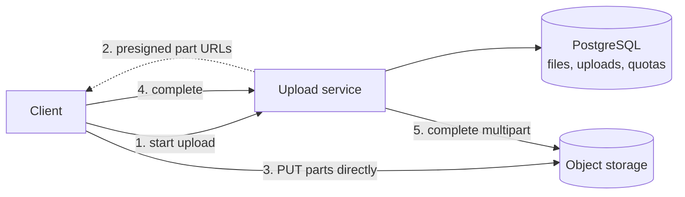
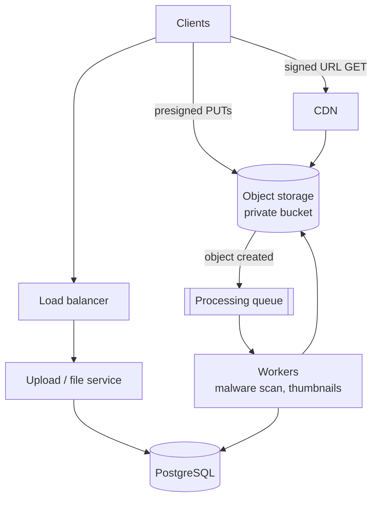
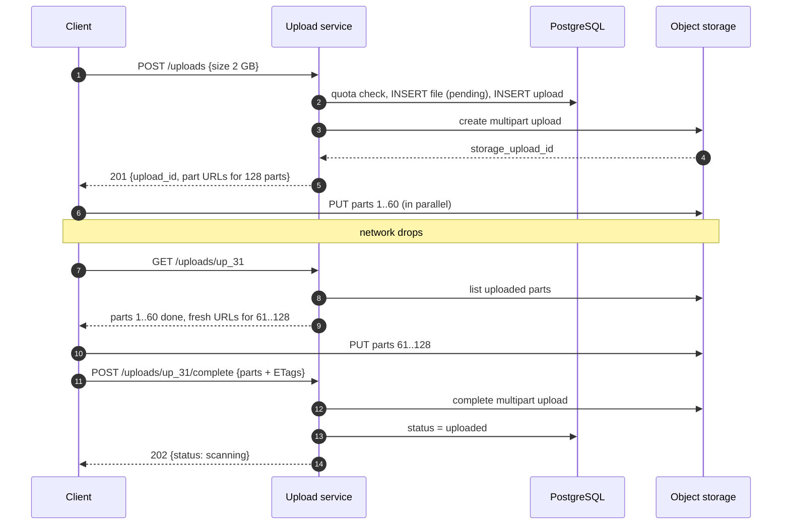
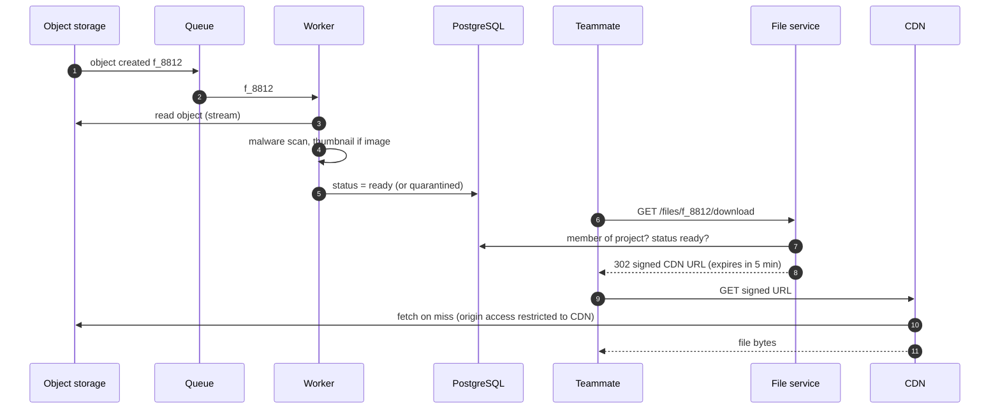
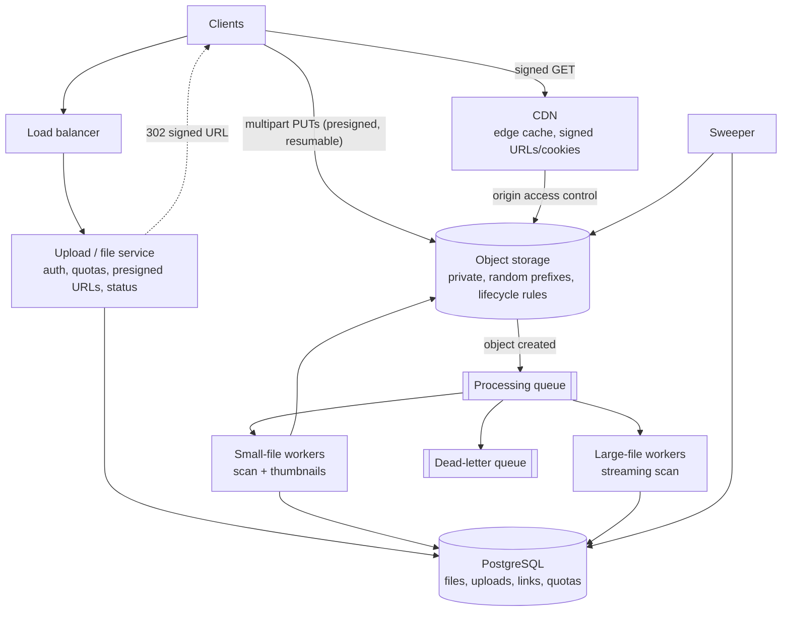

## Problem statement

Design the file upload service for a collaboration app: signed-in users attach files to projects — photos, PDFs, spreadsheets,
occasionally multi-gigabyte videos — and teammates download or preview them. Uploads must survive flaky mobile networks, files must be
scanned for malware before anyone can download them, and images need thumbnails.

**Interview format:** 45 minutes · **Difficulty:** beginner · **Main themes:** direct-to-storage uploads with presigned URLs, multipart
and resumable uploads, asynchronous processing, secure downloads through a CDN, keeping metadata and storage consistent.

> [!TIP] Try it first
> Before scrolling, spend three minutes writing the questions you would ask the interviewer. Then compare with the list below — or
> practise this whole problem as a [timed mock interview](#system-design/hld/interview/file-upload-service).

## Clarifying questions

The answers below are the interviewer's. Questions that change the design come first.

- **Q:** How large can files be, and what's typical? <!-- match: size, large, big, limit, max, maximum, how big, typical -->
  - **A:** Up to 5 GB. The average is about 4 MB — mostly images and documents — with a long tail of large videos.
- **Q:** How many uploads and downloads? <!-- match: scale, volume, how many, traffic, uploads, downloads, per day -->
  - **A:** About 1 million uploads and 10 million downloads a day; weekday office hours are the peak, about 3× average.
- **Q:** Who can access a file? <!-- match: access, permission, private, public, share, who can, authorization -->
  - **A:** Files are private to the project. Members can download them; owners can also create time-limited share links for people
    outside the project.
- **Q:** What processing is needed after upload? <!-- match: processing, scan, virus, malware, thumbnail, preview, convert -->
  - **A:** Every file is scanned for malware before anyone can download it. Images get thumbnails. Nothing else for now.
- **Q:** Do uploads need to resume after a network drop? <!-- match: resume, resumable, interrupted, network, mobile, flaky, retry -->
  - **A:** Yes. Mobile users upload large files over unreliable connections; an interruption shouldn't restart a 2 GB upload from zero.
- **Q:** How long are files kept? <!-- match: retention, keep, delete, how long, expire, recover, trash -->
  - **A:** Until deleted. Deleted files can be restored for 30 days.
- **Q:** Are there storage quotas? <!-- match: quota, limit per user, storage limit, plan -->
  - **A:** Yes — 50 GB per user on the standard plan. Uploads beyond the quota are rejected.
- **Q:** Where are users located? <!-- match: global, region, location, worldwide, latency, geography -->
  - **A:** Worldwide. Downloads should be fast everywhere; data can live in one primary region.
- **Q:** Should identical files be stored once? <!-- match: dedup, duplicate, same file, identical -->
  - **A:** Not required. Keep it simple.

## Functional requirements

> [!TIP] Try it first
> Write four functional requirements before reading on.

- Users can **upload a file** up to 5 GB to a project, **resuming** after interruptions. <!-- match: upload, resume, resumable -->
- Uploaded files are **scanned for malware** (and images get **thumbnails**) before they become downloadable. <!-- match: scan, malware, thumbnail, processing -->
- Project members can **download** files; owners can create **time-limited share links**. <!-- match: download, share, link -->
- Users can **delete** files, with **30-day recovery**. <!-- match: delete, recover, restore -->

````hint title="Hint: when is a file 'uploaded'?"
A file goes through several states: requested, bytes arriving, bytes complete, scanned, ready (or quarantined). Which state should
downloads require?
````

## Non-functional requirements

- **Durability**: once an upload completes, the file is never lost. <!-- match: durable, durability, never lost -->
- **Reliable large uploads** on unreliable networks: resumable, with integrity checks. <!-- match: reliable, resumable, integrity, checksum -->
- **Security**: files are **private by default**; malware is never served. <!-- match: security, private, malware, secure -->
- **Scale**: ~1M uploads/day (~4 TB/day) and ~10M downloads/day (~40 TB/day). <!-- match: scale, per day, terabytes, uploads -->
- **Fast downloads** worldwide, and **high availability** for downloads (99.95%). <!-- match: fast, latency, availability, worldwide -->
- **Consistency** between metadata and stored objects: no "ready" file without bytes, no forgotten bytes without a file. <!-- match: consistency, consistent, orphan -->

````hint title="Hint: where should the bytes flow?"
At 4 TB/day in and 40 TB/day out, should file bytes pass through your API servers at all?
````

## Scope and exclusions

In scope: upload (single and multipart, resumable), processing (malware scan, image thumbnails), access-controlled downloads and share
links, deletion with recovery, quotas.

Out of scope: document previews and conversions, version history, real-time co-editing, deduplication, full-text search inside files, and
multi-region active-active writes.

## Capacity estimation

> [!TIP] Try it first
> Estimate upload and download bandwidth, storage growth and metadata size.

- **Uploads:** 1M/day × 4 MB = **4 TB/day** ≈ 46 MB/s ≈ **370 Mbit/s** average, **~1.1 Gbit/s** at peak.
- **Downloads:** 10M/day × 4 MB = **40 TB/day** ≈ 460 MB/s ≈ **3.7 Gbit/s** average, **~11 Gbit/s** at peak.
- **Storage:** 4 TB/day → **~1.5 PB a year** in object storage (plus thumbnails; object storage handles redundancy). Cold files can move to
  cheaper storage classes.
- **Metadata:** ~500 bytes per file → ~180 GB a year — one PostgreSQL primary.
- **Request rates:** ~12 uploads/s average (plus part uploads for large files) and ~120 downloads/s — trivial for the API; object storage
  sustains thousands of requests per second per key prefix.
- **Large files:** a 5 GB file in 16 MiB parts is 320 parts — well within multipart limits (up to 10,000 parts of 5 MiB to 5 GiB each).

```estimator title="File upload service"
requestsPerDay = 11M
readsPerWrite = 10
writeBytes = 4 MB
readBytes = 4 MB
retentionYears = 3
growthPercent = 20
peakFactor = 3
replication = 1
cachePercent = 5
serverRps = 1000
targetUtilization = 60
```

**What the numbers mean for the design:**

- **Bytes must bypass the API servers.** Gigabits per second of uploads and downloads would need a large fleet just to proxy data;
  presigned URLs send bytes straight to and from storage and the CDN.
- **Petabytes of objects → object storage** with lifecycle tiering; metadata stays small and relational.
- **The API handles only small control requests** (~hundreds per second): a few stateless instances.

````hint title="Hint: what if uploads went through the API?"
At ~1 Gbit/s of uploads at peak, plus slow mobile clients holding connections open for minutes, how many API servers and how much memory
would you need just to relay bytes?
````

## API design

> [!TIP] Try it first
> Design the upload as a conversation: what does the client ask for, where does it send bytes, and how does it say "done"?

```text title="API"
POST /v1/projects/{project_id}/uploads
  { "filename": "site-survey.mp4", "size": 2147483648, "content_type": "video/mp4",
    "sha256": "9f2c..." }                                           (optional whole-file checksum)
  201 { "upload_id": "up_31", "file_id": "f_8812", "mode": "multipart",
        "part_size": 16777216, "parts": 128,
        "part_urls": [ { "number": 1, "url": "https://storage...&X-Amz-Expires=3600" }, ... ],
        "expires_at": "..." }
      small files: { "mode": "single", "url": "<presigned PUT url>" }
  413 too large   403 not a project member   409 quota exceeded

PUT <presigned part URL>                         client -> object storage directly; returns ETag
GET /v1/uploads/{upload_id}                      resume: parts done + fresh URLs for the rest
POST /v1/uploads/{upload_id}/complete
  { "parts": [ { "number": 1, "etag": "..." }, ... ] }
  202 { "file_id": "f_8812", "status": "scanning" }

GET  /v1/files/{file_id}                         metadata + status (scanning | ready | quarantined)
GET  /v1/files/{file_id}/download                302 -> short-lived signed CDN URL (only if ready)
POST /v1/files/{file_id}/share-links  { "expires_in": "7d" }
  201 { "url": "https://app.example/s/..." }
DELETE /v1/files/{file_id}                       204 (soft delete; restorable 30 days)
```

- **Presigned URLs** grant one operation on one object for a short time (minutes to an hour) — the client never gets storage credentials.
- **Complete returns 202**: the bytes are stored, but scanning hasn't finished; downloads wait for `ready`.

````hint title="Hint: how does a client resume?"
After a network drop, the client knows its upload ID. What does it need from the server to continue without re-sending finished parts?
````

## Data model

> [!TIP] Try it first
> Which states does a file pass through, and what must be recorded to resume an upload and serve a download?

```sql
CREATE TABLE files (
  file_id       text PRIMARY KEY,                  -- random, unguessable
  project_id    bigint NOT NULL,
  owner_id      bigint NOT NULL,
  name          text NOT NULL,
  size_bytes    bigint NOT NULL CHECK (size_bytes BETWEEN 1 AND 5368709120),
  content_type  text NOT NULL,
  sha256        text,
  storage_key   text NOT NULL UNIQUE,              -- e.g. 7f/f_8812
  status        text NOT NULL CHECK (status IN
                  ('pending', 'uploaded', 'scanning', 'ready', 'quarantined', 'deleted')),
  created_at    timestamptz NOT NULL DEFAULT now(),
  deleted_at    timestamptz
);
CREATE INDEX files_project ON files (project_id, created_at DESC) WHERE status <> 'deleted';
CREATE INDEX files_pending ON files (created_at) WHERE status = 'pending';

CREATE TABLE uploads (
  upload_id     text PRIMARY KEY,
  file_id       text NOT NULL REFERENCES files (file_id),
  storage_upload_id text,                          -- the object store's multipart upload id
  part_size     integer NOT NULL,
  part_count    integer NOT NULL,
  expires_at    timestamptz NOT NULL
);

CREATE TABLE file_variants (                       -- thumbnails
  file_id      text NOT NULL REFERENCES files (file_id),
  kind         text NOT NULL,                      -- 'thumb_256', 'thumb_1024'
  storage_key  text NOT NULL,
  PRIMARY KEY (file_id, kind)
);

CREATE TABLE share_links (
  token_hash   text PRIMARY KEY,                   -- store a hash, never the token
  file_id      text NOT NULL REFERENCES files (file_id),
  created_by   bigint NOT NULL,
  expires_at   timestamptz NOT NULL
);

CREATE TABLE quotas (
  user_id      bigint PRIMARY KEY,
  bytes_used   bigint NOT NULL DEFAULT 0,
  bytes_limit  bigint NOT NULL DEFAULT 53687091200   -- 50 GiB
);
```

- **Bytes** live in object storage under `storage_key`, with a short random prefix (`7f/`) to spread keys.
- **Status** is the contract between upload, processing and download.
- Share-link tokens are random secrets stored **hashed**, like passwords.

````hint title="Hint: which index finds abandoned uploads?"
Uploads that were started but never completed leave `pending` files and storage parts. What query finds them, and which index makes it
cheap?
````

## Initial high-level architecture

Build the design one requirement at a time.

### Step 1: upload

The client asks the **upload service** to start an upload. The service checks membership and quota, creates a `pending` file row, starts a
multipart upload in object storage (for large files) and returns presigned URLs. The client sends bytes **directly to object storage**,
then calls complete; the service asks storage to assemble the parts and marks the file `uploaded`.



### Step 2: process

Object storage emits an **object-created event** to a queue. **Processing workers** scan the file for malware, generate thumbnails for
images and update the status to `ready` — or `quarantined`.

### Step 3: download and share

The **download endpoint** checks project membership (or a valid share link) and the `ready` status, then redirects to a **short-lived
signed CDN URL**. The CDN fetches from object storage (which only the CDN can read) and caches the object at the edge.

````hint title="Hint: who is allowed to read the bucket?"
If the bucket is private and only the CDN can read it, how does an authorised user get a file without your servers streaming it?
````

## Architecture diagram



## Request and data flow

A resumable multipart upload:



Processing and download:



## Component responsibilities

| Component | Responsibility | Scales with |
|---|---|---|
| Upload / file service | Auth, membership, quotas, presigned URLs, multipart orchestration, status, download redirects, share links | Control requests (hundreds/s) |
| PostgreSQL | Files, uploads, variants, share links, quotas | Metadata size (~180 GB/year) |
| Object storage | File bytes and thumbnails; multipart assembly; event notifications | Petabytes; request rate per prefix |
| Processing queue | Buffer object-created events; retries; DLQ | Upload rate |
| Workers | Malware scanning, thumbnail generation, status updates | Bytes uploaded |
| CDN | Serve downloads near users using signed URLs; cache popular files | Download bandwidth (~11 Gbit/s peak) |
| Clean-up jobs | Abort abandoned uploads, purge deleted files after 30 days | Abandonment and deletion rates |

## Database and technology choices

| Need | Choice | Why | Alternative |
|---|---|---|---|
| File bytes | Object storage (e.g. S3) | 11-nines-class durability, multipart uploads, presigned URLs, lifecycle tiering, event notifications | Self-managed blob store (rarely worth it) |
| Metadata | PostgreSQL | Relational (projects, members, links), transactional quota updates, modest size | DynamoDB if metadata grew enormous |
| Events | Storage notifications → queue | Processing triggered by the bytes actually landing | Client-triggered processing (less reliable) |
| Downloads | CDN with signed URLs; bucket readable only by the CDN | Speed worldwide; no public bucket | Presigned storage GET URLs (no edge caching) |
| Malware scanning | Scanning engine in workers (or a managed scanning service) | Must complete before `ready` | Scan on download (slower, repeated work) |

## Scaling strategy

### Why should uploads bypass our servers?

**Option 1 — stream through the API.** Simple auth and validation in one place, but every byte crosses our servers: ~1 Gbit/s of uploads at
peak, slow mobile clients holding connections for minutes, memory and threads tied up, and a large fleet whose only job is relaying bytes.

**Option 2 — presigned URLs.** The API authorises the upload and returns URLs that let the client `PUT` specific objects directly into
object storage for a short time. The API handles only small control messages; storage scales the data path. The service can constrain each
URL (exact key, expiry, expected content length or checksum).

**Choice:** option 2. The only extra work is tracking upload state (pending → uploaded) and reacting to the storage event.

### How do we upload large files reliably?

Multipart upload splits a file into parts uploaded independently and in parallel, then assembled by the store:

- **Part size:** 16 MiB is a good default — 5 GB is 320 parts, within the 10,000-part limit, and a failed part costs at most 16 MiB to
  resend. (S3 parts must be 5 MiB to 5 GiB, except the last; files under ~100 MB can use a single `PUT`.)
- **Resume:** the client keeps `upload_id`; after an interruption it asks which parts exist (the service lists parts from storage) and gets
  fresh URLs for the rest.
- **Integrity:** the client sends a checksum per part (and optionally for the whole file); storage rejects corrupted parts.
- **Parallelism:** 4–8 parts in flight saturates most connections without overwhelming mobile networks.
- **Abandonment:** a lifecycle rule **aborts incomplete multipart uploads after a day**, so orphaned parts stop costing money.

### How do we keep metadata and storage consistent?

The two stores can't share a transaction, so the design makes every intermediate state safe:

- The **file row is created first** (`pending`) and the object key is derived from it — bytes can never exist under a key nobody knows.
- **Status only moves forward** on evidence: `uploaded` after storage confirms completion; `ready` after the scan succeeds.
- **Downloads require `ready`**, so half-uploaded or unscanned files are never served.
- A **sweeper** marks `pending` files older than a day as abandoned (using the partial index on pending files) and deletes any stray
  objects; the lifecycle rule handles incomplete parts.
- **Quota** is reserved at upload start (size known in advance) and released if the upload is abandoned.

## Caching strategy

### How are downloads served securely and fast?

- The bucket is **private**; only the CDN can read it (an origin access control policy).
- After authorising, the file service returns a **signed CDN URL** valid for a few minutes, scoped to one object. Anyone without a valid
  signature gets 403 from the edge.
- The CDN **caches the object at the edge** keyed by object path (not the signature), so popular files — a project's shared video —
  download fast for every member.
- **Revocation:** short signature lifetimes mean a removed member loses access within minutes; deleting a file also purges it from the CDN.
- **Thumbnails** are small and requested constantly in file lists; they use the same signed-URL scheme, often with signed cookies so a
  page of 50 thumbnails doesn't need 50 signatures.

## Messaging strategy

### How does processing work after upload?

- **Trigger on the bytes, not the client:** object storage emits an object-created event into a queue, so processing starts even if the
  client disappears before calling complete.
- **Idempotent workers:** events may arrive twice; a worker checks the file's status and the object's version before acting, and writes
  thumbnails to deterministic keys.
- **Large files** are streamed through the scanner, never loaded into memory whole; very large files may get their own worker pool so a
  5 GB video doesn't delay a thousand small images.
- **Retries with backoff** for transient failures; after repeated failures the file moves to a dead-letter queue and stays non-downloadable,
  and the user sees "processing failed — try again".
- **Quarantine:** infected files are marked `quarantined`, never served, moved to a restricted location, and the owner is notified.

## Failure scenarios

| Failure | Impact | Mitigation |
|---|---|---|
| Network drops mid-upload | Upload incomplete | Multipart resume from completed parts; fresh presigned URLs |
| Client never calls complete | `pending` file, orphan parts | Storage event or sweeper detects; lifecycle rule aborts incomplete uploads |
| Processing workers down | Files stuck in `scanning` | Queue buffers events; scale workers; alert on queue age |
| Malware scanner outage | Nothing becomes `ready` | Files wait safely (never served unscanned); fail over to a second scanner |
| PostgreSQL primary fails | Uploads can't start; downloads can't authorise | Failover; already-issued signed URLs keep working for minutes |
| CDN outage | Slow or failing downloads | Fallback to presigned storage URLs; multi-CDN for large deployments |
| Duplicate storage event | Double processing | Idempotent workers keyed by file and object version |
| Leaked share link | Unintended access | Expiry, revocation by deleting the link, hashed tokens, access logs |

## Bottleneck analysis

- **Bandwidth** is the dominant resource (gigabits per second each way) and is handled by object storage and the CDN, not our servers.
- **Processing throughput** scales with bytes uploaded; separate pools for large files prevent head-of-line blocking.
- **Metadata writes** (~12 uploads/s plus status updates) are small; quota updates on a single heavy user's row are the only hotspot.
- **Object storage request rates** scale per key prefix (S3 documents at least 3,500 writes and 5,500 reads per second per prefix), so random
  prefixes on keys spread load.

## Consistency and availability trade-offs

- **Status is the source of truth** for what can be downloaded; the object store may briefly contain bytes the metadata doesn't consider
  ready, never the reverse.
- **Durability comes from object storage** (multi-zone replication); the upload is acknowledged as complete only after the store confirms.
- **Downloads favour availability** through the CDN, with access checks at link issuance — a user removed from a project may keep access
  for the few minutes a signed URL lives.
- **Quota accounting** is transactional in PostgreSQL; slight over-reservation during abandoned uploads is preferred over letting users
  exceed quotas.

## Security considerations

- **Private by default:** no public bucket access; signed, short-lived URLs for uploads and downloads.
- **Constrain presigned uploads:** exact object key, expiry, content length, checksum; never let clients choose keys.
- **Malware scanning before availability**; serve files with `Content-Disposition: attachment` and the stored content type, from a
  separate download domain, so uploaded HTML or scripts can't run in the app's origin.
- **Share links:** high-entropy tokens stored hashed, with expiry and revocation; rate-limit link guessing.
- **Encryption** at rest (storage-managed keys or customer-managed keys) and in transit.
- **Audit logs** of downloads and share-link use for sensitive projects.

## Monitoring and observability

- Upload success rate, time from start to `ready`, abandoned-upload rate, multipart resume rate.
- Processing queue depth and age of the oldest event; scan failures and quarantines.
- Download latency and CDN hit ratio; 403 rates at the edge (expired or forged signatures).
- Storage growth per day, cost by storage class, and lifecycle transitions.
- Quota rejections and per-project usage.

## Final architecture

Open this after you have drawn your own.

````solution title="Final architecture"


**In one breath:** the file service authorises uploads, reserves quota and hands out presigned (multipart, resumable) URLs so bytes go
straight into a private bucket; storage events trigger idempotent workers that scan and thumbnail each file and move it from `uploaded` to
`ready` or `quarantined`; downloads check membership or share links and redirect to short-lived signed CDN URLs, with the CDN as the only
reader of the bucket; sweepers and lifecycle rules clean up abandoned uploads and purge deleted files after 30 days.
````

## Alternative designs and trade-offs

| Alternative | Gains | Costs | When to choose it |
|---|---|---|---|
| Proxy uploads through the API | Simple, inline validation | Bandwidth, memory and threads on API servers; a large fleet | Small files, low volume |
| Resumable upload protocol (e.g. tus) via a gateway | Standard resumability across stores | Another component that carries bytes | Multi-cloud or non-S3 stores |
| Presigned storage URLs for downloads (no CDN) | Simpler | No edge caching; slower far from the region | Single-region users, low download volume |
| Scan on download | Faster time to "uploaded" | Repeated scans, slower downloads, risk of serving unscanned files | Rarely appropriate |
| Content-addressed storage (dedup by hash) | Saves storage on duplicates | Deletion and access control get complex | Many identical files across users |

## Interviewer follow-up questions

````question title="How would you let users upload faster from far away?"
Upload parts in parallel, and accept the client's bytes at the network edge: storage acceleration features route uploads over the CDN
provider's backbone from a nearby edge location, and regional buckets with later replication are another option. Parallel multipart parts
help most on high-latency links because each TCP connection's throughput is limited by its round-trip time.
````

````question title="How would you add version history for files?"
Make each upload of the same file a new version: a file_versions table with version number, storage key, size and uploader, with the file
row pointing at the current version. Object storage versioning can keep superseded bytes, but explicit keys per version are easier to
reason about. Retention rules (keep the last N versions or versions newer than 90 days) and quota accounting per version follow.
````

````question title="How do you prevent a user from uploading 5 GB when they only have 1 GB of quota left?"
Reserve quota when the upload starts, using the declared size, in the same transaction that creates the pending file — reject with 409 if
it doesn't fit. Constrain the presigned URLs to that size (content-length conditions, part counts), and verify the final object size on
completion; if the actual size differs, reject the file and release the reservation. Abandoned uploads release their reservation when the
sweeper expires them.
````

````question title="A user removed from a project still has a download link. What happens?"
Signed CDN URLs expire within minutes, so the old link stops working quickly; new links require the membership check, which now fails. If
immediate revocation matters, shorten signature lifetimes further or use signed cookies with session checks at the edge. Share links are
separate, revocable records and must be deleted or expired explicitly.
````

````question title="How would you generate previews for PDFs and videos later?"
Add processing steps to the same pipeline: on ready, enqueue preview jobs by content type into dedicated worker pools (PDF rendering,
video transcoding to a low-resolution streaming format), write outputs as file variants, and expose them through the same signed-URL
mechanism. Heavy jobs get their own queues and autoscaling so they don't delay scanning of new uploads.
````

````question title="Why trigger processing from storage events rather than from the client's complete call?"
Because the client is unreliable: it may crash or lose connectivity after the bytes land but before calling complete. The storage event
fires whenever the object exists, so processing always starts; the complete call still matters for multipart assembly and status updates,
and both paths are idempotent so it doesn't matter which arrives first.
````

## Common mistakes

- **Streaming large uploads through API servers** at gigabits per second.
- **No resumability** for multi-gigabyte uploads on mobile networks.
- **Serving files before scanning**, or from a public bucket.
- **Long-lived or unscoped presigned URLs.**
- **Ignoring abandoned uploads** — pending rows and orphaned parts accumulating forever.
- **Treating metadata and storage as one transaction** instead of designing safe intermediate states.

## Evaluation checklist

```checklist title="Evaluation checklist"
- Asked about file sizes, volume, access rules, processing, resumability and retention
- Estimated upload and download bandwidth and concluded bytes must bypass the API
- Used presigned URLs for direct-to-storage uploads, constrained by key, size and expiry
- Designed multipart, resumable uploads with sensible part sizes and integrity checks
- Modelled file states (pending, uploaded, scanning, ready, quarantined, deleted) and served only ready files
- Triggered processing from storage events with idempotent workers, retries and a DLQ
- Served downloads via a CDN with short-lived signed URLs and a bucket readable only by the CDN
- Handled abandoned uploads and orphaned objects (sweeper, lifecycle abort rule)
- Enforced quotas without races (reservation at upload start)
- Discussed malware handling, share-link security and safe content serving
- Covered failures of workers, the scanner, the database and the CDN
```
