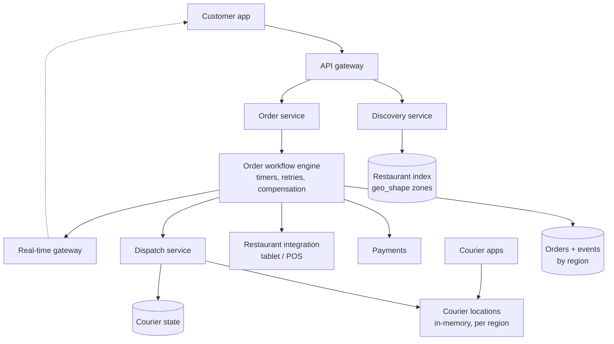
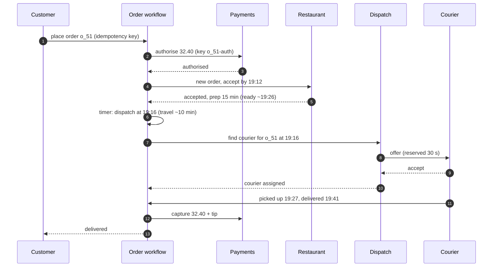
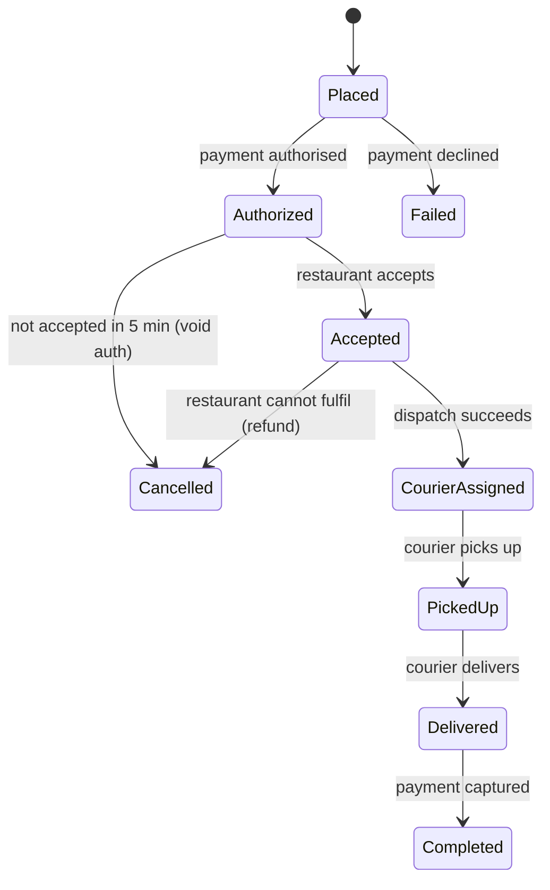
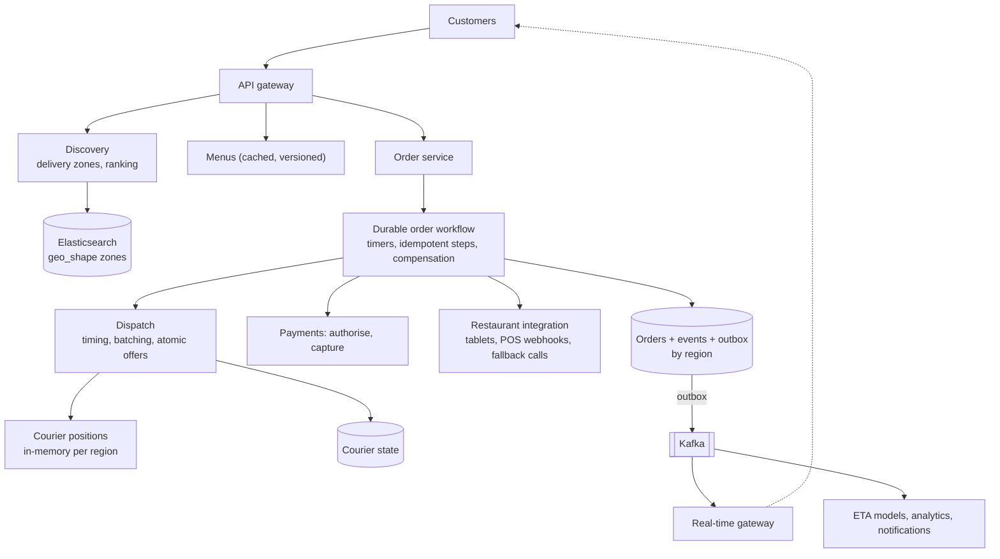

## Problem statement

Design a food delivery platform like DoorDash or Uber Eats: customers browse restaurants that deliver to their address, place and pay for an
order, the restaurant accepts and prepares it, a courier is dispatched to pick it up at the right time, and everyone tracks the order live
until delivery. The platform coordinates three parties — customer, restaurant and courier — through a long-running order workflow.

**Interview format:** 45–60 minutes · **Difficulty:** advanced · **Main themes:** a multi-party order workflow with timers and compensation,
courier dispatch timed to food readiness, delivery-zone search, real-time tracking, payments authorised then captured.

> [!TIP] Try it first
> Before scrolling, spend three minutes writing the questions you would ask the interviewer. Then compare with the list below — or
> practise this whole problem as a [timed mock interview](#system-design/hld/interview/food-delivery).

## Clarifying questions

The answers below are the interviewer's. Questions that change the design come first.

- **Q:** Which features are in scope? <!-- match: features, scope, what do we build, functionality, in scope -->
  - **A:** Restaurant discovery and menus, ordering and payment, restaurant acceptance, courier dispatch, live tracking and delivery.
    Ratings, promotions and grocery are out of scope.
- **Q:** What scale? <!-- match: scale, how many, orders per day, traffic, volume, size -->
  - **A:** About 5 million orders a day with a dinner peak around 5× average, 1 million restaurants, and up to 500,000 couriers online.
- **Q:** How do restaurants receive orders? <!-- match: restaurants receive, tablet, pos, integration, notify restaurant -->
  - **A:** Most use our tablet app; large chains integrate through their point-of-sale systems via an API.
- **Q:** How are couriers assigned? <!-- match: assign, dispatch, courier selection, matching, batching -->
  - **A:** We choose couriers, offer orders one at a time, and may give one courier two orders from nearby restaurants.
- **Q:** When should the courier arrive? <!-- match: timing, arrive, arrival, pickup time, prep time, ready, when -->
  - **A:** Ideally just as the food is ready — not too early (waiting couriers) or too late (cold food).
- **Q:** What happens if a restaurant doesn't accept or something fails mid-order? <!-- match: cancel, failure, restaurant doesn't accept, refund, timeout -->
  - **A:** Orders not accepted within a few minutes are cancelled and the customer isn't charged; later failures need refunds or
    redelivery.
- **Q:** How does payment work? <!-- match: payment, pay, charge, tip, capture -->
  - **A:** Authorise the card when ordering; capture the final amount (including tip changes) after delivery.
- **Q:** What tracking is needed? <!-- match: tracking, live, map, eta, status -->
  - **A:** Order status updates and the courier's live location on a map, with an ETA.

## Functional requirements

> [!TIP] Try it first
> Write three or four functional requirements before reading on.

- Customers can **browse restaurants that deliver to them** and their menus. <!-- match: browse, restaurants, menus, deliver -->
- Customers can **place and pay for orders**. <!-- match: place order, order, pay -->
- Restaurants **accept and prepare** orders and mark them ready. <!-- match: accept, prepare, restaurant -->
- The platform **dispatches couriers** who pick up and deliver. <!-- match: dispatch, courier, deliver -->
- Customers **track order status and courier location** live. <!-- match: track, tracking, status -->

````hint title="Hint: whose state is it?"
An order passes through the customer, the payment provider, the restaurant and a courier over 45 minutes. Where is the single source of
truth for "what happens next"?
````

## Non-functional requirements

- **Reliability of orders**: no lost or duplicated orders or charges. <!-- match: reliable, reliability, lost, duplicated -->
- **Timeliness**: dispatch timed to food readiness; low-latency status updates. <!-- match: timely, timeliness, latency -->
- **Scale for dinner peaks**: hundreds of orders/s, 100,000 courier pings/s. <!-- match: scale, peak, dinner -->
- **High availability** for ordering and tracking. <!-- match: availability, available -->
- **Consistency** of courier assignment: one courier per order at a time. <!-- match: consistency, assignment, one courier -->

````hint title="Hint: timers"
"Cancel if not accepted in 5 minutes" and "dispatch a courier 12 minutes before food is ready" are timers. Where do they live so they survive
crashes?
````

## Scope and exclusions

In scope: restaurant search and menus, ordering, payments (authorise/capture), the order workflow, restaurant integration, courier
dispatch and batching, tracking, cancellation and refunds.

Out of scope: ratings, promotions and ads, courier onboarding and pay, grocery inventory, customer support tooling.

## Capacity estimation

> [!TIP] Try it first
> Estimate orders per second at peak, courier location updates, menu traffic and active orders in flight.

- **Orders:** 5M/day ≈ **58/s** average, **~290/s** at the dinner peak.
- **Active orders:** ~45 minutes each → ~156,000 in flight on average, **~780,000** at peak (each with timers and state).
- **Courier locations:** 500,000 couriers every 5 s = **100,000 updates/s**.
- **Menu and restaurant browsing:** ~500M views/day ≈ **5,800/s** — read-heavy and cacheable.
- **Order storage:** 5M × ~5 KB ≈ 25 GB/day.

```estimator title="Food delivery (browsing and orders)"
requestsPerDay = 505M
readsPerWrite = 100
writeBytes = 5 KB
readBytes = 30 KB
retentionYears = 3
peakFactor = 5
replication = 3
cachePercent = 10
serverRps = 1500
targetUtilization = 60
```

Reads are restaurant and menu views; writes are orders. Courier location updates (100,000/s) are handled by an in-memory location tier,
as in ride-sharing, and aren't modelled here.

**What the numbers mean for the design:**

- **Orders are low-volume but long-lived** with many steps and timers → a durable workflow engine.
- **Browsing is read-heavy** → caches and a search index.
- **Courier locations are write-heavy and ephemeral** → in-memory, sharded by region ([proximity services](lesson:proximity-services)).

````hint title="Hint: in-flight state"
780,000 orders are mid-workflow at peak, each waiting for someone. Is that a problem for a thread-per-order design? For a database-backed
workflow?
````

## API design

> [!TIP] Try it first
> Define restaurant discovery, ordering, the restaurant's view and the courier's offer.

```text title="API"
Customer
  GET  /v1/restaurants?lat=&lng=&q=&cuisine=&cursor=      (only restaurants delivering here)
  GET  /v1/restaurants/{id}/menu                         (cached, versioned)
  POST /v1/orders   Idempotency-Key: ...  { "restaurant_id", "items": [...], "address", "tip",
                                            "payment_method" }
    -> 201 { "order_id": "o_51", "status": "placed", "eta_window": "19:40-19:50" }
  GET  /v1/orders/{id}  + SSE/WebSocket stream of status and courier location

Restaurant (tablet WebSocket or POS webhook)
  <- order.new { order_id, items, accept_by }
  -> POST /v1/restaurant/orders/{id}/accept  { "prep_minutes": 15 }
  -> POST /v1/restaurant/orders/{id}/ready

Courier app (WebSocket)
  <- offer { order_ids, pickup, dropoff, pay, expires_in }    -> accept / decline
  -> location every 5 s, picked_up, delivered (with photo)
```

- Order creation is **idempotent**; restaurant and courier actions are commands into the order workflow.

````hint title="Hint: prep time"
The restaurant says "15 minutes". How does that number flow into courier dispatch?
````

## Data model

> [!TIP] Try it first
> Which records does the order workflow own, and how do you find restaurants that deliver to an address?

```text title="Schema"
restaurants   (restaurant_id PK, name, location, delivery_zone (polygon), hours, status, cuisines)
menus         (restaurant_id, version, items jsonb, updated_at)       cached; versioned
orders        (order_id PK, customer_id, restaurant_id, region, items, amounts, status,
               payment_auth_ref, courier_id, eta, created_at, version)  sharded by region
order_events  (order_id, seq, type, data, at)                        append-only history
couriers      (courier_id, status: offline | available | offered | on_delivery, current_orders[],
               offer_expires_at, version)                            per region, strongly consistent
Live courier positions: in-memory geo index per region (as in ride-sharing)
Search index: restaurants with geo_shape delivery zones, cuisines, open status, popularity
```

- **Delivery zones are polygons**; "who delivers here?" is a point-in-polygon search (an Elasticsearch `geo_shape` query or PostGIS
  `ST_Contains`) ([geospatial indexes](lesson:geospatial-indexes)).
- **Order events** form an audit trail of every transition.

````hint title="Hint: radius or polygon?"
Why might "within 5 km of the restaurant" be the wrong model for where a restaurant delivers?
````

## Initial high-level architecture

Build the design one requirement at a time.

### Step 1: discovery

Restaurants and their delivery zones are indexed in **Elasticsearch**; a search returns open restaurants whose zone contains the customer's
address, ranked by relevance, popularity and expected delivery time. Menus are cached and served with versions.

### Step 2: the order workflow

Placing an order starts a **durable workflow** (an orchestrator over a database, or an engine such as Temporal): authorise payment, send to the
restaurant, wait for acceptance with a timer, plan dispatch, track pickup and delivery, capture payment. Each step is idempotent and the
workflow survives crashes ([multi-step workflows](lesson:multi-step-workflows)).

### Step 3: dispatch

When the restaurant accepts with a prep time, the workflow schedules dispatch so a courier arrives near the ready time; the **dispatch
service** picks candidates from the live courier index, ranks them by travel time and batching opportunities, and offers the order with an
atomic reservation.

### Step 4: tracking

Status changes and the assigned courier's positions flow to the customer through a **real-time gateway** ([real-time at scale](lesson:realtime-at-scale)).

````hint title="Hint: why not dispatch immediately?"
If a courier is assigned the moment the order is placed, what happens when the restaurant takes 25 minutes?
````

## Architecture diagram



## Request and data flow



## Component responsibilities

| Component | Responsibility | Scales with |
|---|---|---|
| Discovery service | Restaurants delivering to an address, ranking | Browse traffic |
| Menu service | Versioned menus, item availability, caching | Menu views |
| Order service + workflow | Order state machine, timers, compensation | Orders in flight |
| Restaurant integration | Tablet connections, POS webhooks, fallbacks | Restaurants |
| Dispatch service | Courier selection, batching, offers, reassignment | Orders being dispatched |
| Courier location tier | Live positions per region | Courier pings |
| Real-time gateway | Status and location pushes | Active orders |
| Payments | Authorise, capture, refund (idempotent) | Orders |

## Database and technology choices

| Need | Choice | Why | Alternative |
|---|---|---|---|
| Orders | Sharded PostgreSQL by region + outbox | Transactions, history | DynamoDB with conditional writes |
| Workflow | Temporal (or an in-house orchestrator on the orders DB) | Durable timers, retries, visibility | Choreographed events (hard to follow) |
| Restaurant search | Elasticsearch with `geo_shape` zones | Point-in-polygon + text + ranking | PostGIS |
| Menus | Database + Redis/CDN cache with versions | Read-heavy | — |
| Courier positions | In-memory geo index per region | High update rate | Redis GEO |
| Courier state | Strongly consistent store with conditional updates | No double assignment | Distributed locks |

## Scaling strategy

### How does the order workflow stay reliable?

The order is a state machine persisted in the database (or the workflow engine's history): every transition is recorded with the next command
using an outbox, every external call has an idempotency key, and timers are durable records rather than sleeping threads — so 780,000
in-flight orders cost storage, not threads. Failures trigger compensation: if the restaurant doesn't accept in time, void the payment
authorisation and notify the customer; if the courier cancels, return to dispatch; if the restaurant can't fulfil after acceptance, refund
([distributed transactions](lesson:distributed-transactions)).



### How is the courier dispatched at the right time?

The workflow estimates the ready time (acceptance time + the restaurant's prep estimate, corrected by its history) and the courier's travel
time to the restaurant, and starts dispatch at `ready − travel − buffer`. Dispatch picks available couriers near the restaurant, ranks them by
predicted arrival, and considers **batching** — a courier already heading to the same restaurant, or a nearby one with a compatible drop-off —
when it doesn't delay either order too much. Offers reserve the courier atomically (`available → offered` with an expiry), as in ride-sharing
([contention](lesson:contention)).

### How do we find restaurants that deliver to an address?

Each restaurant's delivery zone is a polygon (often shaped by roads and drive times, not a circle). The discovery index stores zones as
`geo_shape` and answers "zones containing this point" quickly; results are filtered by open hours and current capacity (busy restaurants can
temporarily shrink their zone or extend their prep time), then ranked ([Elasticsearch](lesson:elasticsearch)).

### How is the dinner peak handled?

Browsing scales with caches and index replicas. Orders are modest in count; the bottlenecks are restaurant capacity and courier supply. The
platform throttles orders per restaurant (prep-time inflation, temporarily closing), raises delivery estimates, and uses dynamic courier pay
to increase supply — all fed by real-time supply/demand metrics per region.

## Caching strategy

### What is cached?

- **Menus** by restaurant and version (immutable once versioned) in Redis and at the CDN for images.
- **Discovery results** per geohash cell and filters for a minute.
- **Restaurant status** (open, busy, prep-time multiplier) in memory, updated by events.
- **Never cached for decisions**: order state and courier assignment always come from their stores ([cache invalidation](lesson:cache-invalidation)).

## Messaging strategy

### Which events and channels connect the parties?

Order transitions publish events through the outbox to Kafka: notifications, analytics, restaurant dashboards and ETA models consume them.
Restaurants receive orders on a persistent tablet connection with acknowledgements; POS integrations receive signed webhooks with retries
([webhooks](lesson:webhooks)). If a tablet doesn't acknowledge within a minute, the workflow escalates (a robocall to the restaurant).

## Failure scenarios

| Failure | Impact | Mitigation |
|---|---|---|
| Restaurant tablet offline | Order not seen | Acknowledgement timeout → phone call fallback → cancel and void |
| Courier cancels after accepting | Pickup delayed | Workflow returns order to dispatch with priority |
| Workflow worker crash | Orders pause | Durable state and timers; another worker resumes |
| Payment capture fails after delivery | Unpaid order | Retries with idempotency, later reconciliation |
| Courier location tier restarts | Tracking gap | Rebuilt from next pings within seconds |
| Dinner spike in one city | Long waits | Regional throttling, delivery estimates, courier incentives |

## Bottleneck analysis

- **Courier supply** at peak — dispatch efficiency and batching matter more than servers.
- **Restaurant throughput** — per-restaurant order throttling.
- **Workflow engine** throughput — scales horizontally; state sharded by region.
- **Tracking fan-out** — modest per order; gateway tier scales with active orders.

## Consistency and availability trade-offs

- **Strong consistency** for order state transitions and courier assignment.
- **Eventual consistency** for discovery, menus, ETAs and tracking.
- **Availability through regional isolation**: each region's orders, couriers and dispatch run independently.
- **Compensation over atomicity** across payment, restaurant and courier steps.

## Security considerations

- Authenticated apps for customers, restaurants and couriers; separate permissions per role.
- Customer addresses and phone numbers shared only with the assigned courier, during the delivery; masked phone relays.
- Signed webhooks for POS integrations; idempotent processing.
- Fraud checks on orders and payments; delivery photo evidence for disputes.

## Monitoring and observability

- Orders per minute by region; acceptance time; cancellation reasons.
- Dispatch latency, offer acceptance rate, courier wait time at restaurants, food wait time for couriers.
- ETA accuracy; on-time delivery rate.
- Workflow backlog and stuck orders (no transition for N minutes).
- Tablet connectivity per restaurant.

## Final architecture

Open this after you have drawn your own.

````solution title="Final architecture"


**In one breath:** customers discover restaurants whose delivery-zone polygons contain their address and browse cached, versioned menus; an
order starts a durable, region-sharded workflow that authorises payment, sends the order to the restaurant with an acceptance timer and
fallbacks, schedules dispatch for when the food will be ready, and reserves couriers atomically from an in-memory regional location index
with batching; every transition is recorded with an outbox event that drives real-time tracking, notifications and ETA models; failures
trigger compensations, and payment is captured after delivery.
````

## Alternative designs and trade-offs

| Alternative | Gains | Costs | When to choose it |
|---|---|---|---|
| Choreographed services instead of a workflow | Loose coupling | Hard to see and fix stuck orders | Very simple flows |
| Dispatch at order time | Simpler | Couriers wait at restaurants | Very fast kitchens |
| Broadcast offers to many couriers | Faster acceptance | Poor courier experience; still needs atomic claim | Low-density markets |
| Radius-based delivery areas | Simple | Ignores roads, rivers, traffic | Early-stage |
| Capture payment at order time | Simpler | Refunds for every change or cancellation | Fixed-price orders |

## Interviewer follow-up questions

````question title="The restaurant never accepts the order. What happens?"
The workflow set a durable timer when it sent the order. If the tablet doesn't acknowledge within a minute, it escalates — for example an
automated phone call. If the order isn't accepted by the deadline (say five minutes), the workflow cancels it: voids the payment
authorisation idempotently, notifies the customer with alternatives, and records the reason. No customer is charged for an order that was
never accepted.
````

````question title="How do you decide when to dispatch a courier?"
Estimate when the food will be ready from the acceptance time and the restaurant's prep estimate, corrected by its historical accuracy and
current load, and estimate couriers' travel times to the restaurant. Start dispatch so the expected arrival lands just before the ready time,
with a buffer. Re-plan if the restaurant updates its estimate. This balances courier idle time against food waiting on the counter.
````

````question title="How would you batch two orders onto one courier?"
When dispatching, consider couriers already assigned to an order at the same or a nearby restaurant whose drop-off is in a compatible
direction. Compute the added delay for both customers with the routing service, and batch only if both stay within their promised windows.
The courier's state holds the list of current orders, updated with a conditional write so batching and new offers can't conflict.
````

````question title="How does a customer see the courier's location live?"
The courier app sends positions every few seconds to the regional location tier. Once a courier is assigned, the workflow subscribes the order
to that courier's updates; the location tier publishes them to the order's channel on the real-time gateway, which pushes them to the
customer's app over SSE or WebSocket along with status changes and a recomputed ETA.
````

````question title="What if the courier picks up the order and then has an accident?"
The courier or support marks the delivery failed; the workflow moves the order into an exception state and decides by policy: dispatch a
remake from the restaurant with a new courier, or refund the customer. Each path is a compensating branch of the workflow with its own timers
and notifications, and the event history records exactly what happened for support and accounting.
````

## Common mistakes

- **Treating an order as one transaction** across payment, restaurant and courier.
- **Timers in memory** or cron scans over all orders.
- **Dispatching immediately** without considering prep time.
- **Radius-only delivery areas.**
- **Assigning couriers without an atomic reservation.**
- **Capturing payment before the final amount is known.**

## Evaluation checklist

```checklist title="Evaluation checklist"
- Asked about scale, restaurant integration, assignment, timing, failures and payment timing
- Estimated orders at peak, orders in flight, courier pings and browse traffic
- Modelled the order as a durable state machine with idempotent steps and timers
- Designed compensations (void, refund, redispatch) for failures
- Found restaurants by delivery-zone polygons containing the address
- Timed courier dispatch to food readiness and considered batching
- Reserved couriers atomically with expiring offers
- Kept courier positions in an in-memory regional index
- Pushed status and location to customers through a real-time gateway
- Authorised at order time and captured after delivery
```
