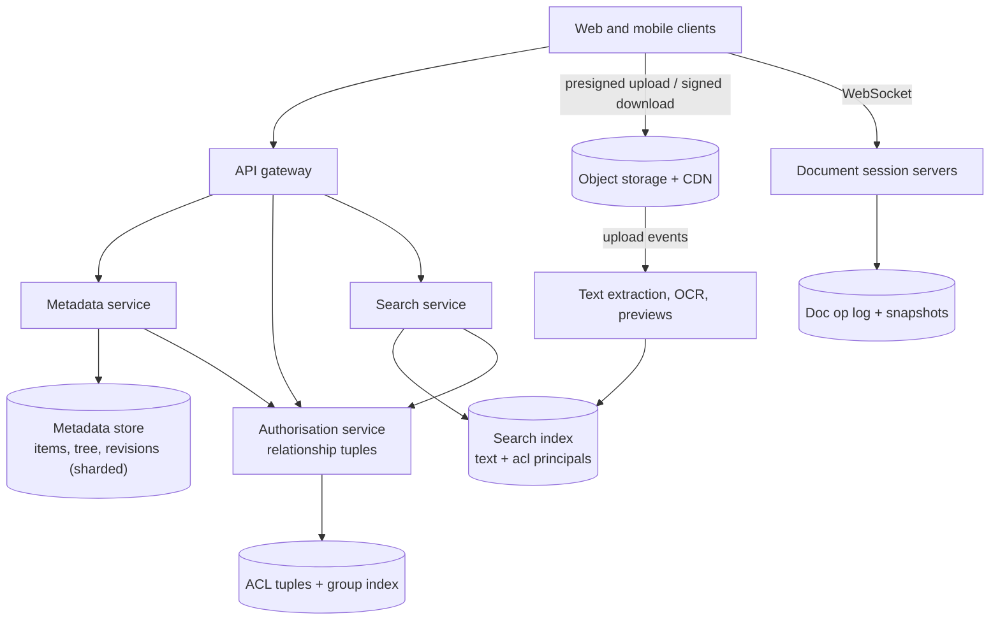
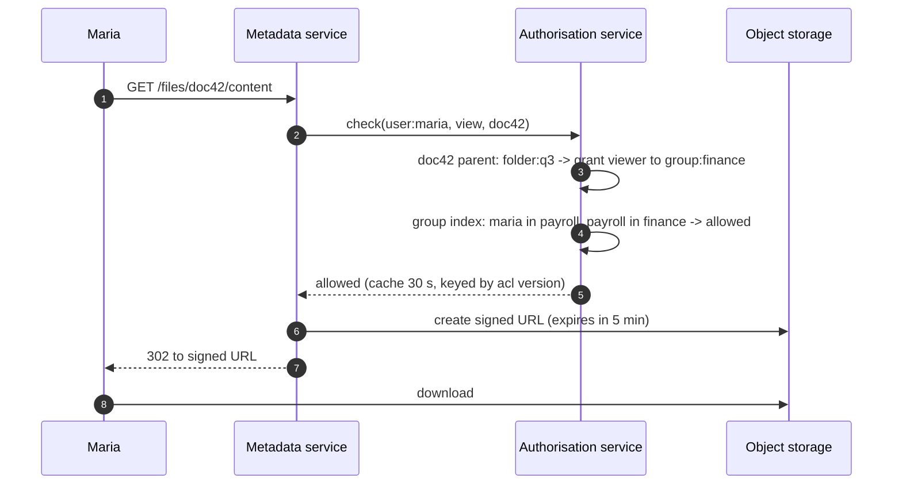
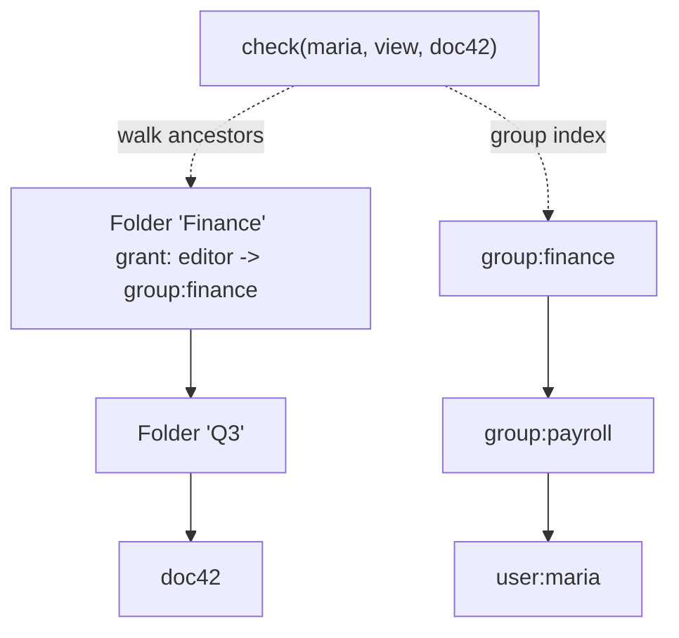
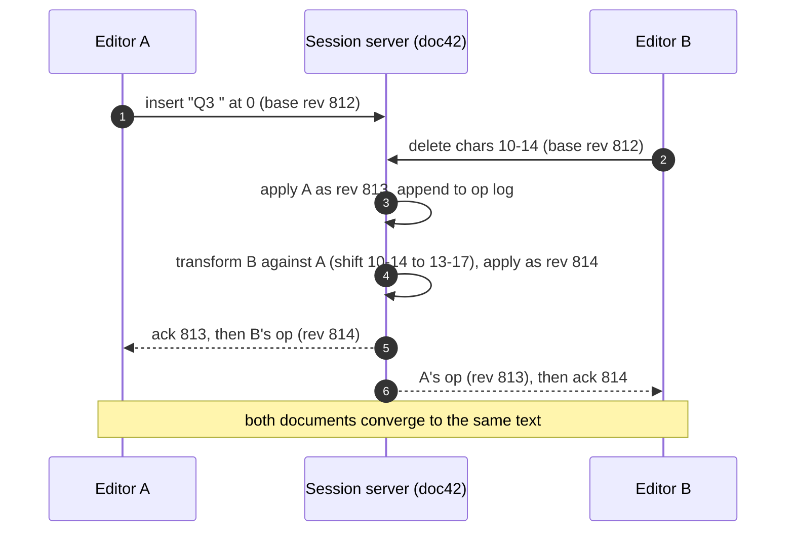
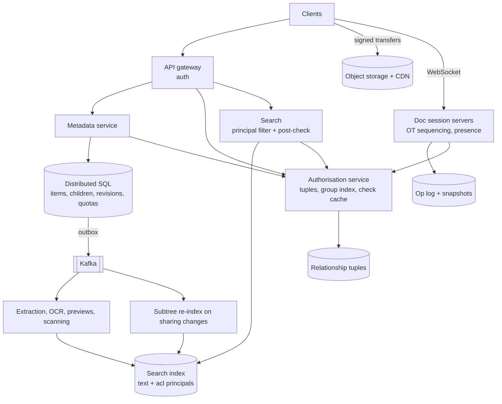

## Problem statement

Design a cloud file service like Google Drive: users store files in folders, share files and folders with people, groups or anyone with a
link at different permission levels, keep version history, search across everything they can access — by name and by content — and edit
documents together in real time. Unlike a sync-first design, the hard parts here are **permissions**, **permission-aware search** and
**collaborative editing**.

**Interview format:** 45–60 minutes · **Difficulty:** advanced · **Main themes:** hierarchical access control and inheritance, permission
checks at scale, content indexing with ACL filtering, versioning, real-time collaborative editing (OT/CRDT), the metadata/blob split.

> [!TIP] Try it first
> Before scrolling, spend three minutes writing the questions you would ask the interviewer. Then compare with the list below — or
> practise this whole problem as a [timed mock interview](#system-design/hld/interview/google-drive).

## Clarifying questions

The answers below are the interviewer's. Questions that change the design come first.

- **Q:** Which features are in scope? <!-- match: features, scope, what do we build, functionality, in scope -->
  - **A:** Upload and download, folders, sharing, version history, search, previews, and real-time collaborative editing of documents.
    Desktop folder sync is out of scope.
- **Q:** What scale? <!-- match: scale, how many, users, files, storage, traffic, volume -->
  - **A:** 100 million daily active users, 10 billion files (about 20 PB), 50 million uploads and 500 million metadata operations a day.
- **Q:** How does sharing work? <!-- match: sharing, share, permissions, roles, access, acl -->
  - **A:** Share with users, groups or "anyone with the link", as viewer, commenter or editor. Sharing a folder shares everything inside it.
- **Q:** How fast must permission changes take effect? <!-- match: revoke, permission change, how fast, immediately, propagate -->
  - **A:** Revoking access must take effect within seconds, everywhere — including search results.
- **Q:** What should search cover? <!-- match: search, content, full text, find files, query -->
  - **A:** File names and the text content of documents, PDFs and images (via OCR), only among files the user can access.
- **Q:** How does collaborative editing behave? <!-- match: collaborative, real time editing, concurrent edits, co-editing, google docs -->
  - **A:** Many users edit the same document at once and see each other's changes and cursors within a few hundred milliseconds; no edits
    may be lost.
- **Q:** How long is version history kept? <!-- match: versions, version history, history, restore -->
  - **A:** Documents keep full revision history; uploaded files keep versions for 30 days or a fixed number of versions.
- **Q:** Are there storage quotas? <!-- match: quota, quotas, storage limit, plan -->
  - **A:** Yes, per user or organisation.

## Functional requirements

> [!TIP] Try it first
> Write three or four functional requirements before reading on.

- Users can **upload, download and organise files** in folders. <!-- match: upload, download, folders, organise -->
- Users can **share** files and folders with users, groups or links, with **roles**. <!-- match: share, roles, permissions -->
- Users can **search** names and content across files they can access. <!-- match: search, content -->
- Users can **edit documents together** in real time. <!-- match: edit together, collaborative, real time -->
- Users can **view and restore versions**. <!-- match: versions, restore, history -->

````hint title="Hint: the check on every request"
Every open, download, search result and edit requires "can this user do this to this file?". How expensive is that check if permissions
are inherited through a deep folder tree and granted to groups?
````

## Non-functional requirements

- **Correct access control**: no unauthorised access; revocations effective within seconds. <!-- match: access control, authorised, revocation -->
- **Durability**: no file or edit is ever lost. <!-- match: durable, durability, never lost -->
- **Low latency**: metadata operations and permission checks in milliseconds; edits propagate in < 500 ms. <!-- match: latency, fast, milliseconds -->
- **Scale**: billions of files, thousands of metadata operations per second. <!-- match: scale, billions -->
- **High availability** for opening and editing documents. <!-- match: availability, available -->

````hint title="Hint: search and revocation"
A user loses access to a folder of 10,000 files. If the search index stores who can see each file, how many index entries change?
````

## Scope and exclusions

In scope: metadata and folder hierarchy, blob storage, uploads/downloads, sharing and ACL evaluation, search with ACL filtering, versions,
previews, collaborative editing, quotas.

Out of scope: desktop sync clients (see [Dropbox](problem:dropbox)), office-suite rendering details, data-loss prevention policies, billing.

## Capacity estimation

> [!TIP] Try it first
> Estimate metadata operations, upload bandwidth, storage and metadata size.

- **Metadata operations:** 500M/day ≈ **5,800/s** average, several times that at peak — each includes a permission check.
- **Uploads:** 50M/day ≈ **580/s**; at ~2 MB average, **~1.2 GB/s** and **~100 TB/day** of new blob data.
- **Storage:** 10B files × ~2 MB ≈ **20 PB**, plus versions.
- **Metadata:** 10B files × ~1 KB ≈ **10 TB**, plus ACL entries — too large for one database; shard it.
- **Collaborative sessions:** a few million documents open for editing at peak, each with a handful of editors.

```estimator title="Cloud drive (metadata operations and uploads)"
requestsPerDay = 550M
readsPerWrite = 10
writeBytes = 2 MB
readBytes = 50 KB
retentionYears = 1
peakFactor = 3
replication = 1
cachePercent = 5
serverRps = 1500
targetUtilization = 60
```

Writes are uploads (blob bytes, durability handled by the object store); reads are metadata operations and listings. Downloads are served from
object storage and the CDN with signed URLs.

**What the numbers mean for the design:**

- **Metadata is the hard store**: sharded, strongly consistent per item, with fast permission evaluation.
- **Blobs are the big store**: object storage with signed, direct transfers ([large blobs](lesson:large-blobs)).
- **Search and editing** are separate subsystems with their own scaling.

````hint title="Hint: shard key for metadata"
Folders contain files owned by different people, and shared drives are owned by organisations. What should the metadata shard key be?
````

## API design

> [!TIP] Try it first
> Define file operations, sharing and search. Where are permission checks applied?

```text title="API"
POST   /v1/files/uploads      { "parent_id", "name", "size", "mime" }  -> presigned upload session
GET    /v1/files/{id}                         -> metadata (requires view)
GET    /v1/files/{id}/content                 -> 302 to a short-lived signed URL (requires view)
GET    /v1/folders/{id}/children?cursor=      -> children the caller can see
PATCH  /v1/files/{id}       { "name" | "parent_id" }          (requires edit)
GET    /v1/files/{id}/revisions               POST /v1/files/{id}/revisions/{rev}/restore

POST   /v1/files/{id}/permissions   { "principal": "user:u9" | "group:g4" | "anyone_with_link",
                                      "role": "viewer" | "commenter" | "editor" }
DELETE /v1/files/{id}/permissions/{perm_id}

GET    /v1/search?q=quarterly+forecast&type=pdf&cursor=   -> only files the caller can view
WS     /v1/docs/{id}/session                  -> collaborative editing ops, cursors, presence
```

- **Every endpoint checks permissions** server-side; download URLs are short-lived so revocation also stops downloads quickly.

````hint title="Hint: listing a folder"
A folder contains 500 items, some shared with the caller and some not. Does listing it need 500 permission checks?
````

## Data model

> [!TIP] Try it first
> How do you represent the folder tree, ACLs and inheritance so checks are fast?

```text title="Schema"
items        (item_id PK, owner_id, parent_id, name, kind: file | folder | doc, mime, size,
              current_rev, blob_key, trashed, created_at, updated_at)   sharded by item_id
children     (parent_id, name, item_id)            PK (parent_id, item_id)   co-located with parent
acl          (item_id, principal, role, inherited_from)   explicit grants on files and folders
group_members(group_id, member)                     users and nested groups
revisions    (item_id, rev, blob_key | op_log_range, author, created_at)
doc_ops      (doc_id, seq, op, author, at)          append-only operation log for documents
quotas       (owner_id, used_bytes, limit_bytes)

Search index: one entry per file with name, extracted text, owner, mime, modified,
              plus an "acl principals" field (users and groups allowed to view)
```

- **Explicit grants** are stored where they're made; **inheritance** is resolved through `parent_id` (and cached), so sharing a folder doesn't
  write 10,000 rows.
- **Relationship-based access control**: permissions are tuples like `(doc:42, viewer, group:finance)` and `(group:finance, member,
  user:u9)`, as in Google's Zanzibar paper ([authentication and authorisation](lesson:auth)).

````hint title="Hint: groups inside groups"
"Finance" includes "Payroll", which includes Maria. How do you answer "is Maria a viewer of doc 42?" without walking the whole graph each time?
````

## Initial high-level architecture

Build the design one requirement at a time.

### Step 1: metadata and blobs

A **metadata service** owns items, the folder tree and revisions in a sharded, strongly consistent store; file bytes go directly to **object
storage** with presigned URLs, and downloads use short-lived signed URLs through a CDN ([object storage](lesson:object-storage)).

### Step 2: permissions

A dedicated **authorisation service** stores relationship tuples (grants, group memberships, parent links) and answers `check(user, action,
item)` by walking item ancestors and group memberships, with aggressive caching and a precomputed index of group membership.

### Step 3: search

An **ingestion pipeline** extracts text from uploads (parsers, OCR) and indexes it with the file's access principals; queries filter by the
caller's principals (their user ID and all groups they belong to), then re-check the top results with the authorisation service.

### Step 4: collaborative editing

Each open document has a **document session server** that sequences edits from all editors, transforms concurrent operations, persists them
to the op log, and broadcasts them to connected clients ([real-time at scale](lesson:realtime-at-scale)).

````hint title="Hint: one authority per document"
If two editors' operations reach two different servers, who decides their order?
````

## Architecture diagram



## Request and data flow



## Component responsibilities

| Component | Responsibility | Scales with |
|---|---|---|
| Metadata service | Items, folder tree, moves, revisions, quotas | Metadata operations |
| Authorisation service | Store tuples, evaluate checks, list accessible principals | Checks/s |
| Object storage + CDN | File and revision bytes; signed downloads | Bytes stored and served |
| Ingestion pipeline | Text extraction, OCR, thumbnails, indexing | Uploads |
| Search service | Queries filtered by principals, post-check | Searches/s |
| Document session servers | Sequence and transform edits, broadcast, persist | Open documents |
| Op log + snapshots | Document history and recovery | Edits |

## Database and technology choices

| Need | Choice | Why | Alternative |
|---|---|---|---|
| Metadata | Spanner-like distributed SQL, or sharded PostgreSQL by item | Strong consistency for moves and renames | Bigtable/HBase with careful transactions |
| ACLs | Zanzibar-style tuple store with caches and a group index | Consistent, scalable permission checks | Per-item ACL rows only (slow inheritance) |
| Blobs | Object storage, versioned keys | Durable, cheap | — |
| Search | Elasticsearch-like index with principal filtering | Full-text with ACL filter | Per-user indexes (too many copies) |
| Editing | Session servers + op log (OT or CRDT) | Real-time, ordered edits | Last-writer-wins saves (lose edits) |
| Events | Kafka via outbox | Drive indexing, previews, audit | — |

## Scaling strategy

### How are inherited permissions checked quickly?

Permissions are stored as relationship tuples, and a check walks two graphs: up the folder tree from the item (each ancestor may grant a role)
and through nested group memberships. Three things keep it fast: a **precomputed group-membership index** (which groups, transitively, contain
this user — maintained when memberships change); **caching** check results keyed by the item's and principals' ACL versions; and keeping tree
depth bounded in practice. Revocation bumps the ACL version, invalidating cached checks within seconds. This is the approach Google described
for Zanzibar, including "zookies" — consistency tokens that ensure a check isn't evaluated against data older than a content change it
protects.



### How does search respect permissions?

Index each file with its **effective viewer principals** — explicit user grants plus the groups that can see it (including inherited folder
grants). A query adds a filter "acl_principals contains any of the caller's principals" (their user ID and their transitive groups, from the
group index), then the top results are re-checked with the authorisation service, so a stale index can never leak a file. When a folder's
sharing changes, an asynchronous job re-indexes the principals of its descendants; until it finishes, the post-check removes revoked
results and newly granted files may appear a little later ([search fundamentals](lesson:search-fundamentals)).

### How does real-time collaborative editing work?

Each document is assigned (by consistent hashing) to one **session server**, the single authority for its edit order. Clients send operations
("insert 'x' at 104, based on revision 812"); the server transforms each operation against those applied since the client's base revision
(**operational transformation**), assigns it the next sequence number, appends it to the op log, and broadcasts it. Clients apply incoming ops
and transform their pending local ones. Periodic snapshots bound replay time. **CRDTs** are the main alternative: edits merge without a
central authority, which suits offline and peer-to-peer editing at the cost of larger metadata ([consistency models](lesson:consistency-models)).



### How is metadata sharded?

By item ID, with the `children` index co-located with the parent folder so listing a folder is a single-shard query. Moves between folders
on different shards need a cross-shard transaction (or a distributed SQL database that provides them), which is why systems at this scale
often use Spanner-like stores. Shared drives belonging to organisations can be placed together for locality ([sharding](lesson:sharding)).

## Caching strategy

### What is cached, and how is it kept correct?

- **Permission check results** keyed by (user, item, ACL versions), short TTL; invalidated by version bumps on revocation.
- **Group membership closures** per user, updated on membership changes.
- **Folder listings and metadata** for hot shared folders.
- **Previews and thumbnails** on the CDN by revision ID (immutable).
- **Downloads** through signed, short-lived CDN URLs — never cache content without a permission check in front ([cache invalidation](lesson:cache-invalidation)).

## Messaging strategy

### Which events drive the background work?

Metadata changes publish events through an outbox: `FileUploaded` (extraction, previews, virus scan, indexing), `PermissionsChanged`
(re-index principals for the subtree, invalidate caches, audit), `FileMoved` (re-evaluate inherited permissions for the moved subtree) and
`RevisionCreated` (retention policies). Subtree jobs are chunked and idempotent so huge folders are processed safely ([outbox and CDC](lesson:outbox-cdc)).

## Failure scenarios

| Failure | Impact | Mitigation |
|---|---|---|
| Search index lags after revocation | Revoked files could appear | Post-check every returned result with the authorisation service |
| Session server for a document crashes | Editors briefly disconnected | Reassign the document; rebuild from snapshot + op log; clients resend unacked ops |
| Authorisation service slow | Every request slows | Caches, replicas, fail closed for access (never default-allow) |
| Large folder re-share | Millions of index updates | Chunked asynchronous jobs; post-check covers the gap |
| Upload interrupted | Partial file | Resumable sessions; item stays "pending" |
| Quota race (two uploads) | Over quota | Atomic quota reservation at upload start |

## Bottleneck analysis

- **Permission checks** on every operation — caching and the group index are essential.
- **Re-indexing after sharing changes** on huge folders — asynchronous, chunked.
- **Hot documents** with hundreds of editors — one session server per document; cap editors, shed viewers to read-only.
- **Metadata hot spots** (very large shared folders) — dedicated shards.

## Consistency and availability trade-offs

- **Strong consistency** for metadata changes and permission writes; checks use consistency tokens so they're not stale relative to content.
- **Eventual consistency** for search indexing and previews, guarded by post-checks for security.
- **Per-document linearizability** for edits through a single session authority.
- **Fail closed** on authorisation errors: unavailable access beats unauthorised access.

## Security considerations

- Server-side permission checks on every API call; signed, short-lived download URLs.
- "Anyone with the link" uses unguessable link tokens; link access can be disabled by organisation policy.
- Encryption at rest with per-tenant keys for enterprise customers; audit logs of shares and accesses.
- Malware scanning on upload; safe preview rendering in sandboxes.

## Monitoring and observability

- Permission check latency and cache hit ratio; check denials and errors.
- Indexing lag for content and for permission changes; post-check removal rate (signals stale index).
- Collaborative editing: op latency, session reassignments, unacknowledged ops.
- Upload success rates, storage growth, quota enforcement events.

## Final architecture

Open this after you have drawn your own.

````solution title="Final architecture"


**In one breath:** file bytes move directly to and from object storage with signed URLs while a strongly consistent, sharded metadata store
holds the folder tree, revisions and quotas; a Zanzibar-style authorisation service stores grants, parent links and group memberships as
relationship tuples and answers every check by walking ancestors and a precomputed group index with versioned caches; content is extracted and
indexed with each file's viewer principals, queries filter by the caller's principals and post-check results, and sharing changes trigger
chunked subtree re-indexing; documents are edited through one session server per document that sequences and transforms operations into a
durable op log with snapshots.
````

## Alternative designs and trade-offs

| Alternative | Gains | Costs | When to choose it |
|---|---|---|---|
| Materialise effective ACL per file | Fast single-row checks | Massive writes on folder re-shares and moves | Flat structures with rare sharing changes |
| Per-user search indexes | Simple permission filtering | Duplicated content for shared files | Personal-only search |
| CRDT-based editing | Offline and peer-to-peer friendly | Larger state, complex garbage collection | Offline-first editors |
| Lock-based editing (one editor at a time) | Simple | No real-time collaboration | Binary file formats |
| Sharded PostgreSQL for metadata | Familiar | Cross-shard moves are hard | Smaller deployments |

## Interviewer follow-up questions

````question title="A user is removed from a group. How quickly do they lose access, and where?"
The membership tuple is deleted and the group-index entry for that user is updated, bumping ACL versions; cached checks keyed on the old
version stop being used within seconds, so file opens and downloads fail immediately after (existing signed download URLs expire within
minutes). Search still contains the group in those files' principals, but the user's principal list no longer includes the group, so the
filter excludes them — and the post-check catches any remaining case.
````

````question title="Why not copy the full ACL onto every file when a folder is shared?"
Because a share or move on a folder with millions of descendants would rewrite millions of rows synchronously, and frequent changes would
create constant write storms and race conditions. Storing explicit grants where they're made and resolving inheritance at check time (with
caching) keeps writes cheap; denormalised copies are kept only where reads need them — the search index — and updated asynchronously with a
safety post-check.
````

````question title="How do two people editing the same paragraph not lose each other's changes?"
Both send operations against the revision they last saw. The document's session server orders them, applying the first and transforming the
second against it — shifting positions or merging overlapping deletes — before applying and broadcasting it. Each client transforms incoming
operations against its own unacknowledged ones the same way, so every copy converges to the same text and no operation is dropped. The ordered
op log is persisted, so even a server crash loses nothing that was acknowledged.
````

````question title="How would you implement version history for documents?"
The op log is the history: every acknowledged operation has a sequence number, author and time. Periodic snapshots let any version be rebuilt
by loading the nearest snapshot and replaying operations up to the target sequence. Named versions are just labels on sequence numbers, and
restoring creates new operations that transform the current document back, so history stays append-only.
````

````question title="How do you search 20 PB of content efficiently?"
You don't search the bytes — you search an inverted index built from extracted text when files are uploaded or changed, sharded by file ID
across many index nodes. Queries go to all shards with the caller's principal filter, each shard returns its top results, and the merged top
results are re-checked for access. Indexing is asynchronous and prioritised (recent and frequently used files first), and very large files
index only their first portion.
````

## Common mistakes

- **Checking permissions only in the UI** or trusting cached checks across revocations.
- **Materialising inherited ACLs synchronously** on every folder change.
- **Search without permission filtering** or without a post-check.
- **Multiple servers accepting edits** for the same document without a single order.
- **Saving whole documents** with last-writer-wins.
- **Long-lived public download URLs.**

## Evaluation checklist

```checklist title="Evaluation checklist"
- Asked about sharing model, revocation speed, search scope, collaborative editing and versions
- Estimated metadata operations, uploads, blob storage and metadata size
- Separated sharded metadata from blob storage with signed transfers
- Modelled permissions as tuples with folder inheritance and nested groups
- Made checks fast with a group index and versioned caches; failed closed
- Indexed content with ACL principals and post-checked results
- Re-indexed subtrees asynchronously after sharing changes
- Sequenced document edits through one session authority with OT (or CRDTs)
- Persisted an op log with snapshots for history and recovery
- Discussed quotas, previews and audit logging
```
