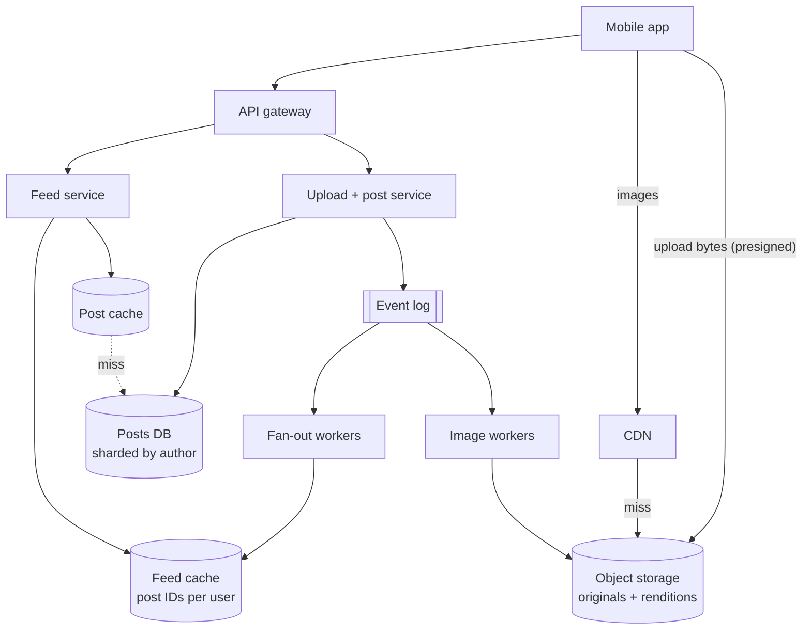
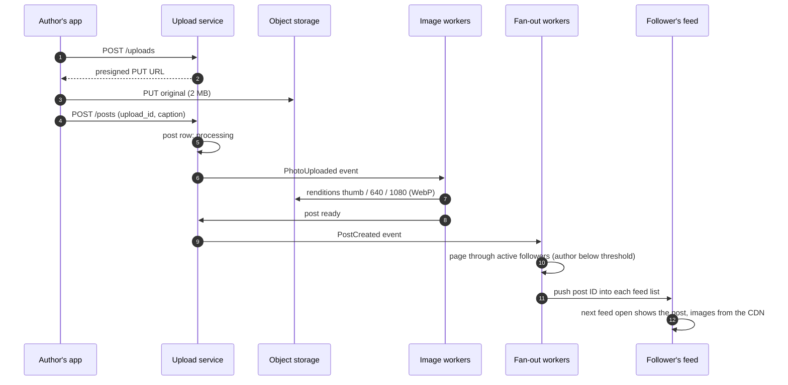
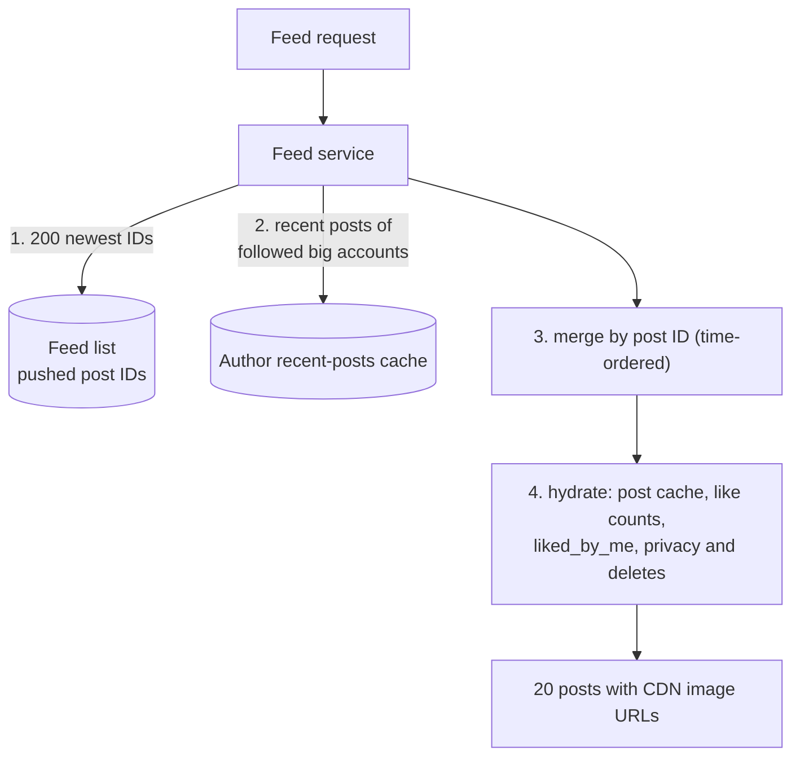
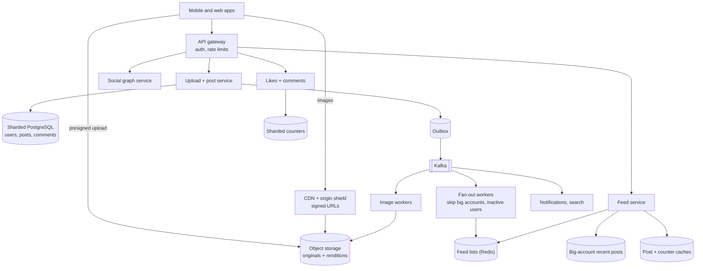

## Problem statement

Design a photo-sharing service like Instagram: users upload photos with captions, follow other users, and scroll a home feed of photos from
the accounts they follow, served quickly to a worldwide audience. Photos must never be lost, and new posts should reach followers' feeds
within seconds.

**Interview format:** 45–60 minutes · **Difficulty:** intermediate · **Main themes:** direct uploads and an image-processing pipeline,
CDN delivery of many image sizes, feed fan-out, sharded metadata, counters.

> [!TIP] Try it first
> Before scrolling, spend three minutes writing the questions you would ask the interviewer. Then compare with the list below — or
> practise this whole problem as a [timed mock interview](#system-design/hld/interview/instagram).

## Clarifying questions

The answers below are the interviewer's. Questions that change the design come first.

- **Q:** Which features are in scope? <!-- match: features, scope, what do we build, functionality, in scope -->
  - **A:** Uploading photos with captions, following users, the home feed, profile pages, and likes and comments. Stories, reels, direct
    messages, search and ads are out.
- **Q:** How many users and how much content? <!-- match: scale, users, dau, how many, uploads per day, traffic, volume -->
  - **A:** 500 million daily active users. About 100 million photos are uploaded per day; each user opens the feed about 10 times a day.
- **Q:** Photos only, or video too? How large are uploads? <!-- match: video, media, photo size, file size, how large, resolution -->
  - **A:** Photos only. The app resizes before upload, so originals average about 2 MB.
- **Q:** Is the feed chronological or ranked? <!-- match: ranking, ranked, chronological, order, algorithm -->
  - **A:** Assume newest first for the core design; ranking is a follow-up.
- **Q:** What latency do we need? <!-- match: latency, fast, p99, load time, speed -->
  - **A:** The first feed page within 300 ms at p99 (excluding image downloads), and images should start loading quickly anywhere in the
    world.
- **Q:** Where are the users? <!-- match: global, worldwide, regions, countries, where are users, geography -->
  - **A:** Worldwide.
- **Q:** How quickly must a new post appear for followers? <!-- match: fresh, freshness, appear, delay, how quickly, real time -->
  - **A:** Within a few seconds normally; up to a minute during peaks is acceptable.
- **Q:** Are there private accounts? <!-- match: private, privacy, visibility, permissions, who can see -->
  - **A:** Yes. Posts from private accounts are visible only to approved followers.
- **Q:** Can posts be deleted? <!-- match: delete, deletion, remove, takedown -->
  - **A:** Yes, by the author or by moderation; deleted photos must stop being served quickly.

## Functional requirements

> [!TIP] Try it first
> Write three or four functional requirements before reading on.

- Users can **upload a photo** with a caption. <!-- match: upload, post, photo -->
- Users can **follow and unfollow** other users, with approval for private accounts. <!-- match: follow, unfollow -->
- Users can **view a home feed** of followed accounts' posts, newest first. <!-- match: feed, home feed, timeline -->
- Users can **view a profile** grid of one user's posts. <!-- match: profile, grid -->
- Users can **like and comment** on posts. <!-- match: like, comment, likes, comments -->

````hint title="Hint: two very different workloads"
One requirement moves megabytes of image data; another assembles small lists of IDs at high request rates. Which components serve each?
````

## Non-functional requirements

- **Durability**: an uploaded photo is never lost. <!-- match: durable, durability, never lost -->
- **Low latency**: feed under 300 ms p99; images served from nearby edges. <!-- match: latency, fast, 300 ms -->
- **High availability**: feeds and images keep serving during partial failures. <!-- match: availability, available -->
- **Scale**: 100M uploads and 5B feed opens per day, worldwide. <!-- match: scale, global, worldwide -->
- **Eventual consistency** for feeds and counters; **privacy** enforced on every read. <!-- match: eventual, consistency, privacy -->

````hint title="Hint: what is the most expensive resource?"
Compute the bytes served per day for images. Compare it with the bytes uploaded.
````

## Scope and exclusions

In scope: uploads, image processing, storage, CDN delivery, follow graph, home feed, profiles, likes and comments, deletion and privacy.

Out of scope: video, stories and reels, direct messages, search and explore, ads, recommendation models, notifications (assume a separate
service).

## Capacity estimation

> [!TIP] Try it first
> Estimate uploads per second, storage per day, feed reads per second and image egress.

- **Uploads:** 100M/day ÷ 86,400 ≈ **1,160/s**, ~3,500/s at peak.
- **Storage:** originals 100M × 2 MB = **200 TB/day**; renditions (thumbnail, 640 px, 1080 px) add ~0.6 MB each → **~260 TB/day**,
  **~95 PB/year** before the storage provider's own redundancy.
- **Feed reads:** 500M × 10 = 5B/day ≈ **58,000/s**, ~175,000/s at peak.
- **Image egress:** each feed open loads ~10 images at ~100 KB (mobile size) → 5B × 1 MB = **5 PB/day ≈ 460 Gbit/s** on average. A CDN
  serving 95% leaves ~23 Gbit/s at origin.
- **Fan-out:** 100M posts × ~300 followers = 30B inbox inserts/day ≈ **350,000/s** if every post were pushed.
- **Feed cache:** 500M users × 500 post IDs × 8 bytes ≈ **2 TB** of IDs.

```estimator title="Instagram (feed API and uploads)"
requestsPerDay = 5.1B
readsPerWrite = 50
writeBytes = 2.6 MB
readBytes = 10 KB
retentionYears = 5
peakFactor = 3
replication = 1
cachePercent = 0
serverRps = 2000
targetUtilization = 60
```

The calculator models feed requests (about 10 KB of JSON each) and uploads (original plus renditions); replication is left at 1 because the
object store provides durability internally. Image egress is far larger than API egress and is computed above.

**What the numbers mean for the design:**

- **Image bytes dominate** — CDN delivery and responsive image sizes are the biggest cost lever.
- **Feed reads are 50× uploads** — precompute feeds; keep them as IDs.
- **Uploads are modest in count but heavy in bytes** — they must go straight to object storage.

````hint title="Hint: storage per year"
260 TB/day × 365 is about 95 PB. Which storage classes and lifecycle rules keep that affordable?
````

## API design

> [!TIP] Try it first
> Define uploading, posting, following and reading the feed. How does a client upload the image itself?

```text title="API"
POST /v1/uploads    { "content_type": "image/jpeg", "size": 2104331, "sha256": "..." }
  -> 201 { "upload_id": "up_77", "put_url": "<presigned URL, valid 15 min>" }
PUT  <put_url>                          (image bytes go straight to object storage)

POST /v1/posts      { "upload_id": "up_77", "caption": "Sunrise", "idempotency_key": "..." }
  -> 202 { "post_id": "2741995508121600000", "status": "processing" }

GET  /v1/feed?cursor=<post_id>&limit=20
  -> 200 { "posts": [ { "id", "author", "caption",
                        "images": { "thumb": url, "640": url, "1080": url },
                        "like_count", "liked_by_me", "created_at" } ], "next_cursor": "..." }
GET  /v1/users/{id}/posts?cursor=...    (profile grid)
PUT  /v1/users/{id}/following/{target}  (follow; pending if target is private)
PUT  /v1/posts/{id}/likes/me            DELETE /v1/posts/{id}/likes/me
POST /v1/posts/{id}/comments            { "text": "..." }
```

- Image URLs point to the **CDN** and are signed with an expiry; clients choose the size that fits the screen.
- `PUT .../likes/me` is idempotent: a double tap doesn't double count.

````hint title="Hint: why 202 for a new post?"
What still has to happen after the post is accepted before followers can see it?
````

## Data model

> [!TIP] Try it first
> List the stores for metadata, the graph, feeds, counters and images. Which key shards each?

```text title="Schema"
users        (user_id PK, handle UNIQUE, is_private, ...)                 sharded by user_id
posts        (post_id PK, author_id, caption, status, image_key, created_at, deleted)
                                                                          sharded by author_id
follows      (follower_id, followee_id, state: active | pending)          by follower_id
followers    (followee_id, follower_id)                                   by followee_id
likes        (post_id, user_id, created_at)  PK (post_id, user_id)        by post_id
comments     (post_id, comment_id, author_id, text, created_at)           by post_id
like_counts  (post_id, shard 0..15, count)                                sharded counters

Feed cache (Redis):     feed:{user_id} -> list of post IDs, newest first, capped at 500
Object storage:         originals/{post_id}.jpg, derived/{post_id}/{thumb|640|1080}.webp
```

- **Post IDs are time-ordered 64-bit IDs** that embed a shard number, so any post's shard is known from its ID, and feeds sort by ID.
- **Posts are sharded by author**, so a profile grid is a single-shard query.
- Images live in **object storage**; the database holds only keys and status ([object storage](lesson:object-storage)).

````hint title="Hint: sharding posts"
Which query must be cheapest: "posts by this author" or "post by ID"? Can an ID scheme make both single-shard?
````

## Initial high-level architecture

Build the design one requirement at a time.

### Step 1: upload and process

The client asks the **upload service** for a presigned URL and uploads the image directly to object storage. When the client creates the
post, a `PhotoUploaded` event triggers **image workers** that validate the file, strip location metadata if needed, and generate renditions;
the post becomes `ready` when they finish ([large blobs](lesson:large-blobs)).

### Step 2: fan out

When a post is ready, a `PostCreated` event goes to **fan-out workers**, which push the post ID into the feed caches of the author's active
followers — except for authors with very large followings, whose posts are pulled at read time ([fan-out](lesson:fan-out)).

### Step 3: read the feed

The **feed service** reads the user's cached list of post IDs, merges recent posts from followed high-follower accounts, hydrates posts from
the post cache (with like counts and whether the viewer liked them), filters deleted and private content, and returns CDN URLs.

### Step 4: deliver images

Clients fetch images from the **CDN**, which caches renditions at the edge and pulls misses from object storage.

````hint title="Hint: where do the bytes flow?"
Trace one photo from the phone to a follower's screen. How many times does it pass through an application server?
````

## Architecture diagram



## Request and data flow



## Component responsibilities

| Component | Responsibility | Scales with |
|---|---|---|
| Upload + post service | Presigned URLs, post records, idempotency | Uploads/s |
| Image workers | Validate, resize, encode renditions, scan | Uploads × renditions (CPU) |
| Object storage | Durable originals and renditions | Bytes stored |
| CDN | Edge caching of images worldwide | Image egress |
| Fan-out workers | Push post IDs into followers' feed caches | Posts × followers |
| Feed service | Read, merge, hydrate, filter feeds | Feed opens/s |
| Social graph service | Follows, followers, approvals | Follow edges |
| Counters service | Likes and comment counts | Likes/s |

## Database and technology choices

| Need | Choice | Why | Alternative |
|---|---|---|---|
| Users, posts, comments | Sharded PostgreSQL (logical shards on fewer servers) | Relational data, mature tooling, shard by user | Cassandra for posts at larger scale |
| Follow graph | Sharded tables keyed both ways | One-hop lookups in both directions | Graph database (unnecessary) |
| Feeds | Redis lists of post IDs | Fast pushes and range reads | Cassandra rows per user |
| Images | Object storage + CDN | Cheap, durable, global delivery | Self-hosted storage (only at very large scale) |
| Events | Kafka | Durable, replayable, multiple consumers | SQS + SNS |
| Like counts | Sharded counters + cache | Spread hot writes | Single counter row (hot) |

## Scaling strategy

### How are uploads and image processing scaled?

Uploads bypass application servers: presigned URLs send bytes straight to object storage. Image workers consume events from a queue and
scale with its depth; each produces a few renditions in modern formats (WebP or AVIF) and writes them under the post's ID, so retries
overwrite rather than duplicate. Processing a 2 MB photo takes well under a second of CPU, so ~3,500 uploads/s at peak needs a few thousand
cores — easy to autoscale. The post is shown as "processing" to the author until renditions exist ([long-running jobs](lesson:long-running-jobs)).

### How is the feed built?

Hybrid fan-out: posts from ordinary accounts are pushed as IDs into followers' feed lists (capped at a few hundred entries, active users
only); posts from accounts above a follower threshold are pulled from a cached "recent posts by author" list and merged at read time.
Inactive users' feeds are rebuilt on their next visit. Ranking, if added, reorders a candidate set built the same way.



### How are images delivered worldwide?

A CDN caches renditions close to users; clients request the size that fits the screen, so most traffic is ~100 KB images, not 2 MB
originals. New posts from popular accounts are fetched by many edges at once, so an origin shield (a mid-tier cache) collapses those misses.
Image URLs are long and unguessable, signed with an expiry, so private-account images can't be fetched by URL guessing, and deleted images
are purged from the CDN.

### How is metadata sharded?

Users, posts and comments are split into many **logical shards** (thousands) mapped onto fewer physical database servers; moving a logical
shard rebalances load without re-keying. Post IDs embed the logical shard of the author plus a timestamp, so `post by ID` and
`posts by author` both hit one shard, and IDs sort by time ([sharding](lesson:sharding)).

### How are likes counted?

A like is a row `(post_id, user_id)` — idempotent, and needed for "liked by me". The visible count comes from **sharded counters** (several
rows per post incremented at random and summed) cached in Redis, so a viral post doesn't serialise on one row ([hot keys](lesson:hot-keys)).

## Caching strategy

### Which caches serve the read path?

- **CDN** for every image rendition (the largest cache by far).
- **Feed lists** in Redis: post IDs per active user.
- **Post cache**: post metadata by ID, populated cache-aside; counts cached separately with short TTLs because they change constantly.
- **Author recent-posts cache** for high-follower accounts, replicated across nodes because millions of feeds read it.

### How are caches kept correct after edits and deletes?

Deletes mark the post deleted in the database, invalidate its cache entry, and purge its image URLs from the CDN; the feed service drops
deleted IDs during hydration, so feed lists don't need to be rewritten. Caption edits invalidate the post cache entry
([cache invalidation](lesson:cache-invalidation)).

## Messaging strategy

### Which events flow through the log?

`PhotoUploaded` (image workers), `PostCreated` and `PostDeleted` (fan-out, search indexing, notifications), `Followed`/`Unfollowed`
(feed backfill and filtering), and `Liked` (counters, notifications). Each consumer has its own group, so adding one never changes the
upload path. Post creation writes the event through an outbox so a post is never stored without its event ([outbox and CDC](lesson:outbox-cdc)).

## Failure scenarios

| Failure | Impact | Mitigation |
|---|---|---|
| Image workers backlog | Posts stay "processing" longer | Autoscale on queue depth; prioritise small jobs |
| Fan-out lag during peaks | New posts appear late in feeds | Chunked fan-out, skip inactive users, monitor lag |
| Feed cache node lost | Some feeds empty | Replicas; rebuild on read with rate limits |
| CDN edge or provider outage | Slow or failed image loads | Multi-CDN or failover to origin with shield |
| Database shard down | Its users' posts unavailable | Replicas with automatic failover |
| Viral post | Hot cache keys and counters | Replicated hot keys, sharded counters, CDN |

## Bottleneck analysis

- **Image egress** — CDN hit ratio and rendition sizes decide cost.
- **Fan-out writes** — bounded by the celebrity threshold and active-user filter.
- **Hydration** — post cache hit ratio; batch multi-gets per feed page.
- **Hot posts** — counters and cache entries for viral content.

## Consistency and availability trade-offs

- **Photos are strongly durable**: a post is acknowledged only after the original is in object storage and the post row is committed.
- **Feeds and counts are eventually consistent**: seconds of lag are acceptable; authors see their own posts immediately (merged at read).
- **Privacy is checked at read time** against the current follow state, so revoking a follower takes effect immediately.
- **Availability over freshness**: feeds serve from caches even when fan-out is behind.

## Security considerations

- Presigned upload URLs are scoped to one key, content type and size, and expire in minutes.
- Validate and re-encode every upload (no executable content, strip EXIF location unless the user opts in).
- Signed, expiring image URLs; private accounts' posts never appear in feeds of non-approved users.
- Rate-limit uploads, follows, likes and comments to fight spam; moderation removes content and purges it from the CDN.

## Monitoring and observability

- Upload success rate and time from upload to `ready`.
- Fan-out lag; feed latency p50/p99; feed cache hit ratio.
- CDN hit ratio, egress by region, origin load.
- Hot keys and counter shard load; database shard latency and replication lag.

## Final architecture

Open this after you have drawn your own.

````solution title="Final architecture"


**In one breath:** clients upload photos directly to object storage with presigned URLs; post creation records metadata in sharded
PostgreSQL and emits events through an outbox to Kafka; image workers produce WebP renditions that a CDN with an origin shield serves
worldwide via signed URLs; fan-out workers push post IDs into Redis feed lists for active followers, while big accounts' posts are pulled
and merged at read time; the feed service hydrates IDs from post and counter caches, enforcing privacy and deletes on every read; likes are
idempotent rows plus sharded counters.
````

## Alternative designs and trade-offs

| Alternative | Gains | Costs | When to choose it |
|---|---|---|---|
| Pure fan-out on read | No fan-out pipeline | Slow, expensive feed reads | Small user base |
| Upload through API servers | Simpler client | Servers carry gigabytes; fragile uploads | Prototypes only |
| Cassandra for posts and feeds | Higher write scale, multi-region | Less flexible queries | Very large scale, multi-region writes |
| Store only originals, resize on the fly | Less storage | CPU on every cache miss, slower first load | Many sizes, low traffic per image |
| Single CDN provider | Simpler | Provider outage affects all images | Most companies |

## Interviewer follow-up questions

````question title="How would you add a ranked feed?"
Keep the same candidate generation — pushed post IDs plus pulled posts from big accounts, maybe a few hundred candidates — then score them
with a ranking service using features like closeness to the author, engagement predictions and recency, and return the top page. Cache the
ranked page briefly per user so scrolling is stable, log impressions for model training, and fall back to newest-first if ranking is slow.
````

````question title="A celebrity with 300 million followers posts. Walk through what happens."
The upload and processing path is the same as for anyone. At fan-out, the author is above the threshold, so nothing is pushed; the post ID
is added to the author's recent-posts cache, which is replicated widely. When followers open their feeds, the feed service merges that cache
with their pushed lists. Image requests for the post hit the CDN, where the origin shield collapses the first wave of misses; the like
counter is sharded so millions of likes don't contend on one row.
````

````question title="How do you make sure a deleted photo stops being served?"
Mark the post deleted in the database (the source of truth), invalidate the post cache, and issue CDN purges for its rendition URLs; the
feed service drops deleted posts during hydration, so stale IDs in feed lists don't matter. Because image URLs are signed with an expiry,
any URL that escaped stops working when it expires. Finally delete the objects from storage after a short grace period, and remove them from
search and other derived stores via the PostDeleted event.
````

````question title="Why shard posts by author rather than by post ID?"
The most common post queries are the author's profile grid and the posts merged from big accounts — both "posts by author", which become
single-shard range scans when sharded by author. Lookups by post ID stay single-shard too if the ID embeds the author's logical shard. The
cost is uneven shard sizes for prolific authors, which logical shards (many more shards than servers) make easy to rebalance.
````

````question title="How would you reduce image delivery cost by half?"
Serve smaller bytes: encode renditions in AVIF or WebP, pick sizes per device and network, and avoid sending 1080 px images to small
screens. Raise the CDN hit ratio with longer TTLs (images are immutable under their URL) and an origin shield. Move rarely viewed originals
to cheaper storage classes via lifecycle rules. Each of these shows up directly in egress and storage bills.
````

## Common mistakes

- **Uploading through application servers.**
- **Serving originals** instead of size-appropriate renditions through a CDN.
- **Pushing celebrity posts** to every follower.
- **Copying post data into feeds** instead of IDs.
- **A single like counter row** for viral posts.
- **Checking privacy only at fan-out time**, not on every read.

## Evaluation checklist

```checklist title="Evaluation checklist"
- Asked about features, scale, media size, ordering, latency, geography and privacy
- Estimated uploads/s, storage per day and year, feed reads/s and image egress
- Uploaded images directly to object storage with presigned URLs
- Processed images asynchronously into several renditions
- Delivered images through a CDN with signed URLs and an origin shield
- Designed a hybrid fan-out with a celebrity threshold and active-user filter
- Stored feeds as capped lists of post IDs and hydrated from caches
- Sharded metadata by user with time-ordered IDs that encode the shard
- Handled likes with idempotent rows and sharded counters
- Enforced privacy and deletes at read time and purged deleted images
```
