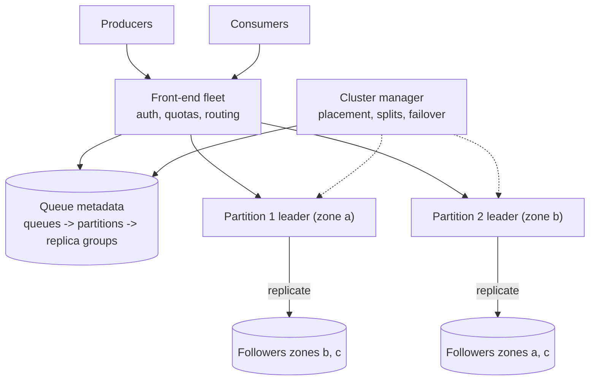
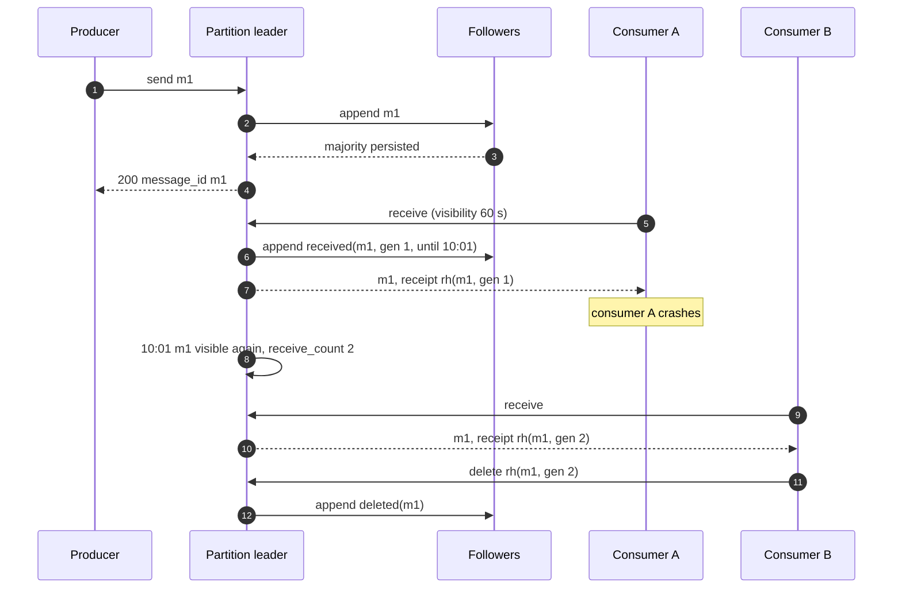
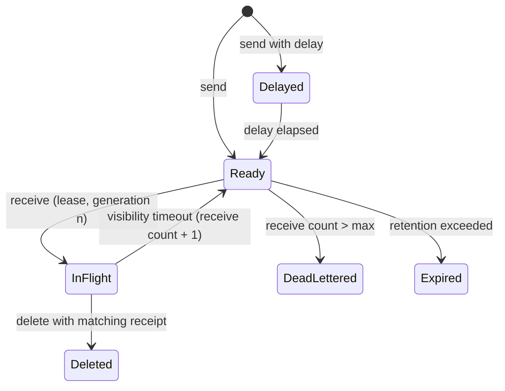
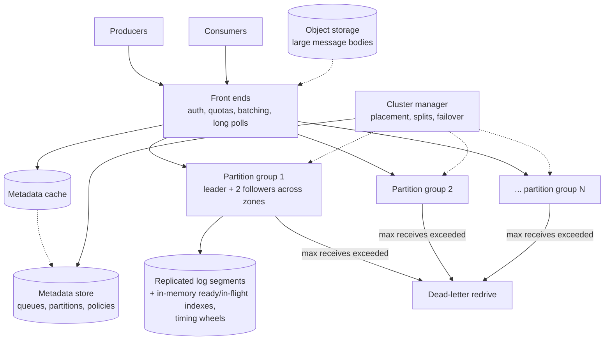

## Problem statement

Design a managed, distributed message queue service like Amazon SQS: producers send messages (jobs) to named queues; consumers receive
them, process them, and delete them; a message that isn't deleted within its visibility timeout becomes available again; messages that keep
failing move to a dead-letter queue. The service hosts many tenants' queues — some tiny, some handling tens of thousands of messages per
second — and must never lose an acknowledged message.

**Interview format:** 45–60 minutes · **Difficulty:** advanced · **Main themes:** durable replicated partitions, visibility timeouts and
receipt handles, at-least-once delivery, FIFO ordering with message groups, dead-letter handling, multi-tenant scaling.

> [!TIP] Try it first
> Before scrolling, spend three minutes writing the questions you would ask the interviewer. Then compare with the list below — or
> practise this whole problem as a [timed mock interview](#system-design/hld/interview/job-queue).

## Clarifying questions

The answers below are the interviewer's. Questions that change the design come first.

- **Q:** Which operations must the queue support? <!-- match: operations, api, features, scope, what do we build, functionality -->
  - **A:** Create and delete queues; send (single and batch), receive (with long polling), delete (ack), change visibility; dead-letter
    queues; delayed messages.
- **Q:** What delivery guarantee? <!-- match: guarantee, delivery, at least once, exactly once, duplicates, semantics -->
  - **A:** Standard queues: at-least-once, best-effort ordering. FIFO queues: strict order per message group and deduplication of
    producer retries.
- **Q:** What scale? <!-- match: scale, throughput, how many, messages per second, traffic, volume -->
  - **A:** About 1 million messages per second across all queues; the largest single queues take 50,000 per second; most queues are tiny.
- **Q:** How large are messages, and how long are they kept? <!-- match: message size, size, retention, how long, keep -->
  - **A:** Up to 256 KB (average about 2 KB), retained up to 14 days if not consumed.
- **Q:** How durable must it be? <!-- match: durable, durability, lose, lost, replicate -->
  - **A:** A message acknowledged to the producer must survive the loss of a server or an availability zone.
- **Q:** What latency? <!-- match: latency, fast, p99, response time -->
  - **A:** Send and receive in tens of milliseconds at p99 (excluding long-poll waiting).
- **Q:** Do we need priorities? <!-- match: priority, priorities, urgent -->
  - **A:** Not within a queue; customers use separate queues for priorities.
- **Q:** Multi-tenant? <!-- match: tenants, multi-tenant, isolation, noisy neighbour, quotas -->
  - **A:** Yes — one customer's huge queue must not affect others.

## Functional requirements

> [!TIP] Try it first
> Write three or four functional requirements before reading on.

- Producers **send messages** (single, batch, delayed) to a queue. <!-- match: send, produce, enqueue -->
- Consumers **receive** messages, which become **invisible** for a visibility timeout. <!-- match: receive, visibility, invisible -->
- Consumers **delete** processed messages; undeleted ones **reappear** after the timeout. <!-- match: delete, ack, reappear -->
- Messages that fail repeatedly move to a **dead-letter queue**. <!-- match: dead letter, dlq -->
- **FIFO queues** preserve order per message group and deduplicate sends. <!-- match: fifo, order, ordering, deduplicate -->

````hint title="Hint: what does 'receive' change?"
A consumer receives a message and then crashes. Without any action, what should eventually happen to that message, and what state must the
queue keep to make it happen?
````

## Non-functional requirements

- **Durability**: no acknowledged message lost, even if a zone fails. <!-- match: durable, durability, no loss, zone -->
- **High availability** for send and receive. <!-- match: availability, available -->
- **Scalability**: 1M messages/s total; any single queue up to 50,000/s. <!-- match: scale, scalability, throughput -->
- **Low latency**: tens of ms p99. <!-- match: latency, ms, p99 -->
- **Tenant isolation**. <!-- match: isolation, tenant -->

````hint title="Hint: one queue, many servers"
A single queue at 50,000 messages/s can't live on one server. How do you split one queue without breaking its semantics?
````

## Scope and exclusions

In scope: queue metadata, partitioning, replicated storage, send/receive/delete paths, visibility timeouts, delays, dead-lettering, FIFO
groups and deduplication, long polling, quotas.

Out of scope: pub/sub fan-out (a separate topic service), message filtering, cross-region replication (one region), consumer autoscaling.

## Capacity estimation

> [!TIP] Try it first
> Estimate ingest bandwidth with replication, daily message count, backlog storage and partitions for the largest queue.

- **Messages:** 1M/s → **86 billion/day**.
- **Ingest:** 1M × 2 KB = **2 GB/s**; replicated three times across zones → **6 GB/s** of storage writes, plus reads.
- **Backlog:** usually small, but provision for, say, 10% of a day's messages waiting → 8.6B × 2 KB ≈ **17 TB**, three copies.
- **Largest queue:** at ~3,000 messages/s per partition (each with replicated writes and state updates), 50,000/s needs **~17 partitions**.
- **Requests:** each message is touched by send, receive and delete — **~3M API calls/s**, reduced by batching (up to 10 messages per call).

```estimator title="Job queue (API calls)"
requestsPerDay = 260B
readsPerWrite = 2
writeBytes = 2 KB
readBytes = 2 KB
retentionYears = 0.003
peakFactor = 2
replication = 3
cachePercent = 0
serverRps = 20000
targetUtilization = 60
```

Writes are sends (2 KB each, retained about a day of backlog with three replicas); reads are receives and deletes. Batching would cut API
calls substantially.

**What the numbers mean for the design:**

- **Storage is write-heavy and short-lived**: an append-only log per partition with segment-based deletion fits well.
- **Every message goes through state changes** (ready → in flight → deleted) — that state must be fast and replicated.
- **Queues must split into partitions**, and the front end must route among them.

````hint title="Hint: empty receives"
A queue has 17 partitions but only 3 hold messages. What happens if consumers poll partitions at random?
````

## API design

> [!TIP] Try it first
> Define send, receive, delete and change-visibility. What is a receipt handle?

```text title="API"
POST /queues/{name}/messages          { "body": "...", "delay_s": 0, "attributes": {...},
                                        "group_id": "order-42", "dedup_id": "..." }  (FIFO)
  -> 200 { "message_id": "m-9f..." }      after the message is replicated to 3 zones

POST /queues/{name}/receive           { "max_messages": 10, "visibility_s": 60, "wait_s": 20 }
  -> 200 { "messages": [ { "message_id", "body", "receipt_handle": "rh-...",
                           "receive_count": 1 } ] }

DELETE /queues/{name}/messages/{receipt_handle}
POST   /queues/{name}/visibility      { "receipt_handle": "rh-...", "visibility_s": 300 }
PUT    /queues/{name}                 { "visibility_s": 30, "retention_days": 4,
                                        "dead_letter": { "queue": "orders-dlq",
                                                         "max_receives": 5 } }
```

- **Receipt handles** identify one *receipt* of a message (partition, offset, lease generation) — not the message — so a stale handle from an
  earlier delivery can't delete a message that has since been redelivered.
- **Long polling** (`wait_s`) keeps the connection open until messages arrive, avoiding empty-receive storms.

````hint title="Hint: why not delete by message ID?"
Consumer A receives a message, stalls past the visibility timeout, consumer B receives it again, then A finally deletes it by message ID.
What went wrong?
````

## Data model

> [!TIP] Try it first
> What does a partition store on disk and in memory to support send, receive, delete and timeouts?

```text title="Schema"
Queue metadata (strongly consistent store)
  queues     (queue_id PK, tenant, name, type: standard | fifo, visibility_s, retention,
              dlq, max_receives, quotas)
  partitions (queue_id, partition_id, replica_group, state: active | draining)

Partition (replicated log, e.g. Raft group of 3 replicas across zones)
  message log segments: append-only records { offset, message_id, body, attrs, enqueued_at,
                                               available_at, group_id }
  state log entries:    received(offset, lease_gen, invisible_until), deleted(offset),
                        visibility_changed(offset, lease_gen, invisible_until)
  in-memory indexes:    ready list (and delay timing wheel), in-flight map by offset,
                        receive counts, per-group head (FIFO), dedup window (FIFO)
```

- **Everything is an appended log entry** replicated before it's acknowledged; in-memory indexes are rebuilt from the log on failover.
- **Segments are deleted whole** once every message in them is deleted or past retention ([Kafka](lesson:kafka), [leader-follower](lesson:leader-follower)).

````hint title="Hint: delays"
How would you hold a message that should only become visible in 15 minutes, without scanning?
````

## Initial high-level architecture

Build the design one requirement at a time.

### Step 1: route requests

A stateless **front-end fleet** authenticates requests, applies quotas, and looks up the queue's partitions in a cached **metadata service**.

### Step 2: store durably

Each partition is a **replica group** (a leader and two followers in different zones) that appends messages and state changes to a replicated
log; the leader acknowledges a send once a majority has persisted it ([consensus](lesson:consensus)).

### Step 3: receive and lease

A receive asks a partition leader for ready messages; the leader marks them in flight with `invisible_until = now + visibility` and a new
lease generation, replicates that state change, and returns receipt handles. Delete and visibility changes check the generation.

### Step 4: time out and dead-letter

The leader's timing wheel returns expired in-flight messages to the ready list, incrementing their receive count; when the count exceeds the
queue's limit, the message is moved to the dead-letter queue instead ([retries and DLQs](lesson:retries-dlq)).

````hint title="Hint: which partition gets the send?"
For a standard queue, any partition works. For a FIFO queue, which partition must a message go to?
````

## Architecture diagram



## Request and data flow



## Component responsibilities

| Component | Responsibility | Scales with |
|---|---|---|
| Front-end fleet | Auth, quotas, routing, batching, long-poll holding | API calls/s, open long polls |
| Metadata service | Queues, partitions, placement, configuration | Queues |
| Partition replica groups | Durable log, message state, leases, timers | Messages/s per partition |
| Cluster manager | Place partitions, split hot queues, handle failures | Partitions, nodes |
| Dead-letter mover | Redrive messages exceeding receive counts | Failing messages |

## Database and technology choices

| Need | Choice | Why | Alternative |
|---|---|---|---|
| Partition storage | Custom replicated log (Raft per partition) on local SSDs | Durable, ordered, fast appends | Built on Kafka + external state store |
| Message state | In-memory indexes rebuilt from the log | Fast receive and timeout handling | A database per partition (slower) |
| Metadata | Consensus store (etcd-like) or strongly consistent DB, cached | Correct routing | — |
| Delays and timeouts | Hierarchical timing wheels per partition | O(1) timers for millions of messages | Sorted index scans |
| Large messages | Body in object storage, pointer in the queue | Keep partitions small | Larger message limits |

## Scaling strategy

### How does one queue scale beyond one server?

A queue is split into partitions, each an independent replica group on different machines. For **standard queues**, sends go to any partition
(round-robin or least loaded) and receives are served from partitions that have ready messages — the front end tracks per-partition backlog
so it doesn't poll empty ones. The cluster manager **splits** hot queues by adding partitions and, when traffic falls, drains and removes
them ([sharding](lesson:sharding)).

### How do visibility timeouts and receipt handles work?

A receive leases a message: the partition records `received(offset, generation, invisible_until)` in its replicated log and returns a receipt
handle encoding (partition, offset, generation). Delete and change-visibility succeed only if the generation still matches — a stale consumer
can't delete a message that was redelivered to someone else. Expiries come from a timing wheel; on leader failover, the new leader rebuilds
in-flight state from the log, so leases survive crashes ([delivery semantics](lesson:delivery-semantics)).



### How do FIFO queues keep order?

Messages carry a **message group ID**; all messages of a group hash to the same partition, and the partition hands out a group's next message
only after the previous one is deleted (or times out) — so each group is processed strictly in order while different groups proceed in
parallel. A **deduplication ID** (or a hash of the body) is remembered for a window (for example 5 minutes), so producer retries don't create
duplicates. Throughput scales with the number of active groups ([backpressure](lesson:backpressure)).

### How is durability guaranteed?

A send is acknowledged only after a majority of the partition's replicas in different zones have persisted it; state changes (receives,
deletes) are replicated the same way. Losing a server or a zone leaves a majority with every acknowledged entry, and a new leader is elected
from it ([leader-follower](lesson:leader-follower)).

### How are tenants isolated?

Per-queue and per-tenant quotas on request rates and backlog size; partitions of one tenant's large queue spread across many nodes so no node
is dominated; front ends shed or throttle (`429` with retry hints) at quota rather than letting hot queues starve shared resources
([fault isolation](lesson:fault-isolation)).

## Caching strategy

### What is cached?

Front ends cache queue metadata and partition maps (with versions, refreshed on routing errors) and per-partition backlog hints. Message
bodies aren't cached: each is typically read once. Partition leaders keep recent segments in the page cache, so most receives are served from
memory.

## Messaging strategy

### How do long polling and batching reduce load?

Consumers call receive with a wait time of up to 20 seconds; the front end holds the request and completes it as soon as any partition has
messages, instead of returning empty responses that consumers immediately retry. Batch send, receive and delete (up to 10 messages per call)
cut per-message API overhead roughly tenfold. Dead-letter redrive is an internal process that moves messages between queues with the same
durability guarantees ([message queues](lesson:queues-pubsub)).

## Failure scenarios

| Failure | Impact | Mitigation |
|---|---|---|
| Partition leader crashes | Partition briefly unavailable | Election among replicas (seconds); in-flight leases rebuilt from the log |
| Zone outage | One replica per group lost | Majority remains; re-replicate to a new zone |
| Consumer crashes mid-processing | Message stuck in flight | Visibility timeout returns it; receive count tracks retries |
| Stale consumer deletes late | Could delete a redelivered message | Generation in the receipt handle rejects it |
| Poison message | Repeated failures | Dead-lettered after max receives |
| Hot queue | Partition overload | Split into more partitions; quotas |

## Bottleneck analysis

- **Per-partition write rate** — replicated appends and state changes; scale by adding partitions.
- **Empty receives** — long polling and backlog-aware routing.
- **Timer volume** for millions of in-flight messages — timing wheels.
- **FIFO throughput** — limited by the number of active groups and one-in-flight-per-group.

## Consistency and availability trade-offs

- **At-least-once delivery**: redelivery after timeouts or crashes is expected; consumers must be idempotent ([dedup](lesson:dedup)).
- **Best-effort ordering** for standard queues in exchange for parallelism; **strict per-group ordering** for FIFO at lower throughput.
- **Majority-replicated writes** favour durability; a partition without a majority is briefly unavailable rather than inconsistent.
- **Strongly consistent state per partition**; no cross-partition coordination needed.

## Security considerations

- Per-queue access policies (who can send, receive, delete); authenticated, signed requests.
- Encryption at rest per tenant key; TLS in transit.
- Message bodies never logged; audit logs for policy changes.
- Quotas protect against accidental or malicious floods.

## Monitoring and observability

- Per queue: messages sent/received/deleted per second, backlog size, age of oldest message.
- In-flight count and visibility timeouts expired (signals slow or crashing consumers).
- Dead-lettered messages per queue.
- Partition leader elections, replication lag, append latency.
- Empty-receive ratio and long-poll durations.

## Final architecture

Open this after you have drawn your own.

````solution title="Final architecture"


**In one breath:** stateless front ends authenticate, apply quotas, batch and hold long polls, routing to a queue's partitions from cached
metadata; each partition is a majority-replicated log across three zones that records sends, leases, deletes and visibility changes, with
in-memory ready and in-flight indexes and timing wheels for delays and timeouts; receives lease messages and return generation-stamped receipt
handles, timeouts redeliver and count receives, excess receives redrive to a dead-letter queue, FIFO queues pin message groups to partitions
with one in-flight message per group and a deduplication window, and a cluster manager splits hot queues and handles failover.
````

## Alternative designs and trade-offs

| Alternative | Gains | Costs | When to choose it |
|---|---|---|---|
| Build on Kafka | Proven log, replication | Visibility timeouts and per-message acks need an extra state layer | Teams already running Kafka |
| Database table with `SKIP LOCKED` | Simple, transactional with app data | Limited throughput, polling | Small internal queues |
| Exactly-once delivery | Simpler consumers | Not achievable end to end; heavy coordination | Never fully; use dedup + idempotency |
| Strict global ordering | Simple mental model | One partition, low throughput | Rarely needed |
| Push-based delivery | Lower latency | Flow control and consumer overload | Pub/sub services |

## Interviewer follow-up questions

````question title="A consumer takes longer than the visibility timeout. What happens and how should consumers handle it?"
The message becomes visible again and another consumer may receive it while the first is still working, so it can be processed twice. The
first consumer's eventual delete fails because its receipt handle's generation is stale. Consumers should extend visibility periodically
(heartbeating) for long jobs, choose timeouts above normal processing time, and make processing idempotent so the rare duplicate is harmless.
````

````question title="How would you implement delayed messages up to 15 minutes?"
Append the message with an available_at time and put it in the partition's timing wheel instead of the ready list. When its slot fires, it
moves to ready. Because the message and its delay are in the replicated log, a new leader rebuilds the wheel after failover. Very long delays
are better handled by a scheduler service than by queue partitions holding messages for days.
````

````question title="How does a FIFO queue process messages in parallel without breaking order?"
Ordering is per message group. All messages of a group live in one partition, and the partition releases a group's next message only after the
previous one is deleted or times out. Different groups — different customers or orders — are independent, so many groups are processed in
parallel across partitions and consumers. Throughput therefore depends on having many active groups.
````

````question title="How do you make sure an acknowledged send survives a zone outage?"
The partition leader acknowledges only after a majority of replicas, each in a different zone, have durably written the message. If a zone
fails, the surviving majority holds every acknowledged entry and elects a new leader if needed; the cluster manager then adds a replacement
replica in a healthy zone and copies the log to it.
````

````question title="Why are receipt handles per receive rather than per message?"
Because a message can be delivered several times. If deletes used message IDs, a slow consumer whose lease expired could delete a message that
had already been redelivered to — and was being processed by — another consumer. Encoding the lease generation in the handle makes only the
current holder able to delete it or extend its visibility.
````

## Common mistakes

- **Acknowledging sends before replication.**
- **Deleting by message ID** instead of a receipt handle with a lease generation.
- **Promising exactly-once delivery.**
- **One partition per queue**, capping throughput.
- **Short polling** with empty receives.
- **No dead-letter path** for poison messages.

## Evaluation checklist

```checklist title="Evaluation checklist"
- Asked about operations, guarantees, scale, message size, retention, durability and tenancy
- Estimated messages/s, replicated ingest, backlog storage and partitions per hot queue
- Split queues into partitions and routed with cached metadata
- Replicated each partition across zones with majority acknowledgement
- Implemented visibility timeouts with leases, generations and receipt handles
- Rebuilt in-memory state from the replicated log on failover
- Supported delays and timeouts with timing wheels
- Dead-lettered messages exceeding a receive count
- Preserved FIFO order per message group with deduplication
- Reduced load with long polling and batching; enforced tenant quotas
```
