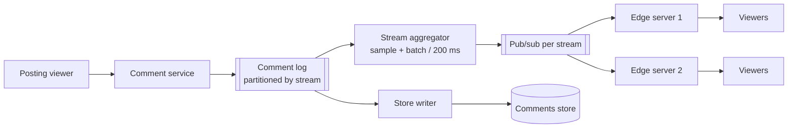
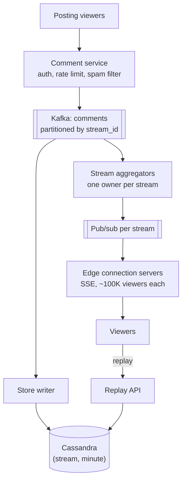
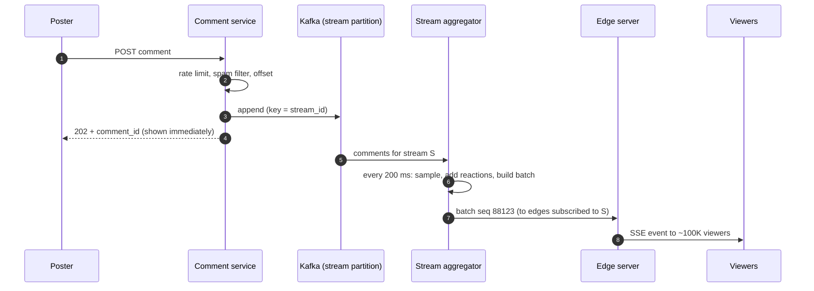
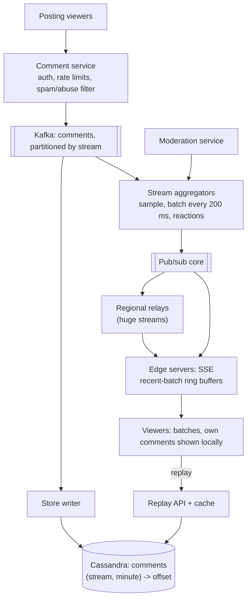

## Problem statement

Design live comments for a video streaming platform: while a stream is live, viewers post comments and every viewer of that stream sees new
comments appear within a second or two. The biggest streams — a cricket final, a product launch — have millions of concurrent viewers and
tens of thousands of comments per second.

**Interview format:** 45 minutes · **Difficulty:** intermediate · **Main themes:** massive fan-out, hot keys (one stream), connection tiers,
sampling and batching, pub/sub hierarchies.

> [!TIP] Try it first
> Before scrolling, spend three minutes writing the questions you would ask the interviewer. Then compare with the list below — or
> practise this whole problem as a [timed mock interview](#system-design/hld/interview/live-comments).

## Clarifying questions

The answers below are the interviewer's. Questions that change the design come first.

- **Q:** How many viewers and streams? <!-- match: scale, viewers, users, how many, concurrent, streams, traffic -->
  - **A:** About 50 million concurrent viewers across ~10,000 live streams. Most streams are small; the largest has 5 million concurrent viewers.
- **Q:** How many comments are posted? <!-- match: comments per second, volume, rate, how many comments, writes -->
  - **A:** Around 10,000 comments a second platform-wide on average; the largest stream can reach 20,000 comments a second at its peak moment.
- **Q:** How quickly must comments appear? <!-- match: latency, fast, real time, delay, how quickly -->
  - **A:** Within about two seconds for viewers.
- **Q:** Must every viewer see every comment? <!-- match: every viewer, sampling, sampled, completeness, miss, missing, dropped -->
  - **A:** No. Nobody can read 20,000 comments a second. On huge streams it's fine to show a representative subset, but a viewer must always
    see their own comments and ones from the streamer or moderators.
- **Q:** Is ordering important? <!-- match: order, ordering, sequence -->
  - **A:** Roughly chronological is enough; strict global order isn't required.
- **Q:** Do comments need moderation? <!-- match: moderation, spam, abuse, filter, block, toxic -->
  - **A:** Yes — automatic spam and abuse filtering before display, streamer-appointed moderators who can delete comments and ban users.
- **Q:** Are comments kept after the stream? <!-- match: replay, replaying, recording, history, store, keep, persist, vod, after the stream, later, video -->
  - **A:** Yes, for replay alongside the recorded video, so they need timestamps relative to the stream.
- **Q:** Reactions as well as comments? <!-- match: reactions, likes, emoji, hearts -->
  - **A:** Nice to have: aggregated reaction counts (hearts) shown as an animation.

## Functional requirements

> [!TIP] Try it first
> Write three or four functional requirements before reading on.

- Viewers can **post comments** on a live stream. <!-- match: post, comment, send -->
- Viewers **see new comments** within ~2 seconds, with **sampling** on very busy streams. <!-- match: see, receive, real time, sampling -->
- **Moderation** filters abuse and lets moderators remove comments and ban users. <!-- match: moderation, remove, ban, filter -->
- Comments are **stored for replay** with stream-relative timestamps. <!-- match: replay, store, history -->

````hint title="Hint: what is the real constraint?"
Compare comments per second on the largest stream with what a human can read per second. What does that imply for what you must deliver?
````

## Non-functional requirements

- **Low latency**: comments visible within ~2 s. <!-- match: latency, 2 seconds, real time -->
- **Massive fan-out**: one stream with **5 million concurrent viewers**; 50M concurrent viewers overall. <!-- match: fan-out, million, concurrent, viewers -->
- **Hot-key resilience**: one stream's traffic must not degrade others. <!-- match: hot, isolation, one stream -->
- **High availability** for viewing comments; occasional loss of a non-own comment is acceptable. <!-- match: availability, available, loss -->
- **Durability** for stored comments (replay). <!-- match: durable, durability, stored -->

````hint title="Hint: how many deliveries is naive fan-out?"
20,000 comments a second to 5 million viewers each. Multiply — then decide what you'll actually send.
````

## Scope and exclusions

In scope: posting, real-time delivery with sampling and batching, moderation hooks, storage for replay, aggregated reactions.

Out of scope: the video pipeline itself, chat between viewers outside a stream, rich media in comments, monetised features (super chats)
beyond a mention.

## Capacity estimation

> [!TIP] Try it first
> Estimate inbound comments, naive versus practical outbound messages for the biggest stream, connections and storage.

- **Inbound:** ~10,000 comments/s average platform-wide; the biggest stream alone can hit ~20,000/s.
- **Naive fan-out for the biggest stream:** 20,000 × 5,000,000 = 10¹¹ deliveries a second — impossible, and pointless.
- **Practical fan-out:** send each viewer a **batch every ~200 ms** (5 a second) containing at most a handful of comments. 5M viewers × 5
  batches = **25M frames/s** for that stream. At ~600 bytes per batch, ~15 GB/s ≈ **120 Gbit/s** — spread over ~50 connection servers of
  100,000 viewers each, that's ~500K frames/s and ~2.4 Gbit/s per server: heavy but feasible.
- **Connections:** 50M concurrent viewers; at ~100,000 per server, **~500 connection servers**, plus headroom.
- **Storage:** ~300 bytes per comment × 10,000/s → **~260 GB/day** for replay.

```estimator title="Live comments (ingest and storage)"
requestsPerDay = 864M
readsPerWrite = 0
writeBytes = 300 B
readBytes = 600 B
retentionYears = 1
peakFactor = 5
replication = 3
cachePercent = 0
serverRps = 20000
targetUtilization = 60
```

The calculator covers comment ingestion and storage (10,000/s average); delivery to viewers isn't request-based — it's the batched push worked
out above.

**What the numbers mean for the design:**

- **Delivery, not ingestion, is the problem**: the system must reduce 20,000 comments/s to a few per viewer per second.
- **One stream is a hot key**: its fan-out must be spread over many servers, isolated from other streams.
- **Batching** turns per-comment messages into per-interval frames, cutting frame rates by orders of magnitude.

````hint title="Hint: what drives server count?"
Is it comments posted, or viewers connected and frames sent to them?
````

## API design

> [!TIP] Try it first
> Viewers mostly receive; what transport fits, and what does a delivered frame contain?

```text title="API"
POST /v1/streams/{stream_id}/comments          { "text": "what a shot!" }
  202 Accepted { "comment_id": "c-..", "stream_offset_ms": 3725120 }
  429 Too Many Requests (per-user rate limit)

GET  /v1/streams/{stream_id}/comments/live      (Server-Sent Events)
  event: batch
  data: { "seq": 88123,
          "comments": [ { "id": "c-..", "user": "..", "text": "..", "t": 3725101 }, ... ],
          "reactions": { "heart": 1240 }, "viewers": 4970000 }

GET  /v1/streams/{stream_id}/comments?from_ms=3600000&to_ms=3660000   (replay)
DELETE /v1/streams/{stream_id}/comments/{id}    (moderator)
```

- **SSE** for delivery: one-way, plain HTTP, automatic reconnect; posting uses a normal `POST`.
- The poster's own comment is shown **immediately by the client** (optimistic) and confirmed by its `comment_id`.

````hint title="Hint: WebSockets or SSE?"
Viewers post occasionally and receive constantly. Which transport is simplest for one-way push at very large scale?
````

## Data model

> [!TIP] Try it first
> What is stored for replay, and what lives only in memory for the live path?

```text title="Schema"
comments  (Cassandra / ScyllaDB)        for replay and moderation
  partition key: (stream_id, minute_bucket)
  clustering:    stream_offset_ms, comment_id
  columns:       user_id, text, status (visible | removed), created_at

live state  (in memory, per stream, on fan-out nodes)
  recent ring buffer of accepted comments (last ~30 s)
  reaction counters per type, viewer count

moderation  (key-value)
  bans (stream_id, user_id), global blocklists
```

- Comments are partitioned by **stream and minute**, so replay reads a stream's comments in time order without hot, unbounded partitions.
- The **live path doesn't read the database** — it runs from in-memory buffers fed by the comment stream.

````hint title="Hint: why bucket by minute?"
A single huge stream writes 20,000 comments a second. What happens to one partition holding all of a stream's comments?
````

## Initial high-level architecture

Build the design one requirement at a time.

### Step 1: post a comment

The **comment service** authenticates, rate-limits the user, runs fast spam/abuse filters, assigns a stream offset, and publishes the comment
to a **comment log** (Kafka), partitioned by stream. A consumer persists comments to the store for replay.

### Step 2: deliver to viewers

Viewers hold SSE connections to **edge connection servers**. Each server tracks which streams its viewers watch and subscribes to those
streams. A **per-stream aggregator** consumes the stream's comments, applies **sampling** for busy streams and builds a **batch** every
~200 ms, which is fanned out to the subscribed edge servers, which push it to their viewers.



### Step 3: moderation and replay

Removals and bans are published on the same stream channel so viewers drop the comment; replay reads the store by stream and time range.

````hint title="Hint: where should sampling happen?"
If every edge server samples independently, viewers on different servers see different comments — fine or not? And what about the cost of
sending every comment to every edge server first?
````

## Architecture diagram



## Request and data flow



## Component responsibilities

| Component | Responsibility | Scales with |
|---|---|---|
| Comment service | Auth, per-user rate limits, spam/abuse filter, offset, publish | Comments posted |
| Kafka comment log | Durable, ordered per stream, feeds aggregation and storage | Comments/s |
| Stream aggregators | One owner per stream: sample, batch, merge reactions, publish batches | Active streams |
| Pub/sub tier | Deliver batches to edge servers subscribed to each stream; relay tiers for huge streams | Streams × edges |
| Edge connection servers | Hold SSE connections, subscribe per stream, push batches | Concurrent viewers (~50M) |
| Store writer + Cassandra | Persist comments for replay and moderation | Comments/s |
| Moderation service | Removals, bans, blocklists | Moderator actions |

## Database and technology choices

| Need | Choice | Why | Alternative |
|---|---|---|---|
| Comment ingestion | Kafka partitioned by stream | Durable buffer, per-stream order, multiple consumers | Direct writes to pub/sub (no durability) |
| Live fan-out | In-memory pub/sub (Redis, NATS) with relay tiers | Low latency; ephemeral batches | Kafka consumed by every edge (too many consumers) |
| Transport | Server-Sent Events | One-way push over HTTP, auto-reconnect | WebSockets (two-way, not needed) |
| Replay storage | Cassandra / ScyllaDB by (stream, minute) | Write-heavy, time-ordered reads | Object storage files per stream minute |
| Reaction counts | In-memory counters in aggregators | Aggregate before fan-out | Per-reaction messages (wasteful) |

## Scaling strategy

### How do we deliver to 5 million viewers of one stream?

- **Batch**: aggregators emit one batch per ~200 ms per stream instead of one message per comment — 5 frames/s per viewer regardless of the
  comment rate.
- **Sample centrally**: the stream's aggregator chooses which comments go into each batch (up to a few per batch), preferring comments from
  the streamer, moderators, verified accounts and highly reacted comments, plus a random sample of the rest. Every viewer sees the same
  stream of comments; each viewer's own comments are added locally by their client.
- **Fan out in a tree**: the aggregator publishes each batch once to a pub/sub cluster; for very large streams, regional **relay nodes**
  subscribe once and re-publish to their region's edge servers — so each hop fans out to tens or hundreds of nodes, not 50,000.
- **Edge servers** push the same batch to all their local viewers of that stream — the serialised payload is built once per batch and written
  to many sockets.

### How do we isolate one huge stream from the rest?

A busy stream is a [hot key](lesson:hot-keys). Each stream has a single aggregator owner (its Kafka partition), so per-stream ordering and
sampling are local; hot streams get dedicated partitions and aggregator capacity. Edge servers handle many streams, but frame building is per
batch, not per viewer, so a hot stream costs edge CPU proportional to its local viewers. Rate limits per user and per stream protect ingestion
during spam waves.

### How do viewers recover after reconnecting?

SSE reconnects automatically with `Last-Event-ID` = the last batch `seq`. The edge server keeps the last ~30 seconds of batches per stream in
memory; if the requested `seq` is within it, it replays the missing batches; otherwise it simply resumes from the latest — for live comments,
skipping old batches is better than flooding the viewer.

## Caching strategy

### What is kept in memory?

- **Recent batches per stream** on each edge server (ring buffer of ~30 s) for reconnects and newly joining viewers, so a new viewer instantly
  sees recent comments without a database read.
- **Recent comments per stream** in each aggregator for building batches and computing "top" comments.
- **Moderation state** (bans, blocklists) cached in the comment service with short TTLs and push invalidation.
- **Replay queries** for popular past streams can be cached per (stream, minute) since they never change after the stream ends.

## Messaging strategy

### Why Kafka for ingestion but in-memory pub/sub for fan-out?

Ingestion needs durability and per-stream ordering — every accepted comment must be stored for replay — so comments go to Kafka partitioned
by stream. Fan-out needs very low latency to a huge, changing set of edge servers and tolerates loss (a missed batch is simply superseded
200 ms later), so batches go through an in-memory pub/sub with relay tiers. Using Kafka for fan-out would mean tens of thousands of consumers
per topic and higher latency per hop.

### How are reactions handled?

Reactions are counted, not delivered individually: the comment service increments in-memory counters (per stream, per reaction type) in the
aggregator, and each batch carries the totals since the last batch, which clients animate. Millions of taps become five small numbers a
second.

## Failure scenarios

| Failure | Impact | Mitigation |
|---|---|---|
| Edge server crashes | ~100K viewers disconnect | SSE auto-reconnect with jitter to other edges; resume from recent batches |
| Aggregator for a stream fails | Batches for that stream pause | Kafka consumer group reassigns the partition; a new owner resumes from committed offset within seconds |
| Pub/sub node fails | Some edges miss batches | Replicated pub/sub; edges resubscribe; next batch supersedes |
| Comment spam wave | Ingestion overloaded, viewers flooded | Per-user and per-stream rate limits, spam filters, slow mode |
| Kafka consumer lag | Comments appear late | Scale aggregators and partitions; alert on lag beyond ~1 s |
| Store writer behind | Replay incomplete for a while | Independent consumer; catches up from Kafka |

## Bottleneck analysis

- **Outbound frames and bandwidth** on edge servers for the biggest streams — batching and per-batch serialisation keep it tractable.
- **Concurrent connections** (~50M) drive edge fleet size.
- **The biggest stream's aggregator** is a single owner by design; its work is bounded by sampling, not by viewer count.
- **Ingestion** (~20K comments/s on one stream) is modest for Kafka; spam control matters more than raw throughput.

## Consistency and availability trade-offs

- **Availability over completeness**: viewers see a representative sample on busy streams; a lost batch is acceptable.
- **Durability for storage**: every accepted comment is in Kafka and then in Cassandra for replay.
- **Approximate ordering**: comments ordered per stream by offset; batches arrive in sequence; global order isn't needed.
- **Read-your-own-comments**: the client shows its own comments immediately, independent of sampling.

## Security considerations

- Authenticate posters; rate-limit per user, per IP and per stream; "slow mode" for busy streams.
- Run spam and toxicity classifiers before accepting comments; quarantine borderline ones for moderators.
- Moderators' actions are authorised per stream; removals propagate to viewers and to stored replay data.
- Escape and sanitise comment text to prevent script injection in clients.

## Monitoring and observability

- Post-to-display latency (sampled end-to-end probes) p50/p99 per stream size tier.
- Concurrent viewers per edge server; SSE reconnect rate.
- Kafka lag per stream partition; aggregator batch build time.
- Outbound bandwidth and frames per edge server.
- Rejected comments (rate limits, spam) and moderation action volume.

## Final architecture

Open this after you have drawn your own.

````solution title="Final architecture"


**In one breath:** comments are authenticated, rate-limited, filtered and appended to Kafka partitioned by stream; one aggregator per stream
samples and batches them every 200 ms with reaction totals and publishes each batch once to a pub/sub core, which fans out — through regional
relays for huge streams — to edge servers holding SSE connections, which push the same batch to all local viewers and keep recent batches for
reconnects; a separate consumer stores every comment in Cassandra by stream and minute for replay.
````

## Alternative designs and trade-offs

| Alternative | Gains | Costs | When to choose it |
|---|---|---|---|
| Deliver every comment to every viewer | Completeness | Impossible at 5M viewers × 20K comments/s | Small streams only (and you can: sampling only kicks in when busy) |
| Clients poll for new comments | Simple, CDN-cacheable per stream | Seconds of latency, request volume | Small platforms; can be cached per stream at the edge |
| WebSockets instead of SSE | Two-way on one connection | More complex infra; not needed for one-way | When viewers send frequently (games, auctions) |
| Kafka consumed directly by edge servers | Durable replay at the edge | Thousands of consumers per topic; higher latency | Fewer, larger edge nodes |

## Interviewer follow-up questions

````question title="How do you guarantee a viewer always sees their own comment, even on a sampled stream?"
The client renders its own comment immediately when the POST is accepted (optimistically, confirmed by the returned comment ID) and inserts
it into its local view, regardless of what the sampled batches contain. If the comment is later removed by moderation, the removal event in
a batch tells the client to hide it.
````

````question title="A stream suddenly goes viral: viewers jump from 50,000 to 3 million in ten minutes. What scales?"
Edge servers: new viewers connect to whichever edges have capacity (autoscaled on connections), and each edge subscribes to the stream once.
The pub/sub core starts routing that stream's batches through regional relays once its subscriber count crosses a threshold. The aggregator
work doesn't grow with viewers — only with comments, which sampling bounds. Ingestion rate limits and slow mode keep the comment rate
manageable.
````

````question title="How would you implement 'top comments' that stay on screen longer?"
The aggregator scores recent comments by reactions, author status and recency, and includes a small 'pinned/top' section in each batch
alongside the sampled live comments. Streamers and moderators can pin comments explicitly. Scores are computed in memory over a sliding
window of the stream's recent comments.
````

````question title="How do comments line up with the video in replay?"
Each comment records the stream offset in milliseconds at acceptance (the live position the poster was watching, adjusted for their playback
delay reported by the client). Replay requests comments by offset range as the recorded video plays, fetching a minute of comments ahead and
displaying each at its offset.
````

````question title="How do you stop spam waves from bots?"
Layered controls: per-account and per-IP rate limits, new-account restrictions, slow mode per stream, a fast classifier in the comment service
for known spam patterns, and duplicate detection (the same text from many accounts). Suspicious comments are held for moderators instead of
published. Because delivery is sampled, a burst of bot comments also has limited visibility.
````

## Common mistakes

- **Delivering every comment to every viewer** without computing the fan-out.
- **One message per comment** instead of batches.
- **Fanning out directly from one server** to millions of connections.
- **Using the replay database on the live path.**
- **Partitioning stored comments by stream alone**, creating unbounded, hot partitions.
- **Ignoring moderation and spam.**

## Evaluation checklist

```checklist title="Evaluation checklist"
- Asked about viewers, comment rates, latency, completeness, ordering and moderation
- Computed naive fan-out for the biggest stream and showed it is impossible
- Batched delivery per stream on a fixed interval
- Sampled comments centrally for busy streams while always showing a viewer's own comments
- Separated durable ingestion (log partitioned by stream) from low-latency fan-out
- Fanned out through a pub/sub tree with relays to edge servers holding SSE connections
- Isolated hot streams with per-stream owners and capacity
- Kept the live path in memory and stored comments separately for replay
- Aggregated reactions into counts instead of per-reaction messages
- Handled edge failures and reconnects with recent-batch buffers
- Discussed rate limits, spam filtering and moderation
```
