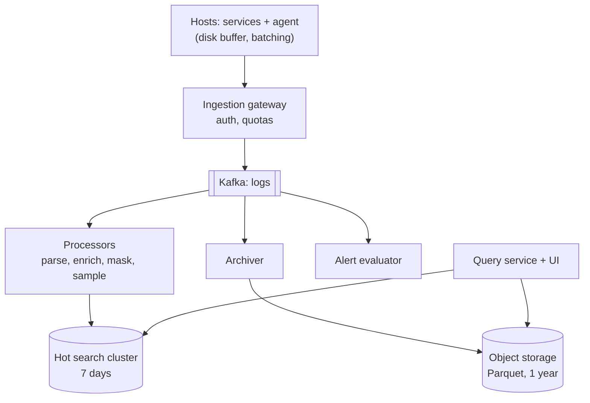
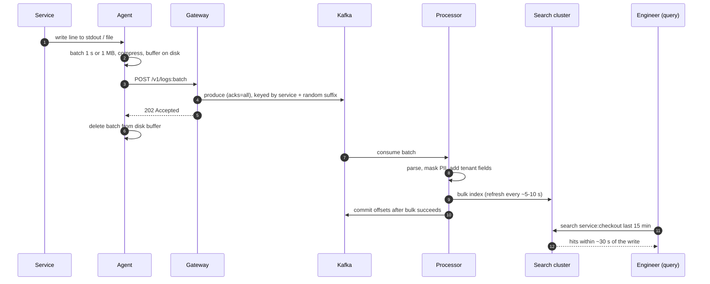
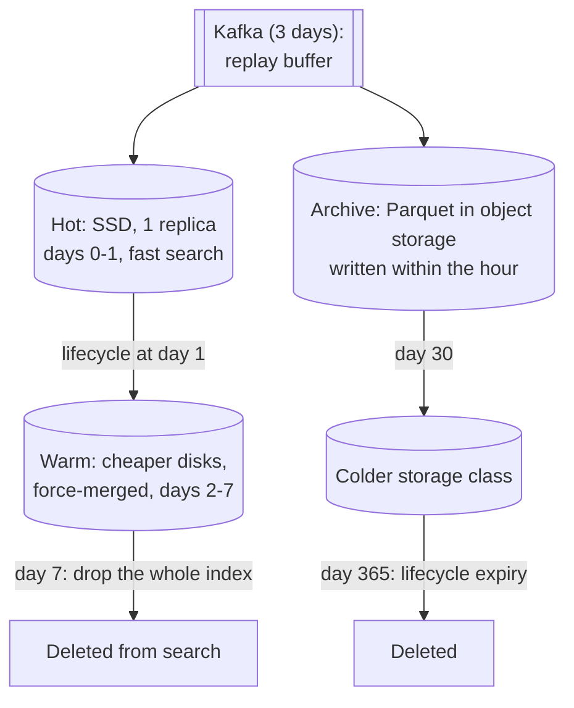
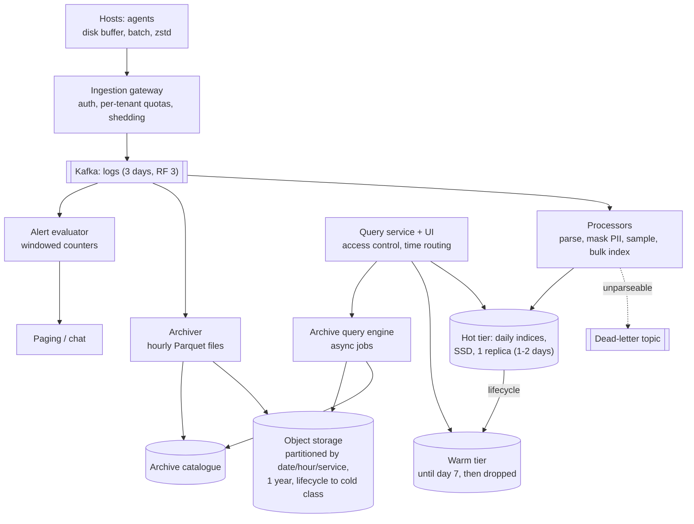

## Problem statement

Design a centralised logging system for a company running thousands of services: every host ships its logs to one platform where engineers
search recent logs within seconds of them being written, set alerts on log patterns, and where older logs are kept cheaply for compliance.

**Interview format:** 45–60 minutes · **Difficulty:** intermediate · **Main themes:** write-heavy ingestion, buffering and backpressure,
indexing for search, tiered retention, cost control, multi-tenancy.

> [!TIP] Try it first
> Before scrolling, spend three minutes writing the questions you would ask the interviewer. Then compare with the list below — or
> practise this whole problem as a [timed mock interview](#system-design/hld/interview/logging-system).

## Clarifying questions

The answers below are the interviewer's. Questions that change the design come first.

- **Q:** How much log data is produced? <!-- match: volume, how much, scale, throughput, data size, bytes, lines per second -->
  - **A:** About 10,000 services on 100,000 hosts, producing about 1 million log lines a second at ~500 bytes each — 500 MB/s on average,
    double that at peaks.
- **Q:** How are logs queried? <!-- match: query, search, queries, how do engineers, use cases, find -->
  - **A:** Filter by service, host, level and time range, search for text or a trace ID, and count matches over time. Most queries cover the
    last few hours.
- **Q:** How quickly must a log be searchable? <!-- match: latency, searchable, how quickly, freshness, delay, real time -->
  - **A:** Within 30 seconds of being written.
- **Q:** How long are logs kept? <!-- match: retention, keep, how long, archive, compliance -->
  - **A:** Searchable for 7 days. Kept for 1 year for compliance, where slower search (minutes) is acceptable.
- **Q:** Are the logs structured? <!-- match: structured, format, json, schema, unstructured, plain text -->
  - **A:** Most services log JSON with standard fields (timestamp, service, level, trace_id, message); some legacy services log plain text.
- **Q:** Can we lose logs? <!-- match: loss, lose, durability, durable, drop, reliable -->
  - **A:** Losing a little debug data under extreme overload is tolerable; audit logs must never be lost.
- **Q:** Who can see which logs? <!-- match: access, permissions, security, tenants, teams, pii, privacy -->
  - **A:** Teams see their own services' logs; some logs contain personal data that must be masked.
- **Q:** Do we need alerts? <!-- match: alerts, alerting, notify, pattern, monitoring -->
  - **A:** Yes — teams define alerts like "more than 100 ERROR lines from checkout in 5 minutes".

## Functional requirements

> [!TIP] Try it first
> Write three or four functional requirements before reading on.

- **Collect logs** from all hosts and services. <!-- match: collect, ship, ingest -->
- **Search logs** by fields, time range and free text, and aggregate counts. <!-- match: search, query, filter -->
- **Alert** on log patterns and rates. <!-- match: alert, alerts -->
- **Retain** logs: 7 days searchable, 1 year archived and still queryable. <!-- match: retain, retention, archive -->
- **Control access** per team and **mask personal data**. <!-- match: access, mask, pii, permissions -->

````hint title="Hint: what is the shape of the workload?"
Compare how many bytes are written per second with how many queries run per second. Which side should the design optimise for?
````

## Non-functional requirements

- **High write throughput**: 500 MB/s average, 1 GB/s at peaks. <!-- match: throughput, write heavy, ingest rate -->
- **Freshness**: searchable within 30 seconds. <!-- match: fresh, 30 seconds, searchable -->
- **Query latency**: seconds for recent data; minutes for archives. <!-- match: query latency, seconds, fast search -->
- **Durability**: no loss of audit logs; best effort for debug logs under overload. <!-- match: durable, durability, loss -->
- **Cost efficiency**: storing every byte on fast disks for a year is not an option. <!-- match: cost, cheap, efficient -->
- **Isolation**: one noisy service must not hurt others. <!-- match: isolation, noisy, tenants -->

````hint title="Hint: where does the money go?"
What does it cost to keep a year of logs on replicated SSDs, compared with compressed files in object storage?
````

## Scope and exclusions

In scope: agents, ingestion, buffering, processing (parsing, enrichment, masking), indexing, tiered storage, search, alerting, access
control.

Out of scope: metrics and tracing systems (separate products), dashboards beyond log counts, log-based anomaly detection with ML.

## Capacity estimation

> [!TIP] Try it first
> Work out daily volume, hot storage for 7 days, and the archive size for a year.

- **Lines:** 1M lines/s × 86,400 ≈ **86.4 billion lines/day**.
- **Bytes:** 500 MB/s × 86,400 s = **43.2 TB/day** raw.
- **Hot tier (7 days, searchable):** 43.2 × 7 ≈ **302 TB** raw; with one replica and index overhead, roughly **600–700 TB** of SSD.
- **Archive (1 year):** 43.2 TB × 365 ≈ 15.8 PB raw; logs compress about 10× in columnar formats → **~1.58 PB** in object storage.
- **Network:** 1 GB/s at peak into the pipeline, replicated in Kafka (×3) and indexed (×2) — internal traffic is several GB/s.
- **Queries:** perhaps a few hundred per second across engineers and alerts — tiny next to the write rate.

```estimator title="Logging system (log lines)"
requestsPerDay = 86.4B
readsPerWrite = 0
writeBytes = 500 B
readBytes = 1 KB
retentionYears = 0.019
peakFactor = 2
replication = 2
cachePercent = 0
serverRps = 25000
targetUtilization = 60
```

The calculator counts each log line as a write; retention of 0.019 years is the 7-day hot tier, with one replica. 25,000 lines/s per
indexing node is a rough figure — measure it with your own mappings.

**What the numbers mean for the design:**

- **Write-heavy by orders of magnitude** — ingestion and indexing dominate cost and design.
- **Hot storage must be bounded**: 7 days on fast disks, everything older in cheap compressed object storage.
- **Bursts and outages are normal** — an incident multiplies log volume exactly when engineers need search the most, so the pipeline needs a
  buffer.

````hint title="Hint: indexing cost"
Full-text indexing every field of 1M lines/s is expensive. Which fields do queries actually filter on?
````

## API design

> [!TIP] Try it first
> Define how agents send logs and how engineers query them.

```text title="API"
Ingestion (agents -> gateway), batched and compressed
POST /v1/logs:batch     Content-Encoding: zstd
  { "resource": { "service": "checkout", "host": "ip-10-1-2-3", "env": "prod" },
    "records": [ { "ts": "2026-11-07T10:15:02.120Z", "level": "ERROR",
                   "trace_id": "4bf9...", "msg": "payment timeout", "attrs": { ... } } ] }
  -> 202 Accepted | 429 Retry-After (tenant over quota) | 503 (back off)

Query
POST /v1/search  { "query": "service:checkout AND level:ERROR AND msg:\"timeout\"",
                   "from": "now-1h", "to": "now", "limit": 100, "cursor": null }
  -> { "hits": [...], "next_cursor": "...", "took_ms": 840 }
POST /v1/search/archive  { same, "from": "2026-03-01", "to": "2026-03-02" }  -> 202 { "job_id" }
GET  /v1/search/archive/{job_id}   -> status, results when done

Alerts
POST /v1/alerts  { "query": "...", "window": "5m", "threshold": 100,
                   "notify": "pagerduty:checkout" }
```

- **Batches with compression** keep request overhead low; 202 means "durably queued", not "searchable yet".
- **Archive queries are asynchronous jobs**, because scanning compressed files takes minutes.

````hint title="Hint: what should the agent do on 503?"
If the gateway is overloaded and the agent retries immediately, what happens? Where can the agent keep logs meanwhile?
````

## Data model

> [!TIP] Try it first
> How are logs laid out in the hot index and in the archive? What determines how cheaply old data can be deleted?

```text title="Schema"
Log record
  ts, service, host, env, level, trace_id, span_id, msg (full text), attrs (limited, typed)

Hot tier (Elasticsearch / OpenSearch)
  index per day per tenant group:   logs-checkout-2026.11.07
  mapping: keyword fields (service, host, level, trace_id), text field (msg), date (ts)
  shards sized ~10-50 GB; 1 replica; deleted by dropping whole indices after 7 days

Archive (object storage)
  s3://logs-archive/date=2026-11-07/hour=10/service=checkout/part-0001.parquet
  (Parquet with zstd compression)
  catalogue table (date, hour, service -> files, min/max ts, row counts)
```

- **Time-based indices** make retention a cheap operation: drop yesterday's index instead of deleting billions of documents.
- **Explicit mappings** (no unbounded dynamic fields) prevent a service's ever-changing attribute names from exploding the index.
- **Archive files are partitioned by date, hour and service** so archive queries read only matching files.

````hint title="Hint: deleting old logs"
Deleting 43 billion documents one by one, versus deleting one day's index — which is cheaper, and why does that shape the index layout?
````

## Initial high-level architecture

Build the design one requirement at a time.

### Step 1: collect

An **agent** on each host (Fluent Bit / OpenTelemetry Collector style) tails log files and stdout, adds host metadata, batches and
compresses records, and sends them to an **ingestion gateway**. It keeps a **disk buffer** so logs survive network or gateway outages.

### Step 2: buffer

The gateway authenticates the tenant, enforces quotas, and writes batches to **Kafka**, which absorbs bursts and lets indexing fall behind
without losing data ([Kafka](lesson:kafka)).

### Step 3: process and index

**Processors** consume from Kafka: parse plain-text lines, normalise fields, mask personal data, drop or sample noisy debug logs, then bulk
index into the **hot search cluster**.

### Step 4: archive, search and alert

An **archiver** consumer writes hourly compressed Parquet files to object storage. A **query service** routes recent time ranges to the
search cluster and older ones to archive scans. An **alerting** consumer evaluates rules on the stream.

````hint title="Hint: why put Kafka in the middle?"
What happens to logs during an incident if the search cluster is the first thing that receives them?
````

## Architecture diagram



## Request and data flow



## Component responsibilities

| Component | Responsibility | Scales with |
|---|---|---|
| Agent | Tail, batch, compress, disk buffer, retry with backoff | Hosts |
| Ingestion gateway | Auth, per-tenant quotas, write to Kafka | Bytes/s |
| Kafka | Durable buffer, replay, fan-out to consumers | Bytes/s × retention (days) |
| Processors | Parse, enrich, mask, sample, bulk index | Lines/s (CPU) |
| Hot search cluster | Index and search the last 7 days | Lines/s and hot bytes |
| Archiver | Write partitioned Parquet files + catalogue | Bytes/s |
| Query service | Route by time range, enforce access, run archive jobs | Queries |
| Alert evaluator | Streaming rule evaluation, notifications | Rules × lines/s |

## Database and technology choices

| Need | Choice | Why | Alternative |
|---|---|---|---|
| Buffer | Kafka (3 days retention) | Absorbs bursts, replayable, multiple consumers | Kinesis, Pulsar |
| Hot search | Elasticsearch / OpenSearch with time-based indices | Full-text + field filters + aggregations | Loki (label index, cheaper, less search power) |
| Archive | Object storage, Parquet + zstd | ~10× compression, pennies per GB-month | HDFS |
| Archive query | Distributed SQL engine over Parquet (Trino/Athena-style) | Scans only partitions in range | Rehydrate into the search cluster on demand |
| Agent | Fluent Bit / OpenTelemetry Collector | Lightweight, disk buffering, many inputs | Custom agent |

## Scaling strategy

### How does ingestion survive bursts?

Three buffers in a row: the **agent's disk buffer** (minutes to hours on each host), **Kafka** (days, partitioned so producers and
consumers scale horizontally), and **bulk indexing** in processors. When indexing lags, Kafka lag grows but nothing is lost, and search is
temporarily less fresh. When even Kafka ingestion must shed load, the gateway returns 429/503 by tenant priority: debug logs are dropped or
sampled first, audit logs never ([backpressure](lesson:backpressure)).

### How is Kafka partitioned?

By service, with a random suffix for large services so one busy service spreads across many partitions (ordering across a whole service
doesn't matter; timestamps order lines at query time). Partition count is set from peak throughput per partition and the number of
processor instances ([partition keys](lesson:partition-keys-retention)).

### How is the hot cluster sized and laid out?

Indices per day and per tenant group; shard size kept around 10–50 GB, which Elastic recommends as a starting point; 1 replica. Hot nodes
use SSDs. Indexing throughput, not disk, usually sets the node count: ~1M lines/s at peak ×2, at a few tens of thousands of lines/s per
node, means on the order of 100+ data nodes. To reduce cost: index only queried fields (keywords for service, host, level, trace ID; text
for the message), store the rest without indexing, and roll indices over by size so shards stay balanced.

### How is retention enforced cheaply?

Lifecycle policies: day-old indices move from hot to warm nodes (cheaper disks, fewer replicas or force-merged), and after 7 days the whole
index is **dropped** — the archive already holds the data. Archive files expire with object storage lifecycle rules after 1 year, or move to
colder storage classes after 30 days.



### How do we isolate noisy tenants?

Quotas per service at the gateway (bytes/s), separate Kafka partitions per big tenant, and separate index groups so one service's mapping
or volume can't degrade others. Over-quota tenants get sampled, and dashboards show each team its own volume and cost.

## Caching strategy

### Is there anything to cache in a write-heavy system?

A little, on the read side: query results for repeated dashboard panels are cached for a short TTL (they're recomputed every refresh
otherwise); the search engine's own filter caches help repeated filters like `service:checkout AND level:ERROR`. Archive job results are
stored for reuse. Ingestion has no cache — it's a stream.

## Messaging strategy

### Who consumes the Kafka log stream?

Three independent consumer groups read the same topic: **processors** (indexing), **archiver** (Parquet files) and **alert evaluator**
(streaming rules). Each commits its own offsets after its own work succeeds, so the archive is complete even if indexing is behind, and a
failed indexer can **replay** from Kafka. Records that fail parsing go to a dead-letter topic with the raw line preserved
([retries and DLQs](lesson:retries-dlq)).

### How do alerts work at this volume?

The alert evaluator keeps per-rule counters over sliding windows keyed by rule and service, updated from the stream — it doesn't query the
search cluster every minute for every rule. Complex alerts that need search run as scheduled queries with limits.

## Failure scenarios

| Failure | Impact | Mitigation |
|---|---|---|
| Search cluster slow or down | Search unavailable or stale | Kafka retains data; indexers catch up; archive still written |
| Log storm during an incident | Volume 5–10× | Quotas, sampling of debug logs, Kafka buffer, autoscaled processors |
| Agent can't reach gateway | Logs pile up on hosts | Disk buffer with size cap; oldest debug dropped first |
| Kafka broker failure | Partitions fail over | Replication factor 3, `acks=all`, min in-sync replicas 2 |
| Processor bug corrupts records | Bad data indexed | Replay from Kafka after fix; reindex affected indices |
| Mapping explosion from a service | Cluster instability | Explicit mappings, field limits, unknown fields stored unindexed |

## Bottleneck analysis

- **Indexing CPU** in the search cluster — reduce indexed fields, bulk sizes tuned, refresh interval of 5–10 s instead of 1 s.
- **Hot storage cost** — 7 days only, one replica, compression, warm tier.
- **Kafka throughput** — enough partitions and brokers for peak bytes, compressed batches.
- **Expensive queries** — free-text searches over long ranges; enforce time limits and require service filters for wide ranges.

## Consistency and availability trade-offs

- **Ingestion availability first**: services must never block on logging; agents buffer locally.
- **Eventually searchable**: logs appear after seconds, longer during incidents when lag grows.
- **Different durability per class**: audit logs use `acks=all` and are never sampled; debug logs can be sampled or dropped under overload.
- **At-least-once delivery**: retries can index a line twice; deterministic document IDs (hash of source, offset) make indexing idempotent.

## Security considerations

- Mask or tokenise personal data (emails, card numbers, tokens) in processors before indexing and archiving; better still, keep it out of
  logs at the source.
- Authenticate agents per tenant (mTLS or tokens); authorise queries per team; audit who searched what.
- Encrypt in transit and at rest; archive buckets locked down with retention locks for compliance logs.
- Support deletion requests where regulations require it (archive partitioning by service and date helps locate data).

## Monitoring and observability

- Ingest bytes/s and lines/s per tenant; gateway rejections (429/503).
- End-to-end freshness: time from log timestamp to searchable (synthetic canary lines).
- Kafka consumer lag per group (indexing, archive, alerts).
- Search cluster indexing rate, rejected bulk requests, heap, disk, shard counts.
- Query latency and failures; archive job durations.
- Monitor the logging system with a separate, minimal monitoring stack so its outage is still visible.

## Final architecture

Open this after you have drawn your own.

````solution title="Final architecture"


**In one breath:** agents batch, compress and buffer logs on disk, sending them to a gateway that enforces per-tenant quotas and writes to
Kafka; three consumer groups read the stream independently — processors parse, mask and bulk index into daily indices on a hot tier that
lifecycle policies move to warm and drop after 7 days, an archiver writes partitioned Parquet files to object storage for a year, and an
alert evaluator keeps windowed counters; queries route by time range to the search cluster or to asynchronous archive scans, and overload
sheds debug logs first while audit logs are never dropped.
````

## Alternative designs and trade-offs

| Alternative | Gains | Costs | When to choose it |
|---|---|---|---|
| Label-only index (Loki-style) + chunks in object storage | Much cheaper ingest and storage | Text search scans chunks, slower | Logs filtered mostly by labels, cost pressure |
| Columnar store (ClickHouse-style) for logs | Fast aggregations, good compression | Weaker free-text search | Analytics-heavy log queries |
| Agents write straight to the search cluster | Fewer components | Bursts overload the cluster; no replay | Small fleets |
| Keep 1 year in the search cluster | One query path | Very expensive storage and cluster size | Tiny volumes |
| Sample all logs heavily | Big savings | Missing lines when debugging rare errors | Very high-volume, low-value logs |

## Interviewer follow-up questions

````question title="An incident triples log volume. What happens, end to end?"
Agents keep sending; the gateway accepts within quotas and Kafka absorbs the extra bytes. Processors autoscale but indexing may still lag,
so search becomes less fresh — monitored by canary lines. If Kafka ingestion nears capacity, the gateway sheds by priority: debug and
sampled-tier logs first, never audit logs. Agents buffer what's rejected and retry with backoff. Nothing blocks the services producing logs.
````

````question title="How do you search a trace ID across all services in the last hour?"
trace_id is indexed as a keyword field in every index, so the query service sends a term query to the hour's indices across tenant groups
the user may access, merges hits by timestamp and returns them. Because it's an exact term lookup in time-bounded indices, it's fast even
across many indices.
````

````question title="How would you cut the cost of this system in half?"
Measure volume by service and level first; usually a few services produce most of the bytes. Then: sample or drop debug logs in
production, shorten hot retention for low-value services, index fewer fields, move to a warm tier sooner, and consider a label-only index
for high-volume, rarely searched logs. Showing each team its own cost tends to cut volume at the source.
````

````question title="How do you make indexing idempotent if processors retry?"
Give each record a deterministic document ID — for example a hash of the Kafka topic, partition and offset — so indexing the same record
twice overwrites rather than duplicates. Commit Kafka offsets only after the bulk request succeeds; a crash before the commit replays the
batch harmlessly.
````

````question title="Why not let agents write directly to Elasticsearch?"
The search cluster would see every burst directly, with no buffer to absorb incidents or maintenance; if it slows down, agents retry and
amplify the load. There'd be no replay after a processing bug, and every additional consumer (archive, alerts) would need its own path from
100,000 hosts. A log in the middle decouples producers from all of that.
````

## Common mistakes

- **No buffer between agents and the index**, so incidents overload the search cluster.
- **Keeping all retention in the search cluster** instead of tiering to object storage.
- **Deleting old documents** instead of dropping time-based indices.
- **Unbounded dynamic mappings**, letting one service destabilise the cluster.
- **No quotas or priorities**, so one noisy service affects everyone.
- **Forgetting personal data** in logs.

## Evaluation checklist

```checklist title="Evaluation checklist"
- Asked about volume, query patterns, freshness, retention, durability and access
- Estimated bytes/day, hot storage for 7 days and the compressed archive for a year
- Put a durable buffer (Kafka) between collection and indexing
- Designed agents with batching, compression and disk buffering
- Used time-based indices, explicit mappings and sensible shard sizes
- Tiered storage: hot, warm, archive in object storage, with lifecycle policies
- Routed queries by time range, with asynchronous archive search
- Handled bursts with quotas, priorities, sampling and backpressure
- Made indexing idempotent and replayable
- Masked personal data and enforced per-team access
```
