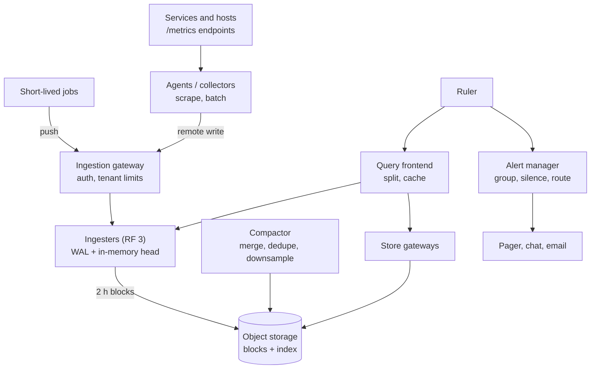
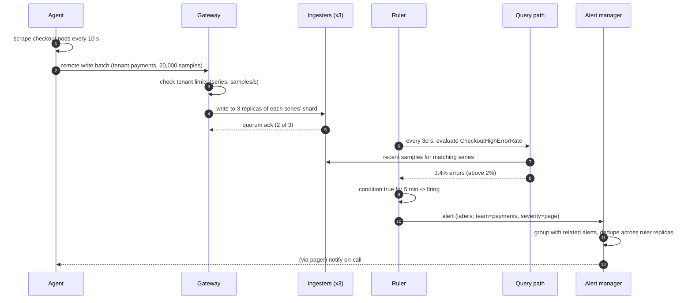
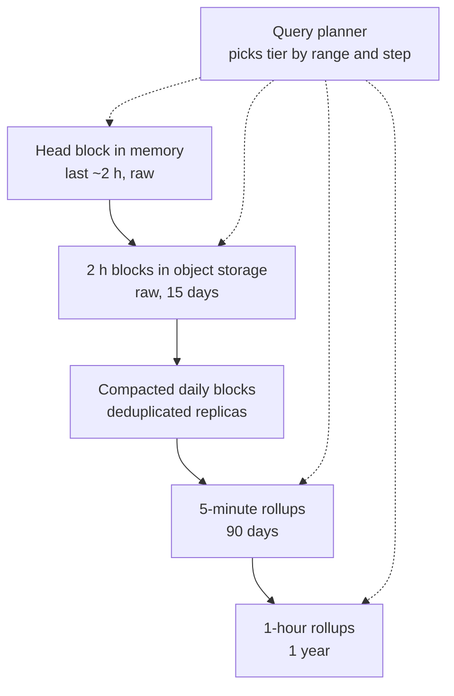
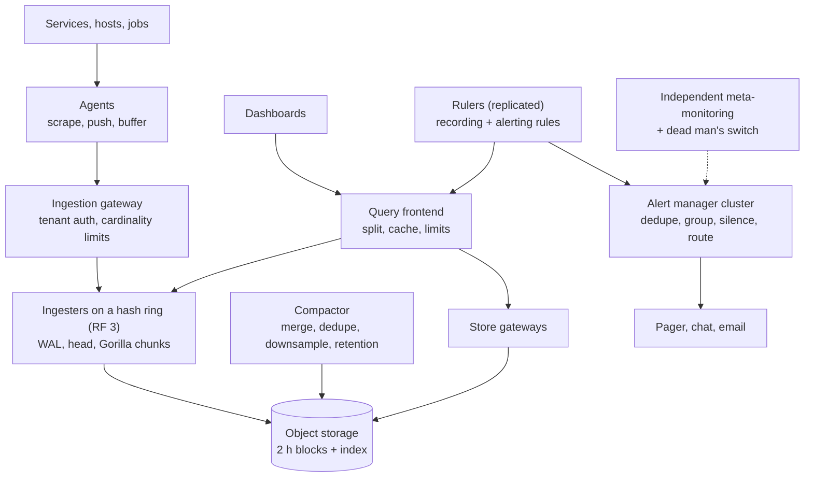

## Problem statement

Design a metrics monitoring and alerting platform like Prometheus at company scale (or a hosted service like Datadog's metrics): agents
collect numeric time series from thousands of services and hosts, the platform stores them cheaply, answers dashboard queries in under a
second, evaluates alert rules continuously, and notifies on-call engineers — and it must keep working during the incidents it exists to
detect.

**Interview format:** 45–60 minutes · **Difficulty:** advanced · **Main themes:** write-heavy time-series ingestion, compression, cardinality
control, tiered retention and downsampling, distributed queries, reliable alert evaluation.

> [!TIP] Try it first
> Before scrolling, spend three minutes writing the questions you would ask the interviewer. Then compare with the list below — or
> practise this whole problem as a [timed mock interview](#system-design/hld/interview/metrics-monitoring).

## Clarifying questions

The answers below are the interviewer's. Questions that change the design come first.

- **Q:** What is in scope? <!-- match: scope, features, what do we build, functionality, in scope -->
  - **A:** Collecting metrics (counters, gauges, histograms), storing them, querying for dashboards, and alerting with notifications.
    Logs and traces are separate systems.
- **Q:** How many time series and how often? <!-- match: scale, how many, series, time series, samples, frequency, interval -->
  - **A:** About 100 million active time series, each sampled every 10 seconds.
- **Q:** Push or pull? <!-- match: push, pull, scrape, collection, agents -->
  - **A:** Mostly pull (scraping service endpoints), plus push for short-lived jobs and serverless functions.
- **Q:** How long is data kept? <!-- match: retention, how long, keep, history, downsampling -->
  - **A:** Full resolution for 15 days; downsampled data for a year.
- **Q:** How fast must queries be? <!-- match: query latency, dashboards, fast, how fast queries -->
  - **A:** Dashboards over the last few hours in under a second; longer ranges in a few seconds.
- **Q:** How quickly must alerts fire? <!-- match: alert latency, alerts, how quickly, detection, notify -->
  - **A:** Rules evaluate every 30 seconds; a firing alert should notify within about a minute.
- **Q:** Multi-tenant? <!-- match: tenants, multi-tenant, teams, isolation, limits -->
  - **A:** Yes — hundreds of teams; one team's cardinality explosion must not hurt others.
- **Q:** How reliable must it be? <!-- match: reliable, reliability, availability, outage, during incidents -->
  - **A:** More reliable than what it monitors — especially alerting, which must work during large incidents.

## Functional requirements

> [!TIP] Try it first
> Write three or four functional requirements before reading on.

- **Ingest metrics** by scraping and by push, with labels. <!-- match: ingest, scrape, push, collect -->
- **Query** time series with label filters and aggregations for dashboards. <!-- match: query, dashboards, aggregations -->
- **Evaluate alert rules** continuously and **notify** with grouping and silences. <!-- match: alert, rules, notify -->
- **Retain** raw data for 15 days and **downsampled** data for a year. <!-- match: retain, retention, downsampled -->

````hint title="Hint: what is a time series?"
A metric name plus one specific combination of label values. How many series does `http_requests_total` create with labels for 50 endpoints,
6 status codes and 300 pods?
````

## Non-functional requirements

- **High write throughput**: ~10 million samples/s. <!-- match: throughput, samples per second, write heavy -->
- **Efficient storage**: compressed, tiered by age. <!-- match: storage, compressed, efficient, cost -->
- **Fast queries**: sub-second for recent data. <!-- match: fast, sub-second, query latency -->
- **Reliable alerting**, independent of the systems monitored. <!-- match: reliable, alerting, independent -->
- **Tenant isolation** with cardinality limits. <!-- match: isolation, cardinality, limits -->

````hint title="Hint: the monitoring outage"
A region-wide network problem breaks production — and the monitoring cluster sits in the same region. Who tells you?
````

## Scope and exclusions

In scope: collection, ingestion, storage engine and compression, long-term storage, downsampling, query engine, recording and alerting
rules, notification routing, meta-monitoring.

Out of scope: logs and traces (see [observability](lesson:observability)), dashboard UI internals, anomaly-detection ML.

## Capacity estimation

> [!TIP] Try it first
> Estimate samples per second, raw versus compressed bytes, 15-day storage and the size of the label index.

- **Samples:** 100M series ÷ 10 s = **10 million samples/s**.
- **Raw size:** 16 bytes per sample (timestamp + float) → **160 MB/s**.
- **Compressed:** delta-of-delta timestamps and XOR-encoded values (as in Facebook's Gorilla paper, about 1.37 bytes per sample) →
  **~14 MB/s ≈ 1.2 TB/day** → **~18 TB for 15 days**, before replication.
- **Downsampled year:** 5-minute rollups (288 per day per series, ~2 bytes each compressed) ≈ **~21 TB/year**.
- **Index:** 100M series × ~200 bytes of labels ≈ **20 GB** of inverted index (label value → series IDs).

```estimator title="Metrics platform (samples and queries)"
requestsPerDay = 864B
readsPerWrite = 0.0001
writeBytes = 2 B
readBytes = 50 KB
retentionYears = 0.04
peakFactor = 1.5
replication = 3
cachePercent = 0
serverRps = 500000
targetUtilization = 60
```

Writes are individual samples (about 2 bytes each after compression, kept 15 days with three replicas); reads are queries. Ingesters handle
hundreds of thousands of samples per second each because samples arrive in large batches.

**What the numbers mean for the design:**

- **Write-heavy, append-only, time-ordered** data → specialised time-series storage with heavy compression.
- **Series count, not sample count, drives memory and index size** → cardinality limits are essential.
- **Old data is queried rarely and coarsely** → downsample and move to object storage.

````hint title="Hint: one sample is tiny"
At 1.37 bytes per sample, what dominates cost — storing samples, or tracking which series exist?
````

## API design

> [!TIP] Try it first
> Define ingestion, query and alert-rule interfaces.

```text title="API"
Ingestion
  scrape: GET http://svc:8080/metrics  (text exposition: name{labels} value)
  push:   POST /api/v1/push  (remote-write: batched, snappy-compressed protobuf)  X-Tenant: payments

Query (PromQL-style)
  GET /api/v1/query_range?query=sum by (status) (rate(http_requests_total{service="checkout"}[5m]))
                         &start=...&end=...&step=30s
  -> { "series": [ { "labels": { "status": "500" }, "values": [[t, v], ...] } ] }

Rules (per tenant, versioned config)
  alert: CheckoutHighErrorRate
  expr:  sum(rate(http_requests_total{service="checkout",status=~"5.."}[5m]))
         / sum(rate(http_requests_total{service="checkout"}[5m])) > 0.02
  for:   5m
  labels: { severity: page, team: payments }
```

- **Batched, compressed remote writes** keep ingestion efficient; every request carries a tenant.
- **Rules are code**: reviewed, versioned, evaluated by the platform ([SLOs and error budgets](lesson:slos-error-budgets)).

````hint title="Hint: query cost"
How many series does `rate(http_requests_total[5m])` touch without a label filter?
````

## Data model

> [!TIP] Try it first
> How are samples stored on disk, and how do you find all series matching `{service="checkout", status=~"5.."}`?

```text title="Schema"
Series identity: hash(metric name + sorted labels) -> series_id
Inverted index (per block): label=value -> sorted list of series_ids
  e.g. service="checkout" -> [17, 42, 9003, ...]; status="500" -> [42, 77, ...]
Chunks: per series, ~120 samples (20 min at 10 s), Gorilla-compressed:
  timestamps as delta-of-delta, values XOR'd with the previous value
Head block (in memory, last ~2 h) + write-ahead log on local disk
Persisted blocks (2 h, then compacted to larger ranges): index + chunks, uploaded to object storage
Downsampled blocks: 5-minute and 1-hour rollups (min, max, sum, count) for long ranges
```

- A query intersects posting lists from the index to find matching series, then reads only their chunks for the time range.
- Blocks are **immutable**; retention deletes whole blocks ([partition keys and retention](lesson:partition-keys-retention)).

````hint title="Hint: why min, max, sum and count?"
A one-hour rollup of a latency gauge stored only as an average — what can't you compute from it later?
````

## Initial high-level architecture

Build the design one requirement at a time.

### Step 1: collect

**Agents** next to services scrape endpoints (or receive pushes from short-lived jobs), attach target labels, and send batched remote-write
requests to the **ingestion gateway**, which authenticates the tenant and enforces limits (samples/s, active series).

### Step 2: ingest and store recent data

The gateway hashes each series to a set of **ingesters** (replication factor 3). Ingesters append to a write-ahead log, keep the last ~2
hours in an in-memory head block, and cut compressed blocks to **object storage** every two hours ([write-heavy systems](lesson:write-heavy)).

### Step 3: compact and downsample

A **compactor** merges small blocks into larger ones, deduplicates replicas, applies retention, and writes 5-minute and 1-hour rollups.

### Step 4: query and alert

The **query frontend** splits queries by time, caches results, and fans out to ingesters (recent data) and store gateways (older blocks). The
**ruler** evaluates recording and alerting rules every 30 s; the **alert manager** groups, deduplicates, silences and routes notifications.

````hint title="Hint: replication and duplicates"
Each sample is written to three ingesters. What does a query see, and where are the duplicates removed?
````

## Architecture diagram



## Request and data flow



## Component responsibilities

| Component | Responsibility | Scales with |
|---|---|---|
| Agents | Scrape, relabel, batch, buffer briefly | Targets |
| Ingestion gateway | Auth, tenant limits, sharding to ingesters | Samples/s |
| Ingesters | WAL, in-memory head, compression, block cutting | Active series |
| Object storage | Durable blocks and indexes | Retained bytes |
| Compactor | Merge, dedupe, downsample, retention | Blocks per day |
| Query frontend + store gateways | Split, cache, fetch blocks, execute queries | Query load and range |
| Ruler + alert manager | Rule evaluation, grouping, routing, silences | Rules, alerts |

## Database and technology choices

| Need | Choice | Why | Alternative |
|---|---|---|---|
| Storage engine | Prometheus-style TSDB (head + WAL + immutable blocks) | Built for append-only series | Cassandra or InfluxDB |
| Long-term store | Object storage (Thanos/Cortex/Mimir-style) | Cheap, durable, unlimited | Local disks only (limited retention) |
| Compression | Gorilla delta-of-delta + XOR | ~1–2 bytes per sample | General-purpose compression (worse) |
| Buffer | Optional Kafka before ingesters | Absorb bursts, replay | Direct writes with retries |
| Query language | PromQL-compatible | Ecosystem of dashboards and rules | SQL over a columnar store |
| Alert routing | Alertmanager-style service | Grouping, inhibition, silences | Direct notifications from rules |

## Scaling strategy

### How is ingestion scaled?

Series are sharded by hash across ingesters with replication factor 3; writes succeed on a quorum. Adding ingesters rebalances shards
through a hash ring ([consistent hashing](lesson:consistent-hashing)). Agents batch and compress samples, so the platform handles requests of
thousands of samples rather than millions of tiny writes. A Kafka buffer between gateway and ingesters is optional: it absorbs bursts and
allows replay, at the cost of another system on the critical path.

### How is cardinality controlled?

Each new label combination creates a series that costs memory in ingesters and space in the index. The gateway enforces per-tenant limits on
active series and new series per minute, rejects or drops offending labels, and reports top series contributors so teams can fix them (for
example a request ID accidentally used as a label). Isolation comes from per-tenant limits and shuffle-sharding tenants across ingesters
([fault isolation](lesson:fault-isolation), [observability](lesson:observability)).

### How does storage stay cheap?

Recent data lives in memory and local disk for fast queries; every two hours ingesters cut immutable blocks to object storage. The compactor
merges blocks into day-sized ones, removes replica duplicates and builds **downsampled** blocks (5-minute and 1-hour min/max/sum/count). Queries
over long ranges automatically read rollups. Retention is block deletion ([object storage](lesson:object-storage)).



### How are queries kept fast?

The frontend splits a long query into day-aligned pieces executed in parallel, caches results for completed time ranges (they never change),
and limits per-query series and samples to protect the cluster. Label matchers resolve through the inverted index before any chunk is read.
**Recording rules** precompute expensive aggregations (for example per-service error ratios) so dashboards query a few series instead of
thousands.

### How is alerting made reliable?

Rules run on replicated rulers (each evaluates the same rules); the alert manager deduplicates identical alerts and is itself clustered. The
alerting path reads recent data from ingesters, not long-term storage, so storage problems don't delay pages. A **dead man's switch** — an
always-firing alert that an external service expects every minute — pages if the monitoring pipeline itself stops, and a small,
independent meta-monitoring stack watches the platform ([health, alerting and incidents](lesson:health-alerting-incidents)).

## Caching strategy

### What is cached?

- **Query results** for completed, step-aligned time ranges (immutable) in the frontend cache.
- **Index lookups and chunk data** for recently queried blocks in store gateways.
- **Recording-rule outputs** act as a precomputed cache for dashboards.
- Results for the most recent window aren't cached long because new samples keep arriving.

## Messaging strategy

### Where are queues used?

Optionally between the gateway and ingesters (Kafka) to absorb bursts and enable replay; between rulers and the alert manager (alerts are
re-sent every evaluation, so delivery is naturally idempotent); and from the alert manager to notification channels with retries. The
critical ingestion path is kept short so a queue outage doesn't stop monitoring ([Kafka](lesson:kafka), [backpressure](lesson:backpressure)).

## Failure scenarios

| Failure | Impact | Mitigation |
|---|---|---|
| Ingester crash | Its in-memory head lost | Replication factor 3; WAL replay on restart |
| Cardinality explosion from one tenant | Ingester memory pressure | Per-tenant series limits, rejection, shuffle sharding |
| Object storage slow | Long-range queries slow | Recent data unaffected; alerting uses ingesters |
| Query of death (huge range, no filters) | Query layer overload | Per-query limits, splitting, timeouts |
| Monitoring cluster down during an incident | No alerts | Dead man's switch, independent meta-monitoring, multi-zone |
| Agent can't reach gateway | Samples dropped | Agent-side buffering for minutes; alert on scrape failures |

## Bottleneck analysis

- **Active series** — memory and index size per ingester; enforce limits.
- **Ingestion bandwidth** — batching and compression.
- **High-cardinality queries** — recording rules and query limits.
- **Compaction throughput** — scale compactors horizontally by tenant and time range.

## Consistency and availability trade-offs

- **Availability over strict consistency**: quorum writes, and queries merge replicas and deduplicate.
- **Eventual consistency** for long-term blocks (available after upload and compaction).
- **Approximate at long ranges**: downsampled data trades precision for cost.
- **Alerting favours freshness**: evaluated on recent in-memory data.

## Security considerations

- Authenticate agents and tenants; isolate tenant data in queries.
- Metrics can leak sensitive information through labels — scrub or reject sensitive label values at ingestion.
- Rate-limit queries and ingestion per tenant.
- Access control on dashboards, rules and silences (a silence can hide an incident).

## Monitoring and observability

- Meta-monitoring: samples ingested per second, rejected samples, active series per tenant.
- Ingester memory, WAL replay times, block upload lag.
- Query latency and errors; cache hit ratio.
- Rule evaluation duration and missed evaluations; notification delivery success.
- Dead man's switch status.

## Final architecture

Open this after you have drawn your own.

````solution title="Final architecture"


**In one breath:** agents scrape or receive metrics and send batched, compressed writes to a gateway that authenticates tenants and enforces
cardinality limits; series are hashed across replicated ingesters that keep a WAL and an in-memory head of Gorilla-compressed chunks and cut
immutable two-hour blocks to object storage, where a compactor merges, deduplicates, downsamples and expires them; a query frontend splits,
caches and limits PromQL queries across ingesters and store gateways; replicated rulers evaluate recording and alerting rules on fresh data
and send alerts to a clustered alert manager that groups and routes them, with an independent meta-monitoring stack and a dead man's switch
watching the platform itself.
````

## Alternative designs and trade-offs

| Alternative | Gains | Costs | When to choose it |
|---|---|---|---|
| Single Prometheus per team | Simple, proven | No global view, limited retention | Small organisations |
| General-purpose database (PostgreSQL/Cassandra) | Familiar | Poor compression and query efficiency for series | Low volume |
| Push-only collection | Works through firewalls | Harder to detect dead targets | Serverless-heavy environments |
| Columnar OLAP store for metrics | Flexible SQL, high-cardinality friendly | Different query model | Analytics-style metrics |
| Hosted SaaS | No operations | Cost at 100M series | Most mid-size companies |

## Interviewer follow-up questions

````question title="A team accidentally adds a user_id label and creates 50 million new series. What happens?"
The gateway tracks active series per tenant and rejects new series beyond the limit, returning errors to that tenant's agents and recording
which metric and label caused it; other tenants are unaffected because limits and ingester shards are per tenant. The team gets an alert and a
report pointing at the label. Without limits, ingesters would run out of memory and every tenant would lose monitoring.
````

````question title="Why compress timestamps with delta-of-delta encoding?"
Scrapes arrive at almost fixed intervals, so the difference between consecutive deltas is usually zero, which needs a single bit. Values that
change slowly XOR to mostly zero bits with the previous value. Together these bring a 16-byte sample down to about 1–2 bytes, as Facebook's
Gorilla paper reported, which is what makes keeping weeks of 10-second data affordable.
````

````question title="How do you query a year of data quickly?"
Use downsampled blocks: for a year-long chart with one point per few hours, read the 1-hour rollups (min, max, sum, count) rather than raw
10-second samples — orders of magnitude fewer points. The query frontend picks the coarsest tier that satisfies the requested step, splits the
range into pieces executed in parallel, and caches completed pieces.
````

````question title="How do you make sure alerts still fire if the monitoring platform has problems?"
Run rulers and alert managers replicated across zones, evaluate alerts on recent data from ingesters rather than long-term storage, and keep
the alerting path short. Add a dead man's switch: an alert that always fires and that an external service expects to receive every minute —
if it stops, the external service pages. Watch the platform with a small, separate meta-monitoring stack that shares no infrastructure with it.
````

````question title="Pull or push collection?"
Pull lets the platform control load and know when a target is down (a failed scrape is a signal), and service discovery decides what to
scrape. Push suits short-lived jobs that may finish before a scrape and environments where targets can't be reached. Most platforms support
both: agents scrape long-running services and accept pushes, then forward everything through the same remote-write path.
````

## Common mistakes

- **Storing samples in a general-purpose database** row by row.
- **No cardinality limits.**
- **Keeping full resolution forever** instead of downsampling.
- **Alerting through the long-term query path.**
- **Monitoring the monitoring with itself.**
- **Rollups that keep only averages.**

## Evaluation checklist

```checklist title="Evaluation checklist"
- Asked about series count, interval, push vs pull, retention, query and alert latency, tenancy
- Estimated samples/s, compressed bytes, 15-day storage and index size
- Designed ingestion with batching, hashing to replicated ingesters and quorum writes
- Used a time-series storage engine with WAL, head block and Gorilla compression
- Moved immutable blocks to object storage with compaction and downsampling
- Enforced per-tenant cardinality limits and isolation
- Built a query path with an inverted index, splitting, caching and limits
- Precomputed expensive queries with recording rules
- Made alerting reliable: replicated rulers, deduplicating alert manager, dead man's switch
- Kept meta-monitoring independent of the platform
```
