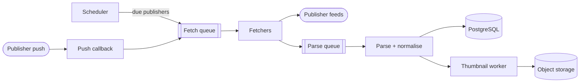
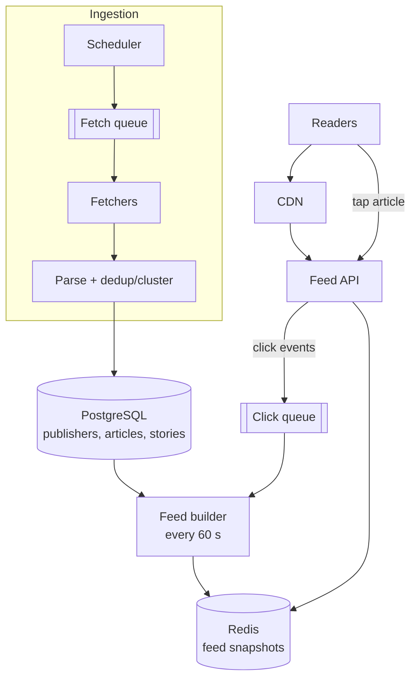
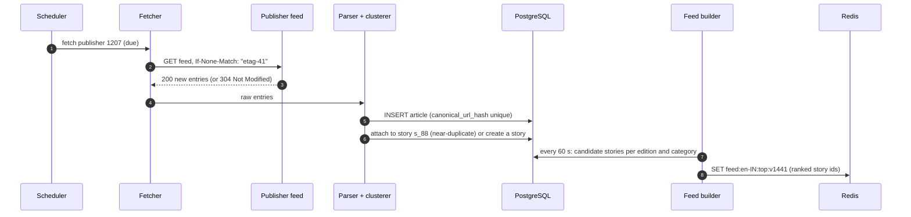
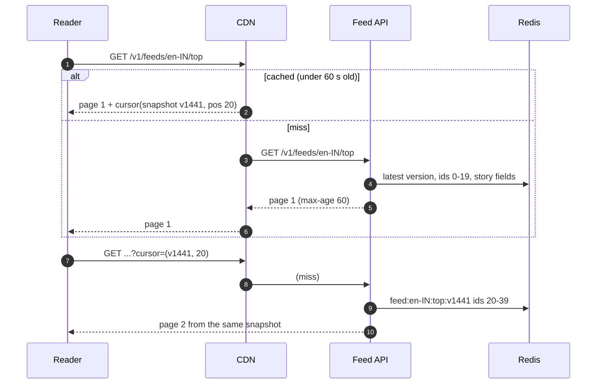
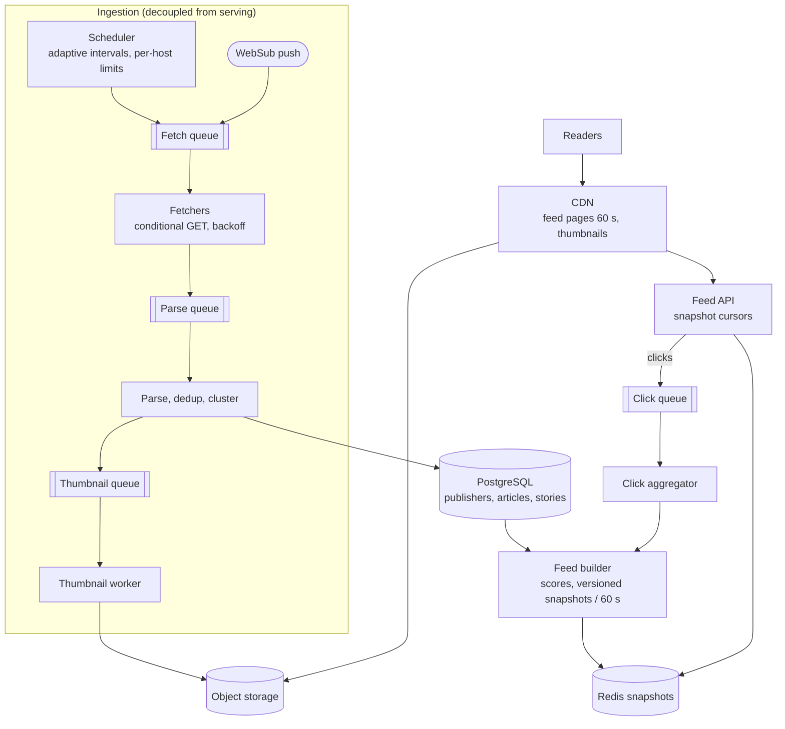

## Problem statement

Design a news aggregator like Google News. The system collects articles from thousands of publishers, groups duplicate coverage of the same
story, and shows readers a fresh, ranked feed — top stories and per-category feeds for their country and language. Tapping an article
opens the publisher's site.

**Interview format:** 45 minutes · **Difficulty:** beginner · **Main themes:** an ingestion pipeline, polite polling, deduplication, a
read-heavy feed with precomputation and CDN caching, stable cursor pagination.

> [!TIP] Try it first
> Before scrolling, spend three minutes writing the questions you would ask the interviewer. Then compare with the list below — or
> practise this whole problem as a [timed mock interview](#system-design/hld/interview/news-aggregator).

## Clarifying questions

The answers below are the interviewer's. Questions that change the design come first.

- **Q:** Where do articles come from? <!-- match: source, sources, publishers, feeds, rss, crawl, ingest -->
  - **A:** About 50,000 publishers that provide RSS or Atom feeds; a few hundred large ones also push updates. We don't crawl arbitrary
    web pages.
- **Q:** How many articles and readers? <!-- match: scale, how many, users, readers, articles, traffic, volume -->
  - **A:** Around 200,000 new articles a day. 100 million monthly readers, 20 million daily; each opens the app about five times a day and
    scrolls about two pages each time. Mornings are the peak, around 3× average.
- **Q:** How fresh must the feed be? <!-- match: fresh, freshness, latency, how quickly, real time, delay, breaking -->
  - **A:** A new article should appear in feeds within about five minutes of the publisher posting it; breaking news faster where
    possible.
- **Q:** Is the feed personalised? <!-- match: personalized, personalised, for you, recommendation, per user -->
  - **A:** Not today. Feeds are per edition — country and language — with top stories plus categories like world, business, sport and
    technology. Personalisation is a later phase.
- **Q:** What do we show for each article? <!-- match: content, full text, snippet, headline, thumbnail, show -->
  - **A:** Headline, a short snippet, publisher, time and a thumbnail. The full article is on the publisher's site.
- **Q:** What about the same story covered by many publishers? <!-- match: duplicate, dedup, same story, cluster, group, repeated -->
  - **A:** Group coverage of the same story into one cluster with a lead article and "more coverage" links, rather than showing twenty
    near-identical headlines.
- **Q:** How should stories be ranked? <!-- match: rank, ranking, order, sort, top, relevance, popular -->
  - **A:** By a mix of recency, how many publishers cover the story, publisher quality, and reader engagement. You can propose the
    details.
- **Q:** Do we need search? <!-- match: search, query, keyword -->
  - **A:** Out of scope.
- **Q:** What are the latency and availability expectations? <!-- match: availability, uptime, p99, fast, slow, sla -->
  - **A:** The feed should load quickly — p99 under 300 ms from the server — and stay available even if ingestion is having problems.

## Functional requirements

> [!TIP] Try it first
> Write three or four functional requirements before reading on.

- **Ingest articles** continuously from publishers' feeds (polling and push). <!-- match: ingest, collect, fetch, poll, crawl -->
- **Group duplicate coverage** of the same story into clusters. <!-- match: group, cluster, dedup, duplicate -->
- Readers can **view a ranked feed** (top stories and categories) for their **edition**, **paginated** by scrolling. <!-- match: feed, ranked, view, edition, paginated, categories -->
- Readers can **open an article** on the publisher's site (we record the click). <!-- match: open, click, article, redirect -->

````hint title="Hint: two halves"
This system has a write-side pipeline (getting articles in) and a read side (serving feeds). They have very different rates and failure
tolerances — design them separately.
````

## Non-functional requirements

- **Freshness**: new articles appear in feeds within **~5 minutes**. <!-- match: fresh, freshness, minutes, within -->
- **Read scale**: ~200M feed page loads a day, ~7,000/s at the morning peak. <!-- match: scale, reads, page loads, peak -->
- **Low latency**: feed responses p99 under 300 ms. <!-- match: latency, p99, fast -->
- **High availability** for reading (99.95%), **independent of ingestion** problems. <!-- match: availability, available, independent -->
- **Politeness**: respect publishers' servers — conditional requests, bounded polling rates. <!-- match: polite, politeness, respect, rate -->
- **Stable pagination**: scrolling doesn't show duplicates or skip stories while rankings shift. <!-- match: stable, pagination, duplicates, scroll -->

````hint title="Hint: how many distinct feeds exist?"
Without personalisation, every reader in the same edition and category sees the same feed. Count the variants — it changes how cacheable
the read side is.
````

## Scope and exclusions

In scope: feed ingestion (polling and push), parsing and normalisation, deduplication and clustering, ranking, feed serving with
pagination, thumbnails, click recording.

Out of scope: search, personalisation, full-text article storage, comments, publisher self-service, and paywall handling.

## Capacity estimation

> [!TIP] Try it first
> Estimate ingestion rates (articles and feed fetches), read rates, storage and the bandwidth for thumbnails.

- **Articles:** 200K/day ≈ **2–3 new articles/s** — tiny.
- **Feed fetches:** poll 5,000 busy feeds every 2 minutes and 45,000 quieter ones every 15 minutes → ~42 + ~50 ≈ **~90 fetches/s**.
- **Reads:** 20M daily readers × 5 opens × 2 pages = 200M page loads/day ≈ **2,300/s**, **~7,000/s** at the morning peak.
- **Feed variants:** ~50 editions × ~20 categories ≈ **1,000 distinct feeds**, identical for everyone in an edition — extremely cacheable.
- **Storage:** ~2 KB of metadata per article → 400 MB/day → ~150 GB/year. Thumbnails ~50 KB → 10 GB/day in object storage.
- **Bandwidth:** a page of 20 items is ~10 KB of JSON → ~23 MB/s; but 20 thumbnails × ~20 KB each per page → ~80 TB/day ≈ **7.4 Gbit/s**
  of images → a **CDN**.

```estimator title="News aggregator"
requestsPerDay = 200.2M
readsPerWrite = 1000
writeBytes = 2 KB
readBytes = 10 KB
retentionYears = 2
peakFactor = 3
replication = 3
cachePercent = 1
serverRps = 3000
targetUtilization = 70
```

Writes are articles (200K/day); reads are feed page loads (200M/day); response size is the feed JSON, not thumbnails.

**What the numbers mean for the design:**

- Ingestion is **low-volume but latency- and politeness-sensitive** — a scheduler, a fetcher pool and a short pipeline.
- Reading is **read-heavy and non-personalised**: precompute ~1,000 feeds and cache them — at the CDN, the origin may see well under
  100 requests a second.
- Thumbnails dominate bandwidth: **object storage plus CDN**.

````hint title="Hint: how much reaches the origin?"
If each of ~1,000 feed variants (a few pages each) is cached at the CDN for 60 seconds, roughly how many requests per second reach your
servers, regardless of reader count?
````

## API design

> [!TIP] Try it first
> Readers need feeds by edition and category, pagination and article clicks. What does the feed response contain?

```text title="API"
GET /v1/feeds/{edition}/{category}?cursor=...&limit=20
    edition: en-IN, en-US, de-DE ...    category: top, world, business, sport, tech ...
  200 OK  Cache-Control: public, max-age=60
  { "snapshot": "2026-03-14T07:05:00Z",
    "items": [ { "story_id": "s_88", "headline": "...", "snippet": "...",
                 "lead": { "article_id": "a_901", "publisher": "...", "published_at": "...",
                           "thumbnail": "https://img.cdn.example/a_901.webp" },
                 "more_coverage": 14 } ],
    "next_cursor": "eyJzbmFwIjoiMjAyNi0wMy0xNFQwNzowNTowMFoiLCJwb3MiOjIwfQ" }

GET /v1/stories/{story_id}              the cluster: lead + other coverage
GET /r/{article_id}                     302 to the publisher URL; click recorded asynchronously

POST /v1/websub/callback/{publisher}    publisher push notifications (verified)
```

- Feed responses are **public and cacheable** for about a minute — the same for every reader in an edition.
- The **cursor** encodes the snapshot and position, so later pages come from the same ranking (deep dive below).

````hint title="Hint: what must the cursor remember?"
Rankings change every minute. If page 2 is computed from a newer ranking than page 1, what does the reader see?
````

## Data model

> [!TIP] Try it first
> Which entities does ingestion write, which does the feed read, and which of them are derived?

```text title="Schema"
publishers   (publisher_id PK, name, feed_url, quality_score, poll_interval_s,
              next_fetch_at, etag, last_modified, error_count)               PostgreSQL
              idx: next_fetch_at                       -- the scheduler's queue

articles     (article_id PK, publisher_id FK, canonical_url_hash UNIQUE, url, title,
              snippet, published_at, edition, category, thumbnail_key,
              simhash, story_id FK, ingested_at)                              PostgreSQL
              idx: (story_id), (edition, category, published_at DESC)

stories      (story_id PK, edition, category, lead_article_id, article_count,
              first_seen_at, updated_at, score)                              PostgreSQL

feed snapshots   feed:{edition}:{category}:{version} -> ordered story ids
                                                          Redis (derived, TTL 30 min)
click counts     clicks:{story_id}:{minute} -> count                        Redis -> aggregated
thumbnails       img/{article_id}.webp                                       Object storage + CDN
```

- The **unique canonical URL hash** stops the same article being ingested twice (exact deduplication).
- **Stories** cluster near-duplicates; the feed ranks stories, not articles.
- **Feed snapshots** are derived and disposable — rebuilt every minute from the database.

````hint title="Hint: what does the feed actually read?"
A feed page is an ordered list of stories plus a few fields per story. Could that list be computed once per minute and shared by
everyone?
````

## Initial high-level architecture

Build the design one requirement at a time.

### Step 1: ingest articles

A **scheduler** picks publishers whose `next_fetch_at` has passed and enqueues fetch jobs; **fetchers** download feeds with conditional
requests; **parsers** normalise entries into articles; new articles are stored and their thumbnails fetched into object storage. Publishers
that support push (WebSub) notify a callback endpoint, which triggers an immediate fetch.



### Step 2: group duplicates

A **dedup/cluster** stage assigns each new article to an existing story or creates a new one.

### Step 3: serve ranked feeds

A **feed builder** recomputes the ranked list of stories for each edition and category every minute and stores a versioned snapshot in
Redis. The **feed API** serves pages from the snapshot; the **CDN** caches responses for a minute; thumbnails come from the CDN.

### Step 4: record clicks

`/r/{article_id}` redirects to the publisher and emits a click event; aggregated clicks feed ranking.

````hint title="Hint: what if ingestion stops?"
Should readers notice when fetchers or the database are struggling? Which component lets the read side keep serving?
````

## Architecture diagram



## Request and data flow

A new article, from publisher to feed:



A reader scrolling:



## Component responsibilities

| Component | Responsibility | Scales with |
|---|---|---|
| Scheduler | Choose due publishers; adapt polling intervals; enforce per-host limits | Number of publishers |
| Fetchers | Conditional GETs, timeouts, retries with backoff, politeness | Fetches/s (~90) |
| Parser / normaliser | RSS/Atom parsing, canonical URLs, edition and category tagging | Articles/s |
| Dedup / clusterer | Exact dedup by URL hash; near-duplicate clustering into stories | Articles/s |
| Thumbnail worker | Fetch, resize, store images | Articles/s |
| Feed builder | Score stories; write versioned snapshots per edition and category | Feed variants (~1,000) |
| Feed API | Serve pages from snapshots; encode cursors; set cache headers | CDN misses |
| CDN | Cache feed pages (60 s) and thumbnails | Readers |
| Click pipeline | Redirect, count clicks per story, feed engagement into ranking | Clicks |

## Database and technology choices

| Need | Choice | Why | Alternative |
|---|---|---|---|
| Publishers, articles, stories | PostgreSQL | ~150 GB/year, relational, unique constraints for dedup, modest write rate | A document store; Cassandra if article volume grew 100× |
| Feed snapshots | Redis (lists or sorted sets) | Fast ordered reads of precomputed lists; versioned keys with TTLs | Precomputed JSON in object storage behind the CDN |
| Pipeline queues | Managed queues or Kafka | Decouple stages, retries, backpressure | In-process pipeline (simpler, couples failures) |
| Thumbnails | Object storage + CDN | ~7 Gbit/s of image egress | Serving images from app servers (no) |
| Push updates | WebSub callbacks | Lower latency and fewer polls for publishers that support it | Polling only |

## Scaling strategy

### How do we ingest 50,000 feeds quickly and politely?

- **Adaptive polling intervals:** each publisher's interval follows how often it actually publishes — a wire service every minute or two,
  a weekly blog every hour or more. Unchanged fetches lengthen the interval; new content shortens it, within bounds.
- **Conditional requests:** send `If-None-Match` with the last `ETag` (or `If-Modified-Since`); a `304 Not Modified` costs the publisher
  almost nothing and saves us parsing.
- **Push where possible:** publishers supporting WebSub notify us of updates, giving near-real-time freshness without polling.
- **Politeness limits:** at most one or two concurrent requests per host, honour `Retry-After` and `robots.txt`, and back off exponentially
  on errors so a struggling publisher isn't hammered.
- **Scheduler correctness:** `next_fetch_at` is indexed; workers claim due rows with `FOR UPDATE SKIP LOCKED` (or the scheduler enqueues
  jobs) so no publisher is fetched twice concurrently.

### How do we detect duplicate and related stories?

Two levels:

- **Exact duplicates** — the same article seen twice (re-polled, or syndicated under the same canonical URL): normalise the URL (strip
  tracking parameters, use the `<link rel="canonical">` when available) and rely on the unique hash constraint.
- **Near-duplicates and the same story** — different publishers covering one event: compute a similarity fingerprint (for example a
  SimHash over the title and snippet) and compare it with recent stories in the same edition; also compare named entities and time. If
  similar enough, attach the article to that story; otherwise create a new one. Only stories from the last day or two are candidates,
  which keeps comparisons cheap.

The **lead article** of a story is chosen by publisher quality and recency; others become "more coverage".

### How are feeds built and ranked?

Every 60 seconds, the feed builder computes, for each edition and category, a score per candidate story — for example

```text title="Formula"
score = (w1 × coverage + w2 × publisher quality + w3 × recent clicks) × freshness decay
freshness decay = 0.5 ^ (age_hours / half_life_hours)
```

— then writes the top few hundred story IDs to a new versioned Redis key (`feed:en-IN:top:v1441`) and atomically updates the "latest"
pointer. Precomputation is cheap: ~1,000 feeds × a few hundred candidates each, once a minute. Breaking news can trigger an early rebuild
for affected editions.

### How does pagination stay stable while rankings change?

Rankings change every minute; offset pagination over the *latest* ranking would show duplicates or skip stories mid-scroll. Instead, the
cursor encodes the **snapshot version and position**. Page 2 reads from the same snapshot as page 1, so the reader scrolls through one
consistent list. Snapshots live for about 30 minutes (TTL), long enough for any scroll session; if one has expired, the API falls back to
the latest snapshot and skips stories the client already has (the client sends recently seen story IDs, or the cursor includes the last
story's score for a keyset-style continuation).

## Caching strategy

### What can be cached, and how fresh must it be?

| What | Where | Freshness |
|---|---|---|
| Feed pages (first and later pages) | CDN, keyed by edition, category and cursor | `max-age=60` — fresher than the five-minute requirement |
| Feed snapshots | Redis, versioned keys | Rebuilt every 60 s; TTL ~30 min |
| Story details | Redis, by story ID | Invalidated when the story changes |
| Thumbnails | CDN, immutable URLs | Long-lived |

With ~1,000 feed variants and a few hot pages each, the CDN turns ~7,000 page loads/s at peak into well under 100 origin requests a
second. **Request coalescing** at the CDN (or origin shield) ensures that when a popular page expires, one request refreshes it.

## Messaging strategy

### How do the ingestion stages connect?

Queues between stages — fetch → parse/dedup → thumbnail — so each stage scales and fails independently:

- **Retries with backoff** for fetch and image failures; publishers that fail repeatedly get longer intervals and an alert, not infinite
  retries.
- **Dead-letter queue** for feeds that can't be parsed (malformed XML), for manual inspection.
- **Idempotent consumers:** re-processing a fetched feed is harmless because articles are deduplicated by URL hash.
- **Backpressure:** if parsing falls behind, fetch jobs wait in the queue; the read side is unaffected because it serves snapshots.
- **Click events** flow through their own queue to an aggregator that maintains per-story click counts for ranking.

## Failure scenarios

| Failure | Impact | Mitigation |
|---|---|---|
| Fetchers or pipeline down | No new articles; feeds go stale | Feeds keep serving the last snapshots; alert on ingestion lag; scale workers |
| A publisher is slow or erroring | Fetches time out | Timeouts, backoff, longer intervals; other publishers unaffected |
| Feed builder fails | Snapshots stop updating | Keep serving the last version; builder runs redundantly (leader election or idempotent runs) |
| Redis down | Feed API can't read snapshots | CDN serves cached pages; replicated Redis; API can rebuild a feed from PostgreSQL in degraded mode |
| PostgreSQL primary fails | Ingestion stalls | Failover; read side unaffected (snapshots and CDN) |
| Breaking news spike | Many readers at once | CDN absorbs it; early feed rebuild for freshness |
| Bad parse floods a story cluster | Wrong grouping | Similarity thresholds, per-publisher limits, manual override |

## Bottleneck analysis

- **Reads** would be the bottleneck without caching (~7,000/s), but identical feeds make the CDN hit ratio very high.
- **Ingestion latency** — the five-minute freshness target — depends on polling intervals for busy publishers and on pipeline lag; push
  (WebSub) and adaptive intervals address it.
- **Clustering cost** grows with the candidate window; limiting it to recent stories per edition keeps it bounded.
- **Thumbnail bandwidth** (~7 Gbit/s) is served entirely by the CDN.

## Consistency and availability trade-offs

- The read side is **eventually consistent by design**: feeds are rebuilt every minute and cached for a minute — comfortably within the
  five-minute freshness requirement — in exchange for very high availability and low cost.
- **Ingestion and serving are decoupled**: serving never waits for ingestion, so ingestion failures make feeds stale rather than
  unavailable.
- **Pagination favours stability over freshness**: a scroll session sees one snapshot, even if a newer ranking exists.
- **Deduplication is strongly consistent for exact duplicates** (unique constraint) and best-effort for near-duplicates.

## Security considerations

- **Untrusted input:** feeds are third-party XML — use a parser with external entities disabled (to prevent XXE attacks), size limits and
  timeouts; sanitise HTML in snippets.
- **Push callbacks:** verify WebSub subscriptions and signatures; rate-limit callbacks.
- **Fetcher safety:** publishers' feed URLs are configured by us, but redirects could point at internal addresses — block private IP
  ranges (SSRF).
- **Click redirects** only to stored article URLs — never an arbitrary URL parameter (open redirect).

## Monitoring and observability

- **Ingestion lag:** time from an article's `published_at` to its appearance in a feed (p50/p95) — the freshness SLO.
- Fetch success rate, 304 rate and errors per publisher; queue depths per stage.
- Feed builder run duration and the age of the latest snapshot per edition.
- Feed API latency, CDN hit ratio, origin request rate.
- Clustering quality signals: stories with unusually many articles, manual overrides.

## Final architecture

Open this after you have drawn your own.

````solution title="Final architecture"


**In one breath:** a scheduler polls 50,000 publisher feeds at adaptive intervals with conditional requests (and accepts WebSub pushes);
a queued pipeline parses, deduplicates by canonical URL and clusters near-duplicates into stories in PostgreSQL; every minute a feed
builder ranks stories per edition and category into versioned Redis snapshots; the feed API serves pages from a snapshot named in the
cursor, cached at the CDN for 60 seconds with thumbnails, so reading stays fast and available even when ingestion struggles.
````

## Alternative designs and trade-offs

| Alternative | Gains | Costs | When to choose it |
|---|---|---|---|
| Rank at request time | Always freshest | Expensive per request; uncacheable; slower | Personalised feeds with small candidate sets |
| Offset pagination on the live ranking | Simple | Duplicates and skipped stories while scrolling | Rarely changing lists |
| Static JSON feed files on object storage + CDN | Almost no serving infrastructure | Cursor flexibility limited; rebuild writes many files | Very simple, fixed pagination |
| Crawling article pages instead of feeds | Full text, more sources | Much heavier, legal and politeness concerns | Search or full-text products |
| Cassandra for articles | Massive write scaling | Joins and constraints harder | 100× the article volume |

## Interviewer follow-up questions

````question title="How would you add a personalised 'For you' feed?"
Keep the non-personalised snapshots as the candidate source. For each user, combine candidates from the editions and categories they
read, then re-rank them with a per-user model (topics followed, publishers clicked, stories already seen) at request time or in a
precomputed per-user feed refreshed periodically for active users. Personalised responses aren't shareable, so they bypass the CDN and are
cached briefly per user; the click pipeline also becomes the training data for the model.
````

````question title="A major event breaks and thousands of articles arrive in minutes. What changes?"
Ingestion queues absorb the burst and workers scale out; clustering groups the flood into a handful of stories, which keeps feeds readable.
Trigger an immediate feed rebuild for affected editions instead of waiting for the minute boundary, and consider lowering the CDN max-age
for top-story pages briefly. Reader traffic spikes too, but identical feeds keep the CDN hit ratio high.
````

````question title="How do you handle a publisher that changes article URLs or republishes the same story?"
Normalise URLs (remove tracking parameters, prefer the canonical link element) and deduplicate on the normalised hash. When URLs change but
content doesn't, the near-duplicate fingerprint attaches the new item to the existing story, and an update rather than a new story appears.
A per-publisher rule set can fix systematic quirks.
````

````question title="How would you show 'live' updates on a story page during a breaking event?"
Story pages could poll the story endpoint every 30–60 seconds (cheap and CDN-cacheable), or subscribe via Server-Sent Events to a channel
per story that the clusterer publishes to when new coverage arrives. With modest fan-out per story, polling with short CDN TTLs is simplest;
SSE becomes worthwhile for very large live events.
````

````question title="How do you keep a rogue or compromised publisher from flooding the feed?"
Per-publisher ingestion limits (articles per hour), quality scores that weight ranking, anomaly alerts on sudden volume or content shifts,
and the ability to pause a publisher immediately. Ranking should never let one publisher dominate a page — cap stories per publisher per
feed page.
````

## Common mistakes

- **Ranking on every request** instead of precomputing ~1,000 shared feeds.
- **Polling every feed at the same fixed interval** — too slow for wire services, wasteful and impolite for quiet blogs.
- **No conditional requests** (`ETag`/`If-Modified-Since`).
- **Offset pagination over a changing ranking.**
- **Coupling serving to ingestion**, so a pipeline problem takes feeds down.
- **Forgetting thumbnail bandwidth** and the CDN.

## Evaluation checklist

```checklist title="Evaluation checklist"
- Asked about sources, scale, freshness, personalisation and duplicate coverage
- Separated the ingestion pipeline from the read path
- Estimated read rates, feed variants, storage and thumbnail bandwidth
- Designed polite, adaptive polling with conditional requests, plus push where available
- Deduplicated exact duplicates with a unique key and clustered near-duplicates into stories
- Precomputed ranked feeds per edition and category on a schedule
- Cached feed pages at a CDN within the freshness requirement
- Made pagination stable with snapshot-based cursors
- Used queues with retries and dead-letter handling between ingestion stages
- Kept feeds serving (stale) when ingestion fails
- Handled untrusted feed input safely (XXE, SSRF, open redirects)
```
