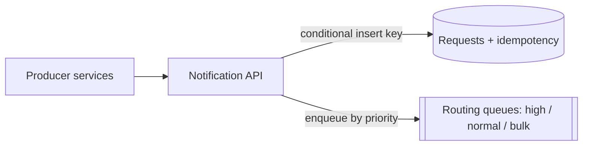
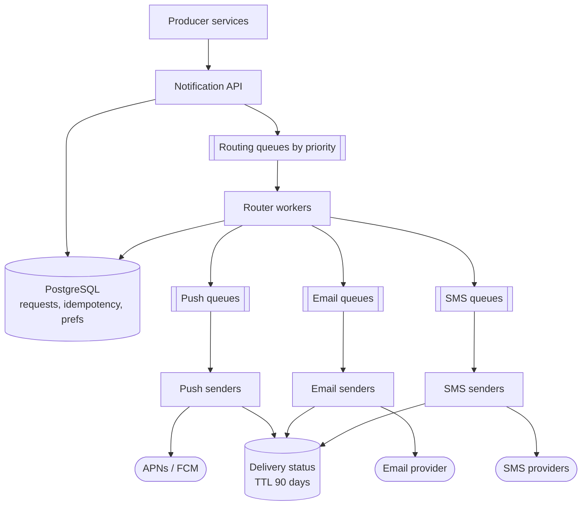
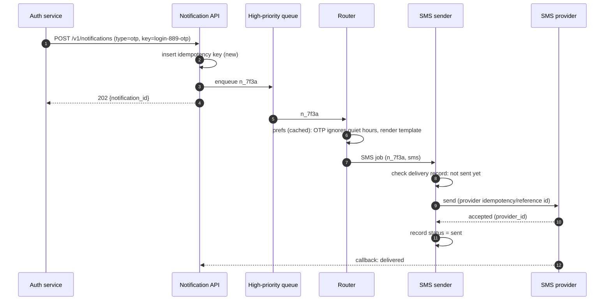
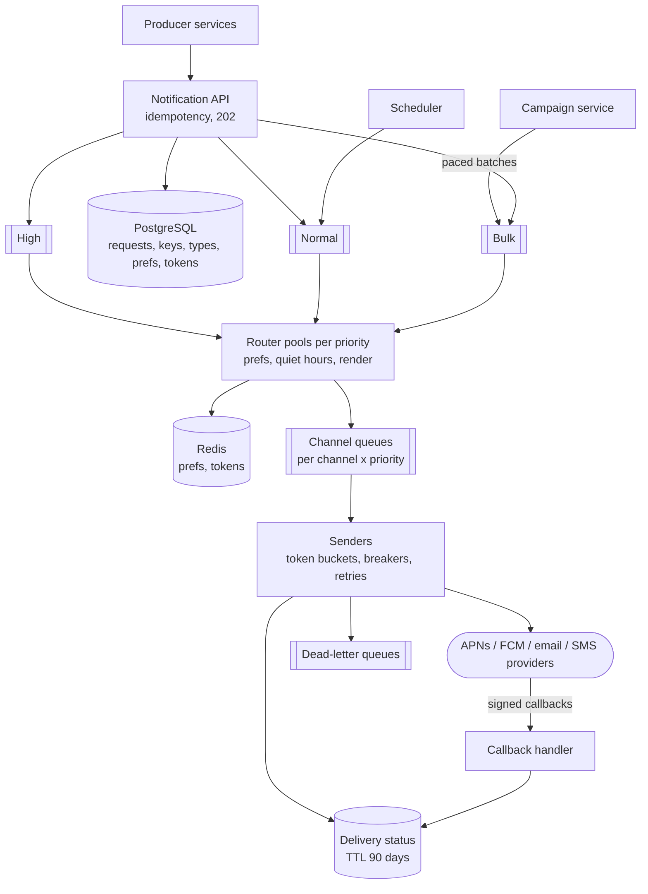

## Problem statement

Design a notification service that other teams' services call to notify users by **push notification, email or SMS** — one-time
passcodes, order updates, security alerts, social activity and marketing campaigns. It must respect user preferences, deliver
reliably without spamming duplicates, and stay fast for urgent messages even while a large campaign is sending.

**Interview format:** 45 minutes · **Difficulty:** beginner · **Main themes:** asynchronous processing, priorities, retries and dead-letter
queues, idempotency, third-party provider limits.

> [!TIP] Try it first
> Before scrolling, spend three minutes writing the questions you would ask the interviewer. Then compare with the list below — or
> practise this whole problem as a [timed mock interview](#system-design/hld/interview/notification-system).

## Clarifying questions

The answers below are the interviewer's. Questions that change the design come first.

- **Q:** Which channels do we support? <!-- match: channels, push, email, sms, text, in-app, mobile -->
  - **A:** Mobile push (iOS and Android), email and SMS. An in-app notification inbox is out of scope.
- **Q:** How many notifications per day, and what kinds? <!-- match: scale, volume, how many, traffic, per day, kinds, types -->
  - **A:** About 50 million a day: roughly 20M transactional (passcodes, orders, security), 20M social activity and 10M marketing. Push
    is about 60% of sends, email 30%, SMS 10%.
- **Q:** Are there bursts? <!-- match: burst, peak, spike, campaign, marketing, broadcast -->
  - **A:** Marketing campaigns target up to 10 million users at once and should finish within about an hour. Normal traffic peaks in the
    evening.
- **Q:** How fast must urgent notifications arrive? <!-- match: latency, fast, urgent, otp, passcode, how quickly, seconds -->
  - **A:** One-time passcodes and security alerts within a few seconds, even during a campaign. Social notifications within a minute.
    Marketing can take an hour.
- **Q:** Who calls the service, and how? <!-- match: who, callers, producers, api, services, trigger -->
  - **A:** Internal services, through an API. They may retry when a call times out.
- **Q:** Can users opt out or set preferences? <!-- match: preferences, opt out, unsubscribe, settings, quiet hours, consent -->
  - **A:** Yes: per category and channel (for example, no marketing SMS), unsubscribe links in marketing email, and quiet hours for
    non-urgent notifications. Legal opt-outs must always be honoured.
- **Q:** Is a duplicate notification acceptable? <!-- match: duplicate, twice, dedup, exactly once, again, retry -->
  - **A:** Duplicates should be very rare — two passcodes or two "your order shipped" messages confuse people. A missed notification is
    worse, though, for transactional types.
- **Q:** Do we need delivery tracking? <!-- match: tracking, delivered, status, receipts, opened, analytics -->
  - **A:** Yes: sent, delivered, failed, and for email, bounces and opens. Keep status for 90 days for support and debugging.
- **Q:** Do we send through our own infrastructure? <!-- match: provider, vendor, apns, fcm, twilio, sendgrid, third party -->
  - **A:** No. Push goes through Apple's and Google's push services; email and SMS through third-party providers, which have rate limits
    and occasional outages.
- **Q:** Are messages templated and localised? <!-- match: template, localization, language, content, personalize -->
  - **A:** Yes. Callers send a template name and data; we render the content in the user's language.

## Functional requirements

> [!TIP] Try it first
> Write three or four functional requirements before reading on.

- Internal services can **send a notification** to a user (or a list of users) by type, template and data, optionally **scheduled**. <!-- match: send, notify, notification, schedule -->
- The system **delivers by push, email or SMS** according to the type and the user's **preferences**, quiet hours and opt-outs. <!-- match: deliver, channel, preferences, opt out -->
- Marketing can **send a campaign** to a large audience. <!-- match: campaign, broadcast, bulk, marketing -->
- Callers and support staff can **check delivery status**. <!-- match: status, tracking, delivered -->

````hint title="Hint: what does the caller actually need back?"
Delivery to phones and inboxes takes seconds to hours and depends on third parties. The caller needs a fast acknowledgement that the
request was accepted — and a way to check what happened later.
````

## Non-functional requirements

- **Scale**: ~50M notifications a day, campaigns of 10M users within an hour. <!-- match: scale, per day, volume, million -->
- **Low latency for urgent types**: passcodes and security alerts delivered within seconds, even during campaigns. <!-- match: latency, seconds, urgent, otp -->
- **Reliability**: accepted transactional notifications are never lost (at-least-once delivery attempts). <!-- match: reliable, never lost, at least once, durable -->
- **Deduplication**: duplicates are very rare, including when callers retry. <!-- match: duplicate, dedup, idempotent, exactly once -->
- **Compliance**: opt-outs and preferences are always honoured. <!-- match: compliance, opt out, preferences, consent -->
- **Availability**: the accept API is highly available (99.95%); delivery degrades gracefully when a provider fails. <!-- match: availability, available, uptime -->

````hint title="Hint: one queue or several?"
If urgent passcodes and a 10-million-user campaign share one queue, how long does a passcode wait? Think about priority before drawing.
````

## Scope and exclusions

In scope: an accept API, preferences and opt-outs, templating, push/email/SMS delivery through providers, retries, priorities, campaigns,
scheduling and delivery status.

Out of scope: an in-app inbox, the campaign-authoring UI and audience segmentation logic (we receive a segment ID or user list), rich
analytics, and A/B testing.

## Capacity estimation

> [!TIP] Try it first
> Estimate average and campaign send rates, the per-channel split, and status storage for 90 days.

- **Average:** 50M/day ≈ **580 notifications/s**; per channel ≈ 350 push/s, 170 email/s, 60 SMS/s.
- **Campaign:** 10M in an hour ≈ **2,800/s** on top of normal traffic → plan for **~5,000 sends/s** at peak.
- **Status log:** ~1 KB per notification (IDs, channel, status history) → 50 GB/day → **~4.5 TB for 90 days**.
- **Device tokens:** ~300M devices × ~200 B ≈ 60 GB. **Preferences:** ~200M users × ~200 B ≈ 40 GB.
- **Provider limits:** FCM's HTTP v1 API meters sends with a token bucket of 600K per minute; a 10M-user push campaign therefore needs
  at least ~17 minutes at the full quota — the send rate must be controlled, not unlimited.

```estimator title="Notification system"
requestsPerDay = 60M
readsPerWrite = 0.2
writeBytes = 1 KB
readBytes = 2 KB
retentionYears = 0.25
peakFactor = 5
replication = 3
cachePercent = 5
serverRps = 1000
targetUtilization = 60
```

Writes are notifications sent (50M/day); reads are status lookups (~10M/day); retention is 90 days.

**What the numbers mean for the design:**

- A few thousand sends/s is **comfortable for queues and stateless workers** — the hard part isn't throughput but **priority, retries,
  deduplication and provider limits**.
- Status data (~4.5 TB, write-heavy, accessed by notification or user ID, expiring after 90 days) suits a **partitioned store with TTL**.
- Preferences and device tokens (tens of GB, read on every send) are worth **caching**.

````hint title="Hint: what limits the campaign?"
Compute how long 10M pushes take at the provider's quota. Your own servers aren't the slowest part of the pipeline.
````

## API design

> [!TIP] Try it first
> What does a calling service send, what does it get back, and how is a retry from the caller handled?

```text title="API"
POST /v1/notifications                         (internal; service-to-service auth)
  Headers: Idempotency-Key: <caller-generated key, e.g. "order-123-shipped">
  Body: { "user_id": "u_42", "type": "order_shipped",        (type -> category, priority, channels)
          "template": "order_shipped_v3",
          "data": { "order_id": "123", "eta": "Tue" },
          "send_at": null }                                  (optional schedule)
  202 Accepted  { "notification_id": "n_7f3a" }    (same key again -> same id, no new send)

POST /v1/campaigns   { "segment_id": "...", "template": "...", "send_at": "..." }
  202 Accepted  { "campaign_id": "c_19" }

GET  /v1/notifications/{id}                    -> 200 { status per channel, attempts, timestamps }
GET  /v1/users/{user_id}/notifications?cursor=...   (support tooling)

PUT  /v1/users/me/preferences
     { "marketing": { "sms": false }, "quiet_hours": "22:00-07:00" }
POST /v1/providers/{provider}/callbacks        (provider delivery receipts; signed)
```

- **202 Accepted**, not 200: the request is durably queued; delivery happens later.
- **Idempotency key from the caller** — ideally derived from the business event (`order-123-shipped`) — makes caller retries harmless.
- The **type** carries policy (priority, default channels, whether quiet hours apply) so callers can't accidentally send marketing as
  urgent.

````hint title="Hint: why 202?"
Delivery depends on providers and can take minutes. What should the API promise at the moment it responds?
````

## Data model

> [!TIP] Try it first
> What must be stored durably at accept time, and what is read on every send?

```text title="Schema"
PostgreSQL (configuration; preferences and tokens also cached in Redis)
notification_types   (type PK, category, priority, default_channels, respects_quiet_hours)
templates            (name, version, locale, channel, subject, body)
                     PK (name, version, locale)
preferences          (user_id PK, opt_outs jsonb, quiet_hours, timezone, locale)
device_tokens        (user_id, token, platform, updated_at)  PK (user_id, token)

PostgreSQL (accepted requests)
notifications        (notification_id, user_id, type, idempotency_key, payload, send_at, created_at)
idempotency_keys     (caller, key) -> notification_id        unique; expires after 7 days

Cassandra / DynamoDB (delivery records, TTL 90 days)
deliveries           (notification_id, channel, status, attempts, provider_id, updated_at)
                     partition: notification_id
user_deliveries      (user_id, created_at, notification_id, channel, status)
                     partition: user_id, sort: created_at   (support lookups)
```

- **Configuration-like data** (types, templates, preferences, tokens) is relational, modest in size and read-heavy → PostgreSQL with a cache.
- **Delivery records** are write-heavy, append-mostly, keyed by notification or user, and expire → a partitioned store with TTL.
- The **idempotency table** enforces one notification per caller key (a conditional insert).

````hint title="Hint: what is read on every single send?"
Preferences, device tokens and the template are read for almost every notification. What does that imply for caching?
````

## Initial high-level architecture

Build the design one requirement at a time.

### Step 1: accept a notification

The **notification API** authenticates the calling service, checks the idempotency key, stores the request, and enqueues it on a queue
for its priority. It returns 202 immediately.



### Step 2: route and render

**Router workers** consume each request, load the user's **preferences**, quiet hours and **device tokens**, decide which channels to use
(or to skip or delay), render the **template** in the user's language, and enqueue one job per channel.

### Step 3: deliver through providers

**Channel senders** (push, email, SMS) consume their queues, call the provider within rate limits, record the outcome, and retry
failures with backoff; jobs that keep failing go to a dead-letter queue. **Provider callbacks** update delivery status and clean up bad
device tokens and bouncing email addresses.

````hint title="Hint: why separate routing from sending?"
Routing reads our own data (preferences, templates); sending talks to slow, rate-limited third parties. Separating them lets each scale,
retry and fail independently.
````

## Architecture diagram



## Request and data flow

An urgent passcode from accept to delivery:



## Component responsibilities

| Component | Responsibility | Scales with |
|---|---|---|
| Notification API | Authenticate callers, enforce idempotency, persist, enqueue by priority, return 202 | Accept rate |
| Routing queues | Durable buffering per priority (high, normal, bulk) | Backlog size |
| Router workers | Preferences, quiet hours, frequency caps, channel choice, template rendering | Notifications/s |
| Channel queues | Per-channel, per-priority work for senders | Backlog |
| Channel senders | Call providers within rate limits; retries with backoff; DLQ | Sends/s, provider limits |
| Scheduler | Release scheduled notifications when due | Scheduled volume |
| Campaign service | Expand a segment into batches and feed the bulk queue at a controlled rate | Campaign size |
| Callback handler | Verify provider callbacks; update status; remove bad tokens; suppress bounces | Callback rate |
| Delivery status store | Per-notification and per-user status, 90-day TTL | Write volume |

## Database and technology choices

| Need | Choice | Why | Alternative |
|---|---|---|---|
| Requests, idempotency, types, templates, preferences, tokens | PostgreSQL + Redis cache | Modest size, relational, read-heavy; unique constraint for idempotency | DynamoDB with conditional writes |
| Queues | Managed queues (e.g. SQS) or Kafka | Durable buffering, retries, DLQs; per-priority isolation | RabbitMQ with priority queues |
| Delivery status | Cassandra or DynamoDB with TTL | Write-heavy, key-based access, automatic expiry | Time-partitioned PostgreSQL tables |
| Push | APNs and FCM | The only routes to iOS and Android devices | Third-party push aggregators |
| Email / SMS | Two providers per channel | Throughput, failover and cost leverage | A single provider (simpler, a single point of failure) |

## Scaling strategy

### How do we deliver reliably without sending duplicates?

Three places duplicates can come from, and the fix for each:

1. **Caller retries** — the caller timed out and called again. The API's idempotency table (unique per caller and key) returns the
   original `notification_id` instead of creating a new one.
2. **Queue redelivery** — a sender crashed after sending but before acknowledging the message, so the queue delivers it again. Before
   calling the provider, the sender checks the `(notification_id, channel)` delivery record; after a successful send, it records
   `sent` before acknowledging. A redelivered job that finds `sent` is dropped.
3. **Provider ambiguity** — the provider call timed out: did it send? Where the provider supports an idempotency key or client reference,
   pass `notification_id:channel`; otherwise accept a rare duplicate for transactional types, because a missed passcode is worse than
   two.

The result is **at-least-once attempts with effectively-once delivery** in all but the provider-timeout corner case — which is the honest
limit of any system that depends on third parties.

### How do we keep passcodes fast while a 10-million-user campaign is sending?

**Isolate by priority at every stage.** Separate queues (and separate worker pools) for high (passcodes, security), normal (social,
orders) and bulk (marketing). High-priority workers never pick up bulk work, so a campaign backlog of millions can't delay a passcode.
Reserve part of each provider's rate limit for high priority — for example, bulk senders may use at most 70% of the push quota. Within
bulk, campaigns are throttled so their backlog drains at a steady rate.

### How do we respect provider limits and survive provider outages?

- **Rate-limit senders per provider** with a shared token bucket (in Redis) so the whole fleet stays under each provider's quota; back off
  on `429` responses using their `Retry-After`.
- **Circuit breakers** per provider: when error rates spike, stop sending for a short period instead of hammering a failing provider and
  burning retries.
- **Failover for email and SMS**: a second provider takes over when the first's breaker opens (push has no alternative to APNs/FCM —
  messages wait in the queue and retry).
- **Feedback loops**: remove device tokens the push service reports as invalid; suppress addresses that hard-bounce; both protect
  sender reputation and quotas.

### How do campaigns and scheduled notifications scale?

- **Campaigns:** the campaign service pages through the segment's user IDs in batches (say 1,000 at a time) and enqueues bulk jobs at a
  controlled rate — fast enough to finish within the hour, slow enough to respect provider quotas. Progress is checkpointed so a crash
  resumes rather than restarts (and the per-user idempotency key `campaign_id:user_id` prevents double sends on resume).
- **Scheduled sends:** store `send_at`; a scheduler queries due notifications by time bucket every few seconds and enqueues them.
  Quiet-hours delays use the same mechanism with a computed `send_at` in the user's timezone.

## Caching strategy

### What do we cache on the send path?

Every send reads preferences, device tokens and a template — at ~5,000 sends/s at peak, that's tens of thousands of lookups per second.

- **Templates and notification types**: tiny, rarely changed — cached in every worker's memory, refreshed on change events.
- **Preferences and device tokens**: Redis cache-aside keyed by `user_id`, invalidated on update. Because opt-outs are a legal
  requirement, preference updates **delete the cache key synchronously** before acknowledging, and the TTL is short (minutes) as a safety
  net.
- **Campaign batches**: the campaign service can bulk-load preferences for 1,000 users at a time instead of 1,000 single reads.

## Messaging strategy

### How do retries, backoff and dead-letter queues work here?

- **Transient failures** (timeouts, 5xx, 429) are retried with **exponential backoff and jitter** — for example 10 s, 30 s, 2 min, 10 min —
  using delayed redelivery (visibility timeouts or a retry topic), never by sleeping in a worker thread.
- **Permanent failures** (invalid token, invalid number, hard bounce) are not retried; they update status and feed the suppression lists.
- **Retry budgets differ by type**: a passcode is useless after a few minutes, so it gets a short retry window (and possibly a channel
  fallback, such as SMS after push fails); marketing can retry for hours.
- After the last attempt, the job goes to a **dead-letter queue** with its error history, raising an alert if transactional DLQ depth
  grows; operators can inspect and replay.

## Failure scenarios

| Failure | Impact | Mitigation |
|---|---|---|
| A provider is down | Sends on that channel fail | Circuit breaker; failover provider for email/SMS; queue and retry push |
| Provider rate limit hit | 429s, slower delivery | Fleet-wide token buckets; reserved headroom for high priority |
| Sender crashes after sending | Message redelivered | Delivery record checked before sending; `sent` recorded before ack |
| Caller retries after timeout | Duplicate request | Idempotency key at the API |
| Campaign floods the queues | Backlog of millions | Bulk queue isolated; throttled campaign feeder |
| Preferences cache stale | Could send to an opted-out user | Synchronous invalidation on update; short TTL |
| Queue unavailable | API can't enqueue | Multi-zone managed queues; API returns 503 so callers retry (idempotently) |
| Status store slow | Status writes lag | Asynchronous status updates; senders don't block on them |

## Bottleneck analysis

- **Provider throughput** is the real ceiling for campaigns (for example, 10M pushes take at least ~17 minutes at FCM's per-minute quota),
  so the design paces work rather than maximising worker count.
- **Preference and token reads** scale with send rate; caching and batch loading keep them off PostgreSQL.
- **Status writes** (~600/s average, several thousand at peak, plus callbacks) suit a partitioned store; PostgreSQL would need time
  partitioning to cope.
- **Hot users** (a celebrity receiving thousands of social notifications) are tamed by **frequency caps and batching** ("Asha and 98 others
  liked your post").

## Consistency and availability trade-offs

- **Accepting** a notification is strongly consistent and durable: the idempotency insert and request record commit before 202.
- **Delivery** is asynchronous and at-least-once; the system prefers a rare duplicate over losing a transactional notification.
- **Preferences** must be honoured as soon as they change — the one place we pay for synchronous cache invalidation.
- **Delivery status** is eventually consistent: provider callbacks can arrive seconds or minutes later, and out of order (a "delivered"
  receipt before our "sent" record is written) — status updates must be order-tolerant.

## Security considerations

- **Service-to-service authentication** on the API (mTLS or signed tokens); per-caller quotas so a buggy service can't spam users.
- **Callback verification**: provider webhooks are signed; verify signatures before updating status.
- **Sensitive content**: never put secrets beyond the passcode itself in notifications; passcodes expire quickly and aren't stored in
  plaintext logs.
- **Compliance**: honour opt-outs and unsubscribe links for marketing; keep audit records of consent changes.
- **Abuse**: a compromised caller could send phishing; restrict which templates and types each caller may use.

## Monitoring and observability

- End-to-end latency from accept to provider acceptance, per priority (passcode p99 is the key SLO).
- Queue depth and age of oldest message per queue and priority.
- Send success, retry and DLQ rates per channel and provider; provider latency and 429s.
- Delivery rates from callbacks (delivered, bounced, invalid token) per channel.
- Duplicate detections at the API and sender levels.
- Campaign progress versus plan.

## Final architecture

Open this after you have drawn your own.

````solution title="Final architecture"


**In one breath:** callers post notifications with an idempotency key and get 202 once the request is stored and queued by priority;
router pools apply cached preferences, quiet hours and caps and render templates into per-channel, per-priority queues; senders deliver
through providers within fleet-wide rate limits, with circuit breakers, failover, backoff retries and dead-letter queues; delivery
records make redelivery harmless; campaigns are expanded and paced into an isolated bulk lane so passcodes stay fast.
````

## Alternative designs and trade-offs

| Alternative | Gains | Costs | When to choose it |
|---|---|---|---|
| One shared queue | Simple | Campaigns delay passcodes | Low volume, no bulk sends |
| Synchronous send in the API | Caller learns the result immediately | Caller latency and failures tied to providers | Rarely — perhaps for a single-channel internal tool |
| Kafka instead of task queues | High throughput, replay | Per-message retry and delay need extra topics and logic | Very high volume, event-sourced pipelines |
| Managed multi-channel platform (e.g. a CPaaS) | Less to build | Cost, lock-in, less control over priority | Small teams |
| PostgreSQL for delivery status | One database | Needs time partitioning for write volume and retention | Lower volume |

## Interviewer follow-up questions

````question title="How do you guarantee a user who opted out of marketing SMS never receives one?"
Check preferences at routing time for every notification, not at campaign creation, so later opt-outs apply. Make preference updates
synchronous to the cache — delete the cached entry before acknowledging the update — and keep a short TTL as a safety net. For legal
opt-outs such as SMS STOP replies, process the provider's inbound message immediately and also maintain a suppression list consulted by
the SMS sender just before sending, as a final guard.
````

````question title="Push notifications to a user fail because their app was uninstalled. What happens?"
The push service responds that the token is unregistered or invalid. The sender records the failure as permanent (no retry) and the
feedback handler deletes that device token, so future sends skip it. If the notification is transactional and the user has another channel
enabled, the router can fall back to email or SMS.
````

````question title="How would you add a daily digest instead of sending every social notification immediately?"
Mark social types as digestible. Instead of sending, the router appends them to a per-user digest buffer (for example a Redis list or a
table keyed by user and day) and schedules a digest notification for the user's chosen local time. At that time a digest worker collects
the buffer, renders one summary template and sends it through the normal pipeline with an idempotency key of user and date.
````

````question title="How do you stop one user receiving 200 notifications in an hour?"
Frequency caps per user and category, enforced in the router with counters (for example a Redis counter per user, category and hour).
Over the cap, notifications are dropped, delayed or aggregated ("Asha and 98 others liked your post"), depending on the type.
Transactional types bypass the caps.
````

````question title="How would you deliver notifications to users in different time zones at 9 am local time?"
Store each user's timezone with their preferences. The campaign service computes each recipient's send_at in UTC from the target local
time and enqueues the job into the scheduler, which releases jobs as their time arrives. That also spreads the campaign over the day
across time zones, smoothing provider load.
````

````question title="How would you prove a notification was sent, for a support investigation?"
Every notification has an ID returned at accept time. The delivery status store keeps the attempts, provider message IDs and timestamps
per channel for 90 days, and the user-indexed table lets support list a user's recent notifications. Provider IDs let you trace the
message in the provider's own logs; callbacks add delivered or bounced events.
````

## Common mistakes

- **Sending synchronously from the API** so callers wait on providers.
- **One queue for everything**, letting campaigns delay passcodes.
- **Retrying without backoff, caps or dead-letter queues** — or retrying permanent failures.
- **No idempotency**, so caller retries and queue redeliveries produce duplicates.
- **Ignoring provider rate limits**, then being throttled mid-campaign.
- **Checking preferences only when a campaign is created**, missing later opt-outs.

## Evaluation checklist

```checklist title="Evaluation checklist"
- Asked about channels, volume, campaigns, urgency, preferences and duplicate tolerance
- Estimated average and campaign send rates and noticed provider quotas are the real limit
- Returned 202 from an accept API and used idempotency keys for caller retries
- Separated routing from sending, with per-channel queues
- Isolated priorities so urgent messages aren't delayed by campaigns
- Designed retries with backoff and jitter, permanent-failure handling and dead-letter queues
- Prevented duplicate sends on queue redelivery with a delivery record
- Respected provider rate limits fleet-wide and handled provider outages (breakers, failover)
- Applied preferences, opt-outs and quiet hours at send time, with cache invalidation
- Paced campaign fan-out and made it resumable
- Stored delivery status with retention and handled out-of-order provider callbacks
```
