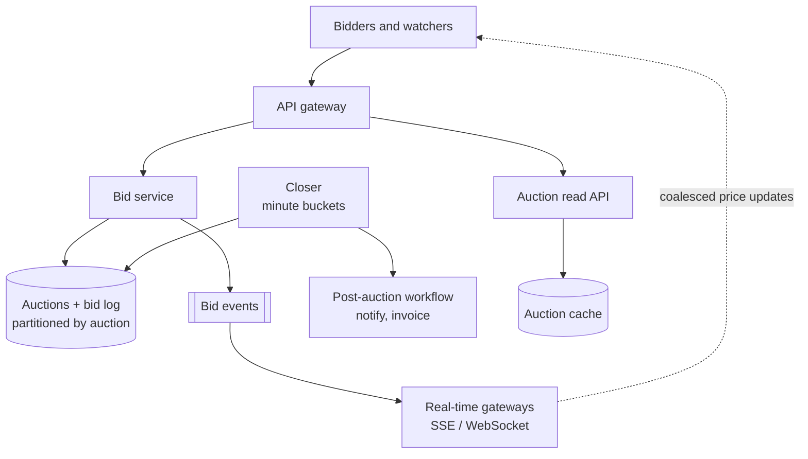
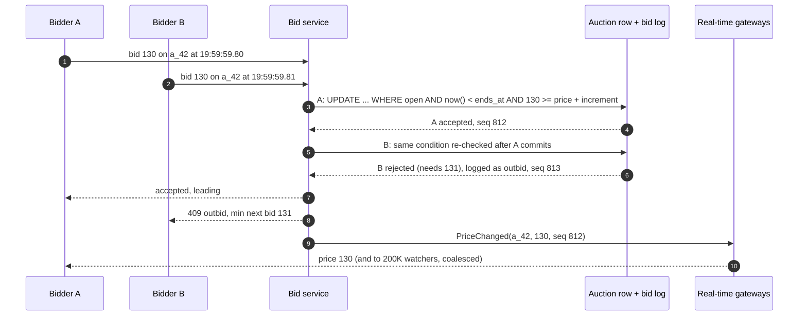
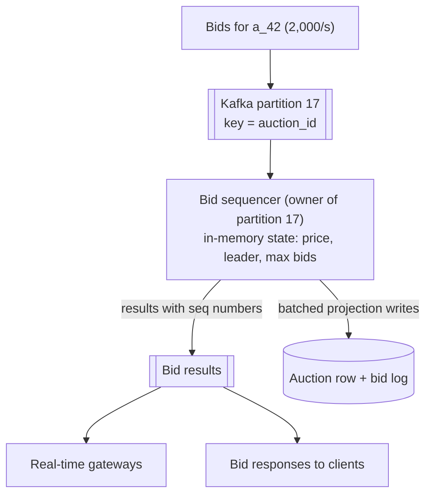
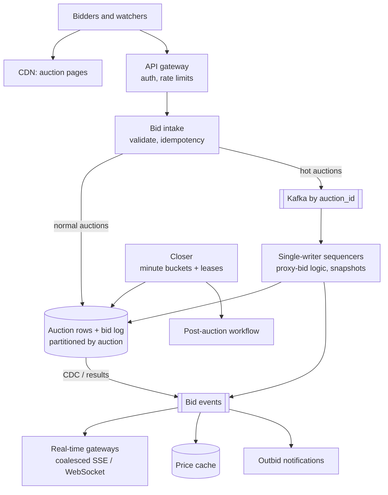

## Problem statement

Design an online auction platform like eBay's auctions: sellers list items with an end time, buyers place bids, everyone watching sees the
current highest bid update live, and each auction closes exactly on time with a correct winner. Popular auctions receive a burst of bids in
their final seconds, with hundreds of thousands of people watching.

**Interview format:** 45–60 minutes · **Difficulty:** advanced · **Main themes:** serialising concurrent bids per auction, an append-only
bid log, real-time fan-out to watchers, closing auctions on time, proxy bidding.

> [!TIP] Try it first
> Before scrolling, spend three minutes writing the questions you would ask the interviewer. Then compare with the list below — or
> practise this whole problem as a [timed mock interview](#system-design/hld/interview/online-auction).

## Clarifying questions

The answers below are the interviewer's. Questions that change the design come first.

- **Q:** Which features are in scope? <!-- match: features, scope, what do we build, functionality, in scope -->
  - **A:** Listing an auction, placing bids, watching the current price live, closing auctions and notifying the winner. Payment after the
    auction, buy-it-now and search are out of scope beyond a mention.
- **Q:** How much traffic? <!-- match: scale, traffic, how many, bids per day, auctions, users, volume -->
  - **A:** About 10 million active auctions and 100 million bids a day; popular auctions get thousands of bids per second in their last
    minute, with up to 200,000 people watching one auction.
- **Q:** What are the bidding rules? <!-- match: rules, increment, minimum bid, highest bid, valid bid, tie -->
  - **A:** A bid must exceed the current price by a minimum increment; ties go to the earlier bid; bids after the end time are rejected.
- **Q:** Do we support proxy (automatic) bidding? <!-- match: proxy, automatic bidding, max bid, auto bid -->
  - **A:** Yes: a bidder can enter a maximum, and the system bids on their behalf up to it.
- **Q:** How exactly must auctions close on time? <!-- match: close, end time, closing, on time, deadline, exactly -->
  - **A:** Bids received before the end time count, bids after don't — to the second. Closing processing (winner notification) can take
    a few seconds.
- **Q:** How fast must watchers see new bids? <!-- match: real time, live, latency, watchers, how fast, update -->
  - **A:** Within about a second.
- **Q:** Do we extend auctions on late bids? <!-- match: extend, sniping, soft close, anti-sniping, last second -->
  - **A:** Keep a fixed end time for the core design; extending on late bids ("soft close") is a follow-up.
- **Q:** Do we need an audit trail? <!-- match: audit, history, disputes, log, record -->
  - **A:** Yes — every bid, accepted or rejected, must be recorded for disputes.

## Functional requirements

> [!TIP] Try it first
> Write three or four functional requirements before reading on.

- Sellers can **create auctions** with a start price and end time. <!-- match: create, list, auction -->
- Buyers can **place bids** (including **proxy bids** up to a maximum). <!-- match: bid, place bid, proxy -->
- Watchers see the **current highest bid live**. <!-- match: live, current highest, watch -->
- Auctions **close on time** and the **winner is notified**. <!-- match: close, winner, notify -->
- Every bid is kept in an **audit log**. <!-- match: audit, log, history -->

````hint title="Hint: the critical section"
For one auction, two bids arrive within the same millisecond. What decides which one is accepted, and where must that decision happen?
````

## Non-functional requirements

- **Correctness**: the highest valid bid always wins; no lost or double-counted bids. <!-- match: correct, correctness, highest -->
- **Low latency**: bid acknowledged in under 200 ms; watchers updated within ~1 s. <!-- match: latency, fast, 200 ms -->
- **Hot-auction throughput**: thousands of bids per second on a single auction. <!-- match: throughput, hot, thousands -->
- **Exact closing**: bids are judged by an authoritative clock. <!-- match: exact, clock, closing -->
- **Durability and auditability** of all bids. <!-- match: durable, durability, audit -->

````hint title="Hint: whose clock?"
A bid is sent at 19:59:59.9 and arrives at 20:00:00.2. Which timestamp decides whether it counts, and which machine's clock produces it?
````

## Scope and exclusions

In scope: auctions, bidding (including proxy bids), live updates, closing, winner notification, audit log.

Out of scope: payments and shipping (a workflow after close), search and recommendations, seller reputation, fraud models (mentioned).

## Capacity estimation

> [!TIP] Try it first
> Estimate bids per second overall and for one hot auction, and the fan-out of live updates.

- **Bids:** 100M/day ≈ **1,160/s** average, ~5,800/s at peak.
- **Hot auction:** ~2,000 bids/s in its final minute — all serialised on **one** auction.
- **Watchers:** 200,000 on one auction; updating each 4 times a second is **800,000 messages/s** for that auction alone — coalesce updates.
- **Closings:** 10M auctions lasting ~7 days ≈ **17 closings/s** on average, but end times cluster at round hours.
- **Bid storage:** 100M × ~200 bytes ≈ 20 GB/day ≈ **7 TB/year**, kept for audits.

```estimator title="Online auction (auction views and bids)"
requestsPerDay = 2.1B
readsPerWrite = 20
writeBytes = 200 B
readBytes = 5 KB
retentionYears = 5
peakFactor = 5
replication = 3
cachePercent = 1
serverRps = 2000
targetUtilization = 60
```

**What the numbers mean for the design:**

- **Overall bid volume is modest**; the challenge is **per-auction serialisation** during final-second bursts.
- **Fan-out dominates real-time cost**: coalesce price updates and use a gateway tier.
- **Closings cluster**, so the closer must handle bursts at round times.

````hint title="Hint: one auction, one writer"
If every bid for auction 42 is processed by one sequential worker, how fast can that worker go if each bid takes 100 microseconds in memory?
````

## API design

> [!TIP] Try it first
> Define creating an auction, placing a bid, and subscribing to live updates.

```text title="API"
POST /v1/auctions   { "item": {...}, "start_price": 50.00, "increment": 1.00, "ends_at": "..." }
  -> 201 { "auction_id": "a_42" }

POST /v1/auctions/{id}/bids      Idempotency-Key: <uuid>
  { "amount": 125.00 }                      (or { "max_amount": 200.00 } for proxy bidding)
  -> 202 { "bid_id": "b_9910", "status": "accepted", "current_price": 125.00, "leading": true }
  -> 409 { "status": "outbid", "current_price": 130.00, "min_next_bid": 131.00 }
  -> 410 { "status": "closed" }

GET  /v1/auctions/{id}                     -> { "current_price", "bid_count", "ends_at", "status" }
GET  /v1/auctions/{id}/events  (SSE)       -> price updates, coalesced, with sequence numbers
```

- **Idempotency keys** so a retried bid isn't placed twice.
- The bid response is authoritative; the live stream is a fast, possibly coalesced view.

````hint title="Hint: what does 'leading' mean with proxy bids?"
If another bidder's maximum is higher than your bid, should your bid be accepted, and are you leading?
````

## Data model

> [!TIP] Try it first
> What is the source of truth for an auction's state: a row that's updated, or a log that's appended?

```text title="Schema"
auctions   (auction_id PK, seller_id, title, start_price, increment, ends_at, status,
            current_price, leader_id, leader_max, bid_seq, version)
bids       (auction_id, seq, bid_id UNIQUE, bidder_id, amount, max_amount, received_at,
            outcome: accepted | outbid | late | invalid)
            PK (auction_id, seq)      append-only, partitioned by auction_id
close_schedule (minute_bucket, auction_id)        due-time index for the closer
watch_subscriptions: in the real-time gateway tier (not persisted per message)
```

- **Bids form an append-only, per-auction log** with a sequence number; the auction row is a projection of that log
  ([event sourcing and CQRS](lesson:event-sourcing-cqrs)).
- **`received_at` comes from the server that serialises bids**, not from the client.

````hint title="Hint: why keep rejected bids?"
Who asks to see bids that didn't win, and why?
````

## Initial high-level architecture

Build the design one requirement at a time.

### Step 1: accept bids correctly

The **bid service** validates the bid and applies it to the auction in one transaction: a conditional update on the auction row (open,
before the end time, amount at least current price plus increment) plus an insert into the bid log. Two concurrent bids serialise on the
auction row ([contention](lesson:contention)).

### Step 2: broadcast updates

Accepted bids emit `PriceChanged` events; a **real-time gateway** tier holds SSE/WebSocket connections and delivers coalesced updates to
watchers ([real-time at scale](lesson:realtime-at-scale)).

### Step 3: close on time

A **closer** scans auctions due in the current minute bucket and transitions them from open to closed with a conditional update; the bid
condition already rejects anything after `ends_at` using database time ([distributed scheduling](lesson:distributed-scheduling)).

### Step 4: scale hot auctions

For auctions receiving thousands of bids per second, route bids through a log partitioned by auction ID to a **single in-memory writer per
auction**, which sequences bids and persists results in batches.

````hint title="Hint: closing vs bidding"
If the closer runs at 20:00:01 and a bid is processed at 20:00:00.5, how do you make sure the bid's acceptance depends on its own time, not
on when the closer runs?
````

## Architecture diagram



## Request and data flow



## Component responsibilities

| Component | Responsibility | Scales with |
|---|---|---|
| Bid service | Validate, sequence and apply bids; proxy-bid logic | Bids/s (per auction for hot ones) |
| Auction store + bid log | Source of truth for prices, leaders and bid history | Auctions, bids |
| Real-time gateways | Hold connections, deliver coalesced updates | Watchers |
| Closer | Close due auctions, trigger post-auction workflow | Auctions ending per second |
| Read API + cache | Auction pages, current price | Page views |
| Post-auction workflow | Winner notification, invoicing, second-chance offers | Closed auctions |

## Database and technology choices

| Need | Choice | Why | Alternative |
|---|---|---|---|
| Auctions and bid log | PostgreSQL partitioned by auction (or DynamoDB with conditional writes) | Transactions, conditional updates | Cassandra with LWT (slower per bid) |
| Hot-auction sequencing | Kafka partitioned by auction ID + in-memory single writer | Serialised, very fast, replayable | Database row lock only |
| Live updates | Pub/sub (Redis or NATS) to SSE/WebSocket gateways | Fan-out to many watchers | Polling |
| Closing | Time-bucketed schedule + leases | Exactly-on-time, crash-safe | Cron scanning all auctions |
| Read cache | Redis | Auction pages are read-heavy | CDN with short TTL |

## Scaling strategy

### How are concurrent bids serialised?

For most auctions, the database does it: the conditional update on the auction row plus the bid insert run in one transaction, so
concurrent bids queue on the row lock and each re-checks the condition. A bid takes a few milliseconds, which supports a few hundred bids per
second per auction — enough for the vast majority.

### What about auctions with thousands of bids per second?

Route bids to a log partitioned by auction ID (Kafka). One consumer owns each partition and keeps the auction's state in memory, applying bids
strictly in log order — a single writer needs no locks, and processing a bid in memory takes microseconds. The writer appends results (the
accepted/outbid outcome with a sequence number) and writes the auction projection to the database in small batches. On failover, a new owner
rebuilds state by replaying the log from the last snapshot. Bidders get their result asynchronously within milliseconds
([Kafka](lesson:kafka), [event sourcing and CQRS](lesson:event-sourcing-cqrs)).



### How does proxy bidding work?

Each bidder may store a maximum. When a new bid arrives, the engine compares it with the current leader's maximum: if the new maximum is
higher, the new bidder leads at the old maximum plus one increment (capped by their own maximum); otherwise the leader stays and the price
rises to the new bid plus an increment. All of this happens inside the same serialised step, so it's consistent. The leader's maximum is
never shown to others.

### How do auctions close exactly on time?

The bid condition uses the **sequencer's clock** (database `now()`, or the sequencer's timestamp on the log), not the client's, so any bid
processed after `ends_at` is rejected regardless of when the closer runs. The closer only finalises: every few seconds it claims auctions
from the current minute bucket with a lease, marks them closed with a conditional update, and starts the post-auction workflow. Because
end times cluster at round hours, the closer scales horizontally by bucket and shard ([clocks](lesson:clocks)).

### How do we fan out to 200,000 watchers?

Gateways subscribe to an auction's topic only if they have watchers for it. Updates are **coalesced** (send the latest price at most every
250 ms) and carry sequence numbers so clients can ignore stale ones. A reconnecting client fetches the current state once.

## Caching strategy

### What can be cached?

- **Auction pages** (title, images, description) — at the CDN, long TTL.
- **Current price and bid count** — in Redis, updated from bid events; read pages show it with sub-second staleness.
- **Never cached for decisions**: bid validity is decided only by the sequencer or database ([cache invalidation](lesson:cache-invalidation)).

## Messaging strategy

### Which events flow, and to whom?

`BidAccepted`/`BidRejected` (with sequence numbers) feed real-time gateways, the read cache, outbid notifications and analytics.
`AuctionClosed` starts the post-auction workflow: notify the winner, create the invoice, notify the seller, and handle non-payment by offering
the item to the next bidder ([multi-step workflows](lesson:multi-step-workflows)).

## Failure scenarios

| Failure | Impact | Mitigation |
|---|---|---|
| Sequencer crashes mid-burst | Bids pause for seconds | Partition reassigned; state rebuilt from snapshot + log; clients retry with idempotency keys |
| Closer down at 20:00 | Auctions stay "open" in the UI | Bids still rejected by `ends_at`; closer catches up from buckets |
| Real-time gateway fails | Watchers miss updates | Reconnect, fetch current state, sequence numbers |
| Duplicate bid submission | Double bid | Idempotency key per bid |
| Clock skew between servers | Inconsistent close decisions | One authoritative clock per auction (database or sequencer) |
| Database primary failover | Bids fail briefly | Retries with idempotency; short promotion time |

## Bottleneck analysis

- **Per-auction serialisation** — bounded by the single writer's speed (microseconds in memory, milliseconds in the database).
- **Fan-out to watchers** — coalescing and gateway capacity.
- **Closing bursts** at round times — bucketed, horizontally scaled closer.
- **Bid log storage** — append-only and partitioned; old auctions archived.

## Consistency and availability trade-offs

- **Linearizable per auction**: bids for one auction are totally ordered by one writer.
- **Eventually consistent views**: live prices, pages and search lag by up to a second.
- **Availability vs correctness at the end**: if the sequencer is down at the end time, bids are rejected rather than accepted late.
- **No cross-auction transactions** are needed, so partitioning by auction scales cleanly.

## Security considerations

- Authenticated bidders; per-user rate limits on bids; idempotency keys.
- Shill-bidding detection (sellers bidding on their own items via linked accounts).
- Proxy maximums are private and never exposed in APIs or logs.
- Audit log is append-only and tamper-evident for disputes.

## Monitoring and observability

- Bid latency (p50/p99), bid outcomes per second, sequencer lag per partition.
- Hot auctions: bids per second, watchers, coalesced update rate.
- Closer lag: auctions past `ends_at` not yet finalised.
- Gateway connections and delivery latency; reconnect rates.

## Final architecture

Open this after you have drawn your own.

````solution title="Final architecture"


**In one breath:** each auction's bids are serialised by one authority — a conditional update on the auction row for normal auctions, or a
single in-memory writer per Kafka partition for hot ones — which applies increment and proxy-bid rules, timestamps bids with its own clock,
rejects anything after the end time and appends every outcome to a per-auction bid log; bid events feed a price cache and real-time gateways
that coalesce updates for watchers; a bucketed closer finalises auctions and starts the post-auction workflow.
````

## Alternative designs and trade-offs

| Alternative | Gains | Costs | When to choose it |
|---|---|---|---|
| Distributed lock per auction | Familiar | Lock service on the hot path, expiry edge cases | Rarely better than row locks |
| Optimistic concurrency with retries | No waiting on locks | Retry storms on hot auctions | Low-contention auctions |
| Sealed-bid auctions | No last-second race | Different product | Procurement, some marketplaces |
| Soft close (extend on late bids) | Fairer, no sniping | Unpredictable end times | Many consumer auctions |
| Polling for prices | Simpler | Load and latency at scale | Small platforms |

## Interviewer follow-up questions

````question title="How would you add soft close (extend the auction when a bid arrives in the last two minutes)?"
Make the extension part of the same serialised bid step: if an accepted bid's server timestamp is within two minutes of ends_at, set ends_at
to that timestamp plus two minutes, atomically with the bid. Publish the new end time in the price update, and move the auction to a later
close bucket. Because the sequencer owns both the bid and the end time, there's no race between extending and closing.
````

````question title="Two bids of the same amount arrive almost simultaneously. Who wins?"
The one the auction's single authority processes first — the first row update to commit, or the earlier position in the auction's partition
log. That order defines "earlier"; client timestamps are ignored. The second bid fails the "at least current price plus increment" check and
is recorded as outbid, so the audit log shows exactly what happened.
````

````question title="How would you rebuild an auction's state after a sequencer crash?"
Load the latest snapshot of the auction state (price, leader, proxy maximums, last applied sequence), then replay bid-log entries after that
sequence from the partition. Because the log is the source of truth and every bid is idempotent by ID, replaying produces the same state,
and duplicates from client retries are ignored.
````

````question title="Watchers report seeing the price go down briefly. Why, and how do you fix it?"
Updates arrived out of order — for example through different gateways or after a reconnect fetched an older cached state. Attach the auction's
bid sequence number to every update and have clients ignore any update with a lower sequence than the last one shown. Coalescing on the server
should also always send the latest state, not queued intermediate ones.
````

````question title="What happens after an auction closes if the winner never pays?"
The post-auction workflow waits for payment with a deadline. On timeout it marks the winner as non-paying, and can offer the item to the
next-highest bidder at their bid (a second-chance offer) or relist it. Each step is a durable workflow state with retries and notifications,
independent of the bidding path.
````

## Common mistakes

- **Reading the current price from a cache** and accepting bids against it.
- **Using client timestamps** to decide whether a bid was on time.
- **Relying on the closer job** for correctness instead of checking `ends_at` on every bid.
- **Broadcasting every bid** to every watcher without coalescing.
- **No bid log**, so disputes can't be answered.
- **Global locks** across auctions.

## Evaluation checklist

```checklist title="Evaluation checklist"
- Asked about bidding rules, proxy bids, closing precision, hot auctions and audit needs
- Estimated overall bids/s, hot-auction bids/s and watcher fan-out
- Serialised bids per auction with conditional updates or a single writer
- Kept an append-only, sequenced bid log as the source of truth
- Used the server's (sequencer's) clock to judge bids against the end time
- Implemented proxy bidding inside the serialised step
- Closed auctions with a bucketed, leased closer that doesn't affect correctness
- Fanned out coalesced updates with sequence numbers through a gateway tier
- Made bids idempotent and recovered sequencer state from snapshots and the log
- Handled post-auction steps in a separate workflow
```
