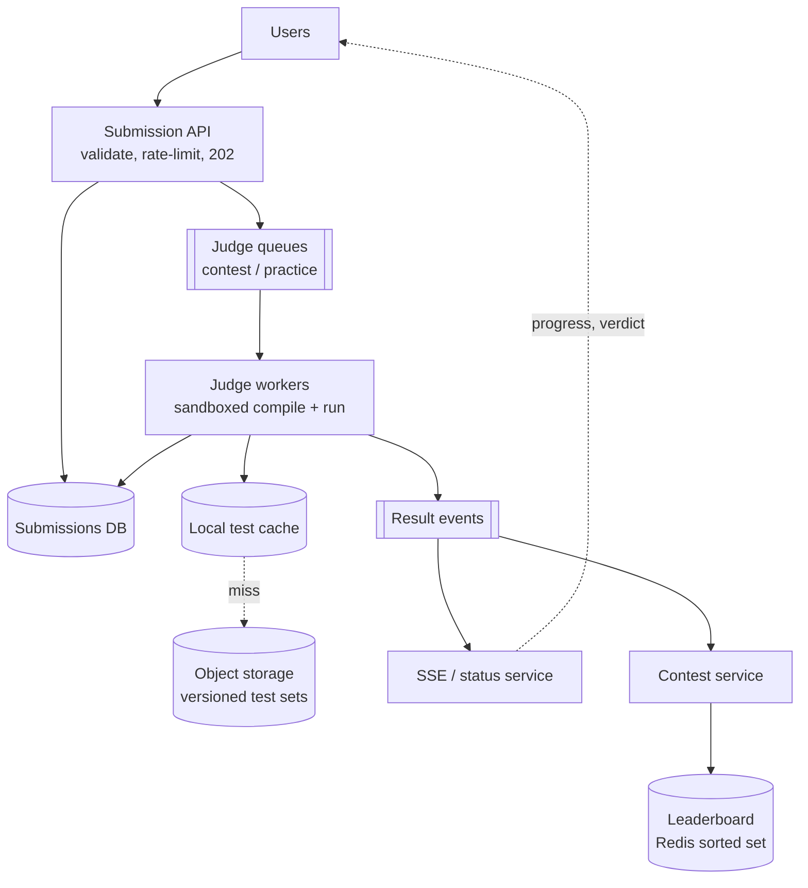
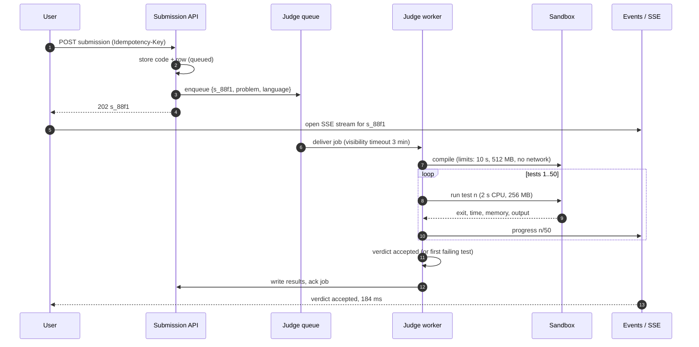
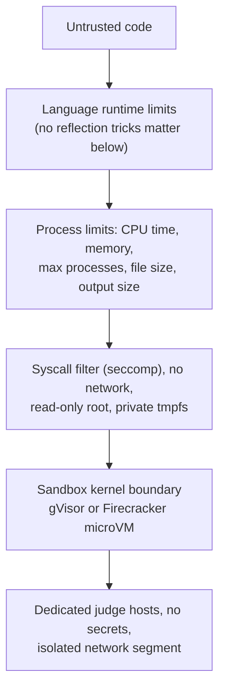
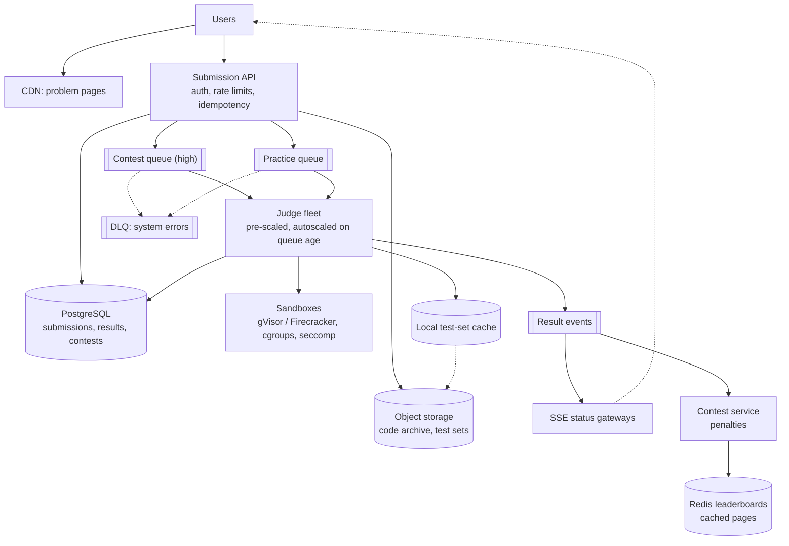

## Problem statement

Design an online judge like LeetCode or Codeforces: users read programming problems, submit code in many languages, and the system compiles
and runs it against hidden test cases, reporting the verdict (accepted, wrong answer, time limit exceeded, runtime error) within seconds.
Weekly contests bring tens of thousands of users submitting at once, with a live leaderboard. Submitted code is untrusted and must never
escape its sandbox.

**Interview format:** 45–60 minutes · **Difficulty:** intermediate · **Main themes:** asynchronous job processing, sandboxing untrusted
code, absorbing contest spikes, streaming results, leaderboards.

> [!TIP] Try it first
> Before scrolling, spend three minutes writing the questions you would ask the interviewer. Then compare with the list below — or
> practise this whole problem as a [timed mock interview](#system-design/hld/interview/online-judge).

## Clarifying questions

The answers below are the interviewer's. Questions that change the design come first.

- **Q:** Which features are in scope? <!-- match: features, scope, what do we build, functionality, in scope -->
  - **A:** Browsing problems, submitting solutions, running them against hidden tests, showing verdicts, and contests with a live
    leaderboard. Discussion forums, editorials and payments are out of scope.
- **Q:** How many submissions? <!-- match: scale, submissions, how many, traffic, volume, users, qps -->
  - **A:** About 5 million submissions a day normally. A contest has up to 50,000 participants, peaking around 6,000 submissions a minute
    near the start and end.
- **Q:** Which languages, and what limits per test? <!-- match: languages, language, limits, time limit, memory limit, compile -->
  - **A:** About 20 languages. Typical limits: 2 seconds CPU time and 256 MB memory per test; problems have around 50 tests.
- **Q:** How fast should a verdict appear? <!-- match: latency, how fast, verdict, results, seconds, feedback -->
  - **A:** Within a few seconds normally; under load, users should at least see the submission queued and tests progressing.
- **Q:** What are the security requirements? <!-- match: security, sandbox, untrusted, malicious, isolation, safe -->
  - **A:** Code is untrusted: no network access, no access to other submissions or test data beyond its input, and no way to harm the
    hosts.
- **Q:** Must timing be fair? <!-- match: fair, fairness, timing, consistent, hardware, reproducible -->
  - **A:** Yes — the same solution should get the same verdict regardless of which machine runs it, especially in contests.
- **Q:** How does the contest leaderboard work? <!-- match: leaderboard, ranking, contest scoring, standings, penalty -->
  - **A:** Rank by problems solved, then by penalty time (time of each accepted solution plus a penalty for wrong attempts), updated live.
- **Q:** Can users resubmit, and are results stored? <!-- match: resubmit, history, store results, submissions history -->
  - **A:** Yes; every submission and its per-test results are kept for the user's history.

## Functional requirements

> [!TIP] Try it first
> Write three or four functional requirements before reading on.

- Users can **submit code** for a problem in a supported language. <!-- match: submit, submission, code -->
- The system **runs it against hidden tests** with time and memory limits and reports a **verdict**. <!-- match: run, tests, verdict, judge -->
- Users see **results as they arrive** (queued, running test 12 of 50, verdict). <!-- match: results, progress, status -->
- Contests show a **live leaderboard**. <!-- match: leaderboard, contest, ranking -->

````hint title="Hint: how long does judging take?"
Compiling plus running 50 tests can take 10 seconds or more. Should that happen inside the HTTP request that submitted the code?
````

## Non-functional requirements

- **Isolation**: untrusted code can't access the network, other data or the host. <!-- match: isolation, sandbox, secure, untrusted -->
- **Throughput under spikes**: absorb contest peaks without losing submissions. <!-- match: spikes, peaks, throughput, contest -->
- **Fairness**: consistent, reproducible timing across machines. <!-- match: fair, fairness, consistent, reproducible -->
- **Low latency** for verdicts in normal load; visible progress under load. <!-- match: latency, fast, seconds -->
- **Durability** of submissions and results. <!-- match: durable, durability, never lost -->

````hint title="Hint: spikes"
Contest traffic peaks for a few minutes at the start and end. Is it cheaper to queue briefly or to provision for the peak?
````

## Scope and exclusions

In scope: problem and submission APIs, the judging queue, judge workers and sandboxes, test data distribution, result delivery, contests and
leaderboards, rejudging.

Out of scope: problem authoring tools, plagiarism detection (follow-up), forums, payments, interactive problems (follow-up).

## Capacity estimation

> [!TIP] Try it first
> Estimate submissions per second, sandbox-seconds per submission, and concurrent sandboxes at normal and contest peaks.

- **Normal load:** 5M/day ÷ 86,400 ≈ **58 submissions/s**.
- **Work per submission:** ~2 s to compile + 50 tests × ~0.2 s average ≈ **12 sandbox-seconds** (worst case 50 × 2 s = 100 s).
- **Concurrent sandboxes (Little's law):** 58/s × 12 s ≈ **700** normally; contest peak 6,000/min = 100/s × 12 s ≈ **1,200**, plus
  headroom for slow solutions ([long-running jobs](lesson:long-running-jobs)).
- **Test data:** 3,000 problems × 50 tests × ~1 MB ≈ **150 GB** — cached on judge machines, fetched from object storage on a miss.
- **Storage:** 5M submissions × ~5 KB of code and results ≈ **25 GB/day**.

```estimator title="Online judge (status polls and submissions)"
requestsPerDay = 55M
readsPerWrite = 10
writeBytes = 5 KB
readBytes = 2 KB
retentionYears = 5
peakFactor = 6
replication = 3
cachePercent = 10
serverRps = 1000
targetUtilization = 60
```

The calculator covers the API: 5M submissions a day (writes of ~5 KB) and about 10 status reads per submission. Judging capacity is
sized separately in sandbox-seconds, above; the high peak factor reflects contests.

**What the numbers mean for the design:**

- **Judging is asynchronous** and sized in concurrent sandboxes, not requests per second.
- **Contest peaks are about twice normal load** for minutes — pre-scale and queue rather than reject.
- **Test data is small enough to cache** on every judge machine.

````hint title="Hint: worst case"
A solution that hits the time limit on all 50 tests uses 100 seconds of sandbox time. What stops a few of those from starving everyone else?
````

## API design

> [!TIP] Try it first
> Define submitting code and getting results. How does the client learn about progress?

```text title="API"
POST /v1/problems/{slug}/submissions
  { "language": "java17", "code": "...", "contest_id": "weekly-412" }   Idempotency-Key: <uuid>
  -> 202 { "submission_id": "s_88f1", "status": "queued", "position_hint": 140 }

GET  /v1/submissions/{id}
  -> { "status": "running", "tests_passed": 12, "tests_total": 50 }
  -> { "status": "done", "verdict": "accepted", "runtime_ms": 184, "memory_kb": 41250,
       "results": [ { "test": 1, "verdict": "ok", "time_ms": 3 }, ... ] }
       (hidden test inputs and expected outputs are never returned)

GET  /v1/submissions/{id}/events          (SSE stream: queued -> compiling -> test 1..50 -> verdict)
GET  /v1/contests/{id}/leaderboard?page=1  -> ranked rows (cached a few seconds)
```

- `202 Accepted` plus an ID: judging happens later; the idempotency key prevents duplicate submissions on retries.
- Progress via **server-sent events** (or polling with backoff) ([real-time transport](lesson:realtime-transport)).

````hint title="Hint: polling cost"
50,000 contestants polling every second is 50,000 requests per second. How would SSE or polling with backoff change that?
````

## Data model

> [!TIP] Try it first
> What records do you keep for problems, submissions and contests? Where do test files live?

```text title="Schema"
problems      (problem_id PK, slug, title, statement, time_limit_ms, memory_mb,
               test_set_version, checker)
submissions   (submission_id PK, user_id, problem_id, contest_id, language, code_ref,
               status, verdict, runtime_ms, memory_kb, created_at, judged_at, attempt)
               index (user_id, created_at DESC), (contest_id, created_at)
test_results  (submission_id, test_no, verdict, time_ms, memory_kb)
contest_entries (contest_id, user_id, solved, penalty, last_accepted_at)

Object storage: tests/{problem_id}/v{version}/{n}.in + {n}.out (checksummed)
Leaderboard:    Redis sorted set per contest, score = solved * 10^7 - penalty_minutes
```

- **Test sets are versioned and immutable**; a submission records which version judged it, so rejudges are reproducible.
- **Status is the state machine** `queued → compiling → running → done | failed`, updated by workers.

````hint title="Hint: one score for two keys"
How can a single numeric score in a sorted set rank by problems solved first and penalty second?
````

## Initial high-level architecture

Build the design one requirement at a time.

### Step 1: accept submissions

The **submission API** validates the request (language, code size, rate limits), stores the code and a `queued` submission row, and enqueues
a judge job. It returns `202` immediately ([sync vs async](lesson:sync-vs-async)).

### Step 2: judge in sandboxes

**Judge workers** pull jobs, fetch the problem's test set (usually from a local cache), compile the code in a sandbox, run each test with
CPU-time, memory, process and output limits, compare output with the expected result (or run a checker), and write per-test results.

### Step 3: deliver results

Workers publish progress events; the client's SSE stream (or polling) shows "running test 12/50" and then the verdict.

### Step 4: contests

A **contest service** consumes verdicts for contest submissions, updates each participant's solved count and penalty, and maintains the
leaderboard in a sorted set.

````hint title="Hint: queue per what?"
Contest submissions and practice submissions share the same workers. Should they share the same queue?
````

## Architecture diagram



## Request and data flow



## Component responsibilities

| Component | Responsibility | Scales with |
|---|---|---|
| Submission API | Validation, rate limits, idempotency, enqueue | Submissions/s |
| Judge queues | Buffer jobs, priorities, retries | Backlog during peaks |
| Judge workers | Fetch tests, compile, run, compare, report | Concurrent sandboxes |
| Sandboxes | Isolation and resource limits for untrusted code | Per job |
| Status/SSE service | Push progress and verdicts | Open streams |
| Contest service | Scoring, penalties, leaderboard | Contest submissions |
| Object storage | Versioned test data, submitted code archive | Problems, submissions |

## Database and technology choices

| Need | Choice | Why | Alternative |
|---|---|---|---|
| Submissions and problems | PostgreSQL (partitioned by time) | Relational, moderate volume | DynamoDB keyed by submission ID |
| Job queue | SQS / RabbitMQ with priorities, or Kafka per priority | Visibility timeouts, retries, DLQ | Database table with SKIP LOCKED |
| Sandbox | gVisor or Firecracker microVMs, or containers with seccomp + cgroups | Strong isolation with fast start | Full VMs (slow), plain processes (unsafe) |
| Test data | Object storage + local SSD cache on workers | Small, immutable, versioned | Network file system |
| Leaderboard | Redis sorted set per contest | O(log N) updates and rank queries | Database ORDER BY on every view |
| Progress delivery | SSE through a gateway tier | One-way stream, simple | Polling with backoff |

## Scaling strategy

### How are untrusted programs isolated?

Layered defences, because a single escape is catastrophic:



Each test runs with CPU-time and memory limits enforced by the kernel (cgroups), a cap on processes (stops fork bombs) and on output size,
no network, and a fresh writable scratch directory. A watchdog kills anything exceeding wall-clock limits. Judge hosts hold no credentials
beyond fetching test data and reporting results.

### How do we absorb contest spikes?

- **Pre-scale** the worker fleet minutes before a scheduled contest starts; contests are known in advance.
- **Separate queues**: contest submissions get priority over practice; practice users see a longer queue during contests.
- **Per-user rate limits** (e.g. one submission every 10 seconds per problem) stop accidental floods.
- **Autoscale on queue age**, not CPU, and show queue position so users understand the wait ([backpressure](lesson:backpressure)).

### How is timing kept fair?

Measure **CPU time**, not wall-clock time; pin each sandbox to dedicated cores on a known machine type, and don't overcommit judge hosts.
Run a calibration solution periodically on every host and drain hosts that drift. For close calls (just over the limit), re-run once on
another host before reporting time limit exceeded.

### What happens when a worker dies mid-judging?

The job's visibility timeout expires and another worker re-runs it from scratch; result writes are keyed by submission and attempt, so a
late write from the dead worker can't overwrite the new one. After a few failed attempts the job goes to a dead-letter queue and the user
sees "system error, rejudging" rather than a wrong verdict ([retries and DLQs](lesson:retries-dlq)).

### How does the leaderboard update live?

Each accepted contest submission updates the participant's solved count and penalty (time since contest start plus a penalty per earlier
wrong attempt) in the database, then writes `score = solved × 10⁷ − penalty_minutes` to a Redis sorted set, so ranking by score orders by
solved first and penalty second. Leaderboard pages are read with `ZRANGE ... REV` and cached for a few seconds
([Redis beyond caching](lesson:redis-beyond-cache)).

## Caching strategy

### What is cached?

- **Test sets** on each judge machine's local SSD, keyed by problem and version; contest problems are pre-loaded before the contest.
- **Compiler and runtime images** pre-pulled on hosts, so sandboxes start in milliseconds.
- **Problem statements** at the CDN and in an application cache.
- **Leaderboard pages** for a few seconds — tens of thousands of viewers refresh constantly.

## Messaging strategy

### Which queues and events exist?

- **Judge queues** per priority (and optionally per language family, so a backlog of slow languages doesn't block others), with visibility
  timeouts, retries and a DLQ ([message queues](lesson:queues-pubsub)).
- **Result events** (`TestProgress`, `Judged`) consumed by the status/SSE service, the contest service, user statistics and plagiarism
  checks — each independently.
- **Rejudge jobs** when a test set is corrected: enqueue affected submissions at low priority with the new test-set version.

## Failure scenarios

| Failure | Impact | Mitigation |
|---|---|---|
| Worker crash during judging | Job stuck | Visibility timeout, re-run, attempt-keyed writes |
| Sandbox escape attempt | Host compromise risk | Layered sandboxing, no secrets on hosts, hosts recycled regularly |
| Contest spike exceeds capacity | Long queues | Pre-scaling, priorities, queue positions shown, per-user limits |
| Slow solutions hog workers | Throughput drops | Strict CPU and wall-clock limits; stop at first failing test |
| Wrong test data published | Wrong verdicts | Versioned test sets, validation against reference solutions, rejudge |
| Leaderboard cache stale | Rankings a few seconds old | Acceptable; short TTL |

## Bottleneck analysis

- **Sandbox capacity** during contest peaks — scale in advance; stop judging at the first failed test.
- **Compile times** for heavy languages — warm images, caching of standard headers/libraries.
- **Status traffic** — SSE instead of tight polling.
- **Leaderboard reads** — cached pages over a sorted set.

## Consistency and availability trade-offs

- **Submissions are durable before 202**; judging is eventually completed (at least once, idempotently).
- **Verdicts are authoritative once written**; rejudges create new results with the new test-set version.
- **Leaderboards are eventually consistent** by seconds.
- **Availability of submission intake over immediacy**: under extreme load, accept and queue rather than reject, unless the backlog becomes
  unreasonable, then rate-limit.

## Security considerations

- Sandboxes as described: kernel-level isolation, syscall filtering, no network, resource limits, fresh environment per run.
- Never expose hidden test inputs or expected outputs in results or error messages (truncate program output shown to users).
- Rate-limit submissions and account creation to prevent abuse of free compute (crypto mining).
- Separate judge infrastructure from the rest of the platform; rotate hosts.

## Monitoring and observability

- Queue depth and age per priority; time from submission to verdict (p50/p99).
- Sandbox utilisation, start latency, kills by reason (time, memory, output).
- Verdict distribution per problem (spikes in "wrong answer" after a test-set change signal bad data).
- Calibration drift per host; worker crashes and DLQ size.
- Contest: submissions per minute, leaderboard update lag.

## Final architecture

Open this after you have drawn your own.

````solution title="Final architecture"


**In one breath:** the submission API stores code and a queued row, returns 202 with an ID, and enqueues the job on a contest or practice
queue; a judge fleet — pre-scaled for contests and autoscaled on queue age — runs each submission in layered sandboxes (microVM or gVisor,
cgroups, seccomp, no network) against versioned, locally cached test sets, measuring CPU time on calibrated hosts and stopping at the first
failing test; per-test progress and verdicts flow as events to SSE gateways and to a contest service that maintains Redis leaderboards with
a solved-then-penalty score; crashed jobs re-run via visibility timeouts with attempt-keyed writes.
````

## Alternative designs and trade-offs

| Alternative | Gains | Costs | When to choose it |
|---|---|---|---|
| Synchronous judging in the request | Simple | Timeouts, no spike absorption, tied threads | Tiny internal tools |
| Plain containers without a sandbox kernel | Faster starts, simpler | Weaker isolation for hostile code | Trusted users only |
| Full VMs per submission | Strongest isolation | Slow starts, expensive | Rarely needed with microVMs |
| Serverless functions for judging | No fleet to manage | Cold starts, limited control over timing fairness | Low volume |
| Polling for results | No streaming infrastructure | Heavy request load during contests | Small scale |

## Interviewer follow-up questions

````question title="How do you stop a submission from attacking the judge machine?"
Assume it will try. Run it in a sandbox with its own kernel boundary (gVisor or a Firecracker microVM), restrict system calls with seccomp,
give it no network interface, a read-only root filesystem and a small private scratch area, and enforce CPU-time, memory, process-count and
output-size limits through cgroups and a watchdog. Judge hosts carry no secrets, sit in an isolated network segment and are recycled
regularly, so even a successful escape gains little.
````

````question title="A contest starts and 20,000 users submit in the first two minutes. What happens?"
The API accepts each submission, stores it and enqueues it on the high-priority contest queue, returning 202 immediately; users see their
queue position. The judge fleet was pre-scaled before the contest and autoscales further on queue age; practice submissions wait behind
contest ones. Per-user rate limits prevent repeated rapid submissions. Judging stops at the first failing test, which frees capacity
quickly for wrong answers. The backlog drains within minutes, and the leaderboard updates as verdicts arrive.
````

````question title="How do you rank a contest leaderboard by solved count and then penalty?"
Combine both into one sortable number: score = solved × 10⁷ − penalty_minutes, where the multiplier exceeds any possible penalty. Higher
solved always wins, and within the same solved count a lower penalty gives a higher score. Store it in a Redis sorted set per contest, update
it on each accepted submission, read pages with reverse range queries, and cache pages for a few seconds.
````

````question title="A problem's test data was wrong. How do you fix past verdicts?"
Publish a corrected test set as a new version, validated against reference solutions. Enqueue rejudge jobs for affected submissions at low
priority, recording the new test-set version with each new result. Update contest standings if the problem was in a contest, notify users
whose verdict changed, and keep the old results for audit. Versioned, immutable test sets make this reproducible.
````

````question title="How do you make execution time fair across machines?"
Use identical machine types, measure CPU time rather than wall-clock time, pin each sandbox to dedicated cores and avoid overcommitting hosts
so noisy neighbours don't slow tests. Calibrate hosts with a reference solution and drain any that drift. For submissions just over the
limit, re-run once on another host before declaring time limit exceeded.
````

## Common mistakes

- **Running user code without a real sandbox**, or with network access.
- **Judging synchronously** inside the submit request.
- **One shared queue** for contests and practice.
- **Measuring wall-clock time** on shared, overcommitted hosts.
- **Tight polling** by tens of thousands of contestants.
- **Mutable test data** without versions, making rejudges impossible to reason about.

## Evaluation checklist

```checklist title="Evaluation checklist"
- Asked about scale, contest peaks, languages, limits, latency, security, fairness and scoring
- Estimated submissions/s and concurrent sandboxes with Little's law
- Accepted submissions asynchronously with 202, an ID and an idempotency key
- Judged with a worker fleet pulling from priority queues
- Designed layered sandboxing with resource limits and no network
- Cached versioned test sets locally on judge machines
- Streamed progress and verdicts with SSE or polling with backoff
- Handled worker crashes with visibility timeouts and idempotent result writes
- Absorbed contest spikes with pre-scaling, priorities and per-user limits
- Built the leaderboard with a sorted set and a combined score
```
