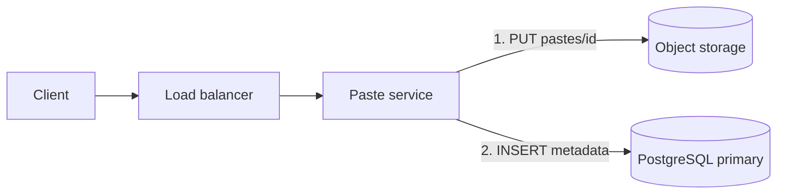
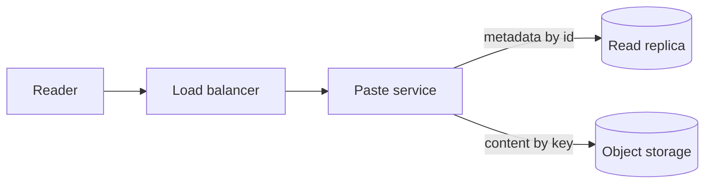
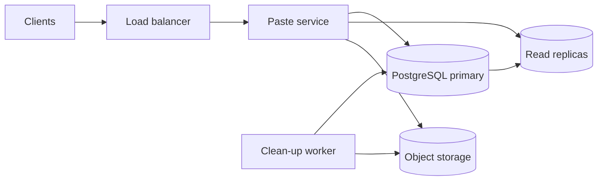
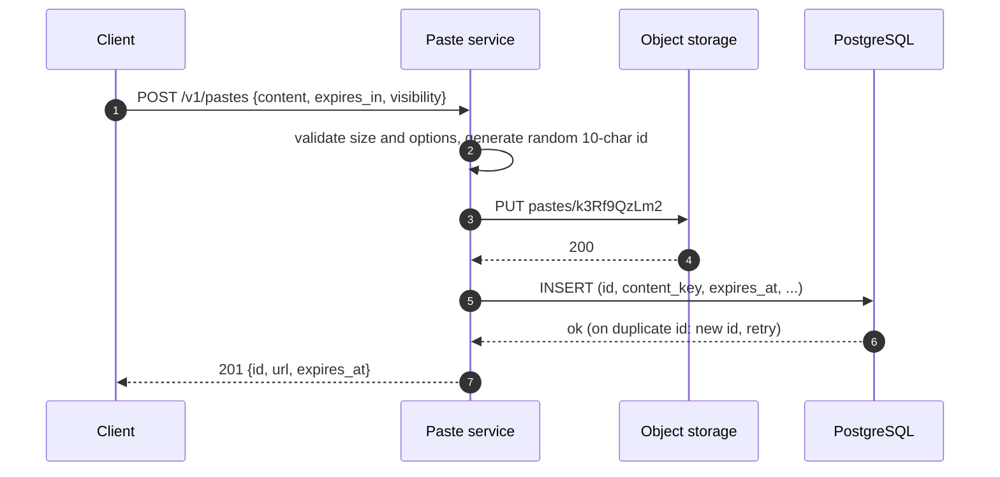
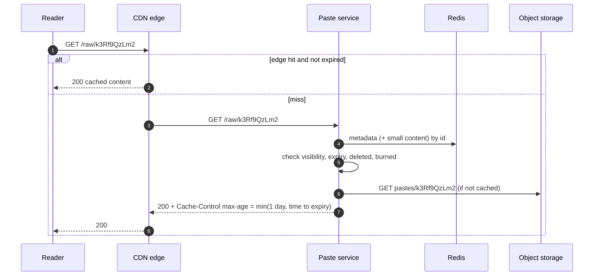
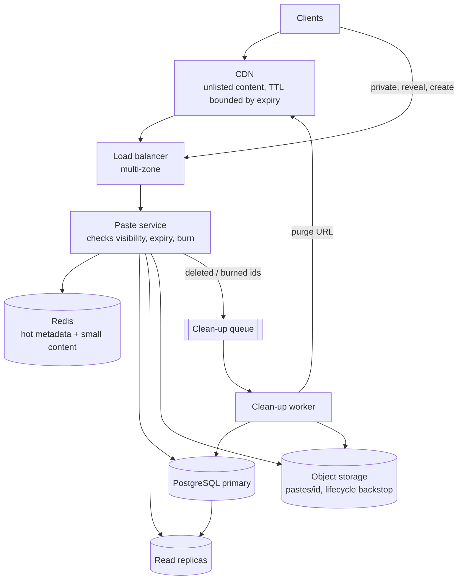

## Problem statement

Design a text-sharing service like Pastebin. A user pastes text — code, logs, notes — and gets a link such as
`https://paste.example/k3Rf9QzLm2`; anyone with the link can read it until it expires. Pastes can optionally be private, expire after a
chosen time, or disappear after the first view.

**Interview format:** 45 minutes · **Difficulty:** beginner · **Main themes:** blob storage vs metadata, expiry and retention, unguessable
IDs, CDN caching with privacy rules.

> [!TIP] Try it first
> Before scrolling, spend three minutes writing the questions you would ask the interviewer. Then compare with the list below — or
> practise this whole problem as a [timed mock interview](#system-design/hld/interview/pastebin).

## Clarifying questions

The answers below are the interviewer's. Questions that change the design come first.

- **Q:** How many pastes are created and read per day? <!-- match: scale, traffic, volume, how many, users, reads, writes, per day -->
  - **A:** About 1 million new pastes a day and about 10 million reads. A paste linked from a popular forum can go viral: plan for peaks
    around 5× average.
- **Q:** How large can a paste be? <!-- match: size, large, big, limit, max, maximum, bytes, length -->
  - **A:** Up to 10 MB. The average is around 10 KB — mostly code snippets and log excerpts.
- **Q:** Do pastes expire? <!-- match: expire, expiry, expiration, ttl, delete, lifetime, retention, forever -->
  - **A:** The creator chooses: 10 minutes, 1 hour, 1 day, 1 week, 1 month or never. About 30% choose never. An expired paste must never
    be shown again.
- **Q:** Who can read a paste — is there a public listing or search? <!-- match: public, private, visibility, unlisted, search, listing, who can see -->
  - **A:** No public listing or search. Pastes are unlisted by default — anyone with the link can read them. Logged-in users can make a
    paste private so only they can read it.
- **Q:** Do users need accounts? <!-- match: account, login, auth, anonymous, sign, users -->
  - **A:** No. Anonymous pastes are allowed. Logged-in users can also list and delete their own pastes.
- **Q:** Can a paste be edited after it's created? <!-- match: edit, update, change, modify, immutable -->
  - **A:** No. Pastes are immutable; an owner can delete one.
- **Q:** Should there be one-time pastes that vanish after reading? <!-- match: burn, one-time, once, self-destruct, read once, first view -->
  - **A:** Yes — an optional "burn after reading" mode: the first person to open it sees it, then it's gone.
- **Q:** Can users pick a custom URL? <!-- match: custom, alias, vanity, choose, url name -->
  - **A:** No. Links are generated, and they shouldn't be guessable — people paste things they don't want strangers to find.
- **Q:** How fast and how available must reads be? <!-- match: latency, fast, slow, availability, uptime, sla, p99 -->
  - **A:** Opening a paste should feel instant — p99 under about 200 ms for users near a region — and reads should be highly available.
    Creating pastes can be slightly less available.
- **Q:** Do we need syntax highlighting or view counts? <!-- match: syntax, highlight, language, views, count, analytics -->
  - **A:** Store a language hint; highlighting happens in the browser. View counts are out of scope.

## Functional requirements

> [!TIP] Try it first
> Write three or four functional requirements from the answers above before reading on.

- Users can **create a paste** with text up to 10 MB, an optional **expiry**, a **visibility** (unlisted or private) and an optional
  **burn-after-reading** flag. <!-- match: create, paste, expiry, private, burn -->
- Anyone with the link can **read a paste** (private pastes: only the owner) until it expires, is deleted or is burned. <!-- match: read, view, open, link -->
- Logged-in users can **list and delete** their own pastes (lower priority). <!-- match: list, delete, my pastes -->

````hint title="Hint: what are the core actions?"
Create and read are the core. Expiry, visibility and burn-after-reading are options on create that change how reads behave. Listing and
deleting are secondary owner features.
````

## Non-functional requirements

- **Scale**: about 1M new pastes and 10M reads a day, with viral peaks around 5× average. <!-- match: scale, traffic, per day, reads -->
- **Low latency** reads: p99 under 200 ms end to end for users near a region. <!-- match: latency, fast, p99 -->
- **High availability** for reads (99.95%); creation 99.9%. <!-- match: availability, available, uptime -->
- **Durability**: a paste is never lost before it expires or is deleted. <!-- match: durable, durability, never lost -->
- **Expiry is strict**: an expired, deleted or burned paste is never served again — including from caches. <!-- match: expiry, expired, strict, never served -->
- **Unguessable links**: IDs can't be enumerated or guessed. <!-- match: guess, guessable, enumerate, random, secure -->
- **Burn-after-reading is exactly once**: exactly one reader sees the content. <!-- match: exactly once, burn, once -->

````hint title="Hint: which requirement constrains caching?"
Strict expiry, private pastes and burn-after-reading all limit what a CDN or cache may keep, and for how long. Note which pastes are safe
to cache before you design the read path.
````

## Scope and exclusions

In scope: creating pastes with expiry, visibility and burn-after-reading; reading by link; owners listing and deleting their pastes.

Out of scope: public listing and search, editing, view counts and analytics, syntax highlighting on the server, and spam or malware
classification beyond basic rate limits and size limits.

## Capacity estimation

> [!TIP] Try it first
> Estimate the write and read rates, storage over five years given that most pastes expire, and read bandwidth.

- **Writes:** 1M/day ≈ **12 pastes/s**, ~60/s at a 5× peak.
- **Reads:** 10M/day ≈ **120 reads/s**, ~600/s at peak — and a single viral paste may take thousands of reads/s by itself.
- **Content storage:** 1M × 10 KB = **10 GB/day**. Most pastes expire; the 30% that never expire add ~1.1 TB a year → **~5.5 TB after
  five years**, plus at most ~210 GB of expiring pastes alive at any time. Store content in **object storage**.
- **Metadata:** ~300 bytes per paste → ~110 GB a year before expiry clean-up; easily one PostgreSQL primary.
- **Read bandwidth:** 10M × 10 KB = 100 GB/day ≈ **1.2 MB/s** average — tiny overall, but a viral paste concentrates it on one object.
- **ID space:** about 570M pastes live after five years. With 8 base-62 characters (62⁸ ≈ 2.2 × 10¹⁴), a random guess hits *some* paste
  about once in 384,000 tries — too easy to scan. With **10 characters** (62¹⁰ ≈ 8.4 × 10¹⁷) it's about once in 1.5 billion tries.

```estimator title="Pastebin"
requestsPerDay = 11M
readsPerWrite = 10
writeBytes = 10 KB
readBytes = 10 KB
retentionYears = 5
peakFactor = 5
replication = 1
cachePercent = 20
serverRps = 2000
targetUtilization = 70
```

The calculator assumes every paste is kept for five years (18 TB); expiry brings the real figure down to about 6 TB. Replication is 1
because object storage handles redundancy itself.

**What the numbers mean for the design:**

- Writes (~12/s) and reads (~120/s) are **small**: a handful of stateless servers and one PostgreSQL primary suffice.
- Content is **blob-shaped and immutable**: object storage for bytes, the database for metadata.
- The hard parts are **correctness, not scale**: strict expiry, privacy, exactly-once burn, unguessable IDs — and one viral paste.

````hint title="Hint: is 8 characters enough?"
Uniqueness and unguessability are different requirements. Divide the ID space by the number of live pastes to see how many random guesses
find one.
````

## API design

> [!TIP] Try it first
> One endpoint per functional requirement. What does create return, and which status codes do reads need?

```text title="API"
POST /v1/pastes
  Headers: Authorization: Bearer <token>   (optional; required for private pastes)
           Idempotency-Key: <uuid>          (optional; safe retries)
  Body:    { "content": "...", "language": "python",
             "expires_in": "1d",            (10m | 1h | 1d | 1w | 1mo | never)
             "visibility": "unlisted",      (unlisted | private)
             "burn_after_read": false }
  201 Created  { "id": "k3Rf9QzLm2", "url": "https://paste.example/k3Rf9QzLm2",
                 "expires_at": "..." }
  413 Payload Too Large (over 10 MB)    429 Too Many Requests

GET /v1/pastes/{id}             metadata + content (JSON)
GET /raw/{id}                   content as text/plain (cacheable for unlisted pastes)
  200 OK | 404 Not Found (unknown, private and not yours, deleted, or burned) | 410 Gone (expired)

POST /v1/pastes/{id}/reveal     burn-after-read pastes: reveals and burns (see deep dive)

GET    /v1/users/me/pastes?cursor=...   200 { items[], nextCursor }
DELETE /v1/pastes/{id}                  204 (owner only)
```

- Private pastes return **404**, not 403, to other users — so their existence isn't confirmed.
- `GET` must stay **safe** — it must not destroy anything. That's why burn-after-reading uses an explicit `POST .../reveal`.

````hint title="Hint: can a GET burn a paste?"
GET requests are made by link-preview bots, browser prefetchers and security scanners — not just people. What happens to a one-time paste
when a chat app unfurls its link?
````

## Data model

> [!TIP] Try it first
> Where does the content live, and where does the metadata live? What indexes do expiry clean-up and "my pastes" need?

Metadata in PostgreSQL; content in object storage under the key `pastes/{id}`:

```sql
CREATE TABLE pastes (
  id               char(10) PRIMARY KEY,       -- random base-62
  owner_id         bigint,                     -- NULL for anonymous pastes
  visibility       text NOT NULL CHECK (visibility IN ('unlisted', 'private')),
  language         text,
  size_bytes       integer NOT NULL CHECK (size_bytes BETWEEN 1 AND 10485760),
  content_key      text NOT NULL,              -- object storage key
  burn_after_read  boolean NOT NULL DEFAULT false,
  created_at       timestamptz NOT NULL DEFAULT now(),
  expires_at       timestamptz,                -- NULL = never
  burned_at        timestamptz,
  deleted_at       timestamptz
);
-- "My pastes", newest first.
CREATE INDEX pastes_owner ON pastes (owner_id, created_at DESC) WHERE owner_id IS NOT NULL;
-- Expiry clean-up scans only pastes that can expire.
CREATE INDEX pastes_expiry ON pastes (expires_at) WHERE expires_at IS NOT NULL;
```

| Operation | Pattern | Frequency |
|---|---|---|
| Read | Get metadata by `id`, then content by key | ~120/s, viral spikes |
| Create | Insert with a new random `id` (must not exist) | ~12/s |
| Owner list | `owner_id`, newest first | Low |
| Clean-up | `expires_at < now()` in batches | Background |

**Why not store the text in PostgreSQL?** Most pastes are small and it would work for them — but 10 MB pastes bloat rows, replicas and
backups, and content is immutable and read whole, which is exactly what object storage and CDNs are built for. A reasonable refinement is
to store very small pastes (say under 4 KB) inline in the row to save a hop; this design keeps one path for simplicity and caches hot
content instead.

````hint title="Hint: what does each read need?"
A read needs the metadata (to check visibility, expiry, burn status) and the content. Only the metadata needs a database; the content is
an immutable blob.
````

## Initial high-level architecture

Build the design one requirement at a time.

### Step 1: create a paste

The client posts to the **paste service** through a load balancer. The service validates size and options, generates a random ID,
uploads the content to object storage, then inserts the metadata row. If the insert fails (an ID collision — vanishingly rare), it picks a
new ID and retries.



Writing content **before** metadata means a crash between the two leaves an orphaned object (cleaned up later), never a metadata row
pointing at nothing.

### Step 2: read a paste

The paste service loads the metadata (from a replica, through a cache), checks visibility, expiry, deletion and burn status, then returns
the content from object storage.



### Step 3: expiry, deletion and burning

A **clean-up worker** periodically finds expired pastes using the `expires_at` index, deletes their objects and rows, and processes
deletions and burned pastes the same way.

````hint title="Hint: where should the expiry check happen?"
Background deletion is never perfectly on time. Which component can guarantee an expired paste is never served, regardless of when the
clean-up job runs?
````

## Architecture diagram



## Request and data flow

Creating a paste:



Reading an unlisted paste (after the caching deep dive):



## Component responsibilities

| Component | Responsibility | Scales with |
|---|---|---|
| CDN | Serve unlisted paste content near readers; absorb viral reads | Read volume |
| Load balancer | TLS, routing, health checks | Requests |
| Paste service | Validate, generate IDs, store content, enforce visibility/expiry/burn on every read | Requests (~120/s) |
| Redis | Hot metadata and small hot content | Hot set |
| PostgreSQL (primary + replicas) | Paste metadata; uniqueness of IDs; atomic burn claims | Metadata size |
| Object storage | Paste content, immutable blobs | Content size |
| Clean-up worker | Delete expired, deleted and burned pastes (objects and rows) | Expiry rate |

## Database and technology choices

| Need | Choice | Why | Alternative |
|---|---|---|---|
| Metadata | PostgreSQL | Tiny write rate; primary key for ID uniqueness; conditional updates for burn; partial indexes for expiry | DynamoDB with conditional writes and TTL |
| Content | Object storage (e.g. S3) | Durable, cheap, immutable blobs up to 10 MB; integrates with CDNs | Inline in the database for tiny pastes only |
| Hot reads | CDN for unlisted content; Redis for metadata | Viral pastes served at the edge; fast metadata checks | Larger replicas only |
| Clean-up | Scheduled worker + object storage lifecycle rules | Precise metadata clean-up; cheap bulk object expiry | Database TTL features (DynamoDB TTL deletes within days, so reads must still check) |

## Scaling strategy

### Where should paste content live?

**Option 1 — in the database row.** Simplest: one read, one write, transactional. Fine for kilobyte pastes, poor for 10 MB ones: large
rows bloat the database, its replicas, backups and buffer cache, and every read of content consumes database I/O.

**Option 2 — always in object storage.** The database holds a small metadata row; content goes to `pastes/{id}`. Object storage is built
for immutable blobs, scales without effort, costs far less per GB, and plugs into a CDN. The cost is an extra hop on uncached reads and a
two-system write.

**Option 3 — hybrid.** Inline small pastes (most of them) in the row; object storage above a threshold. Fastest reads, but two code paths.

**Choice:** option 2, with hot content cached in Redis and at the CDN. The extra hop matters only on cache misses, and one code path is
easier to get right — especially for expiry and burning.

### How do we generate IDs that can't be guessed?

A counter (as in the [URL shortener](problem:url-shortener)) produces enumerable IDs; even permuted, the design intent is unguessability,
so use **random IDs from a cryptographically secure generator**:

- **Length from the numbers:** ~570M live pastes; 8 characters gives one hit per ~384,000 random guesses, 10 characters one per ~1.5
  billion. Choose **10 characters** of base-62 (about 59.5 bits).
- **Uniqueness:** insert with the primary key; on the astronomically rare collision, generate again.
- **Scanning defence:** rate-limit 404s per client, and alert on scanning patterns. Combined with the large ID space, enumeration is
  impractical.

### How does burn-after-reading work exactly once?

Two problems: concurrency (two readers at the same moment) and **non-human readers**. Chat apps, email clients and security scanners
fetch links to build previews; a `GET` that burns the paste would let a bot "read" it first.

- The link opens a **confirmation page** ("This paste will be destroyed after viewing — reveal?"). `GET` never reveals or burns.
- Revealing is a `POST`, which claims the paste **atomically** — only one request can get a row back:

```sql
UPDATE pastes
SET burned_at = now()
WHERE id = $1
  AND burn_after_read
  AND burned_at IS NULL
  AND deleted_at IS NULL
  AND (expires_at IS NULL OR expires_at > now())
RETURNING content_key;
```

- The winner streams the content and the clean-up worker deletes the object afterwards; everyone else gets 404.
- Burn-after-read pastes are **never cached** anywhere (`Cache-Control: no-store`).

### How do we scale reads, including a viral paste?

Average reads are ~120/s — two or three stateless instances. The real risk is one paste linked from a huge forum: thousands of reads a
second for the same ID. Unlisted pastes are immutable and identical for every reader, so the **CDN** absorbs them; the origin sees roughly
one request per edge location per cache lifetime. Behind it, Redis holds hot metadata and small content, and request coalescing ensures
a cache miss for a hot paste triggers one object-storage read, not thousands.

## Caching strategy

### What can the CDN cache, given expiry, privacy and burn-after-reading?

| Paste type | CDN / shared cache? | Rule |
|---|---|---|
| Unlisted, with expiry | Yes | `Cache-Control: public, max-age = min(1 day, seconds until expiry)` — a cached copy can never outlive the paste |
| Unlisted, never expires | Yes | `max-age` of a day; purge by URL on deletion |
| Private | No | `Cache-Control: private, no-store`; served by the paste service after auth |
| Burn-after-reading | Never | `no-store` everywhere |

- **Deletion** needs a CDN purge for the paste's URL — rare enough to do per paste. Expiry needs none, because `max-age` never exceeds the
  time remaining.
- **Redis** caches metadata (and content under ~64 KB) for hot pastes with a TTL bounded the same way. Because pastes are immutable, the
  only invalidations are deletion and burning, which delete the key.
- **Negative caching:** cache "not found" briefly for unknown IDs to blunt scanners.

## Messaging strategy

### How do expired, deleted and burned pastes get cleaned up?

Correctness never depends on clean-up: **every read checks** `expires_at`, `deleted_at` and `burned_at`. Clean-up only reclaims storage:

- A **clean-up worker** runs every minute, selects a batch of expired pastes using the partial index, deletes their objects, then deletes
  the rows — small batches keep the database calm.

```sql
SELECT id, content_key
FROM pastes
WHERE expires_at < now()
ORDER BY expires_at
LIMIT 1000;
```

- **Deleted and burned** pastes are enqueued for the same worker at the moment they're deleted or burned, so their objects disappear
  quickly.
- **Object storage lifecycle rules** are a safety net: store objects under prefixes per expiry class (`exp-1d/`, `exp-7d/`, `exp-30d/`)
  with matching lifecycle expiration. Lifecycle deletion is asynchronous and day-granular — fine as a backstop, never as the expiry check.
- **Orphans** (content uploaded but no row, after a crash) are found by a periodic sweep comparing object keys older than an hour with
  rows.

## Failure scenarios

| Failure | Impact | Mitigation |
|---|---|---|
| Paste service instance dies | Requests to it fail until removed | Several instances across zones; health checks |
| PostgreSQL primary fails | Creation and burning fail briefly; unlisted reads continue from CDN, cache and replicas | Automated failover; idempotency keys for retried creates |
| Object storage slow or erroring | Uncached reads fail | Retries with backoff; CDN and Redis serve hot pastes; multi-zone storage class |
| Clean-up worker falls behind | Storage isn't reclaimed promptly | Reads still enforce expiry; alert on backlog; lifecycle rules as backstop |
| Crash between content upload and metadata insert | Orphaned object | Content first, metadata second; orphan sweep |
| Link-preview bot opens a burn link | Would destroy the paste | Confirmation page; burning only on `POST` |
| Viral paste | Thousands of reads/s on one ID | CDN; request coalescing; Redis |

## Bottleneck analysis

- **Throughput is not the bottleneck** at ~12 writes/s and ~120 reads/s; a minimal fleet suffices.
- **Hot keys are**: one viral paste concentrates reads, which the CDN and coalescing remove.
- **Metadata growth** (~110 GB a year before clean-up) is modest; the expiry index keeps clean-up cheap. Partition by `created_at` month
  if the table ever grows into terabytes.
- **Object storage request rate** for uncached reads is far below typical per-prefix limits; random IDs spread keys anyway.

## Consistency and availability trade-offs

- **Creation is consistent**: the primary key rejects duplicate IDs; a paste exists only after the metadata insert commits.
- **Reads favour availability** — served from CDN, Redis and replicas — but **never at the expense of expiry**: cache lifetimes are bounded
  by `expires_at`, and the service checks it on every origin read.
- **Deletion is briefly eventually consistent** at the CDN (until the purge propagates); acceptable for unlisted content, and private
  pastes are never at the CDN.
- **Burning is strongly consistent** via a conditional update on the primary — availability of the reveal step is traded for exactly-once.
- **Read-your-writes**: a creator opening their new paste may hit a replica that lags; write-through the new paste's metadata to Redis, and
  fall back to the primary on a miss before returning 404.

## Security considerations

- **Unguessable IDs** from a secure random generator; rate-limit 404s to deter scanning.
- **Private pastes** require authentication on every read; return 404 to others; never cache them in shared caches.
- **Content safety:** serve raw content as `text/plain` with `X-Content-Type-Options: nosniff`, and on a separate domain from the app, so
  pasted HTML or scripts can't run in the site's origin.
- **Abuse:** per-IP and per-account creation rate limits, the 10 MB size cap, and a takedown path (delete + CDN purge).
- **Encryption** at rest in object storage and the database; HTTPS everywhere.

## Monitoring and observability

- Read latency (p50/p99) and error rates, split by CDN hit vs origin.
- CDN hit ratio; Redis hit ratio; object-storage error rate and latency.
- Creation rate, 413/429 rates; 404 rate per client (scanning detection).
- Clean-up backlog (pastes past `expires_at` still present) and orphan count.
- Burn claims per minute and reveal errors.

## Final architecture

Open this after you have drawn your own.

````solution title="Final architecture"


**In one breath:** a stateless paste service stores immutable content in object storage under random 10-character IDs and metadata in
PostgreSQL; reads check visibility, expiry and burn status on every origin request, with unlisted content cached at the CDN for no longer
than the paste lives; burn-after-reading is a confirmed `POST` that claims the paste with an atomic conditional update; a clean-up worker
reclaims storage for expired, deleted and burned pastes, with lifecycle rules as a backstop.
````

## Alternative designs and trade-offs

| Alternative | Gains | Costs | When to choose it |
|---|---|---|---|
| Content in the database | One system, transactional | Large rows, heavy replicas and backups, DB I/O for every read | Small max size (a few KB) and low volume |
| DynamoDB for metadata with TTL | Serverless scale; automatic expiry clean-up | TTL deletes within days, so reads must still check expiry; conditional writes instead of SQL | Teams already on AWS serverless |
| Counter-based IDs | Short IDs, no collisions | Enumerable unless permuted; reveals volume | Public content where guessing doesn't matter |
| No CDN; Redis only | Simpler | Viral pastes hit the origin; higher latency far from the region | Small audiences in one region |
| Client-side encryption (key in URL fragment) | Server never sees plaintext | No server-side scanning; lost link = lost data | Privacy-first products |

## Interviewer follow-up questions

````question title="How would you support pastes up to 1 GB?"
Stop sending content through the paste service. Create the paste's metadata first in a pending state, return a presigned upload URL (or a
multipart upload with presigned part URLs for large files), let the client upload directly to object storage, then confirm the paste when
storage reports the object complete. Reads would return a time-limited signed URL to the object or the CDN instead of streaming bytes
through the service. Limits, rate limits and clean-up of abandoned uploads (a lifecycle rule that aborts incomplete multipart uploads)
become important.
````

````question title="How would you guarantee an expired paste is never served from the CDN?"
Never give a shared cache a lifetime longer than the paste has left: set max-age (or s-maxage) to the smaller of a default and the
seconds until expires_at, so the cached copy expires no later than the paste. Combine that with the origin's check on every miss. For
deletions and takedowns, which can happen any time, purge the URL at the CDN. Private and burn-after-reading pastes are never cached in
shared caches at all.
````

````question title="How would you add server-side search across public pastes?"
Add a public visibility level that opts into search, and feed those pastes into a search index (OpenSearch or Elasticsearch) from the
metadata database's change stream, with the content fetched and tokenised by an indexing worker. Expiry and deletion events remove documents
from the index. Unlisted and private pastes never enter it. Add abuse controls, since public search makes the service more attractive for
spam.
````

````question title="Someone pastes stolen credentials or malware. What can the system do?"
Accept reports and give operators a fast takedown path that deletes the paste, purges the CDN and records an audit entry. Proactively,
run asynchronous scanners over new public and unlisted content for known malware signatures and secret patterns, rate-limit creation per IP
and account, and serve raw content as text/plain from a separate domain so it can't execute in the site's origin. Private pastes raise
privacy questions about scanning; that's a policy decision.
````

````question title="How would you serve readers worldwide with low latency?"
Unlisted content is immutable and cacheable, so the CDN already serves most reads from edge locations near readers. For uncached reads
and metadata checks, run read-only paste service instances with replicas in a few regions, and keep creation and burning (which need a
single source of truth for exactly-once semantics) in the primary region. Object storage can be replicated to the read regions.
````

````question title="Why does reading an expired paste return 410 rather than 404?"
410 Gone tells clients and crawlers the resource existed and is permanently gone, which is accurate for an expired paste and lets search
engines and caches drop it. For deleted, burned or private pastes the service returns 404 instead, because confirming that a resource
existed can itself leak information.
````

## Common mistakes

- **Storing 10 MB pastes in database rows** without discussing the cost.
- **Relying on a background job (or database TTL) to enforce expiry** instead of checking on every read.
- **Caching with fixed TTLs** that outlive the paste, or caching private pastes in a CDN.
- **Burning on `GET`**, so link previews and scanners destroy one-time pastes.
- **Short or sequential IDs** for content people expect to be hard to find.
- **Over-engineering for scale** that the numbers (~12 writes/s) don't require, while missing the correctness requirements.

## Evaluation checklist

```checklist title="Evaluation checklist"
- Asked about size limits, expiry options, visibility and burn-after-reading before designing
- Estimated rates and storage, and noticed that throughput is small and correctness is the challenge
- Put content in object storage and metadata in a database, and justified it
- Generated random, sufficiently long IDs and checked guessability against the number of live pastes
- Enforced expiry on every read rather than relying on deletion jobs or TTLs
- Bounded CDN and cache lifetimes by the paste's remaining time; kept private pastes out of shared caches
- Made burn-after-reading exactly once with an atomic conditional update
- Kept GET safe (no burning on GET) and handled link-preview bots
- Planned clean-up of expired, deleted, burned and orphaned content
- Discussed failure of the primary, object storage and the clean-up worker
- Mentioned abuse controls and serving raw content safely
```
