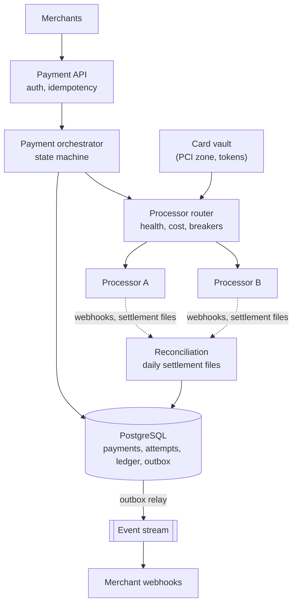
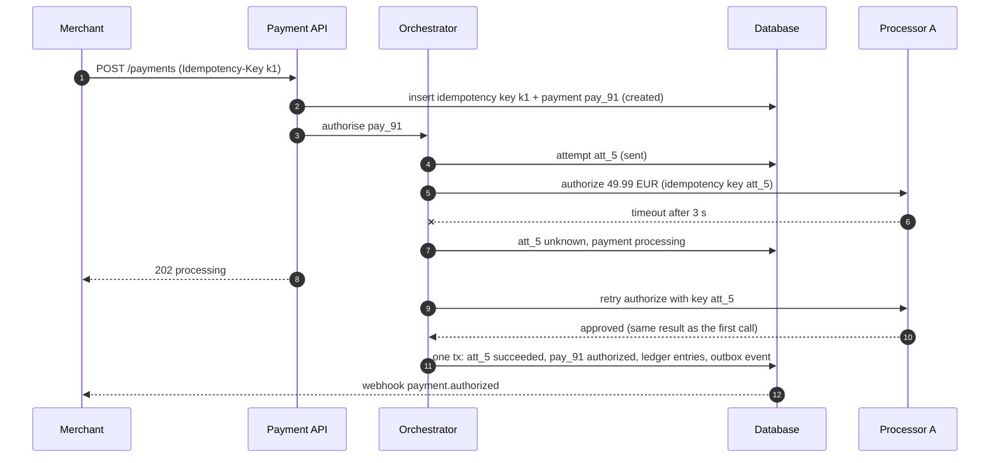
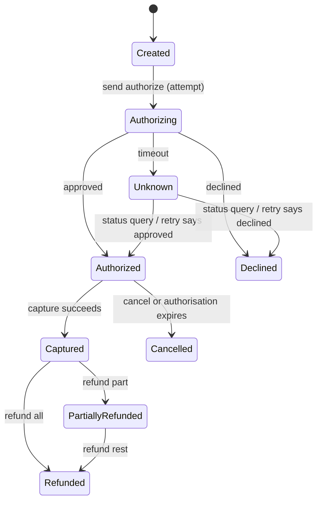
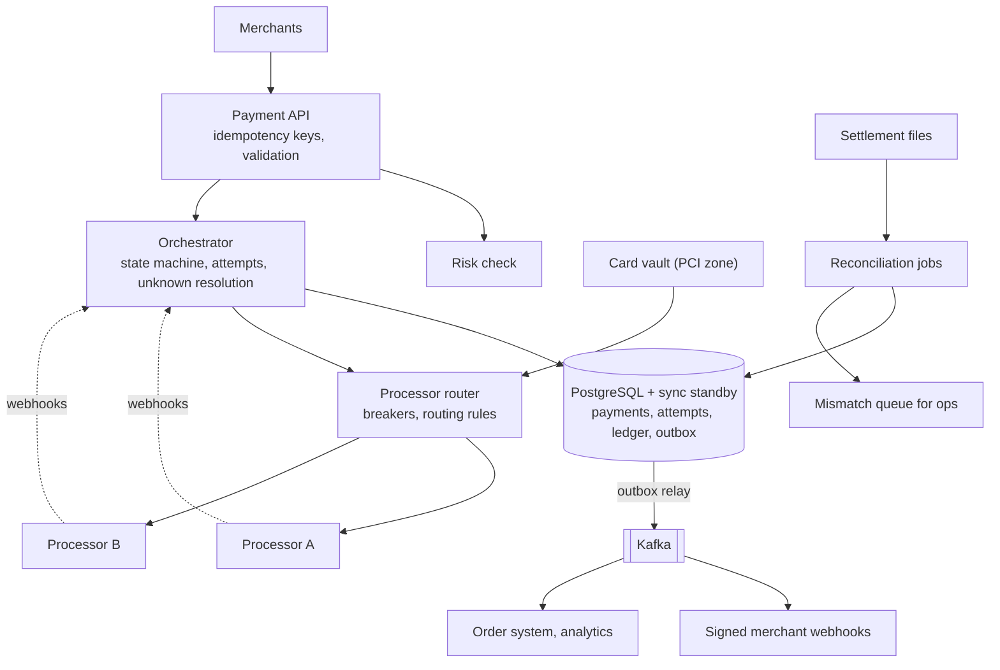

## Problem statement

Design the payment system behind an e-commerce platform or a payment service provider: merchants send payment requests, the system
authorises and captures card payments through external processors, records every movement of money in a ledger, handles refunds, and
reconciles its records with the processors' settlement reports every day. A customer must never be charged twice, and money must never
appear or disappear in the books.

**Interview format:** 45–60 minutes · **Difficulty:** advanced · **Main themes:** idempotency end to end, a payment state machine, a
double-entry ledger, unknown outcomes from external processors, reconciliation, PCI scope.

> [!TIP] Try it first
> Before scrolling, spend three minutes writing the questions you would ask the interviewer. Then compare with the list below — or
> practise this whole problem as a [timed mock interview](#system-design/hld/interview/payment-system).

## Clarifying questions

The answers below are the interviewer's. Questions that change the design come first.

- **Q:** Which operations are in scope? <!-- match: features, scope, operations, what do we build, in scope -->
  - **A:** Card payments (authorise, capture, cancel), refunds, a ledger and daily reconciliation. Payouts to merchants and wallets are a
    follow-up; we don't build the card network.
- **Q:** What volume? <!-- match: scale, volume, how many, payments per day, traffic, tps -->
  - **A:** About 10 million payments a day, with peaks around 10× average during sales events.
- **Q:** Do we talk to one processor or several? <!-- match: processor, processors, psp, acquirer, provider, multiple -->
  - **A:** Several external processors; we route between them and must keep working if one is down.
- **Q:** How strict is "exactly once"? <!-- match: exactly once, double charge, duplicate, twice, idempotent -->
  - **A:** A customer must never be charged twice for one payment, even when requests are retried or processors time out.
- **Q:** What latency do merchants expect? <!-- match: latency, fast, how long, response time -->
  - **A:** A synchronous authorisation result within about 2 seconds normally; processors themselves take hundreds of milliseconds.
- **Q:** Which currencies? <!-- match: currency, currencies, multi-currency, fx -->
  - **A:** Many currencies; assume no currency conversion inside a payment.
- **Q:** What are the compliance requirements? <!-- match: compliance, pci, card data, security, regulation -->
  - **A:** PCI DSS for card data, and financial records kept for years with a full audit trail.
- **Q:** How do we know our records are right? <!-- match: reconcile, reconciliation, settlement, correct, audit, books -->
  - **A:** Processors send daily settlement reports; our ledger must reconcile with them, and differences must be investigated.

## Functional requirements

> [!TIP] Try it first
> Write three or four functional requirements before reading on.

- Merchants can **authorise, capture and cancel** card payments. <!-- match: authorise, authorize, capture, cancel -->
- Merchants can **refund** captured payments, fully or partially. <!-- match: refund, refunds -->
- Every money movement is recorded in a **double-entry ledger**. <!-- match: ledger, double-entry -->
- The system **reconciles** with processor settlement reports daily. <!-- match: reconcile, reconciliation, settlement -->
- Merchants receive **status updates** (API and webhooks). <!-- match: status, webhooks, notify -->

````hint title="Hint: what can go wrong between two systems?"
You send "charge $50" to a processor and the connection times out. Did the charge happen? What must your system do before trying again?
````

## Non-functional requirements

- **Exactly-once effects**: no double charges, no lost payments. <!-- match: exactly once, double charge, no lost -->
- **Correctness of money**: ledger always balances; amounts in integer minor units. <!-- match: correct, balances, ledger -->
- **High availability**: 99.99% for accepting payments, surviving a processor outage. <!-- match: availability, available, 99.99 -->
- **Auditability and durability**: immutable records kept for years. <!-- match: audit, durable, durability, immutable -->
- **Security and PCI compliance**: card data isolated and tokenised. <!-- match: security, pci, tokenised -->

````hint title="Hint: floats"
What happens if you store $0.10 + $0.20 in a binary floating-point column?
````

## Scope and exclusions

In scope: payment API, idempotency, payment state machine, processor routing, webhooks, ledger, refunds, reconciliation, card tokenisation.

Out of scope: payouts and merchant onboarding (follow-ups), fraud models (an external risk check), currency conversion, chargeback
disputes beyond recording them.

## Capacity estimation

> [!TIP] Try it first
> Estimate payments per second, ledger entries, and storage over the retention period.

- **Payments:** 10M/day ≈ **116/s** average, ~1,200/s at peak.
- **Processor calls:** 2–3 per payment (authorise, capture, sometimes refund or status queries).
- **Ledger entries:** ~4 per payment lifecycle → **40M/day**.
- **Storage:** ~2 KB per payment across tables → **20 GB/day**; with 10-year retention ≈ **73 TB** before replication.
- The volume is moderate; **correctness, idempotency and availability**, not throughput, drive the design.

```estimator title="Payment system (payments and status reads)"
requestsPerDay = 60M
readsPerWrite = 5
writeBytes = 2 KB
readBytes = 2 KB
retentionYears = 10
peakFactor = 10
replication = 3
cachePercent = 5
serverRps = 500
targetUtilization = 50
```

Writes are payment operations; reads are status checks and webhook-driven lookups. The per-server rate is deliberately low: each request
waits on external processors.

**What the numbers mean for the design:**

- **A relational database** with strong transactions handles this volume comfortably; shard by merchant only if needed later.
- **Latency is dominated by processors**, so timeouts and unknown outcomes are the main operational problem.
- **Retention is long**: records are immutable and archived, never updated in place.

````hint title="Hint: where does the time go?"
If a processor takes 300 ms typically and 10 s occasionally, how many concurrent requests must the API hold at 1,200 payments/s?
````

## API design

> [!TIP] Try it first
> Define the payment API. Which header makes retries safe, and what does the server store for it?

```text title="API"
POST /v1/payments             Idempotency-Key: 6d1f...  (required)
  { "merchant_id": "m_7", "amount": 4999, "currency": "EUR",
    "payment_method": "tok_visa_4242", "capture": "manual", "reference": "order-1182" }
  -> 201 { "payment_id": "pay_91", "status": "authorized" }
  -> 202 { "payment_id": "pay_91", "status": "processing" }     (outcome pending)
  -> 402 { "payment_id": "pay_91", "status": "declined",
          "reason": "insufficient_funds" }

POST /v1/payments/{id}/capture   Idempotency-Key: ...   { "amount": 4999 }
POST /v1/payments/{id}/cancel    Idempotency-Key: ...
POST /v1/payments/{id}/refunds   Idempotency-Key: ...   { "amount": 1500 }
GET  /v1/payments/{id}

Webhooks to merchants (signed):
  payment.authorized, payment.captured, payment.failed, refund.succeeded
```

- **Amounts are integers in minor units** (cents), with an explicit currency.
- **Idempotency keys are required** on every mutating call; the same key with a different body is rejected
  ([idempotent APIs](lesson:idempotent-apis)).
- `202 processing` is an honest answer when the processor's outcome is unknown; the merchant gets a webhook later ([webhooks](lesson:webhooks)).

````hint title="Hint: replaying the response"
A merchant retries with the same key after the first request succeeded. What should the response be — and must you call the processor again?
````

## Data model

> [!TIP] Try it first
> Design the payment, attempt, idempotency and ledger tables. What invariant must the ledger always satisfy?

```text title="Schema"
idempotency_keys (merchant_id, key, request_hash, payment_id, response, created_at)
             PK (merchant_id, key)
payments    (payment_id PK, merchant_id, amount, currency, status, capture_mode, method_token,
             processor, created_at, version)
attempts    (attempt_id PK, payment_id, processor, operation: authorize | capture | refund,
             processor_ref, state: sent | succeeded | failed | unknown, request_at, response_at)
ledger_tx   (tx_id PK, payment_id, kind, created_at)
ledger_entries (entry_id PK, tx_id, account, amount_minor, currency)     append-only
             invariant: for every tx_id and currency, SUM(amount_minor) = 0
outbox      (event_id PK, payment_id, type, payload, created_at)
```

- **Attempts** record every call to a processor, with our own attempt ID sent as the processor's idempotency key.
- **The ledger is append-only double-entry**: every transaction's entries sum to zero; corrections are new reversing entries, never edits.
- **Balances are derived** from entries (and cached in snapshots), so they can always be recomputed.

A ledger transaction, checked in PostgreSQL 18:

```sql title="A balanced ledger transaction and a balance check"
CREATE TABLE ledger_entries (
  entry_id     bigint GENERATED ALWAYS AS IDENTITY PRIMARY KEY,
  tx_id        text   NOT NULL,
  account      text   NOT NULL,
  amount_minor bigint NOT NULL,          -- positive = debit, negative = credit
  currency     char(3) NOT NULL
);

-- Capture of a 49.99 EUR payment with a 1.20 EUR fee
INSERT INTO ledger_entries (tx_id, account, amount_minor, currency) VALUES
  ('tx_capture_pay_91', 'processor_clearing',  4999, 'EUR'),
  ('tx_capture_pay_91', 'merchant_m_7',       -4879, 'EUR'),
  ('tx_capture_pay_91', 'platform_fees',       -120, 'EUR');

-- Every transaction must balance per currency; this must return no rows.
SELECT tx_id, currency, sum(amount_minor) AS imbalance
FROM ledger_entries
GROUP BY tx_id, currency
HAVING sum(amount_minor) <> 0;
```

````hint title="Hint: why two kinds of record?"
The payments table says what state a payment is in. What does the ledger say that the payments table can't?
````

## Initial high-level architecture

Build the design one requirement at a time.

### Step 1: accept requests idempotently

The **payment API** looks up `(merchant_id, idempotency_key)`. If present with the same request hash, it returns the stored response; if
absent, it inserts the key (the unique constraint makes concurrent duplicates wait or fail) and creates the payment in `created` state.

### Step 2: call the processor safely

A **payment orchestrator** creates an attempt, then calls the chosen processor with the attempt ID as the processor's idempotency key. The
result updates the attempt, the payment status, the ledger and the outbox **in one database transaction**
([multi-step workflows](lesson:multi-step-workflows)).

### Step 3: handle the unknown

On timeouts the attempt becomes `unknown`. The orchestrator retries **with the same attempt ID** or queries the processor's status; only a
definite failure allows a new attempt (possibly with another processor).

### Step 4: reconcile

Processor webhooks and daily **settlement files** are matched against attempts and ledger entries; mismatches go to an investigation queue.

````hint title="Hint: why one transaction?"
What happens if the payment status says captured but the ledger entries were never written?
````

## Architecture diagram



## Request and data flow



## Component responsibilities

| Component | Responsibility | Scales with |
|---|---|---|
| Payment API | Auth, validation, idempotency keys, responses | Requests/s |
| Orchestrator | State machine, attempts, retries, unknown-outcome resolution | Payments in flight |
| Processor router | Choose processor by health, cost, card type; circuit breakers | Processor calls |
| Card vault (PCI zone) | Store card data, issue tokens, detokenise only for processor calls | Payment methods |
| Ledger | Append-only double-entry records, balances | Ledger entries |
| Webhook service | Signed, retried merchant notifications | Events |
| Reconciliation | Match settlement files with attempts and ledger | Daily volume |

## Database and technology choices

| Need | Choice | Why | Alternative |
|---|---|---|---|
| Payments, attempts, ledger | PostgreSQL (synchronous replica in another zone) | ACID transactions across status, ledger and outbox | Spanner/CockroachDB for multi-region writes |
| Events | Outbox + Kafka | No lost or phantom events | Dual writes (unsafe) |
| Workflow | Orchestrator with durable state (or Temporal) | Retries, timers, unknown outcomes | Choreography (hard to follow) |
| Card data | Separate vault service in a PCI-scoped network | Shrinks compliance scope | Processor-hosted card fields |
| Reconciliation | Batch jobs over settlement files + warehouse | Daily, large, auditable | Streaming matching (more complex) |

## Scaling strategy

### How is idempotency enforced end to end?

Three layers: the **merchant's idempotency key** (stored with a request hash and the response, so retries return the same answer and a
different body with the same key is rejected); our **attempt ID** sent as the **processor's idempotency key**, so retrying a processor call
can't charge twice; and **conditional state transitions** in the database (`authorized → captured` only once), so duplicate internal
events have no effect ([dedup](lesson:dedup)).

### What happens when the processor's outcome is unknown?

A timeout doesn't mean failure. The attempt is marked `unknown`; the orchestrator retries the same operation with the same attempt ID, or
queries the processor by that ID, with backoff ([timeouts and retries](lesson:timeouts-retries)). Only a definite decline or error allows
moving on — and never to a second processor while the first may have succeeded, or the customer may be charged twice. If still unknown
after a deadline, the payment stays `processing`, the merchant is told so, and reconciliation settles it.



### Why a double-entry ledger?

Every movement of money debits one or more accounts and credits others by the same total, so each transaction sums to zero. That invariant
makes errors detectable (any imbalance is a bug), balances reconstructable (sum the entries), and history auditable (entries are never
changed — mistakes are fixed by reversing entries). The ledger is written in the same transaction as the payment status change, so the two
can't disagree ([transactions](lesson:transactions)).

### How does reconciliation work?

Each day processors send settlement files listing what they actually captured, refunded and charged in fees. A batch job matches each line
to our attempts (by processor reference) and ledger entries: matched, missing on our side (we think it failed but they captured), missing on
theirs, or amounts that differ. Each mismatch type has an automated fix (record the capture, issue a refund) or goes to an operations queue.
Reconciliation is how "unknown" outcomes are finally settled.

### How do we stay available when a processor is down?

The router tracks each processor's error rate and latency with circuit breakers, and sends **new** payments to a healthy processor
([circuit breakers](lesson:circuit-breakers-bulkheads)). In-flight payments with unknown outcomes stay with their original processor
until resolved. The database runs with a synchronous standby in another zone so a failover loses no committed payment ([failover](lesson:failover)).

## Caching strategy

### Is anything cached?

Very little on the money path. Payment status reads can use a short-lived cache for merchant dashboards, but every state transition reads and
writes the database. Processor routing configuration and health scores are cached in memory. Idempotency lookups go to the database (they must
be strongly consistent).

## Messaging strategy

### How are events published reliably?

Status changes and ledger writes commit together with an outbox row; a relay publishes outbox rows to Kafka ([outbox and CDC](lesson:outbox-cdc)).
Consumers — merchant webhooks, the order system, analytics, risk — are idempotent by event ID. Merchant webhooks are signed, retried with
backoff, and can be re-fetched through the API.

## Failure scenarios

| Failure | Impact | Mitigation |
|---|---|---|
| Processor timeout | Outcome unknown | Retry with same attempt ID / status query; never switch processor mid-attempt |
| Merchant retries after a network error | Duplicate request | Stored idempotency key returns the original response |
| Orchestrator crashes after processor approves | Status not recorded | Retry with same attempt ID returns the same approval; reconciliation |
| Processor outage | New payments fail | Route new payments to another processor; breakers |
| Database primary failure | Writes pause | Synchronous standby, automatic failover, idempotent retries |
| Settlement mismatch | Books disagree with the processor | Reconciliation queue, automated corrections, alerts |

## Bottleneck analysis

- **Processor latency and limits** — concurrency per processor, timeouts, routing.
- **Database write path** — moderate volume; shard by merchant if it grows.
- **Reconciliation batch size** — partition by processor and day.
- **Hot merchants** during their own sales — per-merchant rate limits and capacity planning.

## Consistency and availability trade-offs

- **Strong consistency** for payment state, idempotency keys and the ledger — single database transactions.
- **Honest uncertainty**: when an external outcome is unknown, report `processing` rather than guessing.
- **Eventual consistency** for webhooks, analytics and merchant dashboards.
- **Availability through redundancy of processors and zones**, not by relaxing money invariants.

## Security considerations

- Card numbers only in the **vault** inside a PCI-scoped network; everything else uses tokens.
- Mutual TLS and request signing with processors; signed webhooks to merchants ([webhooks](lesson:webhooks)).
- Strict access controls and audit logs for anyone touching payment data; four-eyes approval for manual ledger corrections.
- Fraud and risk checks before authorisation; velocity limits per card and merchant.

## Monitoring and observability

- Authorisation rate and decline reasons per processor; latency p50/p99 per processor.
- Unknown-outcome counts and age; retries per attempt.
- Ledger imbalance check (must always be zero), reconciliation mismatch counts.
- Webhook delivery success and lag; outbox lag.
- Business metrics: payment volume per minute (a sudden drop is often the first signal).

## Final architecture

Open this after you have drawn your own.

````solution title="Final architecture"


**In one breath:** merchants call a payment API that stores idempotency keys with the response; an orchestrator drives each payment through a
state machine, recording an attempt per processor call and sending its ID as the processor's idempotency key, so timeouts become "unknown"
attempts resolved by retrying or querying the same processor; every status change commits atomically with balanced double-entry ledger
entries and an outbox event; card data stays in a PCI-scoped vault; a router sends new payments to healthy processors; and daily
reconciliation matches settlement files against attempts and the ledger, correcting or escalating every mismatch.
````

## Alternative designs and trade-offs

| Alternative | Gains | Costs | When to choose it |
|---|---|---|---|
| Single processor | Simpler | Outage = no payments | Small merchants |
| Choreographed services | Loose coupling | Hard to reason about money flows | Rarely for payments |
| Mutable balance columns only | Simple reads | No audit trail, errors undetectable | Never as the source of truth |
| Distributed SQL across regions | Multi-region writes | Latency on every write | Global PSPs with regional rules |
| Synchronous everything | Simple client model | Timeouts surface as errors to merchants | Low volume, reliable processors |

## Interviewer follow-up questions

````question title="The merchant's request times out and they retry with the same idempotency key while the first request is still running. What happens?"
The first request inserted the idempotency key row inside its transaction; the second request's insert conflicts on the unique key, so it
either waits for the first to finish and then returns the stored response, or immediately returns a 409 "request in progress" telling the
merchant to retry shortly. Either way only one payment and one processor attempt exist. A retry with the same key but a different body is
rejected as a key reuse error.
````

````question title="How do you guarantee a customer is never charged twice when a processor times out?"
Never treat a timeout as a failure. The attempt has our own ID, sent as the processor's idempotency key, so retrying the same call returns the
original result instead of charging again; alternatively query the processor's status by that ID. Don't send the payment to a different
processor until the first attempt is definitively failed. If it stays unknown, mark the payment processing, and let reconciliation settle it
— refunding automatically if both somehow captured.
````

````question title="How would you add merchant payouts?"
Payouts are another ledger flow: a daily job computes each merchant's available balance from ledger entries (captures minus refunds, fees and
reserves), creates a payout transaction moving the amount from the merchant's balance account to a payout-in-transit account, and sends the
transfer through a banking partner with an idempotency key. When the bank confirms, another entry settles it; failures reverse it. Payouts are
reconciled against bank statements just like processor settlements.
````

````question title="Why store amounts as integers in minor units?"
Binary floating point can't represent most decimal fractions exactly, so sums drift — 0.1 + 0.2 isn't exactly 0.3 — and rounding differs
between systems. Storing integer cents (or the currency's minor unit) makes addition exact and comparisons reliable, which the zero-sum ledger
invariant depends on. The currency's exponent (2 for EUR, 0 for JPY) is applied only for display.
````

````question title="Reconciliation finds a capture at the processor that our ledger doesn't have. What do you do?"
Look up the attempt by the processor reference. If our attempt was left unknown, the capture is real: complete the state transition, write
the ledger entries and notify the merchant — or refund if the order was already cancelled. If there's no matching attempt at all, it's an
anomaly (a duplicate or an integration bug) that goes to the operations queue with an alert, and the money is held until resolved.
````

## Common mistakes

- **Treating timeouts as failures** and retrying with a new key or another processor.
- **Idempotency keys without a stored response** (or without checking the request body).
- **Floating-point money.**
- **Mutable balances without an append-only ledger.**
- **Publishing events outside the database transaction.**
- **No reconciliation**, so unknown outcomes and processor errors go unnoticed.
- **Card numbers stored across many services.**

## Evaluation checklist

```checklist title="Evaluation checklist"
- Asked about operations, volume, processors, exactly-once, latency, compliance and reconciliation
- Required idempotency keys and stored request hashes and responses
- Modelled a payment state machine with attempts per processor call
- Sent our attempt ID as the processor's idempotency key
- Treated timeouts as unknown outcomes and resolved them safely
- Designed an append-only double-entry ledger with a zero-sum invariant
- Committed status, ledger entries and outbox events in one transaction
- Reconciled daily against settlement files with a mismatch workflow
- Routed new payments around failing processors with circuit breakers
- Isolated card data in a PCI-scoped vault with tokens
```
