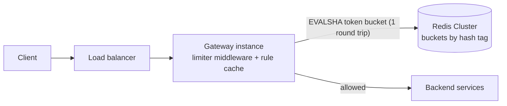
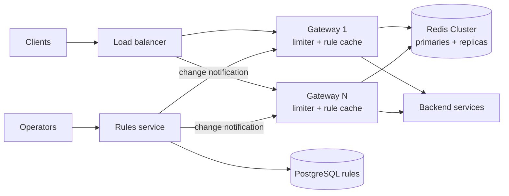
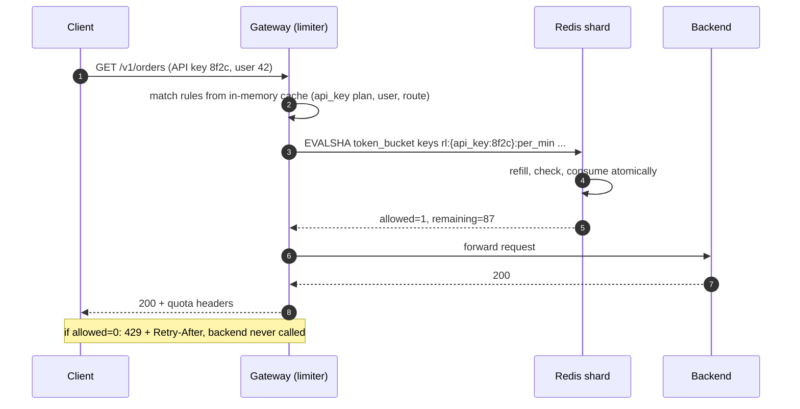
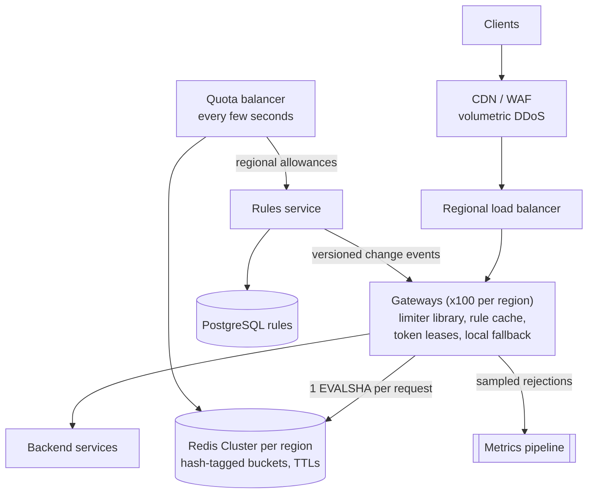

## Problem statement

Design a rate limiter for a public API. Requests arrive at a fleet of API gateway instances in several regions; the limiter must cap how
many requests each client may make — per user, per API key and per IP, with stricter limits on sensitive endpoints — while adding only a
millisecond or two to each request.

**Interview format:** 45 minutes · **Difficulty:** beginner · **Main themes:** algorithm choice, shared counters, atomicity, latency
budgets, failure behaviour (fail open vs closed), hot keys.

> [!TIP] Try it first
> Before scrolling, spend three minutes writing the questions you would ask the interviewer. Then compare with the list below — or
> practise this whole problem as a [timed mock interview](#system-design/hld/interview/rate-limiter).

## Clarifying questions

The answers below are the interviewer's. Questions that change the design come first.

- **Q:** Where does the limiter run — in the client, a gateway, or each service? <!-- match: where, client, server, gateway, middleware, placement -->
  - **A:** Server-side, at our API gateway layer: about 100 gateway instances per region, three regions.
- **Q:** What traffic do we handle? <!-- match: scale, traffic, volume, rps, requests per second, how many, qps -->
  - **A:** About 500,000 requests per second at peak across all regions, from roughly 50 million users and 1 million API keys a day.
- **Q:** What do we limit by, and what are the rules? <!-- match: key, rules, per user, per ip, api key, limits, what to limit -->
  - **A:** Per authenticated user (default 100 requests a minute), per API key by plan (from 1,000 a minute on free to 100,000 a minute on
    enterprise), per IP for anonymous traffic, and stricter per-endpoint limits such as 5 login attempts per minute per account.
- **Q:** Should short bursts be allowed? <!-- match: burst, bursty, smooth, spike, token bucket, algorithm -->
  - **A:** Yes — clients legitimately send small bursts. Enforce the average rate but allow a burst up to the per-minute allowance.
- **Q:** How exact must limits be? <!-- match: accurate, exact, precision, approximate, strict -->
  - **A:** For API quotas, being off by a few percent is fine. Login and other abuse-sensitive limits should be strict.
- **Q:** How much latency can the limiter add? <!-- match: latency, fast, overhead, milliseconds, p99 -->
  - **A:** No more than about 2 ms at p99 per request.
- **Q:** What should happen if the limiter's storage fails? <!-- match: fail, failure, down, unavailable, fail open, fail closed -->
  - **A:** API traffic must keep flowing — we'd rather briefly under-enforce. Login and SMS endpoints should stay protected.
- **Q:** Are limits global across regions or per region? <!-- match: region, global, multi-region, across regions, geo -->
  - **A:** Paid quotas are sold as global numbers, but small overshoots across regions are acceptable. Per-region enforcement with a
    reasonable split is fine.
- **Q:** How do clients learn they're limited? <!-- match: response, 429, headers, retry, tell client, error -->
  - **A:** Standard 429 responses with a retry hint and remaining-quota headers.
- **Q:** How often do rules change? <!-- match: change, configure, update rules, dynamic, deploy -->
  - **A:** Operators change limits and add rules several times a week; changes should apply within a minute without a deploy.

## Functional requirements

> [!TIP] Try it first
> Write three functional requirements from the answers above.

- **Check each request** against all matching rules (user, API key, IP, endpoint) and **allow or reject** it. <!-- match: check, allow, reject, limit -->
- **Reject over-limit requests with 429**, a `Retry-After` hint and remaining-quota headers. <!-- match: 429, retry-after, headers -->
- **Manage rules** — create and change limits per key type, plan and endpoint — taking effect within a minute. <!-- match: rules, configure, manage -->

````hint title="Hint: what is the core operation?"
Every request triggers one "check and consume" against one or more counters. Everything else — headers, rule management — supports that
operation.
````

## Non-functional requirements

- **Low latency**: at most ~2 ms added at p99. <!-- match: latency, 2 ms, overhead, p99 -->
- **Scale**: ~500K requests/s at peak, several rule checks per request. <!-- match: scale, requests per second, rps, 500k -->
- **High availability**: limiter failures must not take the API down — **fail open** for API traffic, **fail closed** for login/SMS. <!-- match: availability, fail open, fail closed -->
- **Accuracy**: within a few percent for quotas; **strict** for abuse-sensitive limits. <!-- match: accuracy, accurate, approximate, strict -->
- **Consistency across instances**: one client's requests spread over 100 gateways must share one limit. <!-- match: shared, distributed, consistent, across instances -->

````hint title="Hint: why can't each gateway count on its own?"
A client's requests are spread across ~100 gateway instances by the load balancer. If each instance enforced "100 per minute" alone, what
would the client actually get?
````

## Scope and exclusions

In scope: the limiting algorithm, where counters live, rule management, response headers, failure behaviour, multi-region behaviour.

Out of scope: DDoS protection at the network edge (handled by the CDN/WAF), billing for quota usage, and bot detection beyond rate limits.

## Capacity estimation

> [!TIP] Try it first
> Estimate checks per second, the memory for counters, and how many counter-store nodes that implies.

- **Checks:** 500K requests/s, each matching two to three rules — but all of a request's rules can be evaluated in **one** call to the
  counter store, so ~**500K store operations/s** at peak.
- **Active buckets:** within a one-minute window maybe ~5M users, ~1M API keys and ~10M IPs are active → ~16M buckets. A small hash per
  bucket costs on the order of 100–150 bytes in Redis → **~2.4 GB**. Memory is not the constraint.
- **Store throughput:** if one Redis shard executes on the order of 50–100K small scripts per second, 500K/s needs **~7–10 primary shards**
  plus replicas across three regions (each region carries its own share).
- **Bandwidth:** ~200 bytes per call × 500K/s ≈ 100 MB/s across the cluster — fine.
- **A default user limit of 100/minute is ~1.7 requests/s** — small counters, but huge numbers of them, and a few enterprise keys at
  100,000/minute (~1,700/s) are **hot keys**.

```estimator title="Rate limiter (counter store)"
requestsPerDay = 43.2B
readsPerWrite = 0
writeBytes = 150 B
readBytes = 200 B
retentionYears = 0.01
peakFactor = 1
replication = 2
cachePercent = 0
serverRps = 75000
targetUtilization = 70
```

Here each "request" is one counter-store operation at the peak rate (500K/s × 86,400 s), each one a write; server capacity is per Redis
shard. Storage outputs don't apply — buckets expire within minutes.

**What the numbers mean for the design:**

- **Memory is small, operations are many**: a sharded in-memory store, with **one round trip per request**, is the core.
- A **2 ms budget** allows exactly one same-zone round trip — no room for a database or a cross-region call on the request path.
- **Hot keys** (enterprise API keys) need special handling.

````hint title="Hint: how many round trips fit in 2 ms?"
A same-zone round trip to Redis is roughly 0.5–1 ms. Two sequential calls, or any cross-region call, would blow the budget. How do you
evaluate several rules in one trip?
````

## API design

> [!TIP] Try it first
> There are two interfaces: what the gateway calls on every request, and what operators use to manage rules. What does a rejected client
> receive?

```text title="API"
Internal (gateway middleware -> limiter library; one Redis round trip):
  check(request) -> { allowed: bool, limit, remaining, retry_after_ms, rule_id }
     keys derived from the request: user_id, api_key, client IP, method + route

Client-facing response when rejected:
  HTTP/1.1 429 Too Many Requests
  Retry-After: 2
  RateLimit-Policy: "per-minute";q=100;w=60
  Content-Type: application/problem+json
  { "type": ".../rate-limited", "status": 429,
    "detail": "Limit of 100 requests per minute exceeded" }
  (allowed responses also carry remaining-quota headers)

Rule management (operators):
  PUT  /v1/rate-limit-rules/{rule_id}
       { "match": { "key_type": "api_key", "plan": "free" }, "limit": 1000, "window_s": 60,
         "burst": 1000, "failure_mode": "open" }
  GET  /v1/rate-limit-rules?version=...      (gateways poll or subscribe for changes)
```

The `RateLimit-Policy` and `RateLimit` header fields are still an IETF Internet-Draft; many APIs also send vendor headers such as
`X-RateLimit-Remaining`. Pick one convention and document it.

````hint title="Hint: library or service?"
Should the gateway call a separate rate-limiter service over the network, or run the limiter logic in-process and talk to the counter store
directly? Count the hops against the 2 ms budget.
````

## Data model

> [!TIP] Try it first
> What is stored per bucket, what is stored per rule, and where does each live?

```text title="Schema"
Rules (system of record: PostgreSQL; cached in every gateway's memory, versioned)
  rule_id, match (key_type, plan, route, method), limit, window_s, burst,
  algorithm (token_bucket | sliding_window), failure_mode (open | closed), version

Buckets (Redis Cluster, one hash per (rule, key); expire when idle)
  key:   rl:{api_key:8f2c}:per_min    <- braces = hash tag: one client's buckets share a shard
  value: { tokens: 87.4, ts: 1767225600123 } (token bucket)
  TTL:   time to refill fully + margin
```

- **Rules** are small, change occasionally and are read on every request → stored durably, **cached in every gateway**.
- **Buckets** are tiny, hot, short-lived and disposable → **in-memory store**, sharded by key; losing them only resets limits briefly.
- The **hash tag** `{api_key:8f2c}` puts all of one client's buckets on the same Redis Cluster slot, so one script can update them
  atomically in a single round trip.

````hint title="Hint: is the counter data precious?"
If every bucket vanished right now, what would happen? That answer decides how much durability the counter store needs.
````

## Initial high-level architecture

Build the design one requirement at a time.

### Step 1: check each request

The limiter runs as **middleware inside every gateway instance**. For each request it derives the keys (user, API key, IP, route), finds the
matching rules in its in-memory rule cache, and sends **one script call** to the Redis shard owning that client's buckets. The script
updates every matching bucket atomically and returns allow or reject.



### Step 2: reject with useful headers

Rejected requests get 429, `Retry-After` computed from the script's "time until a token is available", and quota headers; they never
reach backend services.

### Step 3: manage rules

A **rules service** stores rules in PostgreSQL and publishes changes; gateways keep the whole rule set in memory (it's small), refresh on
change notifications and poll every 30 seconds as a fallback, so changes apply within a minute without deploys.

````hint title="Hint: who sees a rule change first?"
If one gateway has the new rule and another still has the old one for 30 seconds, is that acceptable? What makes the rollout safe?
````

## Architecture diagram



## Request and data flow



## Component responsibilities

| Component | Responsibility | Scales with |
|---|---|---|
| Limiter middleware (in each gateway) | Derive keys, match rules, one store call, build 429s and headers, local fallback | Requests (runs in-process) |
| Rule cache (in each gateway) | Hold all rules in memory; refresh on change | Number of rules (small) |
| Redis Cluster | Atomic bucket updates via scripts; idle buckets expire | Operations/s and active buckets |
| Rules service + PostgreSQL | Durable rules, validation, versioning, change notifications | Operator activity |
| Metrics pipeline | Rejection counts per rule and key for dashboards and alerts | Request volume (sampled) |

## Database and technology choices

| Need | Choice | Why | Alternative |
|---|---|---|---|
| Bucket state | Redis Cluster with Lua scripts | Sub-millisecond in-memory operations; scripts make check-and-update atomic; TTLs clean up idle keys | Memcached (no atomic multi-step logic); a dedicated limiter service (an extra hop) |
| Rules | PostgreSQL + in-memory caches | Durable, versioned, small; read from memory on the hot path | Configuration in a key-value store (etcd, Consul) |
| Algorithm | Token bucket (default) | Allows bursts, enforces the average rate, two numbers per bucket | Sliding-window counter for strict windows; fixed window for simple daily quotas |
| Placement | Library in the gateway | Saves a network hop inside a 2 ms budget | Sidecar or a central limiter service |

## Scaling strategy

### Which algorithm, and how do we make check-and-update atomic?

From the [rate limiting algorithms](lesson:rate-limiting) lesson: a **fixed window** allows 2× bursts at window edges; a **sliding window
log** is exact but stores every request; a **sliding window counter** is a good approximation with two counters; a **token bucket** allows
bounded bursts and enforces the average with two numbers. The requirements ask for bursts with an average rate, so **token bucket** is the
default; strict login limits can use a sliding window counter.

With 100 gateways sharing a bucket, "read tokens, decide, write tokens" from the gateway is a race: two gateways read 1 token and both
allow. The check must run **atomically inside Redis**. A Lua script does that — Redis runs each script without interleaving other
commands — and uses Redis's own clock, so gateway clock skew can't distort refills:

```lua file="token_bucket.lua"
-- Token bucket, atomically, inside Redis.
-- KEYS[1] = bucket key, e.g. "rl:{key_8f2c}:api"
-- ARGV[1] = capacity (max burst), ARGV[2] = refill rate per second,
-- ARGV[3] = tokens to take (usually 1)
-- Returns { allowed (1/0), tokens left (rounded down), ms until one token is available }
local capacity = tonumber(ARGV[1])
local rate = tonumber(ARGV[2])
local cost = tonumber(ARGV[3])

local t = redis.call('TIME')                                  -- Redis's clock, not the caller's
local now = tonumber(t[1]) * 1000 + math.floor(tonumber(t[2]) / 1000)

local state = redis.call('HMGET', KEYS[1], 'tokens', 'ts')
local tokens = tonumber(state[1]) or capacity                 -- new bucket starts full
local ts = tonumber(state[2]) or now

tokens = math.min(capacity, tokens + (now - ts) * rate / 1000)

local allowed = 0
local wait_ms = 0
if tokens >= cost then
  tokens = tokens - cost
  allowed = 1
else
  wait_ms = math.ceil((cost - tokens) * 1000 / rate)
end

redis.call('HSET', KEYS[1], 'tokens', tokens, 'ts', now)
redis.call('PEXPIRE', KEYS[1], math.ceil(capacity * 1000 / rate) + 1000)  -- idle buckets vanish
return { allowed, math.floor(tokens), wait_ms }
```

Tested in a Lua VM with a mocked `redis.call`: with capacity 10 and 5 tokens per second, a burst of 12 allows 10 and rejects 2 with a
200 ms wait; two seconds later exactly 10 more are allowed. In production the script is loaded once (`SCRIPT LOAD`) and called with
`EVALSHA`; calling `TIME` before writing requires Redis 5 or later, where scripts replicate their effects. A multi-rule version loops over
several keys that share the client's hash tag, so one call covers all rules.

### How do we keep the added latency within 2 ms?

- **No extra hop:** the limiter is a library in the gateway, not a separate service — one same-zone round trip to Redis (~0.5–1 ms).
- **One call per request** for all matching rules (same hash tag, one script).
- **Connection pooling and pipelining** in the Redis client; Redis shards in the same zones as the gateways.
- **Tight timeout** on the Redis call (a few milliseconds); on timeout, apply the failure policy instead of waiting.

### How does the limiter handle a million checks per second and hot keys?

- **Shard by client key** across a Redis Cluster (~7–10 primaries per the estimate, each with a replica); clients spread evenly over hash
  slots.
- **Hot keys** — an enterprise key doing ~1,700 requests/s from every gateway — concentrate on one shard. Two mitigations:
  - **Token leasing:** each gateway takes a batch of tokens (say 50) from Redis at once and spends them locally, returning to Redis only
    when its lease runs out. Store calls drop ~50×; accuracy loss is bounded by the unspent leases.
  - **Local pre-check:** if a client is far below its limit, gateways can skip Redis for a fraction of requests and reconcile in batches
    — acceptable for quotas, not for strict limits.

### What about three regions?

Cross-region round trips (70–150 ms) are far beyond the latency budget, so each region **enforces locally** with its own Redis Cluster:

- **Split global quotas** across regions — statically by expected traffic share, or adaptively: a background job reads per-region usage
  every few seconds and rebalances each region's allowance.
- Overshoot is bounded by the rebalancing interval, which the requirements accept ("small overshoots are fine").
- Strict per-account limits (login) are naturally regional — a login attempt hits one region.

## Caching strategy

### How are rules distributed to every gateway?

Rules are read on every request, so they live **in each gateway's memory** — the whole set is small (thousands of rules). The rules service
publishes a change notification with a new **version number**; gateways fetch the new rule set and swap it in atomically, and also poll
every 30 seconds in case a notification was missed. Rules are validated before publishing, and a bad rule can be rolled back to the
previous version in seconds. During rollout some gateways briefly use the old version — harmless for limits that change gradually; for a
sudden tightening (blocking an abusive key), push notifications make it fast.

## Messaging strategy

### What flows asynchronously, and what must not?

Nothing asynchronous belongs on the per-request path — a queue would add latency and could lose the decision's timing. Asynchronous flows
are around it:

- **Rule changes** fan out to gateways via pub/sub notifications (plus polling).
- **Rejection events** are sampled and sent to the metrics pipeline (per rule, per key) for dashboards, abuse detection and customer
  support ("why am I being limited?").
- **Usage rebalancing** across regions reads counters periodically and publishes new regional allowances.

## Failure scenarios

| Failure | Impact | Mitigation |
|---|---|---|
| A Redis primary fails | Its keys' buckets unavailable during failover | Replica promotion; meanwhile apply each rule's failure mode |
| Redis cluster unreachable | No shared counts | **Fail open** for API rules with a conservative per-instance local limit (global limit ÷ instance count); **fail closed** for login/SMS rules; alert |
| Redis slow | Request latency rises | Tight timeouts; treat timeouts like unavailability |
| Bucket data lost (restart) | Limits reset briefly | Acceptable: buckets refill naturally; no durability needed |
| Bad rule deployed | Legitimate traffic rejected | Validation, versioning, instant rollback; alerts on rejection-rate spikes |
| Hot key | One shard overloaded | Token leasing; spread big tenants' sub-limits across hash tags |
| Clock skew between gateways | Unfair refills | Use Redis `TIME` inside the script |

## Bottleneck analysis

- **Redis operations per second** are the main cost; one call per request (multi-rule scripts) halves or thirds it versus one call per rule.
- **Hot keys** are the most likely saturation point; token leasing removes them.
- **Network round trips** dominate latency; co-locating shards with gateways keeps them sub-millisecond.
- **Memory** is trivial (~2.4 GB of buckets), so cluster size is driven by operations, not RAM.

## Consistency and availability trade-offs

- **Within a region, limits are shared and atomic** (one script per decision) — consistent enough for strict limits.
- **Across regions, enforcement is local with periodic rebalancing** — availability and latency are chosen over exact global accuracy.
- **On counter-store failure**, API rules choose availability (fail open with local limits) and abuse-sensitive rules choose protection
  (fail closed) — decided per rule, not globally.
- **Token leasing and local pre-checks** trade small, bounded inaccuracy for large reductions in load and latency.

## Security considerations

- **Key derivation:** never trust client-supplied identity headers; take user and API key from authenticated credentials, and the client
  IP from the edge proxy's verified `X-Forwarded-For` entry.
- **Credential stuffing:** per-account *and* per-IP login limits, failing closed; consider exponential lockouts.
- **Distributed abuse** from many IPs bypasses per-IP limits; combine with per-account limits and edge bot defences.
- **Information leakage:** quota headers shouldn't reveal other customers' usage or internal rule structure.

## Monitoring and observability

- Limiter-added latency (p50/p99) and Redis call errors/timeouts per gateway.
- Allowed vs rejected requests per rule, per plan, and top limited keys.
- Redis operations/s, CPU and memory per shard; hot-key detection.
- Failure-mode activations (fail-open/closed events) — these should page someone.
- Rule version per gateway (detect stragglers after a change).

## Final architecture

Open this after you have drawn your own.

````solution title="Final architecture"


**In one breath:** a limiter library inside every gateway matches requests against an in-memory, versioned rule cache and makes a single
atomic Lua call per request to a regional Redis Cluster, where client buckets share a hash tag; token buckets allow bursts while enforcing
averages; hot keys use token leases; regions enforce locally with periodically rebalanced quotas; on counter-store failure each rule fails
open (with local limits) or closed; rejected clients get 429 with `Retry-After` and quota headers.
````

## Alternative designs and trade-offs

| Alternative | Gains | Costs | When to choose it |
|---|---|---|---|
| Local in-memory limits only | No shared store, zero network latency | Effective limit multiplied by instance count; uneven with load balancing | Coarse protection only, or sticky routing by client |
| Central rate-limiter service | Language-independent, one place for logic | Extra hop, another critical service | Many heterogeneous gateways or languages |
| Fixed window with INCR + EXPIRE | Very simple, two commands | 2× bursts at window edges | Daily or monthly quotas |
| Sliding window log in sorted sets | Exact | Memory grows with the limit; more expensive | Low, strict limits (logins) |
| Global counters in one region | Exact global quotas | Cross-region latency on every request | Low-volume, high-value quotas |
| Managed gateway throttling | Nothing to build | Less control over keys, algorithms and failure modes | Standard per-key quotas |

## Interviewer follow-up questions

````question title="Why not let each gateway count requests in its own memory?"
Because the load balancer spreads one client's requests over all instances. With 100 gateways each allowing 100 per minute, the client
effectively gets up to 10,000 per minute, and the limit changes whenever instances scale in or out. Local counting is useful as a fallback
when the shared store is down — using the limit divided by the number of instances — or combined with token leasing, but the source of
truth must be shared.
````

````question title="How would you implement a limit of 5 login attempts per account per 15 minutes, strictly?"
Use a sliding window: either a sorted set per account holding the timestamps of attempts (ZADD, ZREMRANGEBYSCORE to drop old ones, ZCARD to
count, all inside one script), or a sliding-window counter with two fixed windows. Key it by account ID (not IP), fail closed if the store
is unavailable, and add per-IP limits to catch attackers spreading attempts across many accounts.
````

````question title="An enterprise customer complains they were throttled below their purchased quota. How do you investigate?"
Check the sampled rejection events for their key: which rule fired, in which region and when. Typical causes are regional splitting (one
region received more traffic than its share before rebalancing), unspent token leases on gateways, a rule-version mismatch during a
rollout, or the customer counting a different window than the rule. Fixes include faster rebalancing, smaller leases for that key, or
burst capacity on top of the average.
````

````question title="How would you rate-limit by cost rather than by request count?"
Give each endpoint a cost in tokens — a cheap read costs 1, an expensive export costs 50 — and pass the cost as ARGV[3] to the token-bucket
script. The rule then limits total cost per window. Costs can be static per route or computed after the request (charging the bucket once
the actual work is known), with a pre-check to reject obviously over-budget requests.
````

````question title="What changes if the limiter must protect a downstream dependency rather than enforce customer quotas?"
The key becomes the dependency, not the client, and the goal is a steady output rate, so a leaky bucket or a concurrency limit fits better
than a token bucket. Excess requests queue briefly or are shed, and the limit should adapt to the dependency's health — for example
reducing the allowed rate when its latency rises.
````

````question title="Why does the script use Redis's TIME instead of the gateway's clock?"
Gateways' clocks drift. If one gateway's clock runs a second ahead, its refill calculations add tokens that haven't been earned, and
different gateways disagree about elapsed time for the same bucket. Using Redis's clock means every decision for a bucket uses the same
time source. Since Redis 5, scripts replicate their effects, so calling TIME before writing is allowed.
````

## Common mistakes

- **Counting per gateway instance** and calling it a distributed limit.
- **Read–decide–write from the gateway** (a race between instances) instead of an atomic script.
- **One store call per rule**, doubling or tripling round trips.
- **A separate limiter service** that consumes most of the latency budget.
- **No failure policy** — or failing closed for everything, turning a Redis outage into an API outage.
- **Ignoring hot keys** and cross-region latency.

## Evaluation checklist

```checklist title="Evaluation checklist"
- Asked where the limiter runs, what it keys on, scale, accuracy, latency budget and failure behaviour
- Estimated store operations per second and bucket memory, and concluded operations (not memory) drive cluster size
- Chose an algorithm deliberately (token bucket for bursts) and named alternatives
- Made check-and-update atomic in the shared store (Lua script) and avoided clock skew
- Kept to one round trip per request by evaluating all rules for a client in one call (hash tags)
- Placed the limiter in-process in the gateway to fit the latency budget
- Returned 429 with Retry-After and quota headers
- Distributed rules from a durable store to in-memory caches with versioning and fast rollback
- Defined fail-open vs fail-closed per rule, with a local fallback limit
- Handled hot keys (token leasing) and multi-region enforcement
- Discussed monitoring of rejections and limiter latency
```
