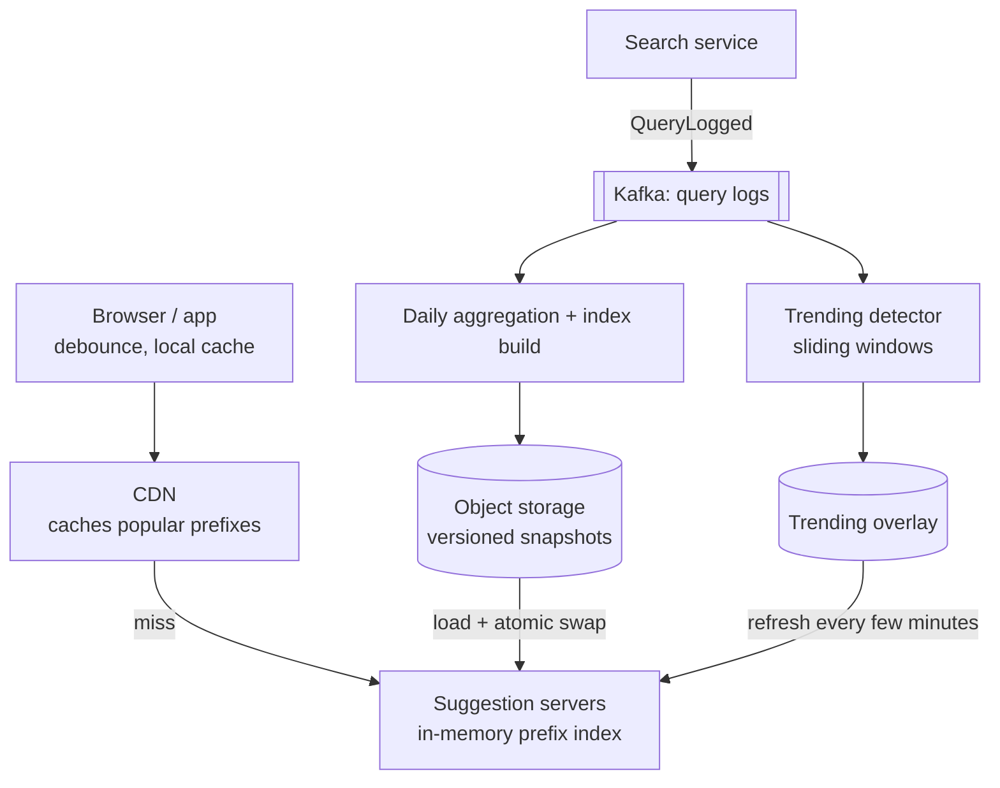
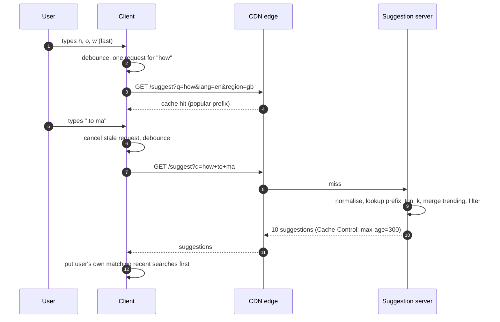
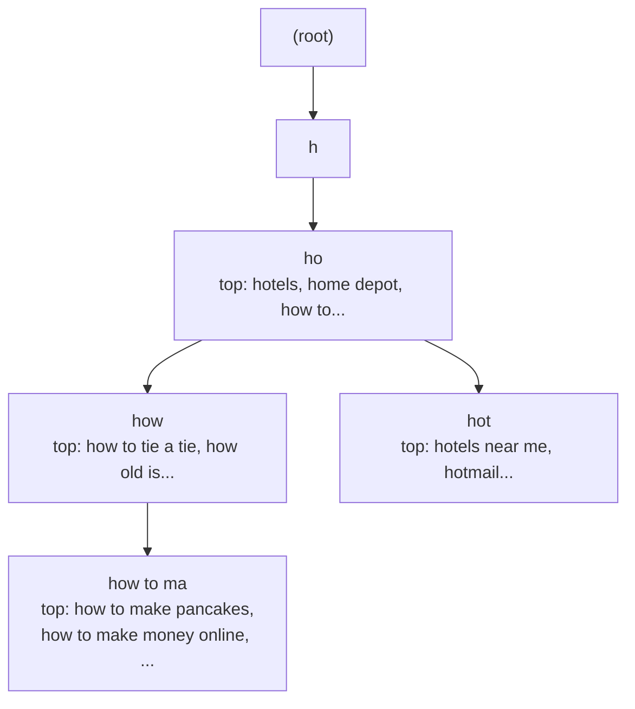
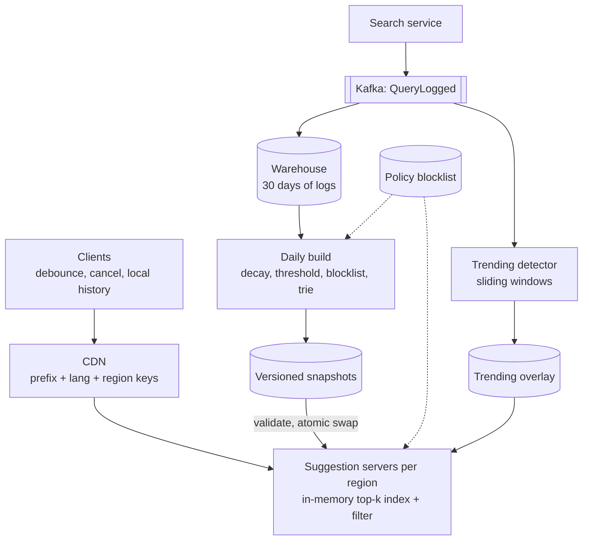

## Problem statement

Design search autocomplete (typeahead) for a large search engine or shopping site: as the user types each character, show the ten most
relevant completions of what they've typed so far, fast enough to feel instant. Suggestions come from what other users actually search for,
reflect trending queries within minutes, and never show offensive content.

**Interview format:** 45–60 minutes · **Difficulty:** intermediate · **Main themes:** prefix indexes with precomputed top-k, offline
aggregation, a fast trending layer, edge caching, request reduction.

> [!TIP] Try it first
> Before scrolling, spend three minutes writing the questions you would ask the interviewer. Then compare with the list below — or
> practise this whole problem as a [timed mock interview](#system-design/hld/interview/search-autocomplete).

## Clarifying questions

The answers below are the interviewer's. Questions that change the design come first.

- **Q:** What exactly do we suggest? <!-- match: what do we suggest, scope, features, suggestions, completions, what is in scope -->
  - **A:** Completions of the query being typed, drawn from popular past queries — not documents or products. Spelling correction is a
    follow-up.
- **Q:** How much traffic? <!-- match: scale, traffic, how many, users, searches, qps, volume -->
  - **A:** About 3 billion searches a day; each search triggers suggestion requests as the user types, about 6 per search.
- **Q:** How fast must suggestions appear? <!-- match: latency, fast, ms, instant, p99 -->
  - **A:** Under 100 ms end to end at p99, so the server side should take only a few milliseconds.
- **Q:** How many suggestions, ranked how? <!-- match: how many suggestions, top, ranking, ranked, order, popularity -->
  - **A:** Up to 10, ranked mainly by popularity, favouring recent popularity.
- **Q:** How fresh must suggestions be? <!-- match: fresh, freshness, trending, new queries, update, how quickly -->
  - **A:** Normal popularity can update daily, but breaking trends should appear within about 15 minutes.
- **Q:** Personalised? <!-- match: personalised, personalized, user history, per user, personal -->
  - **A:** Mostly global per language and region; a user's own recent searches may be shown first.
- **Q:** Which languages and regions? <!-- match: languages, language, regions, countries, locale, international -->
  - **A:** Start with English; the design should extend to other languages, with suggestions per region.
- **Q:** Any content restrictions? <!-- match: offensive, filter, restrictions, safe, blocklist, policy, moderation -->
  - **A:** Yes — offensive, dangerous or legally restricted completions must never appear.

## Functional requirements

> [!TIP] Try it first
> Write three or four functional requirements before reading on.

- Return the **top 10 completions** for a typed prefix. <!-- match: top 10, completions, prefix, suggestions -->
- Rank by **popularity with recency**, per language and region. <!-- match: popularity, rank, recency -->
- Reflect **trending queries** within about 15 minutes. <!-- match: trending, fresh -->
- **Filter** offensive or restricted suggestions. <!-- match: filter, offensive, blocklist -->

````hint title="Hint: compute when?"
Ranking all queries that start with "ho" takes time. Does that work have to happen when the user types, or can it happen earlier?
````

## Non-functional requirements

- **Very low latency**: under 100 ms end to end, a few ms on the server. <!-- match: latency, 100 ms, fast -->
- **High throughput**: hundreds of thousands of requests per second. <!-- match: throughput, scale, requests per second -->
- **High availability**: suggestions degrade gracefully; search itself must never break. <!-- match: availability, available, degrade -->
- **Eventual consistency**: popularity changes can lag minutes to a day. <!-- match: eventual, consistency, lag -->

````hint title="Hint: the cheapest request"
Many users type the same first two or three letters. Which layer could answer "ho" without reaching your servers at all?
````

## Scope and exclusions

In scope: the suggestion service, the prefix index, the offline aggregation pipeline, the trending pipeline, caching, filtering, client
behaviour.

Out of scope: the search results themselves, spelling correction (follow-up), deep personalisation, ads in suggestions.

## Capacity estimation

> [!TIP] Try it first
> Estimate suggestion requests per second and the memory for an in-memory prefix index.

- **Requests:** 3B searches × ~6 requests = **18B/day ≈ 208,000/s**, ~420,000/s at peak.
- **Edge caching:** short prefixes are shared by everyone; if CDN and browser caches answer ~50%, servers see ~210,000/s at peak.
- **Servers:** an in-memory lookup is microseconds; at ~20,000 requests/s per server at 60% target utilisation, **~18 servers** at peak
  (plus replicas per region for latency and failure).
- **Index:** keep the ~20 million most popular queries; precompute the top 10 for every prefix up to 20 characters: ~150M prefixes × ~100
  bytes (10 query IDs plus overhead) ≈ **15 GB**, plus ~0.6 GB of query strings — fits in memory on every serving node.
- **Logs:** 3B searches × ~100 bytes ≈ **300 GB/day** of query logs feeding aggregation.

```estimator title="Search autocomplete (suggestion requests and query logs)"
requestsPerDay = 21B
readsPerWrite = 6
writeBytes = 100 B
readBytes = 500 B
retentionYears = 0.08
peakFactor = 2
replication = 3
cachePercent = 0
serverRps = 20000
targetUtilization = 60
```

Reads are suggestion requests (~500 bytes of JSON); writes are logged searches (~100 bytes), retained for about 30 days for aggregation.
The calculator's server count ignores edge caching, so it's an upper bound.

**What the numbers mean for the design:**

- **Precompute**: per-keystroke latency and volume rule out ranking at request time.
- **The index fits in memory**, so every serving node can hold a full copy for its language and region.
- **Cache aggressively**: suggestion responses aren't personal and repeat constantly.

````hint title="Hint: fewer requests"
What can the client do to avoid sending a request for every single keystroke?
````

## API design

> [!TIP] Try it first
> Define the suggestion request and response. What makes it cacheable?

```text title="API"
GET /v1/suggest?q=how+to+ma&lang=en&region=gb
  Cache-Control: public, max-age=300            (short prefixes may use longer TTLs)
  -> 200 { "prefix": "how to ma",
           "suggestions": ["how to make pancakes", "how to make money online",
                           "how to make a website", ...],
           "index_version": "2026-11-07T04:00Z+trend-0915" }

Search logging (from the search service, asynchronously):
  QueryLogged { "query": "how to make pancakes", "lang": "en", "region": "gb",
                "ts": "...", "session": "hashed" }
```

- The response depends only on **(normalised prefix, language, region)** — no user ID — so CDNs and browsers can cache it.
- The user's own recent searches are merged **in the client** from local history, keeping the server response shareable.

````hint title="Hint: normalisation"
Should "How To Ma", "how  to ma" and "how to ma" be three cache keys or one?
````

## Data model

> [!TIP] Try it first
> What does the serving node hold in memory, and what does the pipeline store?

```text title="Schema"
Pipeline storage
  query_logs        (date, lang, region, query, count)        partitioned by date, 30-day retention
  query_scores      (lang, region, query, score)              daily, time-decayed popularity
  blocklist         (pattern, reason)                          policy filters

Serving snapshot (immutable, versioned, loaded into memory)
  queries           query_id -> text
  prefix_top_k      (lang, region, prefix) -> [query_id x 10] precomputed, prefixes up to 20 chars

Trending overlay (refreshed every few minutes)
  trending          (lang, region, prefix) -> [query_id with boost]
```

- The **serving snapshot is built offline** and shipped to servers; servers never compute rankings.
- A **trie** is the natural way to build it: walk every query into the tree, and store at each node the top 10 queries beneath it.

````hint title="Hint: why store top-k at every node?"
What would a lookup cost if the server had to walk the whole subtree under "ho" to find the most popular completions?
````

## Initial high-level architecture

Build the design one requirement at a time.

### Step 1: serve from memory

**Suggestion servers** hold a versioned in-memory index mapping each prefix to its precomputed top 10. A request normalises the prefix
(lowercase, collapse spaces, strip accents for matching), looks it up, applies the trending overlay, and returns.

### Step 2: build the index offline

The search service logs queries to **Kafka**. A daily **batch job** aggregates counts over the last weeks with time decay, removes rare and
blocked queries, builds the top-10-per-prefix structure, and publishes an immutable snapshot to object storage. Servers load the new
snapshot and switch atomically ([write-heavy systems](lesson:write-heavy)).

### Step 3: capture trends

A **streaming job** counts queries in sliding windows (e.g. the last hour versus the previous day) and detects queries whose rate jumps.
Every few minutes it publishes a small trending overlay that servers merge at read time.

### Step 4: cut traffic

Clients **debounce** (send after ~50–100 ms without typing), cancel stale requests, and cache responses; a **CDN** caches popular prefixes
for minutes ([CDN](lesson:cdn)).

````hint title="Hint: atomic switch"
What happens if half of a server's index is from yesterday's build and half from today's?
````

## Architecture diagram



## Request and data flow



## Component responsibilities

| Component | Responsibility | Scales with |
|---|---|---|
| Client | Debounce, cancel, cache, merge personal history | Users |
| CDN | Cache responses for popular prefixes | Request volume |
| Suggestion servers | In-memory lookup, trending merge, final filter | Cache misses/s |
| Query log (Kafka) | Durable stream of searches | Searches/s |
| Batch builder | Aggregate, decay, filter, build snapshots | Query log volume |
| Trending detector | Sliding-window counts, spike detection | Searches/s |

## Database and technology choices

| Need | Choice | Why | Alternative |
|---|---|---|---|
| Serving index | In-memory trie or sorted prefix table per server | Microsecond lookups; fits in RAM | Redis / key-value store per prefix (extra hop) |
| Snapshots | Versioned files in object storage | Atomic, rollbackable deploys of the index | Database tables |
| Log stream | Kafka | High-volume, replayable | Kinesis / Pub/Sub |
| Batch aggregation | Spark / a warehouse job | Large daily aggregation | MapReduce |
| Trending | Stream processor (Flink) with windows | Minute-level freshness | Micro-batches every few minutes |
| Edge | CDN with short TTLs | Removes most traffic for short prefixes | Regional caches only |

## Scaling strategy

### How is the prefix index built?

Insert each popular query into a trie; at every node keep the top 10 queries in its subtree by score (computed bottom-up while building).
Serving "how to ma" is then a walk of nine characters and a read of a stored list — no subtree scan. To bound size: keep only queries above
a popularity threshold, cap prefix length (beyond ~20 characters few prefixes have useful completions), and store query IDs rather than
strings at nodes ([search fundamentals](lesson:search-fundamentals)).



### How is it served at hundreds of thousands of requests per second?

Every serving node holds the full index for its language and region (~15 GB), so any node answers any prefix; add replicas for throughput
and regions for latency. If an index outgrows memory, **shard by prefix range** (a–f, g–m, ...) — but beware skew: prefixes starting with
"s" or "c" carry far more traffic than "x", so split ranges by traffic, not alphabet ([sharding](lesson:sharding)).

### How do trends get in within 15 minutes?

The daily build can't, so a streaming job counts queries per region in short windows and flags queries whose current rate is far above
their baseline. Every few minutes it publishes a small overlay — prefix → boosted queries — which servers merge with the snapshot's list at
read time. The next daily build absorbs lasting trends into the main index.

### How are deploys of the index made safe?

Snapshots are immutable and versioned. A server loads the new version alongside the old one, runs sanity checks (size, sample lookups,
blocklist tests), then switches a pointer atomically; rollback is switching back. Servers in a region update gradually, and the response
carries the index version for debugging.

## Caching strategy

### Where is caching applied?

- **Browser/app**: cache recent prefix responses; typing backspace re-uses them.
- **CDN**: responses keyed by normalised prefix, language and region with TTLs of minutes; short prefixes have very high hit ratios.
- **Server**: the index itself is in memory; no separate cache is needed.

Because responses are shared, personalisation stays on the client (recent searches), and freshness is bounded by TTLs of a few minutes —
acceptable given the 15-minute trend requirement ([caching basics](lesson:caching-basics)).

## Messaging strategy

### What flows through the log?

Every search (not every keystroke) is logged once by the search service as `QueryLogged`. Two consumer groups read it: the batch exporter
that lands it in the warehouse for the daily build, and the trending detector. Logging is asynchronous and lossy-tolerant — a few dropped
log events don't matter for popularity counts ([Kafka](lesson:kafka)).

## Failure scenarios

| Failure | Impact | Mitigation |
|---|---|---|
| Suggestion servers down in a region | No suggestions there | Route to another region; search still works without suggestions |
| Bad snapshot (empty or corrupted) | Wrong or missing suggestions | Validation before swap; keep previous version for instant rollback |
| Trending job stalls | Trends appear late | Serve the base index; alert on overlay age |
| Offensive query becomes popular | Appears in suggestions | Blocklist at build time and a final filter at serve time, updatable within minutes |
| CDN serves stale suggestions | Old trends for a few minutes | Short TTLs; purge for urgent removals |
| Coordinated manipulation | Fake trends | Count distinct users/sessions, rate-limit, anomaly detection |

## Bottleneck analysis

- **Request volume** — debounce, client caching and the CDN cut it sharply; servers do microsecond work.
- **Index size** — popularity thresholds and prefix-length caps keep it in memory.
- **Build time** — daily batch over billions of log rows; incremental builds if it grows.
- **Skewed prefixes** — matter only if sharding by prefix; full replicas avoid it.

## Consistency and availability trade-offs

- **Eventually consistent popularity**: daily for the base index, minutes for trends, plus CDN TTLs.
- **Availability first**: if suggestions fail, the search box still works — autocomplete is an optional enhancement.
- **Filtering is the exception**: removals of harmful suggestions must take effect fast, so the serve-time filter is updated independently
  of the daily build.

## Security considerations

- Don't log personal data in query logs beyond what's necessary; hash session IDs; respect retention limits.
- Never suggest queries that reveal private information (rare queries containing emails, phone numbers) — popularity thresholds and
  pattern filters remove them.
- Protect against manipulation by counting distinct users and rate-limiting log contributions.
- Rate-limit the suggest endpoint per client to prevent scraping.

## Monitoring and observability

- End-to-end and server latency (p50/p99); CDN hit ratio by prefix length.
- Requests per search (is debouncing working?); suggestion click-through rate.
- Snapshot age and version spread across servers; trending overlay age.
- Filter hits and manual removals.

## Final architecture

Open this after you have drawn your own.

````solution title="Final architecture"


**In one breath:** clients debounce keystrokes and request suggestions keyed only by normalised prefix, language and region, so browsers and
the CDN cache most of them; misses hit regional suggestion servers that hold a versioned in-memory trie with the top 10 queries
precomputed at every prefix, merge a trending overlay refreshed every few minutes, and apply a policy filter; a daily batch over query logs
from Kafka builds decayed, thresholded, filtered snapshots that servers validate and swap atomically, while a streaming job detects spikes
for the overlay.
````

## Alternative designs and trade-offs

| Alternative | Gains | Costs | When to choose it |
|---|---|---|---|
| Rank at request time over a prefix range | Always fresh | Far too slow at this volume | Small catalogues |
| Prefix → top-k in Redis | Shared index, simple updates | Extra network hop, memory cost across a cluster | Index too large for each server |
| Elasticsearch completion suggester | Built-in, fuzzy matching | Heavier, less control over ranking pipeline | Product search on a catalogue |
| Personalised server responses | Better relevance | Uncacheable, more compute | Small user bases or logged-in-only products |
| Streaming-only counts | Freshest | Noisy, harder to filter and decay well | Trend-heavy products (news) |

## Interviewer follow-up questions

````question title="How would you add typo tolerance?"
Generate candidate corrections for the prefix — terms within one or two edits of what was typed, found efficiently with automata over the
trie or a separate index of common misspellings learned from logs (queries users retyped). Look up suggestions for the best few candidates
and merge them below exact-prefix matches, with a penalty. Keep it bounded so latency stays in milliseconds.
````

````question title="How would you support many languages and regions?"
Build separate indexes per language and region (or per language with regional boosts), each from its own slice of the logs, with language-
specific normalisation — accent folding, tokenisation for scripts without spaces, transliteration for some languages. Route requests by
the user's locale. Serving nodes in each region load only the indexes they need.
````

````question title="Why not store suggestions in Redis and update them on every search?"
Updating top-k lists for every prefix of every search would mean dozens of writes per search — billions per day — plus hot keys for short
prefixes, and it would make filtering and decay harder. Popularity changes slowly, so a periodic offline build is far cheaper and more
controllable, and a small streaming overlay covers fast trends. Serving from local memory also avoids a network hop per keystroke.
````

````question title="A harmful suggestion is trending. How do you remove it within minutes?"
Add it (or a pattern) to the policy blocklist, which serving nodes reload independently of the daily index and apply as a final filter
before returning results, and purge cached responses for affected prefixes from the CDN. The next daily build excludes it permanently.
Because the filter runs at serve time, removal doesn't wait for a rebuild.
````

````question title="How do you reduce the number of requests clients send?"
Debounce input so a request is sent only after the user pauses briefly, cancel in-flight requests that are superseded, reuse cached
responses for prefixes already seen (including after backspace), and optionally filter a previous response locally when the new prefix
extends it and the list was complete. Together these often cut requests per search by half or more.
````

## Common mistakes

- **Querying a database with `LIKE 'prefix%'`** on every keystroke and sorting by count.
- **Computing top-k at request time.**
- **Personalising the server response**, making it uncacheable.
- **Updating the index synchronously** for every search.
- **No trending path**, or no fast way to remove harmful suggestions.
- **Sharding alphabetically** without considering traffic skew.

## Evaluation checklist

```checklist title="Evaluation checklist"
- Asked about traffic, latency, ranking, freshness, personalisation, languages and content policy
- Estimated requests/s and the memory of a precomputed prefix index
- Precomputed the top 10 per prefix (trie with top-k at nodes) offline
- Served from memory on replicated nodes per region
- Built snapshots from query logs with decay, thresholds and filters, and swapped them atomically
- Added a streaming trending overlay for minute-level freshness
- Made responses cacheable (no user ID) and used the CDN and client caches
- Reduced requests with debouncing and cancellation
- Kept a fast, serve-time policy filter for removals
- Explained graceful degradation if suggestions are unavailable
```
