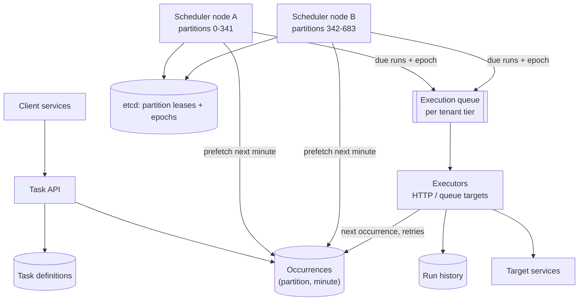
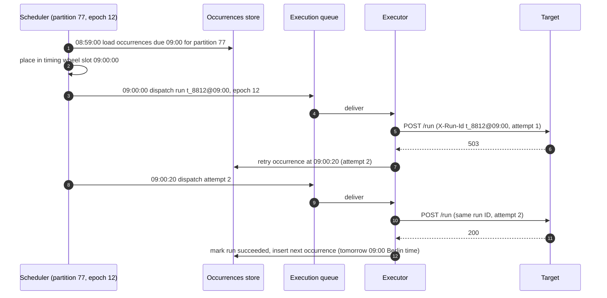
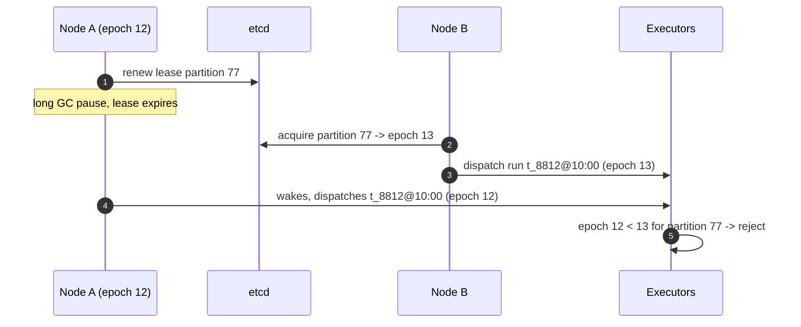
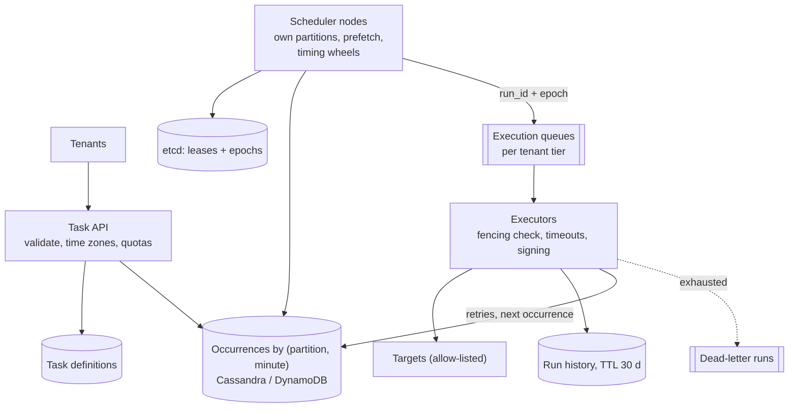

## Problem statement

Design a distributed task scheduler offered as a service to other teams: clients schedule one-off tasks ("call this endpoint at 18:00
tomorrow") and recurring ones (cron expressions), and the scheduler runs each occurrence on time — within about a second — exactly once in
effect, even when machines crash, with retries, history and per-tenant fairness. Hundreds of millions of executions a day, with large spikes
at the top of every hour.

**Interview format:** 45–60 minutes · **Difficulty:** advanced · **Main themes:** time-bucketed storage of future work, partition ownership
with consensus and fencing, in-memory timing wheels, at-least-once execution made idempotent, misfires and spikes.

> [!TIP] Try it first
> Before scrolling, spend three minutes writing the questions you would ask the interviewer. Then compare with the list below — or
> practise this whole problem as a [timed mock interview](#system-design/hld/interview/task-scheduler).

## Clarifying questions

The answers below are the interviewer's. Questions that change the design come first.

- **Q:** What is a task, and what does running it mean? <!-- match: what is a task, task, execution, run, callback, payload -->
  - **A:** A task has a payload and a target: an HTTP callback or a message published to a queue. Running it means delivering that call
    and recording the result. The scheduler doesn't run arbitrary code itself.
- **Q:** One-off, recurring, or both? <!-- match: one-off, recurring, cron, both, schedule types -->
  - **A:** Both: one-off tasks at a timestamp (up to a year ahead) and recurring tasks with cron expressions and time zones.
- **Q:** What scale? <!-- match: scale, how many, executions, tasks per day, volume, traffic -->
  - **A:** About 500 million executions a day, with up to 10× spikes at the start of each hour and day.
- **Q:** How precise must timing be? <!-- match: precision, precise, on time, latency, delay, accuracy -->
  - **A:** Within about one second of the scheduled time.
- **Q:** What delivery guarantee? <!-- match: exactly once, at least once, guarantee, duplicates, semantics -->
  - **A:** Each occurrence must run; duplicates should be extremely rare and detectable — targets receive an idempotency key.
- **Q:** What about failures and retries? <!-- match: retries, failure, retry, dead letter, failed tasks -->
  - **A:** Retries with backoff per task policy, then a dead-letter state the client can inspect and replay.
- **Q:** What if the scheduler was down when tasks were due? <!-- match: missed, misfire, outage, downtime, catch up -->
  - **A:** Each task declares a misfire policy: run all missed occurrences, run once, or skip.
- **Q:** Multi-tenant? <!-- match: tenants, multi-tenant, fairness, quotas, teams -->
  - **A:** Yes — many teams share it; one tenant's burst must not delay others.

## Functional requirements

> [!TIP] Try it first
> Write three or four functional requirements before reading on.

- Clients can **schedule one-off and recurring tasks** (cron with time zones). <!-- match: schedule, one-off, recurring, cron -->
- The scheduler **executes each occurrence on time**, delivering an idempotency key. <!-- match: execute, on time, occurrence -->
- Failed executions are **retried** and then **dead-lettered**. <!-- match: retry, retried, dead letter -->
- Clients can **cancel, pause and inspect** tasks and execution history. <!-- match: cancel, pause, history, inspect -->

````hint title="Hint: finding what's due"
100 million one-off tasks wait for future times. Each second, which ones are due — without scanning all of them?
````

## Non-functional requirements

- **Timeliness**: within ~1 s of the scheduled time, even at hourly spikes. <!-- match: timeliness, on time, 1 s, spikes -->
- **Reliability**: no lost occurrences; duplicates rare and idempotent. <!-- match: reliable, reliability, no lost, duplicates -->
- **Scale**: ~5,800 executions/s average, ~58,000/s peak. <!-- match: scale, executions per second, peak -->
- **High availability**: node failures don't stop scheduling. <!-- match: availability, node failures -->
- **Isolation** between tenants. <!-- match: isolation, tenants, fairness -->

````hint title="Hint: two schedulers, one task"
If two nodes both think they own the same slice of tasks, what happens, and how do you make that impossible or harmless?
````

## Scope and exclusions

In scope: task API, storage of definitions and future occurrences, due-task discovery, partition ownership, dispatch, execution with
retries, history, misfire policies, tenant fairness.

Out of scope: running arbitrary user code (tasks call targets), complex workflow DAGs (see [multi-step workflows](lesson:multi-step-workflows)),
UI.

## Capacity estimation

> [!TIP] Try it first
> Estimate executions per second at average and peak, history storage, and per-partition load.

- **Executions:** 500M/day ≈ **5,800/s** average; **~58,000/s** in the first seconds after the hour.
- **Pending one-off tasks:** ~100 million at any time (most due within days).
- **History:** ~1 KB per execution → **500 GB/day**, ~15 TB for 30 days.
- **Partitioning:** with 1,024 partitions, a peak of ~57 executions/s per partition — easy for one owner each.

```estimator title="Task scheduler (executions and API reads)"
requestsPerDay = 1B
readsPerWrite = 1
writeBytes = 1 KB
readBytes = 1 KB
retentionYears = 0.08
peakFactor = 10
replication = 3
cachePercent = 0
serverRps = 3000
targetUtilization = 60
```

Writes are executions recorded in history (about 30 days, three replicas); reads are status and history queries. The high peak factor
models top-of-the-hour spikes.

**What the numbers mean for the design:**

- **Due-task discovery must be indexed by time**, not scanned ([distributed scheduling](lesson:distributed-scheduling)).
- **Spikes are predictable** (top of the hour): prefetch and pre-scale before them.
- **Partitioned ownership** spreads the work; each partition needs exactly one owner at a time.

````hint title="Hint: prefetching"
If you know at 13:59 which tasks are due at 14:00:00, what can you do in that minute?
````

## API design

> [!TIP] Try it first
> Define creating a task, the execution request the target receives, and history queries.

```text title="API"
POST /v1/tasks   Idempotency-Key: ...
  { "tenant": "billing", "schedule": { "cron": "0 9 * * MON-FRI", "timezone": "Europe/Berlin" }
    | { "at": "2026-11-08T18:00:00Z" },
    "target": { "http": { "url": "https://billing.internal/run", "method": "POST" } }
    | { "queue": "billing-jobs" },
    "payload": {...}, "timeout_s": 30,
    "retry": { "max_attempts": 5, "backoff": "exponential", "max_delay_s": 600 },
    "misfire": "run_once" | "run_all" | "skip", "concurrency": "forbid" }
  -> 201 { "task_id": "t_8812", "next_run_at": "..." }

Execution request to the target:
  POST https://billing.internal/run
  Headers: X-Task-Id: t_8812, X-Run-Id: t_8812@2026-11-09T08:00:00Z, X-Attempt: 1
  -> 2xx = success; 429/5xx/timeout = retry; other 4xx = permanent failure

GET  /v1/tasks/{id}/runs?cursor=     DELETE /v1/tasks/{id}     POST /v1/tasks/{id}/pause
```

- **`X-Run-Id` identifies the occurrence** (task + scheduled time), so targets can deduplicate.
- **`concurrency: forbid`** prevents a recurring task from starting while its previous run is still going.

````hint title="Hint: run ID vs attempt"
Why does the run ID include the scheduled time rather than a random value per attempt?
````

## Data model

> [!TIP] Try it first
> How do you store task definitions and future occurrences so a partition owner can read "everything due in the next minute"?

```text title="Schema"
tasks        (task_id PK, tenant, schedule, timezone, target, payload_ref, retry_policy,
              misfire_policy, status: active | paused | cancelled, version)       sharded by task_id

occurrences  (partition, due_minute, due_at, task_id, run_id, attempt, state)
             PK ((partition, due_minute), due_at, task_id)    wide-column / key-value store
             partition = hash(task_id) mod 1024

runs         (run_id, attempt, started_at, finished_at, outcome, response_code, error)
             history, TTL 30 days

partition_leases (partition, owner_node, epoch, lease_expires_at)   in etcd / ZooKeeper
```

- **Occurrences are bucketed by partition and minute**: an owner reads exactly one small range per minute
  ([partition keys](lesson:partition-keys-retention)).
- **Recurring tasks store only the next occurrence**; after it runs, the next one is computed and inserted.

````hint title="Hint: why a separate occurrences table?"
A recurring task runs forever. What would it mean to store all of its future occurrences?
````

## Initial high-level architecture

Build the design one requirement at a time.

### Step 1: accept and store

The **task API** validates schedules, computes the first occurrence (in the task's time zone, then converted to UTC), and writes the task
and its occurrence in one transaction (or the occurrence via an outbox).

### Step 2: own partitions

**Scheduler nodes** acquire leases on partitions from a consensus store (etcd/ZooKeeper); each lease carries an **epoch** (fencing token)
([consensus](lesson:consensus), [distributed locks](lesson:distributed-locks)).

### Step 3: load and fire

Each owner loads the next minute's occurrences for its partitions into an **in-memory timing wheel** a little ahead of time; when a slot's
time arrives, it dispatches each occurrence to an **execution queue**, tagged with its run ID and the owner's epoch.

### Step 4: execute and reschedule

**Executors** consume from the queue, call the target with timeouts, record the result, schedule retries with backoff as new occurrences,
and for recurring tasks compute and insert the next occurrence.

````hint title="Hint: fencing"
A paused node wakes up after its lease was given to another node and dispatches the same minute again. What rejects it?
````

## Architecture diagram



## Request and data flow



## Component responsibilities

| Component | Responsibility | Scales with |
|---|---|---|
| Task API | Validate, compute first run, store, cancel, pause | Task changes |
| Occurrence store | Future runs bucketed by partition and minute | Pending occurrences |
| Coordination store | Partition leases with epochs | Partitions, nodes |
| Scheduler nodes | Own partitions, prefetch, timing wheels, dispatch | Executions/s |
| Execution queue | Buffer dispatches, isolate tenants | Executions/s |
| Executors | Call targets, timeouts, retries, history | Executions/s × call duration |
| History store | Runs and attempts for inspection | Executions/day |

## Database and technology choices

| Need | Choice | Why | Alternative |
|---|---|---|---|
| Task definitions | Sharded relational DB | Rich queries, transactions | DynamoDB |
| Occurrences | Cassandra / DynamoDB keyed by (partition, minute) | Huge volume, range reads per bucket, TTL | PostgreSQL with `SKIP LOCKED` (smaller scale) |
| Leases | etcd / ZooKeeper | Consensus-backed leases and epochs | Database leases |
| In-memory timers | Hierarchical timing wheel | O(1) insert and expiry for many timers | Priority queue (O(log n)) |
| Execution queue | Kafka or SQS per tenant tier | Buffering, scaling executors | Direct calls from schedulers |
| History | Wide-column store with TTL | Write-heavy, time-ordered | Object storage + query engine |

## Scaling strategy

### How are due tasks found without scanning?

Occurrences are stored by `(partition, due_minute)`. Each partition owner, a minute ahead, reads one bucket per owned partition — a small,
contiguous range — and loads it into a **hierarchical timing wheel** (slots for seconds within minutes), which fires each slot in O(1). Tasks
scheduled less than a minute ahead are written to the bucket and also pushed directly to the current owner, so they aren't missed.

### How is each partition owned by exactly one node?

Nodes acquire time-limited **leases** per partition in a consensus store; each acquisition increments an **epoch**. Dispatches carry the
owner's epoch, and the executor (or the queue writer) rejects messages with an epoch lower than the latest recorded for that partition — so a
node that paused past its lease and wakes up can't double-fire. When a node dies, its leases expire and other nodes take its partitions,
reading any buckets not yet marked dispatched ([partitions and failure detection](lesson:partitions-failure-detection)).



### How is "exactly once" achieved?

Delivery is **at least once** — after a crash, an occurrence may be dispatched again — and effects are made idempotent: each occurrence has a
deterministic **run ID** (task ID + scheduled time) sent to the target, executors record run outcomes keyed by run ID, and targets deduplicate
on it ([dedup](lesson:dedup)). Fencing epochs make duplicates rare; idempotency makes them harmless.

### How are hourly spikes handled?

Spikes are predictable: owners prefetch the next minute early, executors are pre-scaled before :00, and dispatch is spread within the second
if the target allows. Per-tenant queues (or weighted fair queuing) ensure one tenant's 10 million 09:00 tasks don't delay another's
([backpressure](lesson:backpressure)).

### How are recurring schedules computed correctly?

Cron expressions are evaluated in the task's **time zone** with a time-zone library, then converted to UTC. Around daylight-saving changes,
nonexistent times (02:30 when clocks jump forward) and repeated times (02:30 twice when they fall back) follow a documented policy. Only the
next occurrence is stored, computed when the current one completes (or is dispatched, for `concurrency: allow`).

### What about missed runs?

After an outage, owners find buckets in the past that weren't marked dispatched and apply each task's misfire policy: run every missed
occurrence (billing), run once (reports), or skip (notifications that are now pointless) — draining at a controlled rate.

## Caching strategy

### What is cached?

Very little on the dispatch path: the timing wheel itself is the in-memory working set for the next minute. Task definitions (target,
retry policy) are cached by executors with short TTLs and invalidated by version on change, so a cancelled task isn't run — executors also
re-check the task's status before calling the target.

## Messaging strategy

### Why an execution queue between schedulers and executors?

It separates timing from doing: schedulers only decide *when*, and enqueue quickly even during spikes; executors scale independently with
call latency; queues per tenant tier isolate tenants; and failed calls are retried by scheduling new occurrences (with backoff) rather than
holding queue messages for minutes. Exhausted retries move a run to a dead-letter state with a replay API ([retries and DLQs](lesson:retries-dlq)).

## Failure scenarios

| Failure | Impact | Mitigation |
|---|---|---|
| Scheduler node dies | Its partitions pause until leases expire | Short leases; others take over and read unmarked buckets |
| Zombie node after GC pause | Possible duplicate dispatch | Epoch fencing at the queue/executor; idempotent run IDs |
| Target down | Runs fail | Retries with backoff; dead-letter; per-target circuit breakers |
| Executor crash mid-call | Unknown outcome | Re-run with the same run ID; target deduplicates |
| Top-of-hour spike | Delays | Prefetch, pre-scale, tenant fair queues |
| Whole scheduler outage | Missed runs | Misfire policies, rate-limited catch-up |

## Bottleneck analysis

- **Dispatch rate at :00** — prefetching and partition parallelism.
- **Executor concurrency** — calls are I/O-bound; size by Little's law (rate × call duration).
- **Occurrence store hot buckets** — partitioning by hash spreads each minute across 1,024 partitions.
- **Slow targets** — per-target concurrency limits so they don't hog executors.

## Consistency and availability trade-offs

- **At-least-once dispatch with idempotent effects** instead of impossible exactly-once delivery.
- **Strong consistency for ownership** (consensus leases) to keep duplicates rare.
- **Availability through partition reassignment**: a node failure delays only its partitions by the lease time.
- **Eventual consistency** for history and dashboards.

## Security considerations

- Tenants authenticate; each task's target must be on an allow-list for that tenant (prevent the scheduler being used to attack services).
- Sign execution requests (HMAC or mTLS) so targets know they come from the scheduler.
- Encrypt payloads that may contain secrets; store payloads by reference.
- Per-tenant quotas on task count and execution rate.

## Monitoring and observability

- Schedule lag: actual dispatch time − scheduled time (p50/p99), especially at :00.
- Partitions without an owner; lease churn; fenced (rejected) dispatches.
- Execution success rate, retries, dead-lettered runs per tenant and target.
- Queue depth per tenant tier; executor saturation.

## Final architecture

Open this after you have drawn your own.

````solution title="Final architecture"


**In one breath:** tasks are stored with their next occurrence in a store bucketed by hashed partition and minute; scheduler nodes hold
consensus-backed leases with epochs on partitions, prefetch each upcoming minute into in-memory timing wheels and dispatch due occurrences
with deterministic run IDs and their epoch to per-tenant execution queues; executors reject stale epochs, call allow-listed targets with
signed requests and timeouts, record history, schedule retries and the next recurring occurrence, and dead-letter exhausted runs; after
outages, misfire policies decide how missed runs are replayed.
````

## Alternative designs and trade-offs

| Alternative | Gains | Costs | When to choose it |
|---|---|---|---|
| PostgreSQL + `SKIP LOCKED` polling | Simple, transactional | Polling load and limited scale | Up to thousands of runs/s |
| Redis sorted set as the due index | Fast, simple | Memory-bound, durability trade-offs | Short delays, modest volume |
| Single leader scheduler | No partition management | Throughput ceiling, failover pauses | Small deployments |
| Queue delay features (e.g. SQS delays) | Managed | Limited delay range (minutes) | Short retries only |
| Workflow engine timers | Durable, integrated | Heavier per task | Tasks that are steps of workflows |

## Interviewer follow-up questions

````question title="How do you guarantee a task isn't run twice if two scheduler nodes think they own the same partition?"
Ownership comes from consensus-backed leases, and each acquisition increments an epoch for the partition. Every dispatch carries the owner's
epoch, and executors (or the queue writer) record the highest epoch seen per partition and reject anything lower — so a node that lost its
lease during a pause can't double-dispatch. As a second line of defence, every occurrence has a deterministic run ID, so even a rare duplicate
is recognised and ignored by executors and targets.
````

````question title="10 million tasks are scheduled for exactly 09:00:00. What happens?"
They're spread across 1,024 partitions by task-ID hash, so each owner has around 10,000. Owners load them into timing wheels at 08:59, executors
are pre-scaled, and at 09:00:00 owners dispatch to tenant-tier queues as fast as the queues accept; executors drain them within seconds,
with per-tenant fair queuing so a single tenant's batch doesn't block others. If targets can't handle the burst, per-target concurrency limits
and retries smooth it out, and lag metrics show how far behind schedule the tail ran.
````

````question title="How do you handle a cron task scheduled at 02:30 on the day clocks spring forward?"
The schedule is evaluated in the task's time zone, where 02:30 doesn't exist that day. The documented policy decides — typically run at the
next valid time (03:00) or skip that day — and the same applies when clocks fall back and 02:30 happens twice (run once). Storing schedules in
local time with an IANA time zone, rather than as fixed UTC offsets, is what makes this correct across years.
````

````question title="How would you let a task run only if its previous run has finished?"
Give the task a concurrency policy. With "forbid", the next occurrence is computed and enqueued only when the current run finishes; if a run
is still in progress when the next one would be due, that occurrence is skipped or delayed according to the misfire policy. The executor holds
a per-task lease while running, so even overlapping dispatches would see the lease and stand down.
````

````question title="How do you cancel a task that is due in two seconds?"
Mark the task cancelled in the definitions store (incrementing its version) and delete its pending occurrence. The partition owner may already
have it in its timing wheel, so executors re-check the task's status and version before calling the target, and skip cancelled tasks. If the
call has already started it completes, and the history shows it; the API can report that cancellation came too late for that run.
````

## Common mistakes

- **Scanning all tasks** every second to find due ones.
- **Storing every future occurrence** of recurring tasks.
- **Leases without fencing**, so paused nodes double-fire.
- **Claiming exactly-once delivery** instead of at-least-once with idempotent run IDs.
- **Ignoring time zones and DST** in cron evaluation.
- **No tenant isolation** at the top-of-hour spike.

## Evaluation checklist

```checklist title="Evaluation checklist"
- Asked about task types, scale, precision, guarantees, retries, misfires and tenancy
- Estimated executions/s at average and peak and history storage
- Stored future occurrences bucketed by partition and minute
- Assigned partitions with consensus leases and epochs, and fenced stale owners
- Prefetched upcoming work into in-memory timing wheels
- Made execution at-least-once with deterministic run IDs for idempotency
- Separated scheduling from execution with tenant-isolated queues
- Implemented retries with backoff, dead-lettering and replay
- Evaluated cron in time zones with a DST policy and stored only the next run
- Applied misfire policies after outages
```
