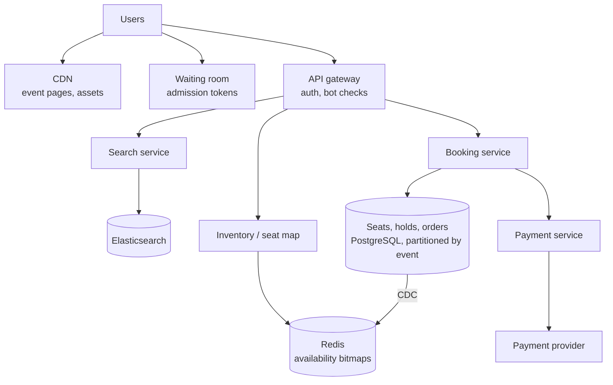
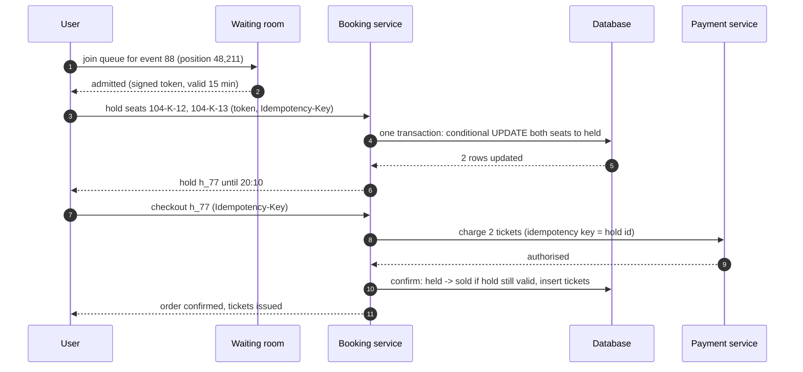
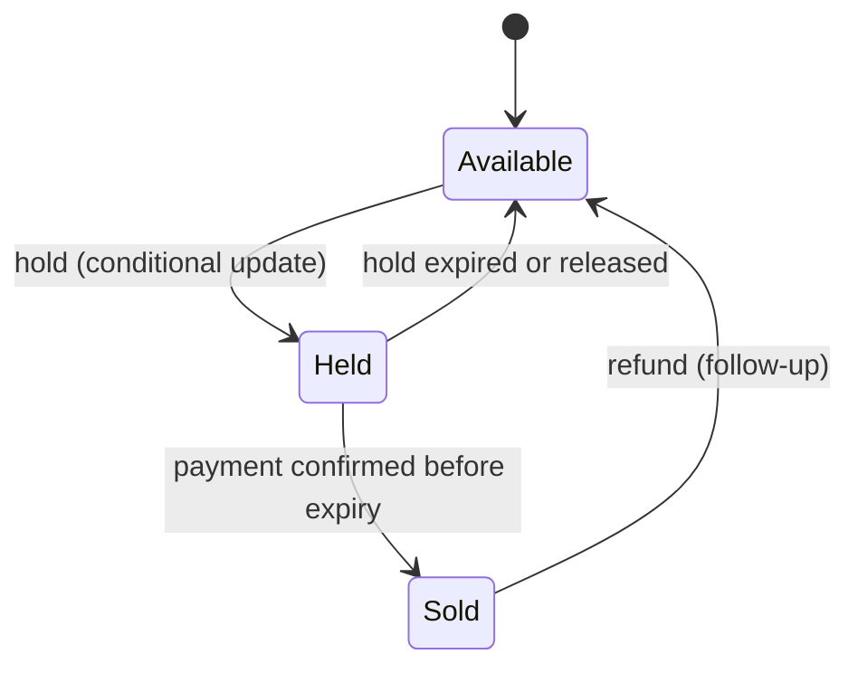
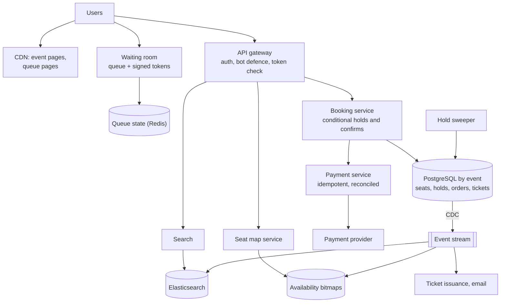

## Problem statement

Design a ticketing platform like Ticketmaster: users search for events, view a venue's seat map, select seats, hold them while paying, and
receive tickets. Most of the year traffic is modest; then a major artist goes on sale and millions of people arrive in the same few minutes
for a few tens of thousands of seats. No seat may ever be sold twice, and the system must stay up and feel fair.

**Interview format:** 45–60 minutes · **Difficulty:** advanced · **Main themes:** contention on scarce inventory, seat holds with expiry,
virtual waiting rooms, read scaling for seat maps, idempotent payments, event search.

> [!TIP] Try it first
> Before scrolling, spend three minutes writing the questions you would ask the interviewer. Then compare with the list below — or
> practise this whole problem as a [timed mock interview](#system-design/hld/interview/ticketmaster).

## Clarifying questions

The answers below are the interviewer's. Questions that change the design come first.

- **Q:** Which features are in scope? <!-- match: features, scope, what do we build, functionality, in scope -->
  - **A:** Searching and browsing events, viewing seat maps, holding seats, paying, and issuing tickets. Resale, dynamic pricing and venue
    management tools are out of scope.
- **Q:** What does peak traffic look like? <!-- match: peak, on-sale, traffic, scale, how many users, spike, concurrent -->
  - **A:** Normally modest. For a top on-sale, about 2 million users arrive within 5 minutes for about 50,000 seats.
- **Q:** Assigned seats or general admission? <!-- match: assigned seats, general admission, seat map, seating, standing -->
  - **A:** Both. Most venues have assigned seats chosen on a seat map; some sections are general admission with a capacity.
- **Q:** How long can a user hold seats while paying? <!-- match: hold, reservation, how long, timeout, expire, cart -->
  - **A:** Ten minutes. If they don't complete payment, the seats go back on sale.
- **Q:** How strict is "no double-booking"? <!-- match: double booking, double-booking, consistency, oversell, sold twice -->
  - **A:** Absolute: a seat must never be sold to two people.
- **Q:** Does fairness matter? <!-- match: fair, fairness, queue, first come, bots, scalpers -->
  - **A:** Yes. Users should be served roughly in arrival order, and bots must not grab most of the inventory.
- **Q:** How do payments work? <!-- match: payment, payments, pay, card, checkout, provider -->
  - **A:** Through an external payment provider. A payment must never be charged twice, and a user must never pay without getting a
    ticket.
- **Q:** How fresh must the seat map be? <!-- match: fresh, seat map, availability, stale, real time, live -->
  - **A:** A few seconds of staleness is fine; the hold step is where correctness is enforced.
- **Q:** What search do we need? <!-- match: search, find events, browse, filter -->
  - **A:** Search events by name, artist, venue, city and date.

## Functional requirements

> [!TIP] Try it first
> Write three or four functional requirements before reading on.

- Users can **search and browse events**. <!-- match: search, browse, events -->
- Users can **view seat availability** on a seat map. <!-- match: seat map, availability, view seats -->
- Users can **hold seats** for 10 minutes and **pay** to confirm them. <!-- match: hold, pay, reserve, book -->
- Users **receive tickets** after successful payment. <!-- match: tickets, receive, issue -->
- During high-demand on-sales, users wait in a **fair queue**. <!-- match: queue, waiting room, fair -->

````hint title="Hint: where is the real contention?"
Two million people look at the seat map, but contention happens only when two of them try to take the same seat. Which step needs strong
consistency, and which can be served from caches?
````

## Non-functional requirements

- **No double-booking**: strong consistency for seat holds and sales. <!-- match: double booking, consistency, strong -->
- **Survive on-sale spikes**: millions of users in minutes without collapse. <!-- match: spikes, peak, scale, millions -->
- **Fairness**: roughly first-come, first-served; bot-resistant. <!-- match: fairness, fair, bots -->
- **High availability** for browsing and search. <!-- match: availability, available -->
- **Low latency** for holds once a user is admitted. <!-- match: latency, fast -->

````hint title="Hint: consistency vs availability"
Is it acceptable for the seat map to be 2 seconds old? Is it acceptable for a hold to succeed on a seat someone else already holds?
````

## Scope and exclusions

In scope: event catalogue and search, seat maps, waiting room, holds, payments, orders, ticket issuance, bot mitigation at a high level.

Out of scope: resale marketplace, dynamic pricing, venue configuration tools, refunds and transfers (follow-ups), entry scanning.

## Capacity estimation

> [!TIP] Try it first
> Estimate arrival rate at on-sale, seat-map read load, and the rate at which users can usefully be admitted.

- **Arrivals:** 2M users in 5 minutes ≈ **6,700 new users/s** at the start of a big on-sale.
- **Seat-map reads:** if 2M users refreshed every 5 seconds, that's **400,000 reads/s** for one event — far too many to send to the
  database; a waiting room keeps most users off the seat map entirely.
- **Useful admission rate:** 50,000 seats at ~2 tickets per order ≈ 25,000 orders. Selling out in ~20 minutes needs only ~1,250 buyers per
  minute (~21/s) actively shopping — the bottleneck is inventory, not servers.
- **Holds:** a few hundred hold attempts per second per event at peak — fine for a well-indexed database with row-level conditional
  updates.
- **Normal traffic:** tens of millions of event-page views per day (a few hundred per second on average), mostly cacheable.

```estimator title="Ticketmaster (on-sale event pages and holds)"
requestsPerDay = 2B
readsPerWrite = 200
writeBytes = 1 KB
readBytes = 20 KB
retentionYears = 3
peakFactor = 50
replication = 3
cachePercent = 1
serverRps = 2000
targetUtilization = 60
```

This models a day containing a major on-sale (page and seat-map reads versus hold and order writes) with a very high peak factor; most reads
are served from CDN and caches, so the server count is an upper bound.

**What the numbers mean for the design:**

- **Reads must be absorbed** by a waiting room, CDN and caches; the database sees only holds and purchases.
- **Contention is per seat**, so it should be resolved per row, not with a global lock.
- **Admission rate** should match the rate at which inventory can be sold.

````hint title="Hint: why let everyone in?"
If only ~21 buyers per second can usefully be served, what happens if all 6,700 arriving per second are allowed to the seat map?
````

## API design

> [!TIP] Try it first
> Define search, seat availability, hold, payment and order APIs. Which must be idempotent?

```text title="API"
GET  /v1/events?q=&city=&from=&to=                 -> search results (cached)
GET  /v1/events/{id}                               -> event details (CDN)
GET  /v1/events/{id}/seats?section=104             -> availability by seat (cached, ~2 s TTL)

POST /v1/queue/{event_id}/join       -> { "ticket": "<signed token>", "position": 48211 }
GET  /v1/queue/{event_id}/status                   -> { "position": 1203, "admitted": false }

POST /v1/events/{id}/holds   Authorization: admission token, Idempotency-Key: <uuid>
  { "seats": ["104-K-12", "104-K-13"] }
  -> 201 { "hold_id": "h_77", "expires_at": "..." }
  -> 409 { "unavailable": ["104-K-13"] }

POST /v1/holds/{hold_id}/checkout   Idempotency-Key: <uuid>
  { "payment_method": "pm_..." }  -> 202 { "order_id": "o_91", "status": "processing" }
GET  /v1/orders/{id}               -> { "status": "confirmed", "tickets": [...] }
```

- **Holds and checkout take idempotency keys**: retries after timeouts never create duplicate holds or charges
  ([idempotent APIs](lesson:idempotent-apis)).
- **Holds require an admission token** during queued on-sales, so bypassing the waiting room doesn't help.

````hint title="Hint: all or nothing"
A user selects two seats; one is taken. Should the hold partially succeed?
````

## Data model

> [!TIP] Try it first
> How do you represent each seat's state so that two concurrent holds can't both succeed?

```text title="Schema"
events     (event_id PK, venue_id, name, starts_at, on_sale_at, queue_enabled)
seats      (event_id, seat_id, section, row, number, price_tier,
            status: available | held | sold, hold_id, hold_expires_at, order_id, version)
            PK (event_id, seat_id)                        partitioned by event_id
holds      (hold_id PK, event_id, user_id, seats[], expires_at, state)
orders     (order_id PK, hold_id UNIQUE, user_id, amount, status, payment_ref,
            idempotency_key UNIQUE)
tickets    (ticket_id PK, order_id, event_id, seat_id, barcode)  UNIQUE (event_id, seat_id)
ga_inventory (event_id, section, capacity, sold, held)     general admission counters

Caches: seat availability per event/section (Redis bitmaps), event pages (CDN),
        search index (Elasticsearch)
```

- **One row per seat per event** makes contention per seat; a conditional update decides each seat atomically
  ([contention](lesson:contention)).
- **`UNIQUE (event_id, seat_id)` on tickets** is the last line of defence against double-booking.

````hint title="Hint: expiry without a sweeper"
How can the hold statement itself treat an expired hold as available, so correctness doesn't depend on a background job?
````

## Initial high-level architecture

Build the design one requirement at a time.

### Step 1: browse and search

Event pages are static enough to serve from a **CDN**; search goes to an **Elasticsearch** index fed from the events database by CDC
([Elasticsearch](lesson:elasticsearch)).

### Step 2: seat map

The **inventory service** keeps per-section availability in Redis (one bit per seat), updated from seat changes; the seat-map API reads from
Redis with a short cache TTL. The map can be a few seconds stale.

### Step 3: hold and buy

The **booking service** holds seats with one conditional update in a database transaction: all requested seats must be available (or held
with an expired hold), otherwise nothing changes. Checkout charges through the **payment service** with an idempotency key, then confirms
the hold and issues tickets.

### Step 4: on-sale protection

For high-demand events a **virtual waiting room** admits users at a controlled rate, giving each a signed admission token required by the
hold API.

````hint title="Hint: where to enforce the queue"
If the waiting room is only a web page, what stops someone from calling the hold API directly?
````

## Architecture diagram



## Request and data flow



## Component responsibilities

| Component | Responsibility | Scales with |
|---|---|---|
| CDN | Event pages, images, static seat-map layouts | Page views |
| Waiting room | Queue positions, admission rate, signed tokens | Users arriving at on-sales |
| Search service | Event search and filters | Search queries |
| Inventory service | Seat-map availability from cache | Seat-map reads |
| Booking service | Holds, confirmations, expiry | Hold attempts |
| Payment service | Idempotent charges, refunds | Orders |
| Ticket service | Issue tickets and barcodes asynchronously | Orders |

## Database and technology choices

| Need | Choice | Why | Alternative |
|---|---|---|---|
| Seats, holds, orders | PostgreSQL, partitioned by event | Transactions, conditional updates, constraints | DynamoDB with conditional writes and transactions |
| Seat availability cache | Redis bitmaps per section | Tiny, fast reads for maps | Cached JSON per section |
| Waiting room | Queue in Redis (sorted set) or a managed queue service + signed tokens | Ordering, cheap position lookups | CDN-edge waiting-room products |
| Search | Elasticsearch fed by CDC | Text search, filters, geo | PostgreSQL full-text for small catalogues |
| Payments | Provider with idempotency keys + orchestration | Exactly-once effects | — |

## Scaling strategy

### How do we guarantee no double-booking?

Each hold is a single transaction of conditional updates on seat rows:

```text title="Hold statement (one transaction for all requested seats)"
UPDATE seats
SET status = 'held', hold_id = :hold, hold_expires_at = now() + interval '10 minutes'
WHERE event_id = :event AND seat_id = ANY(:seats)
  AND (status = 'available' OR (status = 'held' AND hold_expires_at < now()));
-- if rows updated <> number of seats requested: roll back, return 409 with the taken seats
```

Two concurrent requests for the same seat serialise on its row lock; the second re-checks the condition and matches nothing. Confirmation is
another conditional update (`held → sold` only for this hold and only if unexpired), and a unique constraint on `(event_id, seat_id)` in
tickets backs it all up. No distributed lock is needed ([contention](lesson:contention)).



### How does the waiting room work?

When an on-sale opens, arriving users join a queue (random order for those who arrived before opening, then first-come). The waiting room
admits users at a rate tuned to inventory and booking capacity — for example 1,500 per minute — and issues **signed, expiring admission
tokens** (user ID, event, expiry). Everyone else sees their position, served cheaply from cache and CDN. The hold API rejects requests
without a valid token, so skipping the queue doesn't help ([graceful degradation](lesson:graceful-degradation)).

```mermaid title="Waiting room admits buyers at the rate inventory can be sold"
flowchart TB
  A["2M arriving users"]:::client --> Q[("Queue<br/>positions in Redis")]:::cache
  Q -->|"admit 1,500 / min"| T["Signed admission token<br/>15 min validity"]:::svc
  T --> SM["Seat map + holds<br/>(only admitted users)"]:::svc
  Q -.->|"position updates (cached)"| A
  BOT["Bot detection<br/>rate limits, challenges"]:::svc -.-> Q
```

### How is the seat map served at scale?

Seat availability lives in Redis as one bitmap per section, updated by a CDC consumer whenever a seat row changes. The seat-map endpoint reads
the bitmaps with a 1–2 second cache in front; only admitted users see it during busy on-sales. Staleness is acceptable because the hold
statement is the source of truth — a stale "available" seat simply produces a 409 and a refreshed map ([read-heavy systems](lesson:read-heavy)).

### How is general admission handled?

A section with a capacity and no seat numbers is a counter: a conditional decrement (`held + sold + n <= capacity`). For extreme demand, split
the capacity into several counter rows (buckets) chosen at random, so purchases don't serialise on one row ([hot keys](lesson:hot-keys)).

### How do holds expire?

Correctness doesn't depend on a background job: the hold statement treats expired holds as available. A sweeper still releases expired holds
every few seconds so the seat map shows them as free promptly.

## Caching strategy

### What is cached, and what never is?

- **CDN**: event pages, venue layouts, images.
- **Redis**: availability bitmaps per section; queue positions; search results for popular queries.
- **Never cached for decisions**: the hold and confirm steps always go to the database; caches only shape what users see
  ([cache patterns](lesson:cache-patterns)).

## Messaging strategy

### What happens asynchronously?

Seat changes stream through CDC to update availability bitmaps and analytics. `OrderConfirmed` events trigger ticket issuance (barcodes,
wallet passes), emails and fraud review. Payment results arrive through provider webhooks, handled idempotently by order ID
([webhooks](lesson:webhooks), [outbox and CDC](lesson:outbox-cdc)).

## Failure scenarios

| Failure | Impact | Mitigation |
|---|---|---|
| Payment succeeds after the hold expired | Paid without seats | Conditional confirm fails → automatic refund and apology |
| Booking service crashes after charging | Paid, order not confirmed | Payment keyed by hold ID; reconciliation completes or refunds |
| Database primary fails during on-sale | Holds fail briefly | Fast failover; pause admissions; holds idempotent on retry |
| Redis availability stale or lost | Map shows wrong seats | Rebuild from database; holds still correct |
| Waiting room overloaded | Users can't join | Serve queue pages from CDN; queue state in a replicated store |
| Bots | Inventory taken by scalpers | Rate limits, challenges, account checks, purchase limits per user |

## Bottleneck analysis

- **Hot rows** for the best seats — but contention is per seat and short-lived.
- **Admission rate** — deliberately the bottleneck, set from inventory and booking capacity.
- **Seat-map reads** — absorbed by bitmaps, caches and the waiting room.
- **Payment provider throughput** — confirm holds asynchronously and extend holds if the provider is slow.

## Consistency and availability trade-offs

- **Strong consistency** for holds, sales and tickets (single database transactions per event partition).
- **Eventual consistency** for seat maps, search and queue positions — seconds of lag are fine.
- **Availability during spikes** comes from limiting who reaches the consistent core, not from weakening it.
- Prefer **failing a hold** over risking a double sale.

## Security considerations

- Signed, short-lived admission tokens bound to the user and event.
- Bot defences: rate limits per account, device and IP; challenges; verified fan programmes; per-order ticket limits.
- Payment data handled only by the provider (tokenised); never store card numbers.
- Tickets with rotating barcodes to limit screenshot fraud.

## Monitoring and observability

- Admission rate, queue length and wait time per on-sale.
- Hold success and conflict rates; hold expiry rate; confirmation latency.
- Database lock waits and transaction latency on the event's partition.
- Payment success rate, refunds for expired holds, reconciliation mismatches.
- Bot-detection actions and suspicious purchase patterns.

## Final architecture

Open this after you have drawn your own.

````solution title="Final architecture"


**In one breath:** event pages and queue pages come from a CDN; for big on-sales a waiting room admits users at the rate inventory can be
sold and issues signed tokens the hold API requires; the seat map reads per-section availability bitmaps updated by CDC and can be seconds
stale; holds are one transaction of conditional updates per seat (expired holds count as available), confirmation is a conditional
held-to-sold update after an idempotent payment keyed by the hold, and a unique constraint on tickets prevents double-booking outright;
search is Elasticsearch fed by CDC, and ticket issuance and email run asynchronously.
````

## Alternative designs and trade-offs

| Alternative | Gains | Costs | When to choose it |
|---|---|---|---|
| Distributed lock per seat in Redis | Familiar | Extra dependency, lock expiry edge cases | Seats not in a transactional store |
| Seat inventory in Redis with Lua, DB as record | Very high hold throughput | Reconciliation, durability risks | Extreme general-admission demand |
| Lottery instead of queue | Fairer for extreme demand, no stampede | Not instant gratification | Biggest tours |
| Best-available assignment (no seat map) | Less contention, simpler UI | Users can't choose seats | Large venues, high demand |
| No waiting room, autoscale everything | Simpler | Database and payment provider overwhelmed | Small events only |

## Interviewer follow-up questions

````question title="Two users click the same seat at the same moment. Walk through what happens."
Both requests reach the booking service, which runs the hold transaction: a conditional UPDATE on that seat row requiring status available
(or an expired hold). The database serialises the two updates on the row lock; the first commits and changes the seat to held, the second
re-evaluates the condition, matches no row and rolls back. The first user gets the hold, the second gets a 409 with the unavailable seat and
a refreshed map. No distributed lock is involved.
````

````question title="What happens if payment completes but the hold expired a second earlier?"
The confirm step is a conditional update requiring the hold to still own the seats and be unexpired, so it fails. If the seats are still
free, the service can re-hold them and confirm; otherwise it triggers an automatic refund through the payment provider (idempotently, keyed
by the order) and tells the user. To make this rare, holds can be extended briefly once payment has started.
````

````question title="How would you stop bots from buying most of the tickets?"
Combine measures: require logged-in, verified accounts and limit tickets per account and payment method; rate-limit and challenge suspicious
traffic at the edge and in the waiting room; bind admission tokens to the account and device; randomise queue positions for those who
arrive before the sale opens so scripts gain nothing by being early; and run fraud checks after purchase, cancelling clearly automated
orders.
````

````question title="The seat map shows a seat as available, but the hold fails. Is that a bug?"
No — the seat map is served from a cache that can be a few seconds stale, while the hold is checked against the database. Showing slightly
stale availability is an accepted trade-off that lets millions of users view maps cheaply. The hold returns 409 with the taken seats and the
client refreshes the map. What must never happen is the reverse: a hold succeeding on a seat that's already held.
````

````question title="How would you handle general admission with 80,000 spots and a huge rush?"
Use a counter rather than seats: a conditional update that increments held only if held + sold + n stays within capacity. To avoid one hot
row, split the capacity across several bucket rows and pick a bucket at random, falling back to others when one is exhausted. Holds and
confirmations work the same way as for seats, and the waiting room still limits how many buyers compete at once.
````

## Common mistakes

- **Locking the whole event** (or using one global lock) instead of per-seat conditional updates.
- **Reading availability from a cache and then writing** without re-checking in the database.
- **Letting millions of users hit the booking path** instead of admitting them at a controlled rate.
- **Holds without expiry**, or expiry that depends entirely on a sweeper job.
- **Charging without idempotency**, or confirming without checking the hold is still valid.
- **A waiting room the API doesn't enforce.**

## Evaluation checklist

```checklist title="Evaluation checklist"
- Asked about peak demand, seat types, hold duration, fairness, payments and staleness
- Estimated arrival rate, seat-map read load and a useful admission rate
- Modelled one row per seat with status, hold owner and expiry
- Prevented double-booking with conditional updates in one transaction plus a unique constraint
- Treated expired holds as available in the hold condition
- Designed a virtual waiting room with signed admission tokens enforced by the API
- Served seat maps from caches that may be seconds stale
- Made holds and payments idempotent and handled payment after hold expiry
- Handled general admission with counters, split for hot sections
- Considered bots, search and asynchronous ticket issuance
```
