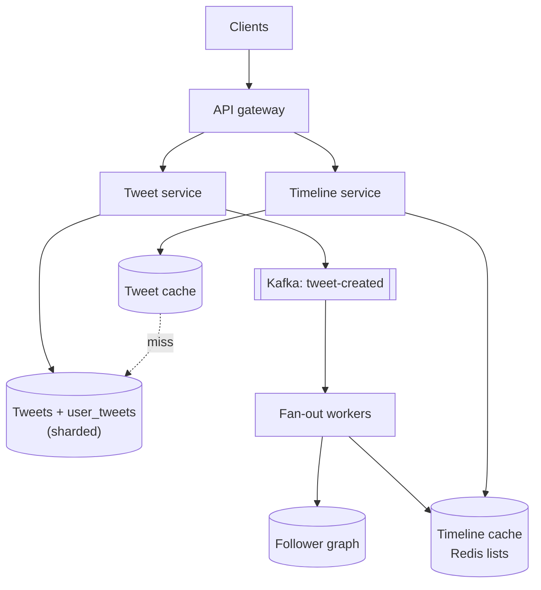
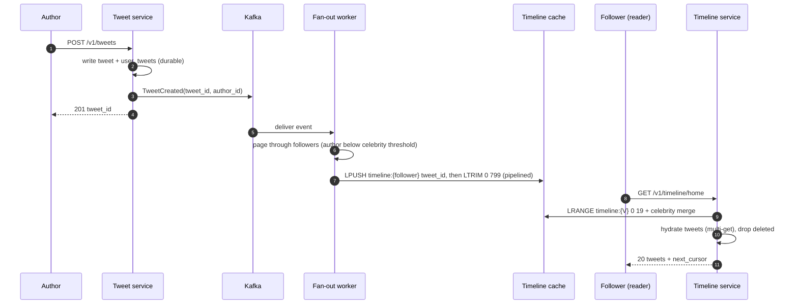
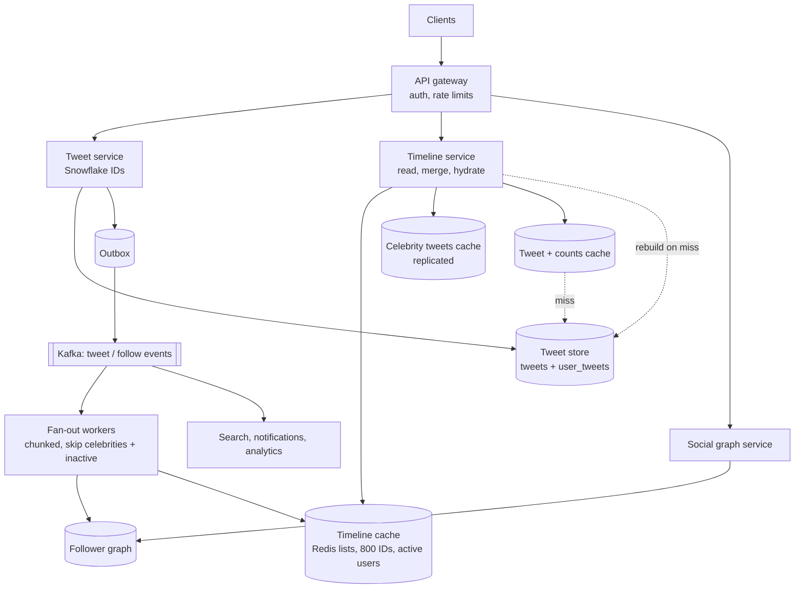

## Problem statement

Design the home timeline of a Twitter/X-style service: users post short tweets, follow other accounts, and open the app to see a reverse
chronological timeline of tweets from the accounts they follow. Some accounts have tens of millions of followers.

**Interview format:** 45–60 minutes · **Difficulty:** intermediate · **Main themes:** fan-out on write vs read, the celebrity problem,
timeline caching, sharding by user, asynchronous fan-out workers.

> [!TIP] Try it first
> Before scrolling, spend three minutes writing the questions you would ask the interviewer. Then compare with the list below — or
> practise this whole problem as a [timed mock interview](#system-design/hld/interview/twitter-feed).

## Clarifying questions

The answers below are the interviewer's. Questions that change the design come first.

- **Q:** What's in scope — posting, following, the home timeline, search? <!-- match: scope, features, posting, following, search, what do we build -->
  - **A:** Posting tweets, following accounts, the home timeline, and a user's own profile timeline. Search, trends, DMs and ads are out.
- **Q:** How many users and how active are they? <!-- match: users, dau, scale, how many, active -->
  - **A:** 200 million daily active users. Each opens the home timeline about 20 times a day.
- **Q:** How many tweets are posted? <!-- match: tweets per day, posts, writes, tweet volume, how many tweets -->
  - **A:** About 500 million tweets a day.
- **Q:** How many accounts does a user follow, and how many followers can an account have? <!-- match: followers, follow, celebrities, fan out, distribution -->
  - **A:** On average a tweet is delivered to about 200 followers, but the distribution is skewed: some accounts have over 50 million.
- **Q:** Is the timeline strictly chronological or ranked? <!-- match: ranking, ranked, order, chronological, algorithm -->
  - **A:** Reverse chronological for this interview. Ranking can be a follow-up.
- **Q:** How fresh must the timeline be? <!-- match: fresh, latency, delay, real time, how quickly -->
  - **A:** A new tweet should appear in followers' timelines within a few seconds; up to a minute for celebrity tweets is acceptable.
- **Q:** What latency for loading the timeline? <!-- match: load time, read latency, p99, fast -->
  - **A:** p99 under 200 ms for the first page.
- **Q:** Can tweets have media? <!-- match: media, images, video, photos -->
  - **A:** Yes, but media upload and storage are handled by a separate media service; tweets reference media by ID.
- **Q:** Can tweets be deleted, and must timelines reflect that? <!-- match: delete, deletion, edit, remove -->
  - **A:** Yes. A deleted tweet must stop appearing quickly, even if it was already delivered.

## Functional requirements

> [!TIP] Try it first
> Write three or four functional requirements before reading on.

- Users can **post tweets** (text up to 280 characters, optional media references). <!-- match: post, tweet, create -->
- Users can **follow and unfollow** accounts. <!-- match: follow, unfollow -->
- Users can **read their home timeline** (tweets from followed accounts, newest first, paginated). <!-- match: home timeline, timeline, feed, read -->
- Users can **view a profile timeline** (one account's tweets). <!-- match: profile, user timeline -->
- **Deleted tweets disappear** from timelines. <!-- match: delete, deleted -->

````hint title="Hint: what is expensive here?"
Posting a tweet is one write. What happens if every timeline load has to gather tweets from 200 accounts at read time?
````

## Non-functional requirements

- **Fast timeline reads**: p99 under 200 ms for the first page. <!-- match: latency, fast, 200 ms, p99 -->
- **Read-heavy at scale**: about 46,000 timeline reads/s on average. <!-- match: read heavy, reads, scale -->
- **High availability**: timelines readable even if fan-out falls behind. <!-- match: availability, available -->
- **Eventual consistency**: new tweets appear within seconds; brief gaps are acceptable. <!-- match: eventual, consistency, seconds -->
- **Durable tweets**: a posted tweet is never lost. <!-- match: durable, durability, never lost -->

````hint title="Hint: availability or consistency?"
Is it worse for a timeline to be a few seconds stale, or for it to fail to load?
````

## Scope and exclusions

In scope: posting, follow graph, home and profile timelines, fan-out, timeline caching, deletes, celebrity accounts.

Out of scope: search, trends, notifications, direct messages, ads, ranking models, media storage (separate service).

## Capacity estimation

> [!TIP] Try it first
> Estimate tweet writes per second, timeline reads per second, and how many timeline entries fan-out would write.

- **Tweets:** 500M/day ÷ 86,400 ≈ **5,790 tweets/s** average; ~2–3× at peaks and during big events.
- **Fan-out:** 5,790 × 200 followers ≈ **1.16M timeline inserts/s** if every tweet were pushed to every follower.
- **Timeline reads:** 200M × 20 = 4B/day ÷ 86,400 ≈ **46,300 reads/s** average.
- **Tweet storage:** ~300 bytes of text and metadata → 500M × 300 B = 150 GB/day ≈ **55 TB/year** before replication.
- **Timeline cache:** keep the newest 800 tweet IDs per active user: 200M × 800 × 8 bytes ≈ **1.28 TB** of IDs (plus overhead) —
  about 20 Redis nodes of ~100 GB usable each, before replicas.

```estimator title="Twitter home timeline (tweets and timeline reads)"
requestsPerDay = 4.5B
readsPerWrite = 8
writeBytes = 300 B
readBytes = 10 KB
retentionYears = 5
peakFactor = 3
replication = 3
cachePercent = 5
serverRps = 2000
targetUtilization = 60
```

The calculator treats tweets as writes and timeline loads as reads (4B reads + 0.5B writes ≈ 8:1); a first page of 20 hydrated tweets is
about 10 KB.

**What the numbers mean for the design:**

- **Reads outnumber writes 8:1**, and each read would otherwise merge 200 accounts' tweets — precomputing timelines pays off.
- **1.16M inserts/s** of fan-out is large but parallel, cheap work (append an 8-byte ID to a list).
- **One 50M-follower tweet** means 50M inserts at once — pushing that is the celebrity problem.

````hint title="Hint: write amplification"
How long would 50M timeline inserts take at, say, 1M inserts/s across the fleet? What else is queued behind them?
````

## API design

> [!TIP] Try it first
> Define posting, following and reading the home timeline. How does pagination work on a feed that keeps growing?

```text title="API"
POST   /v1/tweets                    { "text": "...", "media_ids": ["m-1"] }
  -> 201 { "tweet_id": "1823406971234567", "created_at": "..." }
DELETE /v1/tweets/{tweet_id}         -> 204

PUT    /v1/users/{id}/following/{target_id}     -> 204   (follow; idempotent)
DELETE /v1/users/{id}/following/{target_id}     -> 204   (unfollow)

GET    /v1/timeline/home?limit=20&cursor=<last_tweet_id>
  -> 200 { "tweets": [ { "id", "author", "text", "media", "created_at", "counts" } ],
           "next_cursor": "1823406970000000" }
GET    /v1/users/{id}/tweets?limit=20&cursor=...       (profile timeline)
```

- **Cursor = last tweet ID**: tweet IDs are time-ordered (Snowflake-style), so "older than this ID" is stable as new tweets arrive
  ([pagination](lesson:pagination)).

````hint title="Hint: why not offset pagination?"
New tweets arrive at the top while the user scrolls. What does page 2 by offset return after 5 new tweets arrived?
````

## Data model

> [!TIP] Try it first
> List the stores: tweets, the follow graph, and timelines. Which are sources of truth and which are derived?

```text title="Schema"
tweets          (tweet_id PK, author_id, text, media_ids, created_at, deleted)  sharded by tweet_id
user_tweets     (author_id, tweet_id DESC)       sharded by author_id   -> profile timeline
follows         (follower_id, followee_id, created_at)   sharded by follower_id  ("who do I follow")
followers       (followee_id, follower_id)               sharded by followee_id  ("who follows me")
users           (user_id PK, handle, follower_count, is_celebrity)

Timeline cache (Redis, sharded by user_id)
  timeline:{user_id} -> list of tweet_ids, newest first, capped at 800
Tweet cache (Redis/Memcached)
  tweet:{tweet_id}   -> serialised tweet
```

- **Tweet IDs are time-ordered 64-bit IDs** (timestamp + worker + sequence), so they sort by time without a separate index.
- **The follow graph is stored twice**: by follower (to build "who do I follow") and by followee (to fan out).
- **Timelines are derived** data: losing the cache loses no tweets; it can be rebuilt from `follows` and `user_tweets`.

````hint title="Hint: what does a timeline store?"
Storing whole tweets in every follower's timeline would copy each tweet 200 times. What's the smallest thing a timeline entry can hold?
````

## Initial high-level architecture

Build the design one requirement at a time.

### Step 1: post a tweet

The **tweet service** assigns a time-ordered ID, writes the tweet to the tweets store and the author's `user_tweets`, and publishes a
`TweetCreated` event to Kafka. It responds as soon as the tweet is durable.

### Step 2: fan out on write

**Fan-out workers** consume `TweetCreated`, page through the author's followers, and push the tweet ID onto each follower's timeline list in
Redis (`LPUSH` + `LTRIM` to 800), batching many followers per pipeline.

### Step 3: read the home timeline

The **timeline service** reads the user's list from Redis (one key, already sorted), takes the first page of IDs, **hydrates** them from the
tweet cache with a multi-get, filters deleted tweets, and returns them.

### Step 4: handle celebrities

Accounts above a follower threshold (say 100,000) are **not fanned out**. At read time, the timeline service merges the precomputed timeline
with the recent tweets of the celebrities the user follows (from `user_tweets`, heavily cached).

````hint title="Hint: where do the 200 accounts' tweets come from?"
At read time, the timeline is one Redis list. Who put the IDs there, and when?
````

## Architecture diagram



## Request and data flow



## Component responsibilities

| Component | Responsibility | Scales with |
|---|---|---|
| Tweet service | Validate, assign IDs, persist tweets, publish events | Tweets/s |
| Fan-out workers | Push tweet IDs to followers' timelines | Tweets × followers |
| Social graph service | Follows, followers, follower counts, celebrity flag | Follow edges |
| Timeline service | Read timeline lists, merge celebrity tweets, hydrate, filter | Timeline reads/s |
| Timeline cache (Redis) | Precomputed lists of tweet IDs per active user | Active users × 800 IDs |
| Tweet cache | Hydration of tweet bodies | Hot tweets |
| Tweet store | Durable tweets and per-author lists | Tweet volume |

## Database and technology choices

| Need | Choice | Why | Alternative |
|---|---|---|---|
| Tweets | Sharded wide-column / key-value (Cassandra, Manhattan-style) | Huge write volume, simple key access | Sharded MySQL/PostgreSQL |
| Follow graph | Sharded tables keyed both ways | Fast "followers of X" pages | Graph database (not needed for one hop) |
| Timelines | Redis lists, capped | O(1) push, fast range reads | Cassandra rows per user (slower, cheaper) |
| Event pipeline | Kafka, keyed by author | Durable, replayable, parallel fan-out | SQS (no replay) |
| IDs | Snowflake-style time-ordered IDs | Sortable, no coordination | UUIDs (not time-ordered) |

## Scaling strategy

### Fan-out on write, on read, or both?

- **Bad — fan-out on read for everyone:** each timeline load queries 200 followees' recent tweets and merges them. 46,300 reads/s × 200
  queries ≈ 9M queries/s, and p99 latency follows the slowest shard.
- **Good — fan-out on write for everyone:** reads become one list lookup, but a 50M-follower tweet creates 50M inserts and delays everyone
  else's fan-out behind it.
- **Great — hybrid:** push for ordinary accounts (the vast majority of edges), pull for celebrities. A reader follows maybe a dozen
  celebrities; fetching their recent tweets at read time is a few cached lookups. The threshold is tuned by measuring fan-out cost.

```mermaid title="Hybrid fan-out: push for most authors, pull for celebrities"
flowchart TB
  N["Tweet from an account<br/>with 300 followers"]:::client --> FO["Fan-out workers"]:::svc
  FO -->|"push ID to 300 lists"| TL[("Followers' timeline lists")]:::cache
  CEL["Tweet from an account<br/>with 50M followers"]:::client
  CEL -->|"stored once, no fan-out"| CC[("Celebrity tweets cache")]:::cache
  TL -->|"1. reader's own list"| TLS["Timeline service<br/>merge by tweet ID, hydrate, filter"]:::svc
  CC -->|"2. followed celebrities' tweets"| TLS
  TLS --> R["Reader's home timeline"]:::client
```

### How do the fan-out workers keep up?

Kafka partitions `tweet-created` by author; workers scale out per partition. A tweet with many followers is split into **chunks** (for
example 5,000 followers each) placed on an internal queue, so large fan-outs run in parallel and don't block small ones. Redis writes are
pipelined per shard. Lag is monitored; if fan-out falls behind, timelines are slightly stale but still load ([backpressure](lesson:backpressure)).

### Do we keep timelines for everyone?

No — only for **active users** (say, seen in the last 30 days). Fan-out skips inactive followers. When an inactive user returns, the
timeline service **rebuilds** their timeline on the fly by fan-out-on-read (merging followees' recent tweets), stores it, and fan-out
resumes. This cuts cache size and fan-out work substantially.

### How are the stores sharded?

Timelines by `user_id` (each read touches one shard); tweets by `tweet_id` (spread evenly); `user_tweets` and followers by author ID — so a
celebrity's followers list is one big partition, paged through by fan-out workers, and their `user_tweets` is a hot key served from cache
replicas ([hot keys](lesson:hot-keys)).

## Caching strategy

### Which caches serve a timeline read?

1. **Timeline cache:** per-user list of tweet IDs (the precomputed feed).
2. **Celebrity tweets cache:** each celebrity's newest tweets, replicated across many cache nodes because millions of readers merge them.
3. **Tweet cache:** tweet bodies by ID, with counts (likes, retweets) cached separately and refreshed more often.

A first-page read is one list range, a dozen celebrity lookups and one multi-get — all memory hits in the common case. See
[cache patterns](lesson:cache-patterns).

### What happens on a timeline cache miss?

The timeline is rebuilt from `follows` and `user_tweets` (fan-out on read), then written back. Rebuilds are rate-limited per shard and
coalesced per user so a cache node failure doesn't trigger a rebuild storm ([cache failure modes](lesson:cache-failure-modes)).

## Messaging strategy

### What travels through Kafka?

`TweetCreated`, `TweetDeleted`, `Followed` and `Unfollowed` events, keyed by author. Consumers: fan-out workers, search indexing,
notifications and analytics — each with its own consumer group, so adding a consumer doesn't touch the tweet service. The tweet service
writes the event with the tweet using an [outbox](lesson:outbox-cdc), so a tweet is never stored without its event.

### What happens when someone follows or unfollows?

Follow: optionally backfill the followee's recent tweets into the follower's timeline (a bounded merge). Unfollow: stop future fan-out and
filter the followee's tweets at read time until the timeline is trimmed or rebuilt — cheaper than deleting entries from a list.

## Failure scenarios

| Failure | Impact | Mitigation |
|---|---|---|
| Fan-out workers lag (big event) | New tweets appear late | Autoscale workers, chunked fan-out, priority for small accounts |
| Timeline cache node lost | Timelines missing for its users | Replicas; rebuild on read with rate limits |
| Tweet store shard slow | Hydration misses slow | Tweet cache, timeouts, partial pages |
| Celebrity tweets cache hot | One node overloaded | Replicate hot keys, client-side short-TTL cache |
| Deleted tweet already fanned out | Appears in timelines | Filter at hydration (tweet marked deleted); async cleanup |
| Kafka unavailable | Tweets can't be fanned out | Outbox keeps events; relay resumes when Kafka returns |

## Bottleneck analysis

- **Fan-out write amplification** — bounded by the celebrity threshold and skipping inactive users.
- **Redis memory** for timelines — capped lists of 8-byte IDs, active users only.
- **Hydration multi-gets** — tweet cache hit ratio is critical; popular tweets are read millions of times.
- **Celebrity read merge** — cache celebrity timelines widely; limit how many celebrities are merged per read.

## Consistency and availability trade-offs

- **Eventual consistency** for timelines: a tweet appears in followers' feeds after fan-out — seconds normally, longer in spikes.
- **Strong durability** for tweets themselves: the post is acknowledged only after the tweet is stored.
- **Availability over freshness**: a timeline read never waits for fan-out; it serves what's cached.
- **Read-your-own-tweets**: the timeline service merges the reader's own recent tweets so authors immediately see what they posted.

## Security considerations

- Authenticate all writes; rate-limit posting and following to stop spam and follow-bots.
- Enforce protected accounts and blocks at hydration time (a blocked user's tweets are filtered even if fanned out).
- Validate and sanitise tweet text; links go through a safe-link service.
- Deletion must propagate to caches and downstream consumers (search, analytics) for privacy.

## Monitoring and observability

- Fan-out lag (time from tweet to last follower insert), per-partition consumer lag.
- Timeline read latency p50/p99; cache hit ratios for timeline, tweet and celebrity caches.
- Rebuild rate (timeline misses); Redis memory per shard.
- Tweets/s and fan-out inserts/s; error rates per service.

## Final architecture

Open this after you have drawn your own.

````solution title="Final architecture"


**In one breath:** the tweet service stores each tweet with a time-ordered ID and emits an event through an outbox to Kafka; fan-out
workers push tweet IDs into capped Redis timeline lists for active followers, chunking big fan-outs, but skip celebrities, whose tweets are
merged at read time from a widely replicated cache; the timeline service reads one list, merges celebrity and own tweets, hydrates from the
tweet cache and filters deleted or blocked content; timelines are derived and rebuilt on a miss, so availability wins over freshness while
tweets themselves are durable.
````

## Alternative designs and trade-offs

| Alternative | Gains | Costs | When to choose it |
|---|---|---|---|
| Pure fan-out on read | No write amplification, simple writes | Slow, expensive reads | Few readers, or users follow few accounts |
| Pure fan-out on write | Simplest reads | Celebrity tweets overwhelm fan-out | No accounts with huge followings |
| Timelines in Cassandra instead of Redis | Cheaper per GB, durable | Higher read latency | Cost-sensitive, latency budget allows |
| Store full tweets in timelines | No hydration step | Huge duplication, edits/deletes hard | Very small tweets and few deletes |
| Ranked feed (ML) | Better engagement | Candidate generation + ranking service, harder to reason about | When ranking is a requirement |

## Interviewer follow-up questions

````question title="How would you add a ranked timeline?"
Treat the precomputed timeline plus celebrity tweets as candidate generation, then add a ranking service that scores a few hundred candidates
with features (author affinity, engagement, recency) and returns the top page. Cache the ranked page briefly per user. Keep the chronological
timeline as a fallback when ranking is slow, so the feed always loads.
````

````question title="A celebrity with 50M followers tweets. Walk through what happens."
The tweet service stores it and emits the event. Fan-out workers see the author is above the threshold and skip pushing. The tweet lands in
the celebrity tweets cache (replicated). When any follower loads their timeline, the timeline service merges that cache with their
precomputed list. Nothing writes 50M rows; the cost moves to reads, which are cached memory lookups.
````

````question title="How do you handle a user who follows 5,000 accounts, many of them celebrities?"
Cap how many celebrity timelines are merged per read (for example the most-engaged 50) and fetch them in parallel from cache; or, for such
users, push celebrity tweets as well, since this user is one of few. Alternatively, raise the celebrity threshold for this reader's merge set.
The design should measure merge cost per read and keep it bounded.
````

````question title="How are deleted tweets removed from timelines that already contain their IDs?"
Mark the tweet deleted in the tweet store and invalidate the tweet cache; hydration drops IDs whose tweet is deleted, so it disappears on the
next load even though the ID is still in lists. An asynchronous job can remove the IDs later, but correctness doesn't depend on it. Emit a
TweetDeleted event so search and other consumers remove it too.
````

````question title="What happens if the timeline cache is lost entirely?"
Timelines are derived, so no data is lost, but every read misses. Rebuild on read with strict rate limits, serve a degraded timeline (for
example own tweets plus celebrity tweets) while rebuilding, and prioritise the most active users. Replicas and multi-zone clusters make this
rare; the point is that it is recoverable without touching the source of truth.
````

## Common mistakes

- **Fan-out on read for everyone**, making every timeline load a 200-way scatter-gather.
- **Fan-out on write for everyone**, ignoring the celebrity problem.
- **Copying full tweets** into every timeline instead of IDs.
- **Offset pagination** on a feed that grows at the top.
- **Treating timelines as the source of truth** instead of derived, rebuildable data.
- **Forgetting deletes and blocks**, which must be enforced at read time.

## Evaluation checklist

```checklist title="Evaluation checklist"
- Asked about scale, follower distribution, freshness and ordering
- Estimated tweet writes, timeline reads and fan-out inserts per second
- Compared fan-out on write and on read, and chose a hybrid with a celebrity threshold
- Stored tweet IDs in capped per-user timeline lists, hydrating from a tweet cache
- Used time-ordered IDs and cursor pagination
- Made fan-out asynchronous through a durable log, chunked for large accounts
- Kept timelines only for active users and rebuilt them on a miss
- Sharded timelines by user and tweets by ID; handled hot celebrity keys
- Handled deletes, blocks and unfollows at read time
- Explained eventual consistency for timelines and durability for tweets
```
