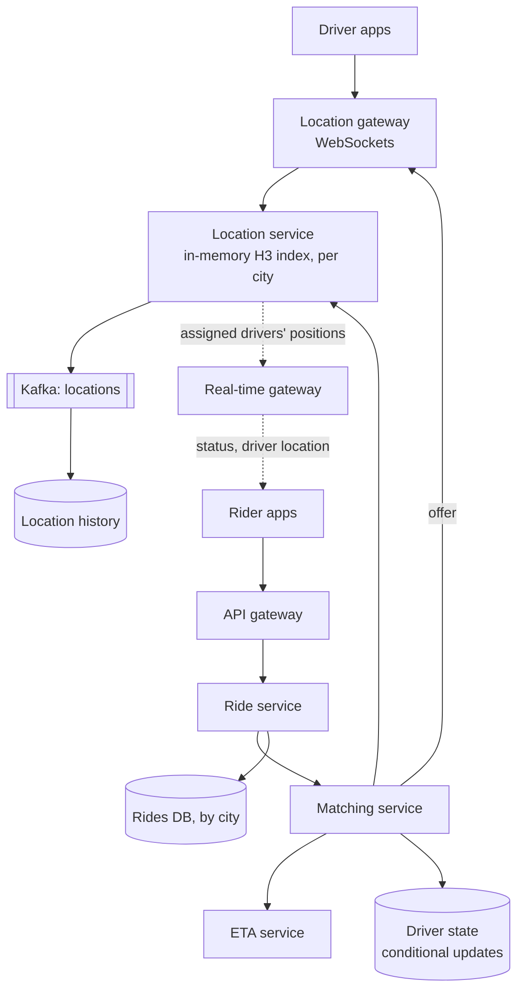
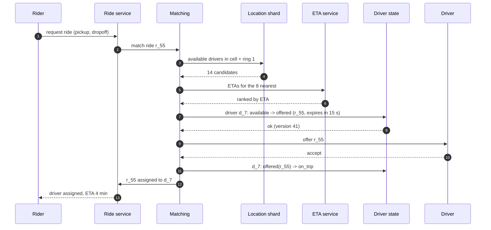
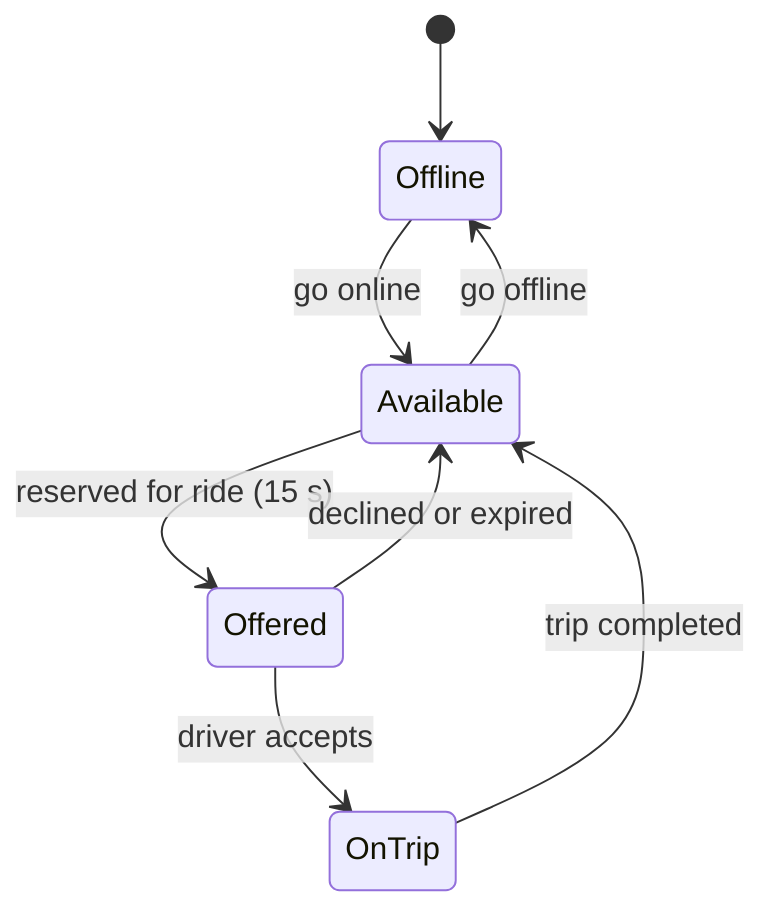
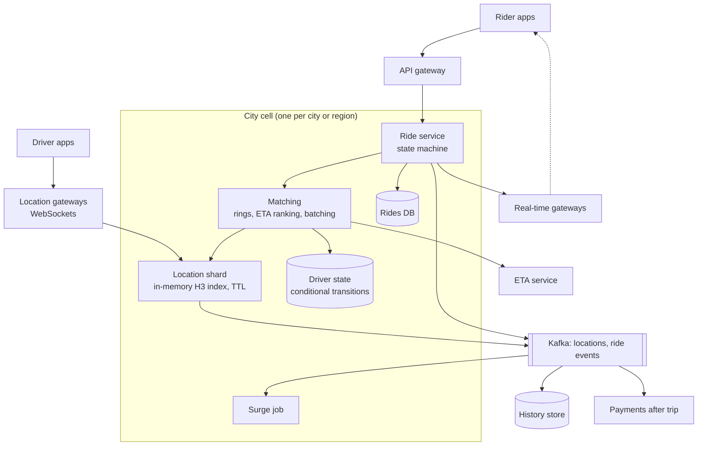

## Problem statement

Design a ride-sharing service like Uber or Lyft: riders request a ride from their location, the system finds a nearby available driver
and offers them the trip, the rider watches the driver approach on a map, and the trip is tracked until drop-off. A million drivers send their
location every few seconds, and a driver must never be dispatched to two riders at once.

**Interview format:** 45–60 minutes · **Difficulty:** advanced · **Main themes:** high-rate location ingestion, in-memory geospatial
indexing, matching with atomic driver reservation, a trip state machine, real-time tracking, geographic sharding.

> [!TIP] Try it first
> Before scrolling, spend three minutes writing the questions you would ask the interviewer. Then compare with the list below — or
> practise this whole problem as a [timed mock interview](#system-design/hld/interview/uber).

## Clarifying questions

The answers below are the interviewer's. Questions that change the design come first.

- **Q:** Which features are in scope? <!-- match: features, scope, what do we build, functionality, in scope -->
  - **A:** Requesting a ride, matching with a driver, live tracking, and completing the trip with a fare. Payments run after the trip
    through a separate service; pooled rides and scheduled rides are out of scope.
- **Q:** How many drivers and rides? <!-- match: scale, how many, drivers, rides, users, traffic, volume -->
  - **A:** About 1 million drivers online at peak and 10 million rides a day, in hundreds of cities.
- **Q:** How often do drivers send locations? <!-- match: location updates, how often, frequency, gps, ping -->
  - **A:** Every 4 seconds while online.
- **Q:** How fast must matching be? <!-- match: latency, how fast, match time, matching speed, wait -->
  - **A:** A rider should see an assigned driver within about 10 seconds in normal conditions.
- **Q:** How should a driver be chosen? <!-- match: choose, ranking, nearest, best driver, eta, criteria -->
  - **A:** Mostly by shortest estimated time to pickup; an ETA service on the road network exists. Driver ratings and fairness matter a
    little.
- **Q:** Can a driver get two requests at once? <!-- match: double dispatch, two requests, same driver, consistency, conflict -->
  - **A:** No — each offer goes to one driver at a time, and a driver can be on at most one trip.
- **Q:** How fresh must the driver's position be on the rider's map? <!-- match: tracking, fresh, map, live, real time, position -->
  - **A:** Within a few seconds.
- **Q:** What about surge pricing? <!-- match: surge, pricing, demand, supply, price -->
  - **A:** Mention it, but the core design is matching and tracking.

## Functional requirements

> [!TIP] Try it first
> Write three or four functional requirements before reading on.

- Drivers **report their location** and availability continuously. <!-- match: location, report, availability -->
- Riders **request a ride** and are **matched** to a nearby driver who accepts. <!-- match: request, match, matched -->
- Riders and drivers see **live tracking** during pickup and the trip. <!-- match: tracking, live -->
- Trips progress through a **lifecycle** to completion and fare calculation. <!-- match: lifecycle, trip, completion, fare -->

````hint title="Hint: two very different data flows"
One flow writes 250,000 location updates a second; another makes a few hundred careful matching decisions a second. Should they share a
database?
````

## Non-functional requirements

- **High write throughput** for locations: ~250,000 updates/s. <!-- match: throughput, location updates, write heavy -->
- **Fast matching**: driver assigned within ~10 s. <!-- match: fast, matching, 10 s, latency -->
- **No double dispatch**: strong consistency on driver and trip state. <!-- match: double dispatch, consistency, strong -->
- **High availability**, isolated per city or region. <!-- match: availability, isolated, region -->
- **Low-latency tracking** (a few seconds). <!-- match: tracking, low latency -->

````hint title="Hint: durability of locations"
If the system loses the last 10 seconds of driver positions, what breaks? Compare that with losing a trip record.
````

## Scope and exclusions

In scope: location ingestion and indexing, matching and dispatch, trip state, real-time tracking, geographic sharding, surge at a high
level.

Out of scope: payments (an asynchronous service after the trip), ETA/routing internals (assume a service), pooled rides, driver onboarding,
fraud.

## Capacity estimation

> [!TIP] Try it first
> Estimate location updates per second, ride requests per second, concurrent trips, and tracking messages.

- **Location updates:** 1M drivers ÷ 4 s = **250,000 updates/s**.
- **Live location state:** 1M × ~100 bytes ≈ **100 MB** — fits in memory many times over; throughput, not size, is the constraint.
- **Ride requests:** 10M/day ≈ **116/s** average, ~350/s at peak — each triggers a geo query, a few ETA calls and an offer.
- **Concurrent trips:** 116/s × ~20 minutes ≈ **140,000 trips** in progress on average.
- **Tracking:** each active trip pushes the driver's position every 4 s → ~35,000 messages/s to riders.
- **Location history:** 250,000/s × 100 B ≈ **2 TB/day**, written to cheap storage asynchronously.

```estimator title="Ride-sharing (location updates and requests)"
requestsPerDay = 21.6B
readsPerWrite = 0.002
writeBytes = 100 B
readBytes = 2 KB
retentionYears = 0.25
peakFactor = 2
replication = 2
cachePercent = 0
serverRps = 20000
targetUtilization = 60
```

Writes are location updates (kept as history for about 90 days); reads are a small number of ride-related queries. The location fleet
handles tens of thousands of in-memory updates per server per second.

**What the numbers mean for the design:**

- **Locations are write-heavy and ephemeral** → in-memory, sharded by geography, with history streamed elsewhere.
- **Matching is low-volume but must be correct** → strongly consistent driver and trip state.
- **Tracking is a real-time fan-out** of modest size → a WebSocket gateway tier.

````hint title="Hint: why not PostGIS?"
What would 250,000 updates per second do to a disk-based spatial index with write-ahead logging and index maintenance?
````

## API design

> [!TIP] Try it first
> Define the driver location stream, the ride request, and the driver's offer response.

```text title="API"
Driver app (WebSocket)
  -> { "type": "location", "lat": 12.9718, "lng": 77.5941, "heading": 90, "speed": 8.2,
       "ts": 1730971234 }
  -> { "type": "status", "status": "available" | "offline" }
  <- { "type": "offer", "ride_id": "r_55", "pickup": {...}, "expires_in": 15 }
  -> { "type": "offer_response", "ride_id": "r_55", "accept": true }

Rider app (HTTPS + WebSocket)
  POST /v1/rides  Idempotency-Key: ...  { "pickup": {...}, "dropoff": {...}, "product": "standard" }
    -> 202 { "ride_id": "r_55", "status": "matching" }
  <- { "type": "ride_update", "status": "driver_assigned", "driver": {...}, "eta_s": 240 }
  <- { "type": "driver_location", "lat": ..., "lng": ..., "seq": 812 }
  POST /v1/rides/{id}/cancel
```

- Locations flow over a **persistent connection** (cheap per message); ride requests use **idempotency keys**.
- Offers carry an **expiry**, after which the next driver is tried.

````hint title="Hint: offer timeout"
A driver ignores an offer. How long do you wait, and what state must the driver and the ride be in while you wait?
````

## Data model

> [!TIP] Try it first
> Which data is in memory, which is strongly consistent, and which is historical?

```text title="Schema"
In memory, per city shard (location service)
  cell (H3 res 8) -> set of driver_ids          driver_id -> { lat, lng, heading, ts, cell }
  entries expire if no update for 20 s

Strongly consistent (per city, e.g. Redis with replication or a sharded SQL store)
  driver_state (driver_id PK, status: offline | available | offered | on_trip,
                offer_ride_id, offer_expires_at, current_ride_id, version)

Trips (sharded relational / NewSQL, by city)
  rides (ride_id PK, rider_id, driver_id, city, status, pickup, dropoff, requested_at,
         matched_at, started_at, completed_at, fare, version)

History (Kafka -> Cassandra / object storage): driver_id, ts, lat, lng, ride_id
```

- **Live positions** are disposable: rebuilt from the next updates within seconds.
- **Driver status** is the scarce resource: transitions are conditional updates ([contention](lesson:contention)).

````hint title="Hint: the source of truth for 'available'"
The location index says a driver is nearby. Is that enough to offer them a ride?
````

## Initial high-level architecture

Build the design one requirement at a time.

### Step 1: ingest locations

Driver apps keep a WebSocket to a **location gateway**, which forwards updates to the **location service** shard for the driver's city. The
shard updates an in-memory index keyed by H3 cell and publishes the update to a Kafka stream for history and analytics
([proximity services](lesson:proximity-services), [geospatial indexes](lesson:geospatial-indexes)).

### Step 2: match

The **ride service** creates a ride (`matching`). The **matching service** queries the location shard for available drivers in the pickup cell
and expanding rings, asks the **ETA service** for road travel times to the best candidates, ranks them, and **atomically reserves** the best
driver (`available → offered` with an expiry) before sending the offer.

### Step 3: dispatch

If the driver accepts, the ride and driver move to `assigned`/`on_trip` in one coordinated step; if they decline or the offer expires, the
driver returns to `available` and the next candidate is tried.

### Step 4: track

Both apps subscribe to the ride's channel on the **real-time gateway**; the location service publishes the assigned driver's updates to it
([real-time at scale](lesson:realtime-at-scale)).

````hint title="Hint: shard by what?"
A ride in Bengaluru never needs drivers in Berlin. What is the natural shard key for locations, matching and trips?
````

## Architecture diagram



## Request and data flow



## Component responsibilities

| Component | Responsibility | Scales with |
|---|---|---|
| Location gateway | Driver WebSockets, auth, forwarding, offers | Online drivers |
| Location service | In-memory geo index per city, TTLs, publishing | Location updates/s |
| Matching service | Candidate search, ETA ranking, atomic reservation, offers | Ride requests/s |
| Driver state store | Status transitions with conditions | Status changes/s |
| Ride service | Ride lifecycle, idempotency, fares | Rides |
| Real-time gateway | Push ride updates and driver positions | Active trips |
| History pipeline | Store locations for trips, analytics, disputes | Bytes/day |

## Database and technology choices

| Need | Choice | Why | Alternative |
|---|---|---|---|
| Live positions | In-memory grid (H3 cells) or Redis GEO, per city | 250K updates/s, millisecond queries | PostGIS (too write-heavy) |
| Driver state | Redis with Lua/conditional ops, or a strongly consistent SQL shard per city | Atomic status transitions | Distributed lock service |
| Rides | Sharded PostgreSQL / NewSQL by city | Transactions, lifecycle queries | DynamoDB with conditional writes |
| Location stream | Kafka | High-volume, replayable | Kinesis |
| History | Cassandra or object storage | Cheap, write-heavy | Time-series DB |
| Tracking | WebSocket gateways + pub/sub per ride | Low latency | Polling |

## Scaling strategy

### How are 250,000 location updates per second absorbed?

Location shards per city (or per region of a large city) hold positions in memory: each update overwrites the driver's record and moves it
between H3 cells only when it crosses a boundary; entries expire after ~20 s without updates. The gateway routes each update to its city's
shard; very large cities are split by cell ranges. Updates are also published to Kafka for history, so the in-memory state is never the only
copy that matters ([write-heavy systems](lesson:write-heavy)).

### How is a driver never dispatched twice?

The location index is only a candidate source; the **driver state store** is the authority. Reserving a driver is a conditional transition
`available → offered(ride, expires_at)` that succeeds for exactly one ride; accepting is `offered(ride) → on_trip(ride)`; expiry returns
`offered → available`. Two matching requests racing for the same driver can't both succeed. The ride has its own conditional transitions
(`matching → assigned` once), so a ride can't get two drivers either.



### How is matching quality kept high?

Candidates come from the pickup cell and expanding rings until there are enough (H3 k-rings); straight-line distance shortlists, **road ETAs**
rank. In busy areas, matching can batch requests for a second or two and solve a small assignment problem (minimising total pickup time)
instead of greedily giving each rider the nearest driver.

### How does sharding by geography work?

Locations, matching and active trips for a city live in that city's shard — a natural cell for isolation: an outage in one city doesn't
affect others ([fault isolation](lesson:fault-isolation)). Rides near city boundaries query neighbouring shards for edge cells. Global
services (accounts, payments) are separate.

### How is surge pricing computed?

A stream job counts open requests (demand) and available drivers (supply) per H3 cell over short windows and computes a multiplier per cell,
smoothed over neighbouring cells and time to avoid flicker. The ride service reads the current multiplier when quoting a fare.

## Caching strategy

### What is cached?

The live location index is effectively an in-memory cache rebuilt from the update stream. Rider and driver profiles (name, photo, vehicle)
are cached for the trip screens. ETA results for (cell, cell) pairs are cached for a minute or two, since many requests share them. Surge
multipliers are cached per cell and refreshed every few seconds ([cache patterns](lesson:cache-patterns)).

## Messaging strategy

### What flows through queues and streams?

Driver locations go to Kafka for history and analytics. Ride lifecycle events (`RideRequested`, `DriverAssigned`, `TripStarted`,
`TripCompleted`) are published through an outbox to drive notifications, payments after completion, receipts and analytics
([outbox and CDC](lesson:outbox-cdc)). Payments are a separate workflow triggered by `TripCompleted`, so a payment-provider issue never
blocks matching ([multi-step workflows](lesson:multi-step-workflows)).

## Failure scenarios

| Failure | Impact | Mitigation |
|---|---|---|
| Location shard restarts | City's live positions missing briefly | Rebuild from next updates (seconds) or Kafka replay |
| Driver loses connectivity | Stale position, missed offers | TTL removes them from candidates; offers expire |
| Matching crashes after reserving a driver | Driver stuck in `offered` | Offer expiry returns them to `available` |
| Two requests race for one driver | Double dispatch | Conditional state transition; only one wins |
| City-wide surge of requests | Slow matching | Batch matching, surge pricing, queueing with ETAs shown |
| Real-time gateway fails | Tracking pauses | Clients reconnect; fetch current ride state |

## Bottleneck analysis

- **Location ingestion** per big city — split shards by cell ranges.
- **ETA calls** per match — shortlist first, cache cell-to-cell ETAs.
- **Driver state contention** in dense areas at peak — conditional updates are short; batch matching reduces races.
- **Connection counts** on gateways — scale horizontally; drivers ~1M, riders in trips ~hundreds of thousands.

## Consistency and availability trade-offs

- **Strong consistency** for driver status and ride assignment (no double dispatch).
- **Eventual, lossy freshness** for positions: a few seconds stale is fine; missing updates self-heal.
- **Availability per city**: cells isolate failures; a city's matching can degrade (longer waits) without global impact.
- **Durable trips**: ride records and lifecycle events are persisted transactionally; positions are history, not truth.

## Security considerations

- Authenticate drivers and riders; bind WebSocket sessions to identities.
- Detect GPS spoofing (impossible speeds, mismatched cell data) and fraudulent trips.
- Share precise locations only between matched parties and only during the trip; mask phone numbers with relay numbers.
- Rate-limit ride requests and cancellations to prevent abuse.

## Monitoring and observability

- Location update rate and lag per city shard; stale-driver counts.
- Time to match (p50/p99), offer acceptance rate, offers per ride.
- ETA accuracy (predicted vs actual pickup time).
- Active trips, tracking message delivery latency, gateway connections.
- Surge multipliers per area and supply/demand ratios.

## Final architecture

Open this after you have drawn your own.

````solution title="Final architecture"


**In one breath:** drivers stream locations over WebSockets to per-city location shards that keep an in-memory H3 index with TTLs and publish
updates to Kafka for history; a rider's request creates a ride that the city's matching service fills by searching cells and expanding rings,
ranking by road ETA, and atomically reserving a driver (available → offered with expiry) before offering the trip; acceptance moves driver
and ride to on-trip together; real-time gateways push status and the driver's position to the rider; ride events flow through Kafka to
payments, surge computation and history, and each city runs as an isolated cell.
````

## Alternative designs and trade-offs

| Alternative | Gains | Costs | When to choose it |
|---|---|---|---|
| PostGIS for live positions | Simple, durable | Write amplification at 250K/s | Small fleets |
| Broadcast requests to many drivers, first to accept wins | Faster acceptance | Poor experience for drivers, needs atomic claim anyway | Some delivery apps |
| Greedy nearest-driver matching | Simple, fast | Worse overall pickup times in dense areas | Low-density markets |
| Global single cluster | Simpler operations | Large blast radius, cross-region latency | Early-stage |
| Polling for tracking | No WebSocket tier | More load, laggier maps | Very small scale |

## Interviewer follow-up questions

````question title="Two riders request at the same moment and the same driver is the best match for both. What happens?"
Both matching attempts try the conditional transition of that driver from available to offered. Only one succeeds; the other sees the
condition fail and moves on to its next-ranked candidate immediately. Because the reservation is atomic and carries an expiry, the losing
request never sends an offer to that driver, and the winning offer can't be duplicated.
````

````question title="The driver doesn't respond to the offer. What happens?"
The offer has a 15-second expiry stored with the driver's offered state. When it passes, a timer (or the next state check) returns the driver
to available — or temporarily unavailable if they've ignored several offers — and matching offers the ride to the next candidate. The rider
just sees "finding a driver" a little longer.
````

````question title="Why not store locations in a relational database with a spatial index?"
Location updates arrive at around 250,000 per second, overwrite the previous value, and are useless after a few seconds. A disk-based spatial
index would pay write-ahead logging, index maintenance and replication for every update — expensive work for data that's disposable. An
in-memory index sharded by city handles the rate easily, and a separate stream keeps history for trips and analytics.
````

````question title="How would you add pooled rides (several riders sharing a car)?"
Matching becomes a routing problem: a driver on a trip can accept another rider if the detour stays within limits for everyone. Candidates
include drivers with spare seats on compatible routes, and the matching service evaluates insertion of the new pickup and drop-off into each
driver's planned route with the ETA service. The driver state gains seat counts and a planned route, still updated with conditional
transitions so seats aren't double-booked.
````

````question title="How would you handle a city where matching is overloaded during a big event?"
Increase supply and smooth demand: surge pricing in the affected cells, batch matching to use drivers efficiently, and designated pickup zones
to reduce search areas. Protect the system with per-city admission control on ride requests and show riders queue positions or estimated
waits instead of timing out. Because each city is its own cell, the overload stays local.
````

## Common mistakes

- **Storing every location update in the main database.**
- **Using the location index as the authority** for driver availability.
- **Offering one ride to several drivers** without an atomic claim.
- **Ranking by straight-line distance** only.
- **One global cluster** instead of geographic shards and cells.
- **Blocking matching on payments** or other slow services.

## Evaluation checklist

```checklist title="Evaluation checklist"
- Asked about scale, update frequency, matching latency, selection criteria and double dispatch
- Estimated location updates/s, concurrent trips and tracking fan-out
- Kept live locations in an in-memory geo index sharded by city with TTLs
- Streamed locations to Kafka for history instead of the main database
- Matched with cell rings, shortlisted by distance and ranked by road ETA
- Reserved drivers with atomic, expiring state transitions
- Modelled ride and driver state machines
- Pushed status and positions through a WebSocket gateway tier
- Isolated cities as cells and handled boundaries
- Discussed surge pricing and payments as asynchronous concerns
```
