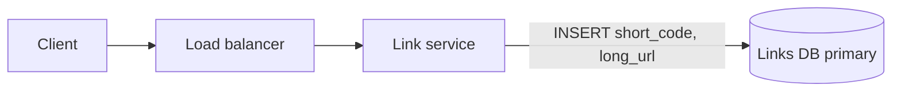
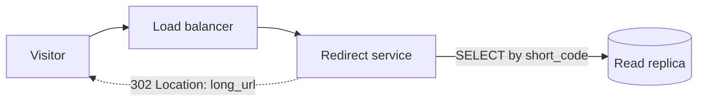
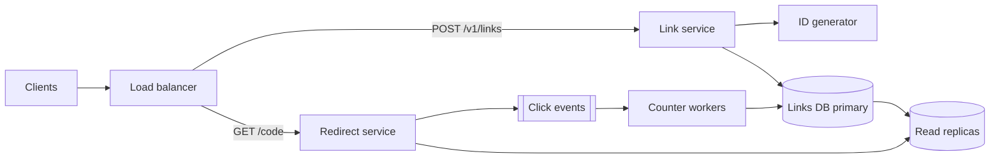
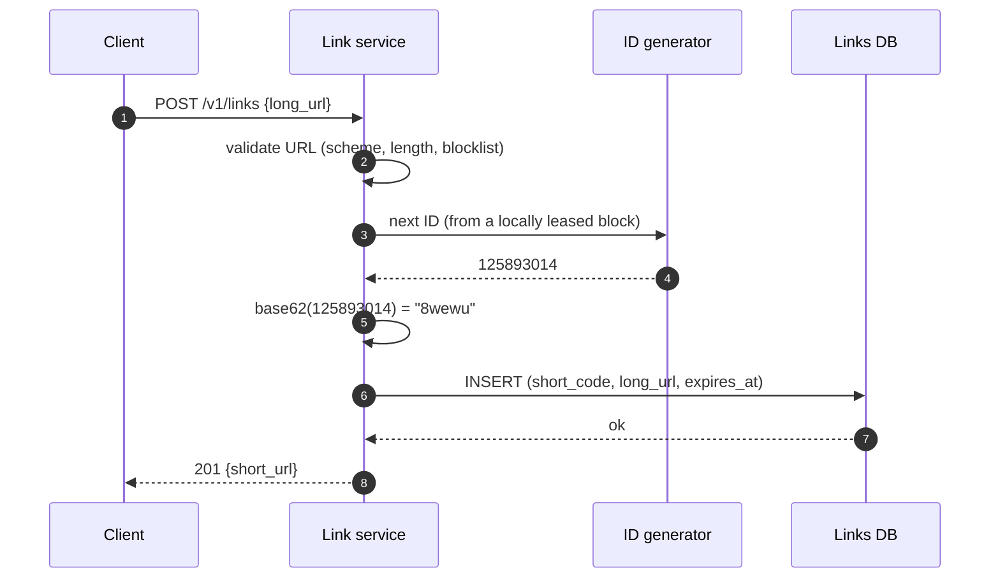
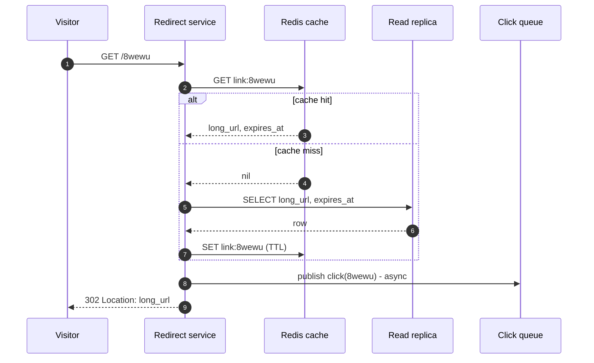
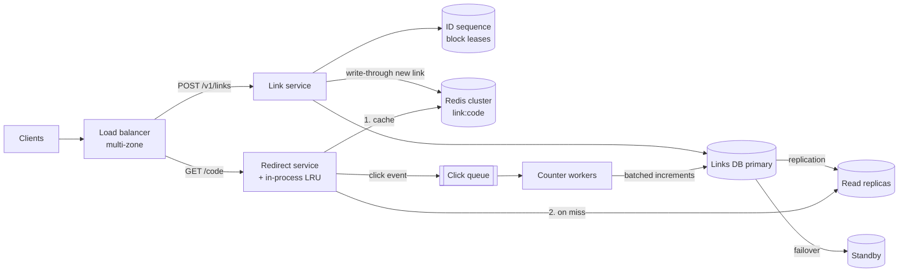

## Problem statement

Design a URL-shortening service like Bitly or TinyURL. A user submits a long URL and receives a short link such as
`https://sho.rt/aZ3kQ9x`; anyone who opens the short link is redirected to the original URL.

**Interview format:** 45 minutes · **Difficulty:** beginner · **Main themes:** a read-heavy workload, unique ID generation, caching.

> [!TIP] Try it first
> Before scrolling, spend three minutes writing the questions you would ask the interviewer. Then compare with the list below — or
> practise this whole problem as a [timed mock interview](#system-design/hld/interview/url-shortener).

## Clarifying questions

The answers below are the interviewer's. Questions that change the design come first.

- **Q:** How many new short links are created, and how many redirects happen? <!-- match: scale, traffic, volume, users, links, redirects, how many, writes -->
  - **A:** About 100 million new links a month and about 10 billion redirects a month. Expect viral links: peaks of around five times average.
- **Q:** Can users choose their own short code (a custom alias)? <!-- match: custom, alias, vanity, choose, pick, own name -->
  - **A:** Yes, optionally. A custom alias must be unique; if it's taken, the request fails.
- **Q:** Do links expire? <!-- match: expire, expiry, expiration, ttl, delete, lifetime, retention -->
  - **A:** Optionally — a creator can set an expiry time. Links without one live indefinitely; plan storage for five years.
- **Q:** Do we need analytics on clicks? <!-- match: analytics, stats, clicks, count, tracking, metrics -->
  - **A:** Just a total click count per link, which may lag by a minute or so. Detailed analytics (country, referrer, time series) are out of scope.
- **Q:** Do users need accounts? <!-- match: account, login, auth, users, anonymous, sign -->
  - **A:** No. Anyone can create links anonymously; assume API keys exist for heavy users and are handled elsewhere.
- **Q:** How short should the codes be, and which characters? <!-- match: short, length, characters, chars, code, format, alphabet -->
  - **A:** As short as practical, URL-safe characters only. Around seven characters is fine.
- **Q:** How fast must a redirect be, and how available? <!-- match: latency, fast, slow, availability, uptime, sla, p99 -->
  - **A:** Redirects should feel instant — well under 100 ms end to end — and must be highly available. Creating links can be a little less available.
- **Q:** If the same long URL is shortened twice, should it get the same code? <!-- match: same, duplicate, twice, again, dedup -->
  - **A:** No requirement either way. Different creators may want separate links, so a new code each time is fine.
- **Q:** Can a link's destination be edited after creation? <!-- match: edit, update, change, modify, destination -->
  - **A:** No. Links are immutable once created (they can expire).

## Functional requirements

> [!TIP] Try it first
> Write three functional requirements from the answers above before reading on.

- Users can **create a short link** for a long URL, optionally with a **custom alias** and an **expiry** time.
- Opening a short link **redirects** the visitor to the original URL.
- Users can see the **click count** of a link (lower priority; may lag). <!-- match: click count, clicks, stats -->

````hint title="Hint: what are the core user actions?"
There are really only two user-facing actions — create and follow a link — plus one read of derived data (the count). Everything
else from the clarifying questions (alias, expiry) is an option on create.
````

## Non-functional requirements

- **Low latency** redirects: under 20 ms at p99 inside our system, so the end-to-end redirect stays well under 100 ms. <!-- match: latency, fast, p99 -->
- **High availability** for redirects (99.99%); link creation can be 99.9%. <!-- match: availability, available, uptime -->
- **Uniqueness**: a short code maps to exactly one long URL and is never reused while that link exists. <!-- match: unique, uniqueness, collision -->
- **Scale**: about 100M new links and 10B redirects a month, with peaks around 5× average. <!-- match: scale, traffic, requests, redirects, per month, rps -->
- **Durability**: once a link is returned to the user, it is never lost. <!-- match: durable, durability, lost, never lose -->
- Click counts are **eventually consistent**: they may lag by about a minute. <!-- match: eventual, eventually, lag -->

````hint title="Hint: which operation needs the strongest guarantee?"
Creating a link needs a strong uniqueness guarantee (especially for custom aliases). Redirects need speed and availability more than
anything else. Click counts can lag. Say this split out loud — it shapes every later decision.
````

## Scope and exclusions

In scope: creating links (with optional alias and expiry), redirects, a total click count.

Out of scope, stated up front: user accounts and dashboards, detailed analytics, editing links, malware and phishing detection beyond a
simple blocklist, QR codes, and active-active multi-region deployment.

## Capacity estimation

> [!TIP] Try it first
> From the scale answers, estimate requests per second (average and peak), storage over five years, and how much of it is reads.

Rounded so you can do it out loud:

- **Writes:** 100M links/month ÷ 30 ≈ 3.3M/day ÷ ~86,400 s ≈ **40 writes/s**.
- **Reads:** 10B redirects/month ÷ 30 ≈ 333M/day ≈ **3,900 redirects/s** on average, **~20,000/s** at a 5× peak.
- **Read:write ratio:** 100:1 — this is a read-heavy system.
- **Storage per link:** a 7-character code, a long URL (say ~100–200 bytes on average), timestamps and index overhead — call it **500 bytes**.
- **Storage:** 3.3M/day × 500 B ≈ 1.7 GB/day ≈ 600 GB/year ≈ **3 TB over five years**, about **9 TB** with three copies.
- **Key space:** 5 years × 1.2B links/year = 6B links. Base-62 codes (`a–z`, `A–Z`, `0–9`): 62⁶ ≈ 57 billion, 62⁷ ≈ 3.5 trillion. **Seven
  characters** leaves plenty of headroom even if growth is much faster than planned.

Try changing the assumptions:

```estimator title="URL shortener"
requestsPerDay = 337M
readsPerWrite = 100
writeBytes = 500 B
readBytes = 500 B
retentionYears = 5
peakFactor = 5
replication = 3
cachePercent = 20
serverRps = 5000
targetUtilization = 70
```

**What the numbers mean for the design:**

- 40 writes/s is tiny: **one database primary handles writes easily**; ID generation doesn't need to be exotic.
- 20,000 reads/s at peak, each a lookup by key, is the real load: **a cache should absorb most redirects**, with read replicas behind it.
- 3 TB over five years fits one large database (or a modest managed key-value table); sharding is a *later* concern, not a day-one one.
- The working set is skewed — a small fraction of links gets most clicks — so a cache of tens of GB is an upper bound; far less will
  give a high hit ratio.

````hint title="Hint: per-day to per-second"
Divide a daily number by about 100,000 (86,400 rounded up) to get a per-second rate you can say out loud: 333M/day → ~3,300/s
(the exact figure is ~3,900/s). Then multiply by the peak factor.
````

## API design

> [!TIP] Try it first
> One endpoint per functional requirement. What does each take and return, and which status codes matter?

```text title="API"
POST /v1/links
  Headers: Authorization: Bearer <api key>   (optional; anonymous allowed, rate-limited by IP)
           Idempotency-Key: <uuid>             (optional; safe retries)
  Body:    { "long_url": "https://example.com/some/very/long/path?x=1",
             "custom_alias": "spring-sale",     (optional)
             "expires_at": "2027-01-01T00:00:00Z" }  (optional)
  201 Created  { "short_code": "aZ3kQ9x", "short_url": "https://sho.rt/aZ3kQ9x",
                 "long_url": "...", "expires_at": "..." }
  400 Bad Request   invalid or disallowed URL (only http/https)
  409 Conflict      custom alias already taken
  429 Too Many Requests

GET /{short_code}
  302 Found   Location: <long_url>
  404 Not Found      unknown code
  410 Gone           expired link

GET /v1/links/{short_code}/stats
  200 OK  { "short_code": "aZ3kQ9x", "clicks": 18234, "created_at": "...", "as_of": "..." }
```

Two decisions worth saying out loud:

- **302 vs 301.** A `301 Moved Permanently` lets browsers cache the redirect, so repeat clicks never reach us — less load, but we lose
  those clicks from the count and can't honour expiry for browsers that cached it. A `302 Found` (or `307`) sends every click through
  us. With click counts and expiry in the requirements, **302** is the right default.
- **Idempotency on create.** Because `POST` isn't naturally idempotent, a client retrying after a timeout could create two links; an
  optional `Idempotency-Key` makes retries return the original result.

````hint title="Hint: which HTTP status code for the redirect?"
Think about what happens to click counts and expiry if browsers are allowed to cache the redirect permanently.
````

## Data model

> [!TIP] Try it first
> List the entities, their keys and the access pattern for each. Which store would you choose, and why?

```text title="Schema"
links
  short_code    VARCHAR(16)  PRIMARY KEY      -- generated base-62 code or custom alias
  long_url      TEXT         NOT NULL
  created_at    TIMESTAMP    NOT NULL
  expires_at    TIMESTAMP    NULL             -- index for the expiry clean-up job
  creator_key   VARCHAR(64)  NULL             -- API key, if any

link_stats
  short_code    VARCHAR(16)  PRIMARY KEY
  clicks        BIGINT       NOT NULL DEFAULT 0
  updated_at    TIMESTAMP    NOT NULL
```

Access patterns:

| Operation | Pattern | Frequency |
|---|---|---|
| Redirect | Get `long_url, expires_at` by `short_code` | ~20K/s peak |
| Create | Insert a new `short_code` that must not exist | ~40/s |
| Stats | Get `clicks` by `short_code` | Low |
| Clean-up | Find links with `expires_at < now` | Background |

**Store choice.** Every hot operation is a single-key lookup or a conditional insert. Two good options:

- **PostgreSQL**: the primary key gives uniqueness for free (an `INSERT` fails if the alias exists), 3 TB over five years fits one
  large instance, and read replicas handle cache misses. Simple and familiar.
- **A managed key-value store** such as DynamoDB: a conditional put (`attribute_not_exists(short_code)`) gives the same uniqueness,
  and it scales horizontally without us managing shards.

Either is defensible. This design uses **PostgreSQL**, because the write rate is tiny and the data fits; the trigger to move to a
partitioned key-value store is data size or operational preference, not load. Click counts live in a separate table so frequent
counter updates don't touch the hot `links` rows.

````hint title="Hint: what does the redirect actually need?"
The redirect only needs `short_code → (long_url, expires_at)`. That's a primary-key lookup — the simplest access pattern there is, and
a perfect fit for a cache.
````

## Initial high-level architecture

Build the design one requirement at a time.

### Step 1: create a short link

The client calls the **link service** through a load balancer. The service validates the URL, obtains a unique short code (or checks the
custom alias), inserts the row and returns the short URL.



### Step 2: redirect

The **redirect service** — separate from the link service because its load is a hundred times higher and its latency target stricter —
looks up the code and returns a `302`. For now, it reads from a database replica.



### Step 3: count clicks

Updating a counter row on every redirect would put 20K writes/s on the database and slow down redirects. Instead, the redirect service
publishes a **click event** to a queue and returns immediately; **counter workers** aggregate events and update `link_stats` in batches.

````hint title="Hint: why not one service for everything?"
Create and redirect have very different load (40/s vs 20,000/s) and latency needs. Separating them lets each scale and be tuned
independently — and keeps a bug in link creation from taking down redirects.
````

````hint title="Hint: where does the code come from?"
You need something that produces a unique short code for each new link, quickly, without two link-service instances producing the same
one. Keep it as a box called "ID generator" for now; it's a deep dive later.
````

## Architecture diagram

The complete initial design, before the deep dives add caching and ID-range details:



## Request and data flow

Creating a link:



Following a link (after the caching deep dive below):



## Component responsibilities

| Component | Responsibility | Scales with |
|---|---|---|
| Load balancer | TLS termination, routing by path, health checks | Requests |
| Link service | Validate URLs, allocate codes, check aliases, insert links, rate-limit creators | Writes (~40/s) |
| ID generator | Hand out unique numeric IDs in blocks | Writes |
| Redirect service | Resolve code → URL via cache then replica; emit click events; return 302/404/410 | Reads (~20K/s peak) |
| Redis cache | Hot `short_code → long_url` mappings | Hot-set size, read rate |
| Links DB (primary + replicas) | System of record for links and counts | Data size; cache-miss rate |
| Click queue | Buffer click events so redirects never wait on counting | Click rate |
| Counter workers | Aggregate clicks and write batched increments | Click rate |

## Database and technology choices

| Need | Choice | Why | Alternative |
|---|---|---|---|
| Link storage | PostgreSQL (primary + replicas) | Tiny write rate, primary-key uniqueness, 3 TB fits; simple operations | DynamoDB / Cassandra if data or ops push toward a partitioned KV store |
| Hot lookups | Redis (replicated) | Sub-millisecond key lookups; tens of thousands of ops/s per node | Memcached; in-process LRU for the very hottest links |
| Click events | Managed queue or Kafka | Decouple counting from redirects; absorb bursts | Fire-and-forget increments in Redis, flushed periodically |
| ID generation | Database sequence (or Redis `INCRBY`) handing out blocks of IDs | Unique, fast, and simple; blocks avoid a call per link | Snowflake-style IDs; random codes with a uniqueness check |

## Scaling strategy

These are the deep dives an interviewer is most likely to push on.

### How do we generate unique short codes?

**Option 1 — hash the long URL** (for example MD5) and take the first 7 base-62 characters. Same URL gives the same code, but different
URLs can collide in 7 characters, so every insert must check and handle collisions — and it conflicts with "a new code per creation".

**Option 2 — random 7-character codes**, insert with a uniqueness check, retry on conflict. Simple and unguessable; collisions are rare
early (6B used out of 3.5T) but every create costs a check, and collision rates rise as the space fills.

**Option 3 — a counter, base-62 encoded.** A global sequence gives each link a unique integer; base-62 turns it into a short string
(with the alphabet `0–9a–zA–Z`, 125,893,014 → `8wewu`). No collisions by construction. Two refinements make it production-ready:

- **Lease blocks of IDs.** Each link-service instance reserves, say, 1,000 IDs at a time from the sequence (one database call per thousand
  links), then hands them out from memory. Instances never overlap, and the sequence is not a per-request bottleneck. A crashed instance
  just wastes the rest of its block — gaps are harmless.
- **Make codes non-sequential.** Sequential codes are guessable (anyone can enumerate links). Apply a reversible permutation of the ID
  space before encoding — such as a small keyed Feistel network over the range `[0, 62⁷)` — so neighbouring IDs produce unrelated
  codes. Because a permutation is one-to-one, there are still no collisions. (Multiplying by a constant modulo 62⁷ is also a bijection
  if the constant shares no factor with 62⁷ — odd and not a multiple of 31 — but its output is much easier to reverse-engineer.)

**Custom aliases** go into the same table. The primary-key constraint rejects duplicates (→ `409`). A custom alias could collide with a code
the generator produces later; the generator's insert then fails its uniqueness check, and the service simply takes the next ID.

### How do we serve 20,000 redirects per second with low latency?

The redirect service is stateless, so it scales horizontally behind the load balancer — at a few thousand lookups per second per instance,
six to ten instances cover the peak with headroom. The bottleneck is data access, solved by the cache in the next section: with a 95%+
hit ratio, replicas see under 1,000 lookups/s at peak, which two replicas handle comfortably. Each redirect is then one network hop to Redis
(well under a millisecond inside a datacenter) plus the service's own work — comfortably inside the 20 ms budget.

### How would the database scale if links grew far beyond the plan?

Three TB over five years fits one primary. If growth were 10× faster, partition `links` by a hash of `short_code` — every query is by
`short_code`, so each lookup touches exactly one partition and no cross-shard queries exist. This is also the moment a managed key-value
store becomes attractive, because it does that partitioning for you.

## Caching strategy

### What do we cache, and how do we keep it correct?

- **Cache-aside** in Redis: key `link:<code>` → `long_url` and `expires_at`. On a miss, read a replica and populate the cache.
- **Links are immutable**, which makes invalidation almost free: the only changes are expiry and abuse takedowns. Set the cache TTL to the
  smaller of a default (say 24 hours) and the time until the link expires; delete the key on takedown.
- **Negative caching:** cache "not found" for unknown codes for a short time (say 60 seconds) so scanners and typos don't hammer the database.
- **Read-your-writes on create:** a link just created may not have reached the replicas. Write it into the cache at creation time
  (write-through for new links), and on a miss fall back to the primary before returning `404`.
- **Hot links:** a viral link can get tens of thousands of hits per second. One Redis node handles that, but an in-process LRU of the
  top few thousand links in each redirect instance removes even that hop for the hottest keys.

Sizing: the estimator's 33 GB (20% of a day's reads) is an upper bound; because clicks concentrate on a small fraction of recent links,
a few GB of hot mappings typically gives a very high hit ratio. Start with a modest replicated cluster and watch the hit rate.

## Messaging strategy

### How do we count clicks without slowing redirects?

The redirect publishes a small click event (`code`, timestamp) and doesn't wait for counting. Counter workers consume events, aggregate
per code in memory for a few seconds, and write one batched `UPDATE link_stats SET clicks = clicks + n` per code — turning 20,000 events
a second into a few hundred row updates.

Delivery is **at-least-once**, so a worker crash can replay events and slightly over-count. For a click counter that's acceptable; if exact
counts mattered (say, for billing), give each event an ID and de-duplicate within a window. If the queue is unavailable, the redirect
service should drop or locally buffer click events rather than fail the redirect — counts are lower priority than redirects.

## Failure scenarios

| Failure | Impact | Mitigation |
|---|---|---|
| A redirect instance dies | Requests to it fail until health checks remove it | Several instances across zones; load balancer health checks |
| Redis cluster unavailable | All lookups hit replicas: up to ~20K/s at peak | Replicated Redis with failover; replicas sized for a degraded hit rate; in-process LRU; shed load if needed |
| Links DB primary fails | Creation fails; redirects continue from cache and replicas | Automated failover to a standby; link service returns `503` briefly |
| A replica lags | A brand-new link may 404 on a replica | Write-through to cache on create; fall back to the primary on a miss |
| ID sequence unavailable | New blocks can't be leased | Instances keep issuing from their current block; blocks large enough to ride out a failover |
| Click queue down or backed up | Counts lag | Drop or buffer events locally; redirects unaffected |
| A link goes viral | One hot key | Redis handles it; in-process LRU for hottest codes |

## Bottleneck analysis

- **Read path** is the dominant load (100:1). Cache hit ratio is the key metric: at 95% hits, replicas see 1,000 lookups/s at peak; at 50%
  hits, 10,000 — so a cache outage is the scenario to size for.
- **Write path** is negligible at 40/s; the only shared resource is the ID sequence, which block leasing reduces to a call every thousand links.
- **Counter updates** would be a write bottleneck if done per click; batching removes it.
- **Storage** grows ~600 GB/year — monitor and plan partitioning well before one instance's limits.

## Consistency and availability trade-offs

- **Creation is consistent:** uniqueness of codes and aliases is enforced by the database constraint on the primary. If the primary is
  unavailable, creation fails rather than risk duplicates — a deliberate choice of consistency over availability for writes.
- **Redirects favour availability:** they're served from cache and replicas, which may be slightly stale. Because links are immutable,
  "stale" only ever means "a link created moments ago isn't visible yet" or "a just-expired link still redirects briefly" — both handled
  above or acceptable.
- **Counts are eventually consistent** by requirement: they lag by the aggregation window.

## Security considerations

- **Abuse:** shorteners are attractive for phishing and spam. Rate-limit creation per IP and API key; check new URLs against a blocklist
  (and, beyond this design's scope, a safe-browsing service); be able to take a link down quickly (delete the cache key).
- **URL validation:** accept only `http` and `https` schemes (never `javascript:` or `data:`), enforce a maximum length, normalise.
- **Enumeration:** sequential codes would let anyone crawl every link; the ID permutation prevents that.
- **Transport:** HTTPS everywhere; HSTS on the short domain.

## Monitoring and observability

- Redirect latency (p50/p99), error rate, and `404`/`410` rates — a spike in 404s can mean a cache or replica problem, or a scanner.
- Cache hit ratio, Redis memory and evictions.
- Replica lag; primary CPU and connection count.
- Link creation rate and `409`/`429` rates; ID blocks remaining per instance.
- Click queue depth and consumer lag.
- Alert on user-visible symptoms (redirect error rate and p99), not on every internal metric.

## Final architecture

Open this after you have drawn your own.

````solution title="Final architecture"


**In one breath:** a stateless link service allocates codes from leased ID blocks (permuted and base-62 encoded) and writes to a
PostgreSQL primary, which enforces uniqueness for aliases; a separately scaled, stateless redirect service resolves codes through a
replicated Redis cache (with an in-process LRU for the hottest links) and read replicas, returns `302`s, and publishes click events
that workers aggregate into batched counter updates.
````

## Alternative designs and trade-offs

| Alternative | Gains | Costs | When to choose it |
|---|---|---|---|
| Hash-based codes (MD5 → base-62) | Same URL gets the same code; no ID service | Collision handling on every insert; conflicts with "new code per creation" | Deduplication is a requirement |
| Random codes + uniqueness check | No coordination; unguessable | Extra check per create; rising collisions as the space fills | Low write volume and a simple stack |
| DynamoDB / Cassandra instead of PostgreSQL | Horizontal scaling built in; conditional writes for uniqueness | Fewer query options; cost model to understand | Very large data or a preference for managed KV |
| `301` permanent redirects | Far less traffic to our servers | Lose click counts and expiry for cached redirects | No analytics, no expiry |
| Redirects at the CDN edge (edge functions + edge KV) | Lowest global latency | Harder consistency for new and expired links; counting at the edge | Global audience with strict latency targets |

## Interviewer follow-up questions

````question title="How would you remove expired links?"
Redirects already return `410` for expired links by checking `expires_at`, so correctness doesn't depend on deletion. A background job
periodically deletes (or archives) rows with `expires_at < now()` in small batches using the index on `expires_at`, and deletes the
matching cache keys — or simply lets them expire, since cache TTLs never exceed a link's expiry. Whether an expired code may ever be
reused is a product decision; the safe default is never to reuse codes.
````

````question title="One link suddenly receives a million clicks per second. What breaks?"
The cache key for that link becomes a hot key and a single Redis node may saturate; the click queue partition for that code gets hot.
Mitigations: serve the hottest links from an in-process LRU in every redirect instance (the mapping is immutable, so staleness isn't an
issue), replicate hot keys across Redis replicas, and pre-aggregate click counts inside each redirect instance before publishing (one
event per code per second instead of one per click). The redirect tier scales horizontally for the rest.
````

````question title="How would you make short codes hard to guess?"
Sequential counters produce sequential codes. Apply a keyed bijective permutation to the numeric ID before base-62 encoding — for example
a small Feistel network over the range `[0, 62⁷)` — so neighbouring IDs map to unrelated-looking codes; being one-to-one, it introduces no
collisions. Alternatively use random codes with a uniqueness check, which are unguessable by construction. Either way, rate-limit clients
that generate many 404s, since scanning is the practical attack.
````

````question title="How would you serve users worldwide with low latency?"
Redirects are read-only and links are immutable, so they replicate well: run redirect services and caches in several regions, with
read replicas (or a globally replicated key-value store) in each, and route users to the nearest region with latency-based DNS or anycast.
Keep creation single-region (or partition code ranges per region) so uniqueness stays simple, and write new links through to the local
cache so the creator can use the link immediately.
````

````question title="How would you add detailed analytics such as clicks by country and referrer?"
Enrich click events in the redirect service with country (from IP), referrer and user agent, and send them to a streaming pipeline —
Kafka into a stream processor that maintains per-link, per-minute aggregates in an analytics store (a columnar database such as ClickHouse
or Druid), while raw events land in object storage for batch reprocessing. The redirect path stays unchanged: it only publishes events.
````

````question title="What if the same long URL is shortened millions of times?"
With "a new code per creation", that's fine — each creation is a new row, costing about 500 bytes. If storage or abuse became a concern,
deduplicate per creator: index a hash of `(creator, long_url)` and return the existing code. Global deduplication across creators is
usually undesirable because different creators want separate click counts.
````

## Common mistakes

- **Skipping the estimate**, then over-engineering the write path (sharded writes at 40/s) while under-designing the read path.
- **Hashing URLs without handling collisions**, or claiming MD5 truncated to 7 characters is "unique".
- **Using a single counter row** (or a database call per created link) for ID generation without leasing blocks.
- **Updating click counts synchronously** on every redirect.
- **Choosing `301` without noticing** it breaks click counting and expiry.
- **Ignoring abuse** — open URL shorteners are spam and phishing magnets.

## Evaluation checklist

```checklist title="Evaluation checklist"
- Asked about scale (links created and redirects) before designing
- Identified the read:write ratio (~100:1) and what it implies
- Estimated storage over the retention period and checked the code length against the key space
- Defined create, redirect and stats APIs with sensible status codes
- Chose 302 over 301 and explained the impact on counts and expiry
- Picked a store from the access pattern (single-key lookups, conditional insert) and justified it
- Explained a collision-free way to generate short codes, including custom aliases
- Separated the redirect path from the create path
- Added a cache with an invalidation story (immutable links, TTL bounded by expiry, negative caching)
- Kept click counting off the redirect path (async events, batched updates)
- Walked through failure of the cache, the database primary and the queue
- Mentioned abuse prevention: rate limits, URL validation, non-guessable codes
```
