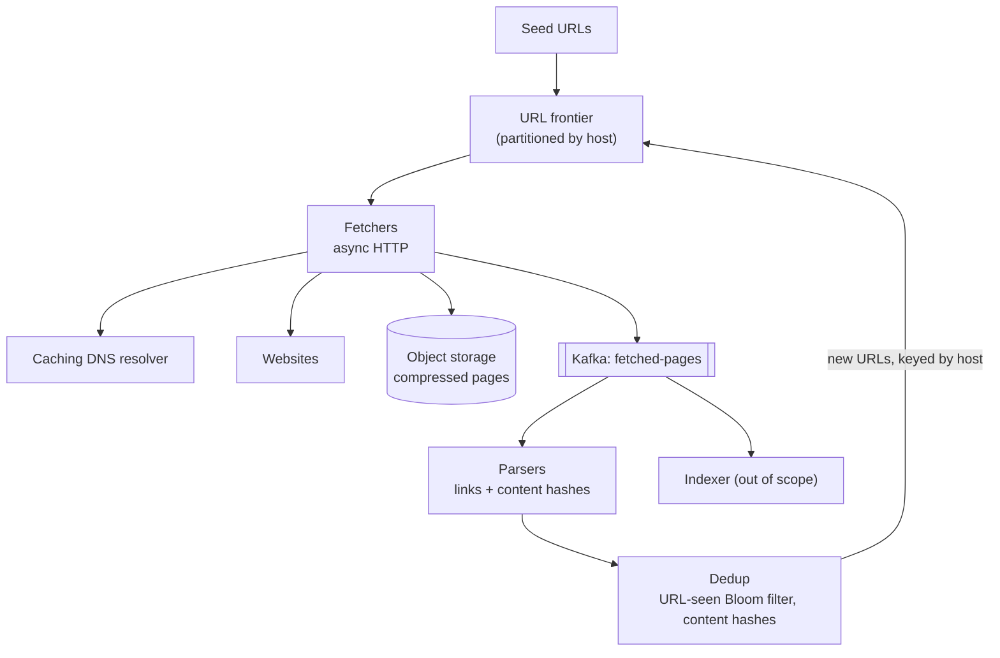
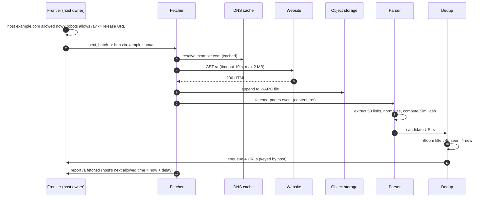
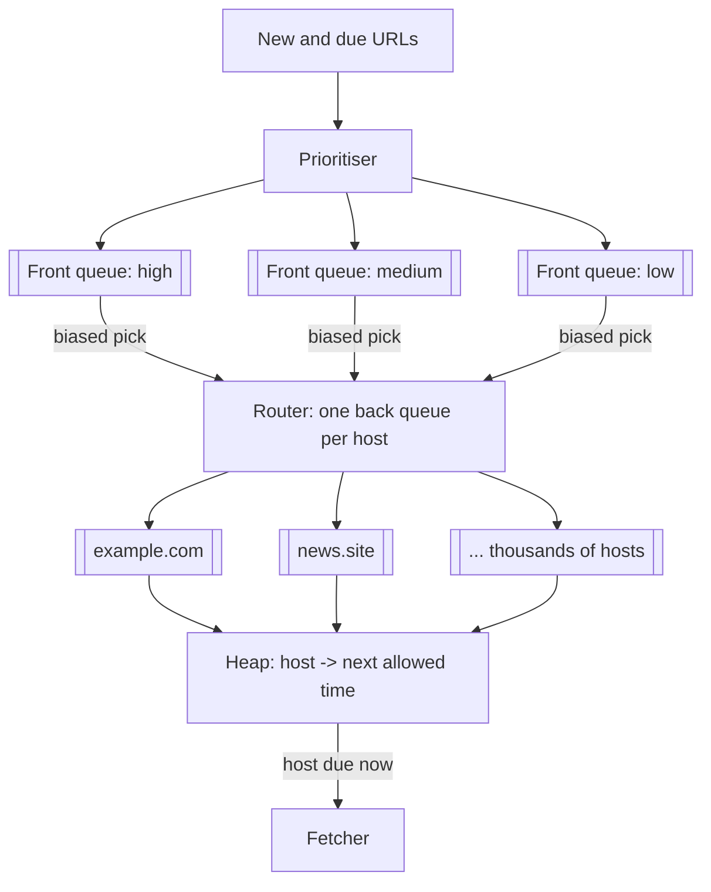
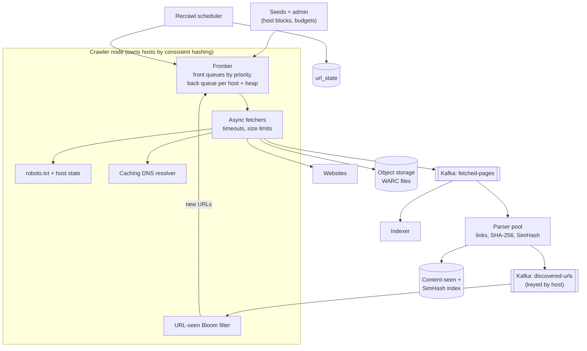

## Problem statement

Design a web crawler that feeds a search engine: starting from seed URLs, it downloads pages, extracts links, and keeps discovering and
re-downloading the web — about a billion pages a month — while staying polite to every website and avoiding duplicate work.

**Interview format:** 45–60 minutes · **Difficulty:** intermediate · **Main themes:** the URL frontier, politeness, URL and content
deduplication, partitioning by host, crawler traps, recrawl scheduling.

> [!TIP] Try it first
> Before scrolling, spend three minutes writing the questions you would ask the interviewer. Then compare with the list below — or
> practise this whole problem as a [timed mock interview](#system-design/hld/interview/web-crawler).

## Clarifying questions

The answers below are the interviewer's. Questions that change the design come first.

- **Q:** What is the crawler for? <!-- match: purpose, what for, use case, search, goal, why -->
  - **A:** Feeding a search engine's indexer. The output is stored page content plus extracted links.
- **Q:** How many pages, and how often? <!-- match: scale, how many pages, pages per month, volume, throughput -->
  - **A:** About 1 billion pages a month, out of roughly 15 billion URLs we know about.
- **Q:** What content types? <!-- match: content types, html, images, pdf, media, file types -->
  - **A:** HTML only. Images, video and PDFs are out of scope.
- **Q:** Do we have to be polite to websites? <!-- match: polite, politeness, robots, robots.txt, rate, crawl delay -->
  - **A:** Yes. Obey robots.txt, honour crawl-delay, and never overload a site — at most one request at a time per host by default.
- **Q:** How fresh must the crawl be? <!-- match: fresh, freshness, recrawl, update, how often, change -->
  - **A:** Popular or frequently changing pages should be recrawled daily; most pages monthly or less.
- **Q:** What about duplicate pages? <!-- match: duplicate, duplicates, dedup, same content, mirrors -->
  - **A:** Don't store or index the same content twice; many URLs point to identical or nearly identical pages.
- **Q:** Do we need to execute JavaScript? <!-- match: javascript, rendering, js, dynamic, spa, headless -->
  - **A:** Not for most pages. Assume a small fraction need rendering; a separate rendering service can handle those.
- **Q:** How long do we keep pages? <!-- match: storage, keep, retention, history, versions -->
  - **A:** Keep the newest copy of each page; history is out of scope.

## Functional requirements

> [!TIP] Try it first
> Write three or four functional requirements before reading on.

- **Fetch pages** starting from seeds and from links discovered in fetched pages. <!-- match: fetch, download, crawl -->
- **Extract links** and add new URLs to the crawl. <!-- match: extract, links, parse, discover -->
- **Store page content** for the indexer. <!-- match: store, content, save -->
- **Obey robots.txt** and per-host rate limits. <!-- match: robots, polite, politeness -->
- **Recrawl** pages according to how often they change and how important they are. <!-- match: recrawl, refresh, freshness -->

````hint title="Hint: what makes this hard?"
Downloading a page is easy. What makes crawling a billion pages hard: the number of pages, the number of hosts, or the rules each host sets?
````

## Non-functional requirements

- **Throughput**: about 1 billion pages/month (~400 pages/s average, ~1,000/s peak). <!-- match: throughput, pages per second, scale -->
- **Politeness**: never more than the allowed rate per host. <!-- match: polite, politeness, per host -->
- **Robustness**: survive malformed HTML, slow servers, crawler traps and node failures without losing the frontier. <!-- match: robust, traps, failures, malformed -->
- **Efficiency**: avoid fetching the same URL twice in a cycle and storing duplicate content. <!-- match: efficient, dedup, duplicates -->
- **Extensibility**: new content types or processing steps can be added. <!-- match: extensible, extensibility, pluggable -->

````hint title="Hint: politeness vs throughput"
400 pages/s at one request per host at a time — what does that imply about how many hosts must be in flight at once?
````

## Scope and exclusions

In scope: frontier, fetching, politeness, DNS, parsing and link extraction, URL and content dedup, storage, recrawl scheduling, traps.

Out of scope: indexing and ranking, media and PDFs, history of page versions, login-protected content.

## Capacity estimation

> [!TIP] Try it first
> Estimate pages per second, bandwidth, storage, and the memory needed to remember 15 billion URLs.

- **Fetch rate:** 1B pages ÷ (30 × 86,400 s) ≈ **386 pages/s** average; plan for ~1,000/s.
- **Bandwidth:** average HTML page ~100 KB → 386 × 100 KB ≈ **39 MB/s ≈ 310 Mbit/s** average inbound.
- **Storage:** 1B pages × 100 KB = **100 TB per crawl cycle** raw; compressed HTML is typically 4–5× smaller (~20–25 TB).
- **URL-seen set:** 15B URLs × 10 bits (Bloom filter, ~1% false positives) ≈ **18.75 GB** — fits in memory, partitioned across nodes.
- **Frontier:** 15B URLs × ~100 bytes ≈ **1.5 TB** — must live on disk with in-memory buffers.
- **Concurrency:** a fetch takes ~1 s end to end (DNS, connect, download), so ~400–1,000 fetches are in flight at any time — easy with
  asynchronous I/O, spread across many hosts.

```estimator title="Web crawler (pages fetched)"
requestsPerDay = 33M
readsPerWrite = 0
writeBytes = 100 KB
readBytes = 1 KB
retentionYears = 0.083
peakFactor = 2.5
replication = 3
cachePercent = 0
serverRps = 100
targetUtilization = 60
```

The calculator counts each fetched page as a write of 100 KB (before compression); retention of one month approximates "the newest copy of
every page" because each cycle replaces the last. The 100 pages/s per crawler node reflects parsing and link extraction, not network.

**What the numbers mean for the design:**

- **Throughput is modest; politeness is the constraint.** Hundreds of pages per second only works if fetches are spread across thousands of
  hosts at a time.
- **URL dedup must be in memory** (or nearly) — checking a database for every one of ~50 links per page would be 20,000 lookups/s.
- **The frontier is large and durable**: it is the crawler's state, and losing it means starting over.

````hint title="Hint: how many links per page?"
If each page has ~50 links, how many URL-seen checks per second does 386 pages/s generate?
````

## API design

> [!TIP] Try it first
> A crawler has no public API. What are the internal interfaces between its components?

```text title="API"
Internal interfaces (gRPC or message topics)

Frontier.enqueue(urls[], priority, discovered_from)       # from parsers (after dedup)
Frontier.next_batch(worker_id, max=100) -> [ { url, host, priority, attempt } ]
Frontier.report(url, status, fetched_at, next_crawl_at)   # success, 404, retry later

Topic fetched-pages:  { url, final_url, status, content_ref (blob key), content_hash, fetched_at }
Topic discovered-urls (keyed by host): { url, source_url, anchor_text }

Admin: POST /seeds, GET /hosts/{host} (robots, rate, budget), POST /hosts/{host}/block
```

- **Components talk through queues keyed by host**, so every URL for a host reaches the one node that owns that host's politeness state.

````hint title="Hint: who owns a host?"
If two fetchers on different machines both fetch from example.com, how would they agree on the one-request-at-a-time rule?
````

## Data model

> [!TIP] Try it first
> What state does the crawler keep about URLs, hosts and content?

```text title="Schema"
url_state     (url_hash PK, url, host, last_fetched, next_crawl_at, status, content_hash,
               change_rate, priority)                       partitioned by host hash
host_state    (host PK, robots_txt, robots_fetched_at, crawl_delay, ip, last_fetch_at,
               error_rate, page_budget)
content_seen  (content_hash PK, first_url)                  exact duplicates
simhash_index (band, band_value -> [doc ids])               near-duplicate lookup
blob store    pages/{date}/{shard}.warc.gz  -> compressed page records (object storage)

In memory per crawler node
  url-seen Bloom filter for its hosts' URLs
  front queues (by priority) and back queues (one per host) + heap of host -> next allowed time
```

- **Partition everything by host**: one node owns a host's URLs, robots rules, rate limiter and back queue.
- **Content is stored in large compressed files** (WARC-style) in object storage, not one object per page.

````hint title="Hint: why not one object per page?"
A billion small objects a month means a billion PUT requests and per-object overhead. What does batching pages into large files buy?
````

## Initial high-level architecture

Build the design one requirement at a time.

### Step 1: fetch from a frontier

A **URL frontier** hands batches of URLs to **fetchers**, which resolve DNS (through a caching resolver), download pages with asynchronous
HTTP, and write the content to object storage, publishing a `fetched-pages` event.

### Step 2: parse and discover

**Parsers** consume fetched pages, extract and normalise links (lowercase host, remove fragments, resolve relative paths, strip tracking
parameters), and send them back to the frontier keyed by host.

### Step 3: deduplicate

Before a URL enters the frontier, a **URL-seen check** (Bloom filter, backed by `url_state`) drops URLs already known. After a fetch, a
**content hash** catches exact duplicates and a **SimHash** catches near-duplicates, so mirrors and session-ID variants aren't stored twice.

### Step 4: be polite and keep fresh

The frontier releases a host's next URL only when that host's **next allowed time** has passed (crawl-delay or adaptive delay) and only if
robots.txt allows the path. A **recrawl scheduler** sets each page's `next_crawl_at` from its importance and observed change rate.

````hint title="Hint: priority and politeness together"
The frontier has to choose the most important URL and respect each host's delay. Can one queue do both?
````

## Architecture diagram



## Request and data flow



## Component responsibilities

| Component | Responsibility | Scales with |
|---|---|---|
| URL frontier | Priority + per-host politeness queues, durable state, recrawl schedule | URLs known, hosts |
| Fetchers | DNS, robots, HTTP download with limits, store content | Pages/s, concurrent connections |
| DNS resolver | Cache lookups; avoid hammering DNS servers | Distinct hosts |
| Parsers | Link extraction, normalisation, content fingerprints | Pages/s (CPU) |
| Dedup service | URL-seen Bloom filters, exact and near-duplicate content | Links/s |
| Object storage | Compressed page archives for the indexer | Bytes crawled |
| Recrawl scheduler | Estimate change rates and set next crawl times | URLs known |

## Database and technology choices

| Need | Choice | Why | Alternative |
|---|---|---|---|
| Frontier storage | Per-node disk-backed queues (RocksDB) with in-memory buffers | 1.5 TB of URLs, sequential access | Kafka topics per priority (no per-host scheduling) |
| URL state | Wide-column store (Cassandra/HBase) keyed by URL hash | Billions of rows, simple lookups | Sharded relational DB |
| URL-seen check | Bloom filter per node + URL state | Memory-efficient set membership | Full hash set (≈ 15B × 8 B = 120 GB+) |
| Page storage | Object storage, WARC-style compressed files | Cheap, durable, batch-friendly | HDFS |
| Pipeline | Kafka between fetchers and parsers | Buffer CPU-bound parsing, replay | Direct RPC |

## Scaling strategy

### How is the frontier designed?

A two-level design (as in the Mercator crawler): **front queues** order URLs by priority (PageRank-like importance, freshness need);
a router moves URLs into **back queues**, one per host, and a **heap** keyed by each host's next allowed fetch time decides which host is
served next. Fetchers ask for work; the frontier pops the host whose time has come, takes its next URL, and sets the host's next time to
now + delay. Priority picks *what*, politeness picks *when*.



### How is work partitioned across machines?

Hash the **host** (or registered domain) to a crawler node with [consistent hashing](lesson:consistent-hashing). That node owns the host's
back queue, robots.txt, rate limiter and the Bloom filter partition for its URLs, so politeness needs no cross-node coordination.
Discovered URLs are routed by host to the owning node. Very large sites (one host with millions of pages) still get one request at a time,
which is the point; their crawl simply takes longer.

### How are duplicates avoided?

- **URL level:** normalise URLs, then check a Bloom filter (10 bits per URL ≈ 1% false positives — an acceptable rate of skipped new URLs);
  `url_state` is the source of truth for recrawl decisions. See [deduplication](lesson:dedup).
- **Exact content:** SHA-256 of the normalised body; if seen, record the URL as an alias and don't store again.
- **Near-duplicates:** SimHash fingerprints compared by Hamming distance (via banding) catch pages that differ only in ads, dates or
  session IDs.

### How do we avoid crawler traps?

Traps generate endless URLs: calendars with infinite next-month links, session IDs in URLs, deeply nested paths. Defences: maximum URL
length and depth, a per-host page budget per cycle, detecting repeating path segments, stripping session parameters during normalisation,
and lowering the priority of hosts whose new URLs keep producing duplicate content.

### How do we keep pages fresh?

Each page has an estimated change rate (from how often its content hash changed in past fetches) and an importance. The scheduler sets
`next_crawl_at` so important, frequently changing pages (news homepages) are fetched daily or hourly and stable pages monthly. Conditional
requests (`If-Modified-Since`, `ETag`) make unchanged recrawls cheap.

## Caching strategy

### What is worth caching?

- **DNS results**, honouring TTLs, in a local caching resolver on each node — DNS lookups would otherwise add latency to every fetch and
  overload upstream resolvers ([DNS](lesson:dns)).
- **robots.txt** per host, refreshed about daily, in the host's owning node.
- **Bloom filters** in memory as the URL-seen cache in front of `url_state`.

## Messaging strategy

### Where do queues help?

- **Fetchers → parsers** through Kafka: parsing is CPU-heavy and bursty; the log buffers it and lets the indexer consume the same stream.
- **Parsers → frontier** through a topic keyed by host, so each URL reaches the node owning its host.
- **Failed fetches** go back to the frontier with a retry time (exponential backoff for 5xx and timeouts); permanent failures (404, robots
  disallow) are recorded, not retried ([retries and DLQs](lesson:retries-dlq)).
- **Backpressure:** if parsers lag, fetchers slow down by requesting fewer URLs — the frontier is the natural buffer
  ([backpressure](lesson:backpressure)).

## Failure scenarios

| Failure | Impact | Mitigation |
|---|---|---|
| Crawler node dies | Its hosts stop being crawled | Frontier on durable disk with checkpoints; hosts reassigned by consistent hashing |
| Website slow or down | Fetchers tied up | Per-request timeouts, max page size, adaptive per-host delays, back off on errors |
| Crawler trap | Endless URLs from one host | Depth/length limits, per-host budgets, duplicate-content detection |
| DNS outage or slowness | Fetches stall | Local caching resolvers, multiple upstream resolvers |
| Parser crash on malformed HTML | Lost links | Tolerant parsers, isolated workers, poison messages to a DLQ |
| Bloom filter lost | Re-crawling known URLs | Rebuild from url_state; checkpoint filters periodically |

## Bottleneck analysis

- **Per-host politeness** caps throughput per site; the crawler needs many hosts in flight.
- **Parsing CPU** — scale parsers independently from fetchers.
- **URL-seen checks** at ~20,000/s — in-memory Bloom filters, partitioned by host.
- **Frontier disk I/O** — sequential writes and reads with large in-memory buffers.

## Consistency and availability trade-offs

- **Approximate dedup is fine**: a Bloom filter false positive skips a new URL (it will probably be found again via another link).
- **At-least-once fetching**: a crash may refetch a few pages; content dedup makes this harmless.
- **No global ordering**: priority is approximate across nodes; politeness is strict per host.
- **Availability of the crawl** matters less than its total throughput; a node's hosts can pause briefly during reassignment.

## Security considerations

- Identify the crawler with a clear user agent and a contact page; obey robots.txt.
- Treat fetched content as untrusted: limit page sizes, decompression ratios (zip bombs) and redirect chains; never execute scripts outside
  a sandboxed renderer.
- Block crawling internal or private IP ranges (SSRF via DNS answers that point at internal addresses).
- Honour removal requests and legal blocks via the admin host block list.

## Monitoring and observability

- Pages fetched/s, bytes/s, and fetch outcomes by status code.
- Frontier size, hosts in flight, average wait per host.
- Duplicate rates (URL and content), trap detections.
- DNS latency and failure rate; robots.txt fetch failures.
- Freshness: age distribution of stored pages by priority tier.

## Final architecture

Open this after you have drawn your own.

````solution title="Final architecture"


**In one breath:** URLs are partitioned by host across crawler nodes with consistent hashing; each node's frontier picks what to crawl by
priority and when by per-host delay, honouring robots.txt; asynchronous fetchers resolve DNS through a local cache, download with strict
limits and append compressed pages to object storage, publishing events to Kafka; parsers extract and normalise links and fingerprint content
for exact and near-duplicate detection; new URLs return to their host's owner, filtered by an in-memory Bloom filter; a scheduler recrawls
pages by importance and change rate, and traps are cut off by depth, length and per-host budgets.
````

## Alternative designs and trade-offs

| Alternative | Gains | Costs | When to choose it |
|---|---|---|---|
| Single global queue | Simple | No per-host politeness; hot hosts dominate | Small crawls of a few sites |
| Kafka-only frontier | Reuses infrastructure | Hard to schedule per-host delays and priorities | Focused crawlers with few hosts |
| Exact URL set instead of Bloom filter | No false positives | ~10× more memory | When missing any URL is unacceptable |
| Render every page with a headless browser | Complete content for JS sites | 10–100× more CPU per page | Small, JS-heavy target sets |
| One object per page | Simple retrieval | Billions of small objects, high request cost | Small crawls |

## Interviewer follow-up questions

````question title="How do you prioritise which URLs to crawl first?"
Score URLs by importance (link-based authority of the page or host, how many known pages link to it), freshness need (time since last crawl
times its estimated change rate), and quality signals (low for hosts producing duplicates or spam). Front queues hold priority bands; the
router pulls from higher bands more often, while back queues still enforce per-host politeness.
````

````question title="How do you handle a site that responds slowly or starts returning 503s?"
Treat it as a signal to back off: increase that host's delay adaptively (for example to a multiple of its observed response time), honour
Retry-After headers, and pause the host after repeated errors. Retries go back to the frontier with exponential backoff, and the host's
budget for the cycle shrinks so the crawler doesn't keep spending effort on it.
````

````question title="How would you crawl JavaScript-heavy sites?"
Detect pages whose useful content requires JavaScript (empty bodies, known frameworks, poor link yield) and route them to a separate
rendering pool of sandboxed headless browsers with strict CPU and time limits. Rendering is far more expensive, so it's reserved for
important pages, and its results flow into the same parsing pipeline.
````

````question title="What happens when a crawler node fails?"
Its hosts are reassigned to other nodes by consistent hashing. The new owner loads the hosts' frontier segments from durable storage (the
frontier is checkpointed) and rebuilds robots and rate state lazily. A few in-flight fetches are repeated, which content dedup makes
harmless. Politeness is safe because only one node owns a host at a time.
````

````question title="How big is the URL-seen set if you store full URLs, and why use a Bloom filter?"
15 billion URLs at ~100 bytes is about 1.5 TB — too large for memory. Storing 8-byte hashes is still ~120 GB plus hash-table overhead. A
Bloom filter at 10 bits per URL is ~18.75 GB with about a 1% false-positive rate, which only means occasionally skipping a new URL. The
authoritative url_state table resolves recrawl decisions.
````

## Common mistakes

- **Ignoring politeness**, or enforcing it with a global lock instead of partitioning by host.
- **One FIFO queue** for all URLs, letting a single large site dominate.
- **Checking a database for every discovered link** instead of an in-memory filter.
- **No URL normalisation**, so trivial variants of a URL are crawled separately.
- **No defences against traps** or oversized responses.
- **Storing one object per page** at billion scale.

## Evaluation checklist

```checklist title="Evaluation checklist"
- Asked about purpose, scale, content types, politeness and freshness
- Estimated pages/s, bandwidth, storage and the size of the URL-seen set
- Designed a frontier separating priority from per-host politeness
- Partitioned hosts across nodes so each host has one owner
- Obeyed robots.txt and crawl-delay, with adaptive back-off
- Deduplicated URLs (normalisation plus Bloom filter) and content (hashes plus SimHash)
- Cached DNS and robots.txt
- Defended against crawler traps and hostile responses
- Scheduled recrawls by importance and change rate
- Kept the frontier durable and explained node failure recovery
```
