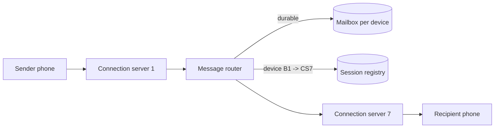
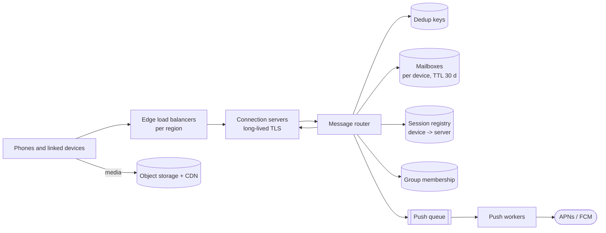
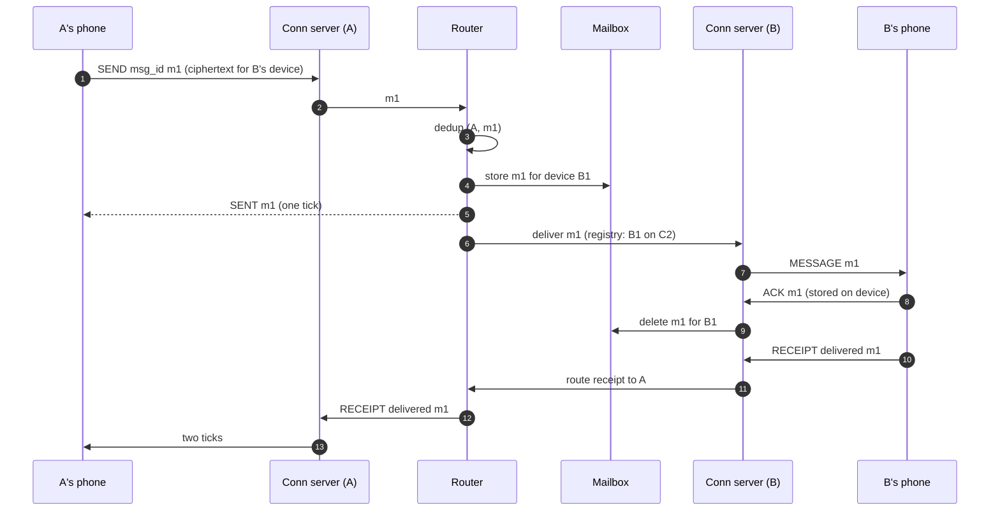
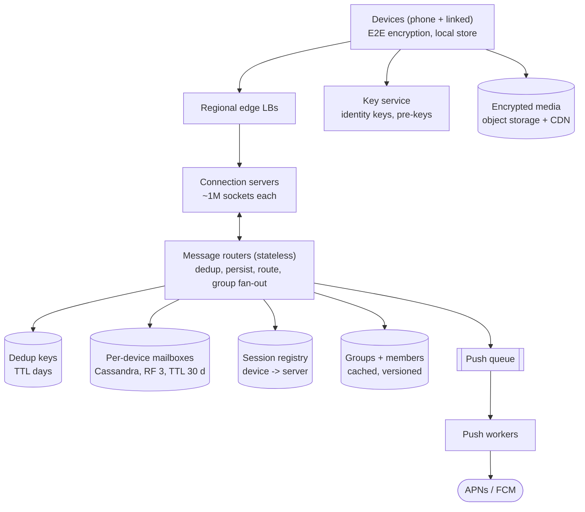

## Problem statement

Design a mobile messaging service like WhatsApp: one-to-one and small-group chats for over a billion daily users, with messages delivered
instantly when the recipient is online and stored until they come online otherwise, delivery and read receipts (✓, ✓✓, blue ✓✓), and
end-to-end encryption so the service can't read messages.

**Interview format:** 45–60 minutes · **Difficulty:** intermediate · **Main themes:** massive connection counts, store-and-forward
delivery, receipts, idempotency, routing users to connection servers, end-to-end encryption at the architecture level.

> [!TIP] Try it first
> Before scrolling, spend three minutes writing the questions you would ask the interviewer. Then compare with the list below — or
> practise this whole problem as a [timed mock interview](#system-design/hld/interview/whatsapp).

## Clarifying questions

The answers below are the interviewer's. Questions that change the design come first.

- **Q:** How many users and messages? <!-- match: scale, users, how many, traffic, volume, messages per day, dau -->
  - **A:** About 1 billion daily active users sending around 50 messages each a day — 50 billion messages a day — with peaks about twice the
    average.
- **Q:** One-to-one only, or groups too? <!-- match: group, groups, group size, members, one to one -->
  - **A:** Both. Groups have up to 1,024 members; most are much smaller.
- **Q:** What happens when the recipient is offline? <!-- match: offline, store, later, not connected, deliver later, store and forward -->
  - **A:** The server stores the message and delivers it when any of the recipient's devices connects, for up to 30 days. Once delivered to all
    the recipient's devices, the server deletes it — there's no server-side history.
- **Q:** Do we need delivery and read receipts? <!-- match: receipt, receipts, delivered, read, ticks, seen, status -->
  - **A:** Yes: sent (server has it), delivered (reached the recipient's device), read (opened). Read receipts can be disabled by users.
- **Q:** Is the content end-to-end encrypted? <!-- match: encryption, encrypted, e2e, end to end, privacy, security -->
  - **A:** Yes. The server routes and stores ciphertext only; key exchange is part of the design to discuss at a high level.
- **Q:** How fast must delivery be? <!-- match: latency, fast, real time, how quickly, delay -->
  - **A:** Under a second end to end when both sides are online, including across continents where possible.
- **Q:** Multiple devices per user? <!-- match: devices, multi-device, linked devices, desktop, web -->
  - **A:** Yes — a phone plus up to four linked devices (desktop, web), each receiving its own copy.
- **Q:** Media and calls? <!-- match: media, images, video, photos, files, calls, voice -->
  - **A:** Media yes (photos, videos, documents) — assume they're uploaded to object storage and the message carries an encrypted reference.
    Calls are out of scope.
- **Q:** Must messages arrive in order? <!-- match: order, ordering, sequence -->
  - **A:** Within a conversation, yes, as the sender sent them.

## Functional requirements

> [!TIP] Try it first
> Write four functional requirements before reading on.

- Users can **send messages** (text and media references) to a person or a **group**. <!-- match: send, message, group -->
- Recipients **receive in real time** when online, or on reconnect via **store-and-forward**. <!-- match: receive, real time, offline, store and forward -->
- Senders see **delivery and read receipts**. <!-- match: receipt, receipts, delivered, read -->
- Each of a user's **devices** receives its own copy. <!-- match: devices, multi-device -->

````hint title="Hint: where does a message live?"
There's no server-side history: the server is a temporary mailbox. When can a message be deleted, and what must be true before that?
````

## Non-functional requirements

- **Scale**: ~1B DAU, ~50B messages/day (~580K/s average, ~1.2M/s peak), hundreds of millions of concurrent connections. <!-- match: scale, billion, concurrent -->
- **Low latency**: sub-second delivery when both are online. <!-- match: latency, sub-second, real time -->
- **Reliability**: an accepted message is **never lost** and delivered **exactly once** per device from the user's point of view. <!-- match: never lost, reliable, exactly once, duplicates -->
- **Ordering** within each conversation. <!-- match: order, ordering -->
- **Privacy**: **end-to-end encryption**; the server never sees plaintext. <!-- match: encryption, e2e, privacy -->
- **High availability**: messaging keeps working through server and zone failures. <!-- match: availability, available -->

````hint title="Hint: 'exactly once' on an unreliable mobile network"
Phones lose connectivity mid-send and mid-receive. Which two identifiers and acknowledgements make retries safe in both directions?
````

## Scope and exclusions

In scope: 1:1 and group messaging, offline delivery, receipts, multi-device delivery, push notifications to wake offline phones, encryption
architecture, media references.

Out of scope: voice and video calls, status/stories, server-side message history and search (by design there is none), payments, contact
discovery details.

## Capacity estimation

> [!TIP] Try it first
> Estimate messages per second, connections, receipts and the size of undelivered storage.

- **Messages:** 1B × 50 = 50B a day ≈ **580K/s** average, **~1.2M/s** at peak.
- **Receipts:** each message produces a delivered and usually a read receipt — ~100B small receipt messages a day, more than the messages
  themselves.
- **Connections:** a few hundred million devices connected at peak. A well-tuned connection server can hold hundreds of thousands to a
  couple of million mostly idle connections; at ~1M per server that's **several hundred servers**, spread across regions.
- **Undelivered storage:** most messages are delivered within seconds. If ~5% of a day's messages wait for an offline device at any moment —
  2.5B × ~1 KB of ciphertext and metadata — that's **~2.5 TB** of mailbox data, with a 30-day upper bound on how long any message waits.
- **Bandwidth:** text is tiny (~1 KB); media goes through object storage and a CDN, not the chat servers.

```estimator title="WhatsApp-style messaging"
requestsPerDay = 110B
readsPerWrite = 1.2
writeBytes = 1 KB
readBytes = 1 KB
retentionYears = 0.08
peakFactor = 2
replication = 3
cachePercent = 0
serverRps = 20000
targetUtilization = 60
```

Writes are messages accepted (50B/day); reads are deliveries to devices (~1.2 per message counting groups and linked devices). Retention is
30 days at most, and in practice most messages are deleted within seconds of delivery.

**What the numbers mean for the design:**

- **Over a million messages a second** and **hundreds of millions of connections**: the connection tier and the routing of messages to it
  are the heart of the design.
- **Storage is transient**: a store-and-forward mailbox, not an ever-growing history.
- **Receipts double the traffic**: they must be as cheap as messages.

````hint title="Hint: is storage the hard part?"
Compare the bytes stored at any moment with the messages per second and the connection count. Which resource drives the architecture?
````

## API design

> [!TIP] Try it first
> Design the frames on the persistent connection: sending, acknowledging, delivering and receipts.

```text title="API"
Persistent connection (TLS, long-lived; WebSocket or a custom binary protocol), one per device

client -> server
  SEND     { msg_id: "uuid-from-sender", to: "user:B" | "group:G", ciphertext(s), media_ref? }
  ACK      { msg_id }                          device stored the message: server may delete its copy
  RECEIPT  { msg_id, to: "user:A", kind: "delivered" | "read" }
  SYNC     { }                                 after reconnect: send me everything waiting

server -> client
  SENT     { msg_id, server_ts }               server durably accepted it (one tick)
  MESSAGE  { msg_id, from, conversation, seq, ciphertext, media_ref? }
  RECEIPT  { msg_id, from: "user:B", kind }

REST (side channels)
  POST /v1/media              -> presigned upload URL for an encrypted blob
  GET  /v1/keys/{user}        -> public identity and pre-keys for starting an encrypted session
```

- The sender generates **`msg_id`** — retries reuse it, so the server stores each message once.
- The receiving device **ACKs** after persisting locally; only then does the server delete its copy for that device.

````hint title="Hint: who can delete the server's copy?"
The server must keep a message until every target device has it. What signal tells the server that a specific device has safely stored it?
````

## Data model

> [!TIP] Try it first
> What does the server store for a message waiting for an offline device, and how is it found when the device reconnects?

```text title="Schema"
mailbox  (Cassandra / ScyllaDB, or a log per device)
  partition key: device_id
  clustering:    enqueued_at, msg_id
  columns:       conversation_id, seq, sender, ciphertext (per device), media_ref,
                 expires_at (TTL 30 days)

session registry  (Redis / in-memory, replicated)
  device_id -> connection server id
  (set on connect, removed on disconnect, TTL refreshed by heartbeats)

users & devices  (sharded relational or key-value)
  users (user_id, phone_hash, ...), devices (user_id, device_id, push_token, identity_key)

groups  (key-value / relational)
  groups (group_id, members[], version)   up to 1,024 members

prekeys  (key-value)
  device_id -> signed pre-key, one-time pre-keys (consumed on use)

dedup  (key-value, TTL)
  (sender_device, msg_id) -> accepted      for a few days
```

- With end-to-end encryption each **device** gets its own ciphertext, so the mailbox is per device.
- Rows expire automatically (**TTL 30 days**) and are deleted as soon as the device ACKs.

````hint title="Hint: why is the mailbox keyed by device, not user?"
Each of a user's devices has its own encryption keys and its own online/offline state. What does that imply for what's stored and when it's
deleted?
````

## Initial high-level architecture

Build the design one requirement at a time.

### Step 1: connect

Each device keeps a long-lived TLS connection to a **connection server** (chosen by the load balancer or by geography). On connect, the
server records `device → connection server` in the **session registry** and asks the **mailbox** for anything waiting.

### Step 2: send to an online recipient

The sender's connection server passes the message to the **message router**, which deduplicates by `msg_id`, writes it to each target
device's mailbox (durable), acks `SENT` to the sender, then looks up each target device's connection server in the registry and forwards
the message there for immediate delivery.



### Step 3: deliver to an offline recipient

If the device isn't connected, the message stays in its mailbox and a **push notification** (APNs/FCM) wakes the phone; when it connects,
it syncs its mailbox. Each delivered message is ACKed by the device and then deleted.

### Step 4: receipts

The recipient device sends `delivered` after storing the message and `read` when the user opens the chat. Receipts are routed back to the
sender exactly like messages (through the mailbox if the sender is offline).

````hint title="Hint: groups"
For a 200-member group, does the sender upload 200 copies? Think about who fans out and what is encrypted with which keys.
````

## Architecture diagram



## Request and data flow

One message from A to B (B online on one device), with receipts:



## Component responsibilities

| Component | Responsibility | Scales with |
|---|---|---|
| Connection servers | Hold device connections, heartbeats, push/pull frames | Concurrent connections |
| Session registry | Map each connected device to its connection server | Connected devices |
| Message router | Dedup, persist to mailboxes, route to connection servers, group fan-out | Messages + receipts/s |
| Mailbox store | Durable per-device queue until ACK or 30-day expiry | Undelivered messages |
| Group service | Membership and versioning for groups (≤1,024) | Groups |
| Key service | Public identity keys and pre-keys for session setup | Session setups |
| Push workers | Wake offline phones via APNs/FCM | Offline deliveries |
| Media storage + CDN | Encrypted blobs, presigned uploads/downloads | Media bytes |

## Database and technology choices

| Need | Choice | Why | Alternative |
|---|---|---|---|
| Mailboxes | Cassandra / ScyllaDB (or a per-device log) | High write and delete rate, partition by device, TTLs | Kafka per partition of devices (harder per-device deletes) |
| Session registry | Replicated in-memory store (Redis) | Very high read/write rate, ephemeral | Consistent hashing of devices to servers (no registry lookups) |
| Dedup keys | Key-value with TTL | `(sender_device, msg_id)` for a few days | Folding dedup into the mailbox write |
| Users, devices, groups | Sharded key-value or relational | Modest per-user data, high read rate | — |
| Connection servers | Event-driven runtimes (Erlang/BEAM, Netty, Go) | Many idle connections per server | — |
| Encryption | Signal-protocol style (X3DH key agreement + Double Ratchet) | Proven E2E design with forward secrecy | — |

## Scaling strategy

### How do we route a message to the right connection server among hundreds?

Two common approaches:

- **Session registry (chosen)**: on connect, write `device → server` to a replicated in-memory registry (with a TTL refreshed by heartbeats).
  The router looks up each target device and sends the message directly to that server. Flexible — devices can connect anywhere, e.g. the
  nearest region.
- **Deterministic placement**: hash the user to a server (consistent hashing), so no lookup is needed; but users can't simply connect to the
  nearest server, and rebalancing moves connections.

Registry entries can be stale (a server died); deliveries to a dead server fail, and the message simply waits in the mailbox until the
device reconnects elsewhere — correctness never depends on the registry.

### How is delivery made reliable and duplicate-free?

- **Sender → server**: the client retries `SEND` with the same `msg_id` until it gets `SENT`; the router dedups on `(sender_device,
  msg_id)`.
- **Server durability**: `SENT` is returned only after the message is written to the replicated mailbox.
- **Server → device**: delivery is at-least-once (pushed live and/or synced on reconnect); the device ACKs after storing, and ignores a
  `msg_id` it already has.
- **Deletion**: the mailbox entry for a device is deleted only after that device's ACK; a 30-day TTL bounds storage for devices that never
  return.

### How do groups scale?

With end-to-end encryption, the server can't fan out plaintext. Signal-style **sender keys**: the sender encrypts the message once with a
group sender key (distributed earlier to each member device over pairwise encrypted sessions), and the router fans out the **same
ciphertext** to every member device's mailbox — 1,024 members × a few devices is a few thousand mailbox writes, fine for the limit. Group
membership changes rotate sender keys. Groups are capped precisely because fan-out on write is per member device.

### How does ordering work?

Order is needed per conversation. The sender's device stamps a per-conversation sequence number; the router preserves per-sender order by
routing a conversation's messages through one path, and the receiving device orders by sender sequence and server timestamp, requesting gaps.
Across different senders in a group, the server timestamp at acceptance gives a consistent order for display.

## Caching strategy

### What is cached?

- **Session registry** is itself an in-memory store; routers cache entries briefly per device and invalidate on failure.
- **Group membership** is cached in routers (versioned; refreshed when the group's version changes).
- **Public keys and pre-keys** are cached on devices after first use; one-time pre-keys are consumed and must not be cached server-side.
- Message content is **not cached** — it's transient, encrypted and deleted after delivery.

## Messaging strategy

### Why per-device mailboxes rather than a general broker topic?

Each device needs its own durable queue that can be drained on reconnect, acknowledged per message and deleted — millions of tiny, mostly
empty queues that come and go. A partitioned store keyed by device (with TTLs) fits that shape better than broker topics or queues, which are
designed for fewer, busier streams. Within the router fleet, messages between routers and connection servers flow over direct RPC; durable
storage is the mailbox, not the transport.

### How do push notifications fit?

If a target device isn't connected, the router enqueues a push job: "you have messages" (content-free, because the server has no plaintext;
the app wakes, connects and syncs). Push jobs are deduplicated per device and coalesced — ten messages in a minute produce one wake-up.

## Failure scenarios

| Failure | Impact | Mitigation |
|---|---|---|
| Connection server crashes | Its devices disconnect | Devices reconnect (jittered backoff) elsewhere and sync mailboxes; registry TTLs expire stale entries |
| Router crash mid-delivery | Message may be redelivered | Durable mailbox before `SENT`; device dedups by `msg_id` |
| Mailbox partition unavailable | Delivery to some devices delayed | Replication (RF 3, quorum writes); senders retry on timeout |
| Stale session registry entry | Live delivery attempt fails | Message stays in the mailbox; device syncs on reconnect |
| Region outage | Devices in that region disconnect | Reconnect to another region; mailboxes replicated across regions |
| APNs/FCM delays | Offline users notified late | Messages wait safely; delivery on next connect |

## Bottleneck analysis

- **Connection count and heartbeat traffic** dominate the edge — hundreds of millions of sockets, each with periodic keep-alives.
- **Router throughput** — over a million messages and more receipts per second — scales horizontally; it's stateless apart from caches.
- **Mailbox writes and deletes** at that rate need a store built for it (LSM-based); TTLs and immediate deletes keep it small.
- **Group fan-out** is bounded by the group size cap.

## Consistency and availability trade-offs

- **Durable before acknowledged**: one tick means the message is safely stored server-side.
- **At-least-once delivery + device dedup = exactly-once display.**
- **Registry and presence are best-effort**; correctness relies on mailboxes, so the live path can be optimistic.
- **Ordering per conversation**, not globally.
- Availability is favoured: during a region problem, devices reconnect elsewhere and messages wait in replicated mailboxes.

## Security considerations

- **End-to-end encryption**: devices establish pairwise sessions using public identity keys and pre-keys fetched from the key service (X3DH),
  then encrypt each message with the Double Ratchet, giving forward secrecy. The server stores and routes only ciphertext.
- **Key transparency / safety numbers** let users verify keys, protecting against a compromised key directory.
- **Metadata** (who talks to whom, when) is still visible to the server; minimise retention and logging.
- **Media** is encrypted on the device with a random key carried inside the encrypted message; object storage holds only ciphertext.
- **Abuse**: rate-limit sends from new accounts, spam reporting by users (reported messages are shared by the reporter's device).

## Monitoring and observability

- End-to-end delivery latency for online recipients (measured via receipt timing), p50/p99.
- Connected devices per server; connect/disconnect and reconnect rates.
- Mailbox depth and age of oldest undelivered message; TTL expirations (messages that were never delivered).
- Router throughput, dedup hit rate, error rates.
- Push notification send and failure rates.

## Final architecture

Open this after you have drawn your own.

````solution title="Final architecture"


**In one breath:** each device holds a long-lived connection to a regional connection server registered in a session registry; stateless
routers deduplicate by sender message ID, write ciphertext durably to per-device mailboxes (TTL 30 days), acknowledge with one tick, and
forward to the target devices' connection servers, falling back to content-free push notifications for offline devices that then sync;
devices ACK to delete mailbox copies and send delivered/read receipts that travel the same path; groups use sender keys so one ciphertext fans
out to each member device; media is encrypted on the device and stored in object storage.
````

## Alternative designs and trade-offs

| Alternative | Gains | Costs | When to choose it |
|---|---|---|---|
| Server-side history (cloud storage of all messages) | Multi-device history, search | Huge storage; conflicts with E2E design | Products without E2E by default |
| Deterministic user → server placement | No registry lookups | Users can't connect to the nearest server; rebalancing is disruptive | Single-region deployments |
| Kafka topics as mailboxes | Mature durability tooling | Per-device delete/ack semantics are awkward at billions of devices | Fewer, larger consumers |
| Fan-out of plaintext on the server for groups | Simpler crypto | Breaks end-to-end encryption | No E2E requirement |
| Polling instead of persistent connections | Simpler servers | Battery, latency and request volume | Very low message rates |

## Interviewer follow-up questions

````question title="How do linked devices (desktop, web) receive messages if the phone is offline?"
Each linked device is a full participant with its own identity keys and its own mailbox. The sender encrypts a copy for every device of the
recipient (and of the sender, to sync their own other devices) — the device list comes from the key service. Each device connects, syncs and
ACKs its own mailbox independently, so a desktop keeps working while the phone is off.
````

````question title="What happens to messages for a device that never comes back?"
They wait in its mailbox until the 30-day TTL expires and are then deleted; the sender's message stays at one tick for that device.
Unregistering a device (logging out) deletes its mailbox immediately. Monitoring tracks TTL expirations as undelivered messages.
````

````question title="How do read receipts work when the sender is offline?"
A receipt is just a small message addressed to the sender's devices. If they're offline, it goes into their mailboxes like any message and is
delivered on reconnect; the sender's app then updates the ticks. If the recipient has disabled read receipts, their device never sends the
'read' receipt.
````

````question title="How would you send a message to a 1,024-member group efficiently with end-to-end encryption?"
Use sender keys: each member's device shares a symmetric sender key with the group over the pairwise encrypted sessions (done once, and again
when membership changes). A message is encrypted once with the sender key, uploaded once, and the router writes the same ciphertext into
every member device's mailbox — a few thousand writes at the size cap. When someone leaves, keys rotate so they can't read future messages.
````

````question title="How do you avoid a reconnect storm when a connection server holding a million devices restarts?"
Drain it gradually during deploys: stop accepting new connections and ask clients to reconnect in batches over minutes. For crashes, clients
reconnect with exponential backoff plus jitter, spreading a million reconnects over tens of seconds; the edge load balancers rate-limit new
connections per server, and mailbox syncs are paged so a reconnect doesn't pull everything at once.
````

````question title="Why not store messages forever on the server?"
The product requirement is no server-side history: messages are encrypted end to end and the server is only a mailbox, which keeps storage
small, limits the data the service holds about users, and simplifies the security story. Backup, if offered, is an encrypted client-side
backup to the user's own cloud storage, not a server-readable history.
````

## Common mistakes

- **Designing a history store** when the requirement is store-and-forward.
- **Keying the mailbox by user** when each device needs its own encrypted copy and ACK.
- **Acknowledging before storing durably.**
- **No sender-generated message ID**, so retries duplicate messages.
- **Server-side plaintext fan-out for groups** in an end-to-end encrypted product.
- **Ignoring receipts' volume**, which exceeds message volume.

## Evaluation checklist

```checklist title="Evaluation checklist"
- Asked about scale, groups, offline delivery, receipts, encryption, devices and ordering
- Estimated messages/s, receipts, concurrent connections and transient storage
- Designed a connection tier with a session registry (or deterministic placement) for routing
- Persisted messages to per-device mailboxes before acknowledging the sender
- Made sends idempotent with sender-generated message IDs
- Delivered at least once with device acknowledgements and deduplication
- Deleted mailbox entries on device ACK, with a TTL for devices that never return
- Handled offline devices with content-free push notifications and sync on reconnect
- Routed delivered and read receipts like messages
- Explained end-to-end encryption at a high level (key service, pairwise sessions, sender keys for groups)
- Discussed connection-server failures and reconnect storms
```
