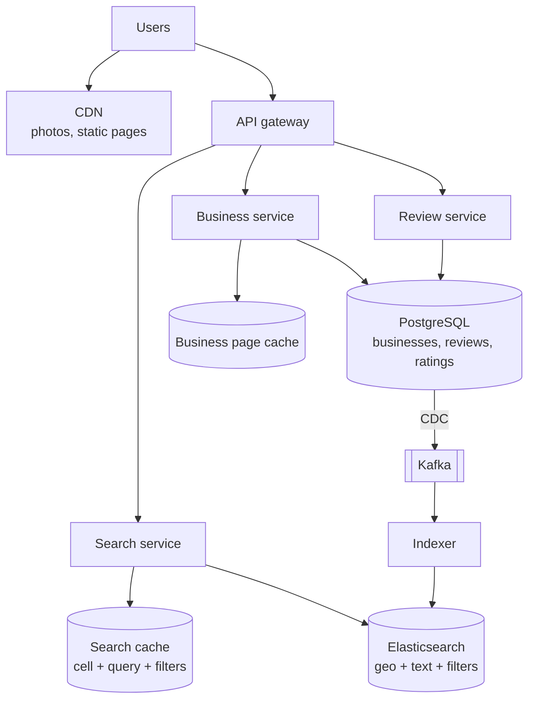
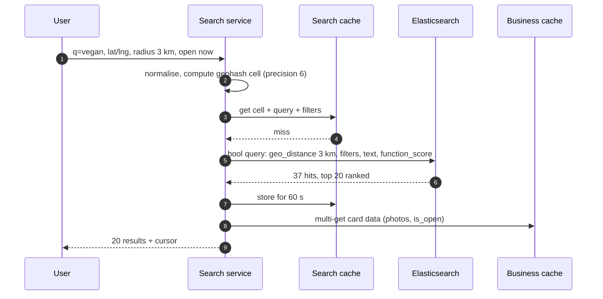
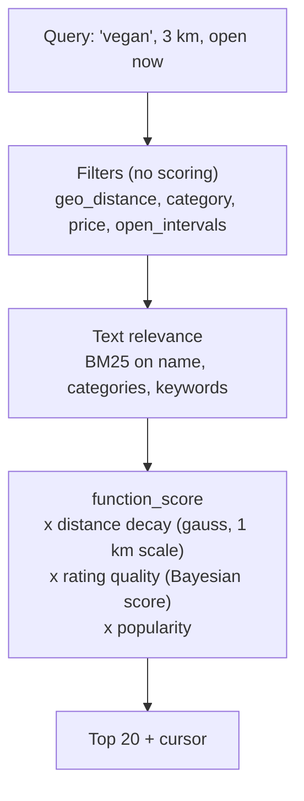
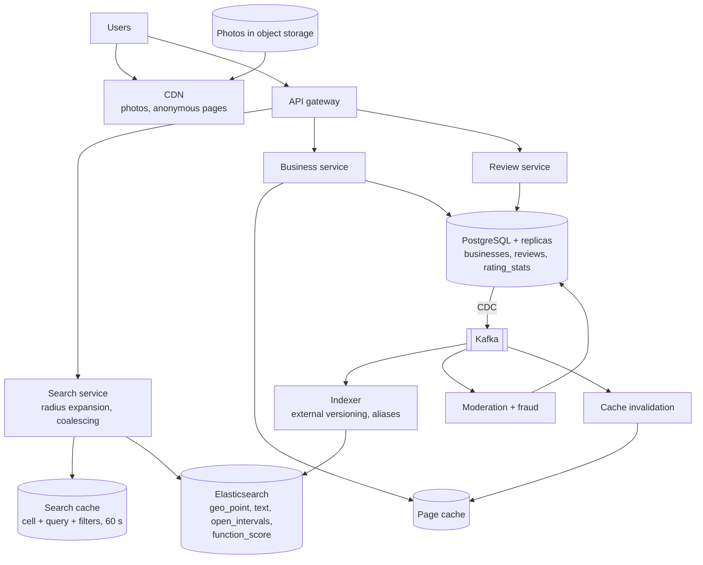

## Problem statement

Design a local business discovery service like Yelp: users search for places near a location ("coffee", "vegan restaurants open now"),
filter by category, price and rating, browse business pages with photos and reviews, and write reviews. Searches vastly outnumber edits, and
results must be relevant, nearby and fast.

**Interview format:** 45–60 minutes · **Difficulty:** advanced · **Main themes:** geospatial search combined with text and filters, ranking,
a search index fed by CDC, rating aggregation, read-heavy caching.

> [!TIP] Try it first
> Before scrolling, spend three minutes writing the questions you would ask the interviewer. Then compare with the list below — or
> practise this whole problem as a [timed mock interview](#system-design/hld/interview/yelp).

## Clarifying questions

The answers below are the interviewer's. Questions that change the design come first.

- **Q:** Which features are in scope? <!-- match: features, scope, what do we build, functionality, in scope -->
  - **A:** Searching businesses near a location with text and filters, business pages with photos and reviews, and writing reviews and
    ratings. Reservations, ads and messaging are out of scope.
- **Q:** How many businesses and searches? <!-- match: scale, how many, businesses, searches, traffic, users, volume -->
  - **A:** About 50 million businesses worldwide; 100 million searches and 300 million business-page views a day; about 1 million new
    reviews a day.
- **Q:** What filters and sorting do users need? <!-- match: filters, filter, sort, category, price, open now, rating -->
  - **A:** Category, price level, minimum rating, "open now", and distance; default sorting by relevance, with options for distance or
    rating.
- **Q:** How large is the search area? <!-- match: radius, area, how far, distance, map, bounding box -->
  - **A:** A radius around the user (default around 5 km) or the visible map area; widen automatically if there are too few results.
- **Q:** What latency is acceptable? <!-- match: latency, fast, p99, response time -->
  - **A:** Search results within 300 ms at p99.
- **Q:** How quickly must new reviews and business edits appear? <!-- match: fresh, freshness, new reviews, update, how quickly, edits -->
  - **A:** Within a few minutes is fine.
- **Q:** How is relevance defined? <!-- match: relevance, ranking, ranked, best results, order -->
  - **A:** A mix of text match, distance, rating quality and popularity.
- **Q:** Do we need to handle fake reviews? <!-- match: fake, spam, fraud, moderation, abuse -->
  - **A:** Yes, at a high level: suspicious reviews are filtered from ratings.

## Functional requirements

> [!TIP] Try it first
> Write three or four functional requirements before reading on.

- Users can **search nearby businesses** by text, category and filters. <!-- match: search, nearby, filters -->
- Users can **view a business page** with details, photos, ratings and reviews. <!-- match: business page, view, details -->
- Users can **write reviews** with a star rating and photos. <!-- match: review, write, rating -->
- Business owners can **update business information** (hours, menu, photos). <!-- match: update, owners, hours -->

````hint title="Hint: one query, three kinds of filter"
"Vegan restaurants open now within 2 km" combines text, a structured filter and a geographic filter. Which single system can do all three
efficiently?
````

## Non-functional requirements

- **Low latency** search: under 300 ms p99. <!-- match: latency, 300 ms, fast -->
- **Read-heavy scale**: thousands of searches and page views per second. <!-- match: read heavy, scale, searches per second -->
- **High availability** for search and pages. <!-- match: availability, available -->
- **Eventual consistency**: reviews and edits visible within minutes. <!-- match: eventual, consistency, minutes -->
- **Relevance** that users trust (rating integrity). <!-- match: relevance, trust, integrity -->

````hint title="Hint: source of truth"
If the search index is lost, can you rebuild it? From what?
````

## Scope and exclusions

In scope: business data, geo + text search, ranking, business pages, reviews and ratings, photos, caching, index synchronisation.

Out of scope: reservations and ordering, advertising, personalised recommendations (follow-up), map tiles (third-party).

## Capacity estimation

> [!TIP] Try it first
> Estimate searches and page views per second, review writes, and storage for businesses, reviews and photos.

- **Searches:** 100M/day ≈ **1,160/s**, ~3,500/s at peak.
- **Business pages:** 300M/day ≈ **3,500/s** average.
- **Reviews:** 1M/day ≈ **12 writes/s** — tiny compared with reads.
- **Storage:** businesses 50M × 2 KB ≈ **100 GB**; reviews ~2B × 1 KB ≈ **2 TB**; photos ~500M × 500 KB ≈ **250 TB** (object storage + CDN).
- **Search index:** business documents with text, categories, geo point, hours and rating — on the order of a few hundred GB, spread over
  shards and replicas.

```estimator title="Nearby places (searches, pages and reviews)"
requestsPerDay = 401M
readsPerWrite = 400
writeBytes = 1 KB
readBytes = 20 KB
retentionYears = 5
peakFactor = 3
replication = 3
cachePercent = 10
serverRps = 1500
targetUtilization = 60
```

Reads are searches and page views; writes are reviews and edits. Photo bytes are served from the CDN and aren't modelled here.

**What the numbers mean for the design:**

- **Read-heavy by ~400:1** — cache business pages and popular searches; replicas for reads ([read-heavy systems](lesson:read-heavy)).
- **Search needs geo + text + filters together** — a search engine, not the primary database.
- **The data set is moderate** — businesses fit easily in one database; the index and caches carry the load.

````hint title="Hint: cache keys for search"
Two users standing 50 m apart search for "coffee". How could their requests share a cache entry?
````

## API design

> [!TIP] Try it first
> Define the search request and the business and review APIs.

```text title="API"
GET /v1/search?q=vegan&lat=12.9716&lng=77.5946&radius_m=3000
              &categories=restaurants&price=1,2&min_rating=4&open_now=true&sort=relevance&cursor=...
  -> { "results": [ { "id", "name", "distance_m", "rating", "review_count", "price",
                      "categories", "is_open", "photo_url" } ],
       "next_cursor": "...", "expanded_radius_m": null }

GET  /v1/businesses/{id}                         -> details, hours, photos, rating summary
GET  /v1/businesses/{id}/reviews?sort=newest&cursor=...
POST /v1/businesses/{id}/reviews   { "stars": 4, "text": "...", "photo_ids": [...] }
PATCH /v1/businesses/{id}          (owners: hours, phone, menu)
```

- Pagination uses **cursors** (or search-after keys), not deep offsets ([pagination](lesson:pagination)).
- The response reports when the radius was **expanded** because too few results were found.

````hint title="Hint: open now"
Opening hours are in local time at the business. How do you evaluate "open now" for a search spanning a time-zone boundary?
````

## Data model

> [!TIP] Try it first
> Which data lives in the database, and what does a search document contain?

```text title="Schema"
businesses   (business_id PK, name, lat, lng, geohash, address, city, country, timezone,
              categories[], price_level, phone, hours jsonb, status, updated_at)
reviews      (review_id PK, business_id, user_id, stars, text, created_at, status, helpful_count)
              index (business_id, created_at DESC)
rating_stats (business_id PK, review_count, star_sum, bayes_score, updated_at)
photos       (photo_id PK, business_id, object_key, uploaded_by, status)

Search document (Elasticsearch, one per business)
  name, categories, keywords from reviews/menus, location (geo_point), price_level,
  rating, review_count, bayes_score, open_intervals (weekly minute ranges, UTC), status
```

- The **database is the source of truth**; the search index is derived and rebuildable ([search fundamentals](lesson:search-fundamentals)).
- **Rating stats** are maintained incrementally (sum and count) and also as a smoothed score for ranking.

````hint title="Hint: averages lie"
A business with one 5-star review and one with 2,000 reviews averaging 4.7 — which should rank higher under "best rated"?
````

## Initial high-level architecture

Build the design one requirement at a time.

### Step 1: store businesses and reviews

A **business service** and a **review service** write to PostgreSQL (primary plus read replicas). Photos go to object storage via presigned
uploads and are served by the CDN ([object storage](lesson:object-storage)).

### Step 2: index for search

Changes stream from PostgreSQL through CDC into Kafka; an **indexer** builds search documents (business fields, rating stats, review
keywords) and bulk-writes them to **Elasticsearch** ([Elasticsearch](lesson:elasticsearch)).

### Step 3: search

The **search service** sends one query to Elasticsearch: a geo-distance filter, structured filters (category, price, rating, open now) and a
text query, with a scoring function combining text relevance, distance decay and rating quality.

### Step 4: cache

Business pages are cached (and served partly from the CDN); popular searches are cached by **(geohash cell, normalised query, filters)** for a
minute or two.

````hint title="Hint: ratings and the index"
A new review changes a business's rating. Which systems must update, and in what order?
````

## Architecture diagram



## Request and data flow



## Component responsibilities

| Component | Responsibility | Scales with |
|---|---|---|
| Search service | Query building, radius expansion, caching, ranking parameters | Searches/s |
| Elasticsearch | Geo, text and filter queries; scoring | Searches/s, documents |
| Business service | Business details, owner edits, page cache | Page views |
| Review service | Write, moderate and list reviews; update rating stats | Reviews, review reads |
| Indexer | Build search documents from CDC events | Change rate |
| Object storage + CDN | Photos | Photo bytes served |

## Database and technology choices

| Need | Choice | Why | Alternative |
|---|---|---|---|
| Source of truth | PostgreSQL + read replicas (PostGIS available) | Relational data, modest size | MySQL |
| Search | Elasticsearch / OpenSearch with `geo_point` | Geo + text + filters + custom scoring in one query | PostGIS + full-text for smaller scale |
| Sync | CDC (Debezium) → Kafka → indexer | Reliable, ordered, rebuildable | Dual writes (lossy) |
| Caches | Redis for pages and popular searches | Read-heavy | CDN for anonymous pages |
| Photos | Object storage + CDN | Cheap, global | — |

## Scaling strategy

### How does geo + text search work in one query?

Elasticsearch indexes each business's location as a `geo_point` (Lucene's BKD trees make radius and bounding-box filters fast), alongside text
fields and keyword filters. A `bool` query applies the geo-distance and structured filters (cached, not scored) and a text query on name,
categories and review keywords; a `function_score` blends text relevance with a distance decay and the rating score. If fewer than ~10 results
come back, the search service widens the radius and retries ([geospatial indexes](lesson:geospatial-indexes),
[proximity services](lesson:proximity-services)).



### How is "open now" evaluated?

Hours are stored in the business's local time, then converted when indexing into **weekly UTC minute ranges** (Monday 00:00 UTC = minute 0).
At query time the search service computes the current minute-of-week in UTC and filters on documents whose ranges contain it — correct across
time zones, with special-hours exceptions (holidays) re-indexed as they change.

### How are ratings computed fairly?

Each new review updates `rating_stats` (`star_sum`, `review_count`) in the same transaction. For ranking, use a **Bayesian average** that pulls
businesses with few reviews towards the global mean: `(C × m + star_sum) / (C + review_count)`, where `m` is the global average and `C` a
smoothing constant. Reviews flagged by the fraud filter are excluded from the stats.

### How does the system handle read load?

Business pages are cached for minutes and invalidated on edits; anonymous page HTML can be served by the CDN. Searches are cached per
(geohash cell at roughly 1 km precision, normalised query, filters) for 60 seconds — nearby users with the same query share results. Read
replicas serve review lists. Elasticsearch scales with replicas for query throughput ([cache patterns](lesson:cache-patterns)).

### How does the index stay in sync?

CDC captures every change to businesses, reviews and rating stats; the indexer rebuilds the affected business document and writes it with
the database row version as an external version, so out-of-order updates can't overwrite newer ones. Reindexing everything (for mapping
changes) builds a new index behind an alias ([outbox and CDC](lesson:outbox-cdc)).

## Caching strategy

### Which caches, and how are they invalidated?

- **CDN**: photos (immutable URLs), static assets, anonymous business pages with short TTLs.
- **Business page cache**: invalidated by the business service on edits and by review events (rating summary).
- **Search result cache**: short TTL only — tolerating a minute of staleness is simpler than invalidating by area.
- **Rating stats**: read through with the business page; updated transactionally in the database.

## Messaging strategy

### What flows asynchronously?

CDC events from the database feed the search indexer, cache invalidation, review moderation (spam and fake-review models) and analytics.
Photo uploads trigger processing (resizing, moderation) before they appear ([large blobs](lesson:large-blobs)). Moderation decisions flow
back as review status changes, which recompute rating stats.

## Failure scenarios

| Failure | Impact | Mitigation |
|---|---|---|
| Elasticsearch cluster degraded | Slow or failed searches | Replicas, serve cached results, fall back to simple geo queries on PostGIS |
| Indexer lag | New reviews/edits not searchable yet | Acceptable minutes of lag; alert on lag |
| Database primary failure | Writes fail briefly | Failover; reads continue from replicas and caches |
| Search cache stampede for a popular query | Burst of identical ES queries | Request coalescing per cache key |
| Fake review campaign | Ratings manipulated | Fraud detection, exclusion from stats, rate limits |
| Bad mapping change | Search errors | Build new index behind an alias, validate, switch |

## Bottleneck analysis

- **Search QPS** on Elasticsearch — replicas, caching, filters before scoring.
- **Dense areas** (city centres) return many candidates — limit radius, rely on scoring, paginate with search-after.
- **Rating updates** for very popular businesses — tiny volume, but keep the stats update in the review transaction cheap.
- **Photo egress** — CDN.

## Consistency and availability trade-offs

- **Eventual consistency** between the database and the search index (seconds to minutes).
- **Strong consistency** for writing reviews and updating rating stats (one transaction).
- **Availability first for search**: serve cached or simplified results rather than errors.
- **Users see their own review immediately** by reading it from the database on their own pages.

## Security considerations

- Authenticated review writing with rate limits and verification signals; one review per user per business.
- Business owners verified before editing listings.
- Moderation for review text and photos; strip location metadata from photos.
- Protect against scraping of listings with rate limits and bot detection.

## Monitoring and observability

- Search latency p50/p99, zero-result rate, radius expansions.
- Cache hit ratios for search and pages.
- Indexer lag (database change to searchable), index error rate.
- Review volume, moderation actions, rating-change anomalies.

## Final architecture

Open this after you have drawn your own.

````solution title="Final architecture"


**In one breath:** PostgreSQL is the source of truth for businesses, reviews and rating statistics (updated in the review transaction), and
CDC streams every change through Kafka to an indexer that maintains versioned Elasticsearch documents with a geo point, text, filters, weekly
UTC opening intervals and a Bayesian rating score; the search service runs one geo-filtered, text-scored query with distance and quality decay,
widens the radius when results are sparse, and caches results per geohash cell, query and filters; business pages are cached and photos come
from a CDN.
````

## Alternative designs and trade-offs

| Alternative | Gains | Costs | When to choose it |
|---|---|---|---|
| PostGIS + PostgreSQL full-text only | One system, transactional | Weaker relevance and scale for search | Small catalogues |
| Geohash prefix scans in a key-value store | Simple, scalable | Text and filters done in application code | Pure "nearby" without text |
| Quadtree service in memory | Adapts to density | Custom service to build and run | Very high QPS geo-only queries |
| Precomputed results per cell and category | Fastest reads | Many combinations, staleness | Fixed category browsing |
| Personalised ranking | Better relevance | Less cacheable, ML infrastructure | Mature product |

## Interviewer follow-up questions

````question title="How would you find the 20 best coffee shops within 2 km?"
One Elasticsearch query: filter by geo_distance 2 km and category coffee (filters are cheap and cached), score by text relevance combined with
a distance decay and the business's Bayesian rating score, and return the top 20 with a search-after cursor. If fewer than 20 match, widen to
4 km. The results are cached briefly under the user's geohash cell, query and filters so nearby users reuse them.
````

````question title="Why not query PostgreSQL directly for nearby search?"
PostGIS can do radius queries efficiently, and for a small catalogue that's enough. At this scale the query also needs full-text relevance over
names, categories and review keywords, structured filters and custom scoring, at thousands of queries per second — exactly what a search
engine is optimised for. Keeping PostgreSQL as the source of truth and Elasticsearch as a derived index gives both transactional writes and
fast search.
````

````question title="How do you rank a business with 3 reviews against one with 3,000?"
Use a Bayesian (smoothed) average: (C × m + sum of stars) / (C + number of reviews), where m is the global average rating and C a constant like
20. With few reviews the score stays near the global mean; with many it converges to the real average. Combine it with a popularity term such
as the log of the review count, so well-established places rank above barely-reviewed ones with similar averages.
````

````question title="A business changes its opening hours. How quickly is search correct, and how?"
The owner's edit commits to PostgreSQL; CDC streams it within seconds to the indexer, which recomputes the weekly UTC opening intervals and
updates the document with the row version. After Elasticsearch's refresh (about a second) the "open now" filter is correct. Cached search
results may be up to a minute stale, which is acceptable; the business page cache is invalidated immediately.
````

````question title="How would you add personalised results?"
Generate candidates with the same geo and filter query (a few hundred), then rerank them with a model using the user's history — cuisines they
like, price levels, places they've visited — and features of each business. Personalisation makes results less cacheable, so cache the
candidate set per cell and query, and apply the per-user reranking on top.
````

## Common mistakes

- **Separate lat and lng B-tree indexes** as the geo strategy.
- **Dual-writing** the database and the search index.
- **Ranking by raw average rating**, letting one 5-star review win.
- **Computing "open now" in local time without time zones.**
- **No radius expansion** in sparse areas.
- **Caching search per exact coordinate**, so the cache never hits.

## Evaluation checklist

```checklist title="Evaluation checklist"
- Asked about scale, filters, radius, latency, freshness, relevance and fake reviews
- Estimated searches/s, page views/s, review writes and storage
- Kept PostgreSQL as source of truth and Elasticsearch as a derived index via CDC
- Combined geo filtering, structured filters and text relevance in one query
- Ranked with distance decay, a smoothed rating and popularity
- Expanded the radius when results were sparse
- Handled "open now" across time zones
- Maintained rating stats transactionally and excluded flagged reviews
- Cached pages and searches (by geohash cell) and served photos via CDN
- Planned reindexing with aliases and versioned updates
```
