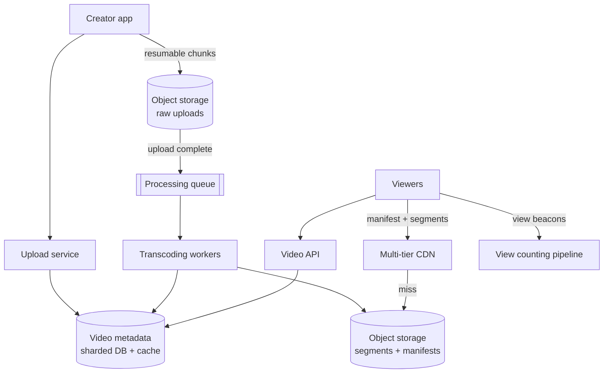
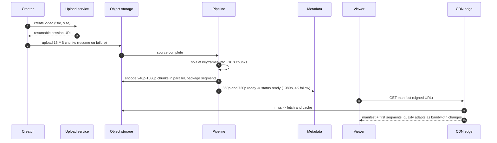
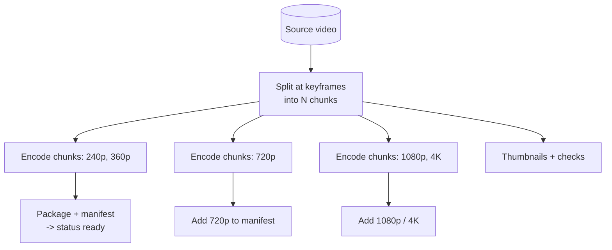
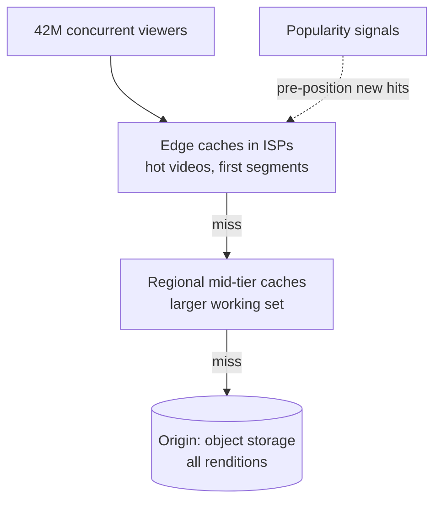
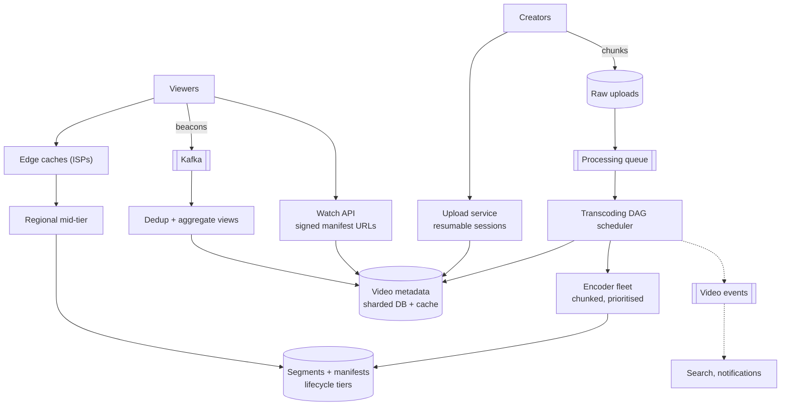

## Problem statement

Design a video-sharing platform like YouTube: creators upload videos of any length, the platform processes them into formats every device
can play, and viewers around the world stream them smoothly, with quality adapting to their network. Videos must never be lost, and
playback must start quickly.

**Interview format:** 45–60 minutes · **Difficulty:** intermediate · **Main themes:** resumable uploads, a parallel transcoding pipeline,
adaptive bitrate streaming, multi-tier CDN delivery, view counting at scale.

> [!TIP] Try it first
> Before scrolling, spend three minutes writing the questions you would ask the interviewer. Then compare with the list below — or
> practise this whole problem as a [timed mock interview](#system-design/hld/interview/youtube).

## Clarifying questions

The answers below are the interviewer's. Questions that change the design come first.

- **Q:** Which features are in scope? <!-- match: features, scope, what do we build, functionality, in scope -->
  - **A:** Uploading videos, processing them, watching with adaptive quality, and view counts. Search, recommendations, comments, live
    streaming and monetisation are out of scope.
- **Q:** How much video is uploaded and watched? <!-- match: scale, how much, uploads, hours, views, traffic, volume, users -->
  - **A:** About 500 hours of video uploaded every minute, and about 1 billion hours watched per day. Assume uploads average 10 minutes
    and views average 6 minutes.
- **Q:** How large can uploads be, and in what formats? <!-- match: size, file size, formats, codecs, resolution, how large, length -->
  - **A:** Up to 12 hours or 256 GB, in common formats (MP4, MOV, WebM); assume uploads average about 5 Mbit/s.
- **Q:** Which devices and networks must playback support? <!-- match: devices, networks, mobile, bandwidth, quality, adaptive, playback -->
  - **A:** Phones on poor mobile networks through to 4K TVs. Quality should adapt to bandwidth without stalling.
- **Q:** How quickly must an uploaded video be watchable? <!-- match: processing time, how quickly, available, publish, latency of processing -->
  - **A:** Within minutes for a 10-minute video; low resolutions can appear first, higher ones later.
- **Q:** How fast should playback start? <!-- match: start time, startup, latency, buffering, fast -->
  - **A:** Under 2 seconds to first frame for most viewers.
- **Q:** Where are the viewers? <!-- match: global, worldwide, regions, where, countries -->
  - **A:** Worldwide, with very uneven popularity — a few videos get most views, and there's a huge long tail.
- **Q:** How accurate must view counts be? <!-- match: view count, views counted, accuracy, analytics, counter -->
  - **A:** Approximately real time is fine; counts can lag by minutes, but they shouldn't be inflated by bots or replays.
- **Q:** Do videos ever get deleted or blocked? <!-- match: delete, takedown, copyright, moderation, block -->
  - **A:** Yes — by creators, by moderation, and for copyright claims; blocked videos must stop playing quickly.

## Functional requirements

> [!TIP] Try it first
> Write three or four functional requirements before reading on.

- Creators can **upload a video** (resumably) with a title and description. <!-- match: upload -->
- The platform **processes videos** into multiple resolutions and formats, with thumbnails. <!-- match: process, transcode, encode -->
- Viewers can **stream a video** with **adaptive quality** and seeking. <!-- match: stream, watch, play, adaptive -->
- The platform shows **view counts**. <!-- match: view count, views -->
- Videos can be **removed or blocked**. <!-- match: remove, delete, block, takedown -->

````hint title="Hint: three pipelines"
Uploading, processing and watching have completely different traffic shapes. Sketch each separately before connecting them.
````

## Non-functional requirements

- **Durability**: uploaded and processed videos are never lost. <!-- match: durable, durability, never lost -->
- **Fast start and smooth playback**: under 2 s to first frame; minimal rebuffering. <!-- match: start, playback, rebuffering, smooth, latency -->
- **Massive egress**: about 100 Tbit/s of video delivered on average. <!-- match: egress, bandwidth, scale, throughput -->
- **High availability** of playback worldwide. <!-- match: availability, available -->
- **Cost efficiency** for storage, transcoding and delivery. <!-- match: cost, efficient, cheap -->

````hint title="Hint: where does the money go?"
Compare storage per day, transcoding compute per day, and bytes delivered per day. Which dominates?
````

## Scope and exclusions

In scope: resumable uploads, transcoding and packaging, thumbnails, storage, adaptive streaming, CDN delivery, metadata, view counting,
takedowns.

Out of scope: search, recommendations, comments, live streaming, ads and monetisation, creator analytics beyond view counts.

## Capacity estimation

> [!TIP] Try it first
> Estimate videos uploaded per second, storage per day, concurrent streams and average egress.

- **Uploads:** 500 h/min × 1,440 = 720,000 hours/day; at 10 minutes each, **4.3M videos/day ≈ 50/s**.
- **Original size:** 10 min × 5 Mbit/s ≈ **375 MB** per video.
- **Stored per video:** original plus the rendition ladder (240p–4K, a couple of codecs) ≈ 3× the original ≈ **1.1 GB** →
  **~4.9 PB/day**, **~1.8 EB/year**.
- **Views:** 1B hours ÷ 6 minutes ≈ **10B views/day ≈ 116,000 view starts/s**.
- **Concurrent streams:** 1B hours ÷ 24 h ≈ **42M streams** on average.
- **Egress:** 6 min × 2.5 Mbit/s average delivered ≈ 112 MB per view → **~1.1 EB/day ≈ 104 Tbit/s** average.
- **Transcoding:** assuming ~10 core-hours per hour of video for the full ladder → 7.2M core-hours/day ≈ **300,000 busy cores**.

```estimator title="YouTube (view starts and uploads)"
requestsPerDay = 10B
readsPerWrite = 2300
writeBytes = 1.1 GB
readBytes = 112 MB
retentionYears = 1
peakFactor = 2
replication = 1
cachePercent = 0
serverRps = 2000
targetUtilization = 60
```

Reads are view starts (each delivering ~112 MB of video, almost all from CDN caches); writes are uploads, stored with their renditions.
Replication is left at 1 because the object store provides durability internally.

**What the numbers mean for the design:**

- **Delivery dominates everything**: ~100 Tbit/s can only come from caches close to viewers.
- **Storage grows by petabytes per day**: tiering the long tail matters.
- **Transcoding is a large, parallel batch workload**: split, encode in parallel, prioritise.

````hint title="Hint: concurrent streams"
How many viewers are watching at any moment, and what does that say about where the bytes must come from?
````

## API design

> [!TIP] Try it first
> Define the upload session, video metadata, and what the player requests to start streaming.

```text title="API"
POST /v1/videos     { "title", "description", "size_bytes", "content_type", "sha256" }
  -> 201 { "video_id": "v_9Tq2", "upload_url": "<resumable session URL>", "chunk_size": 16777216 }
PUT  <upload_url>  Content-Range: bytes 0-16777215/392001024   (repeat; resume on failure)
GET  <upload_url>  -> 308 Range: bytes=0-167772159                (how much the server has)

GET  /v1/videos/{id}                -> { "title", "status": "processing|ready|blocked", "duration",
                                         "thumbnails", "views", "manifest_url" }
GET  <manifest_url>      HLS/DASH manifest: renditions and segment URLs (signed, on the CDN)
GET  <segment_url>                  2-6 s media segment from the nearest cache

POST /v1/videos/{id}/views   { "session_id", "watched_seconds" }   (beacons for view counting)
DELETE /v1/videos/{id}
```

- The **upload session** accepts chunks with byte ranges and can report how much it has, so clients resume after failures.
- Playback is just **HTTP GETs of a manifest and segments**, which is why it caches so well.

````hint title="Hint: why segments?"
What would seeking and quality switching cost if each video were one big file per resolution?
````

## Data model

> [!TIP] Try it first
> What lives in the metadata store, and what lives in object storage? How are renditions organised?

```text title="Schema"
videos        (video_id PK, channel_id, title, description, status, duration_s, created_at,
               visibility, blocked_regions)                      sharded by video_id
renditions    (video_id, codec, resolution, bitrate, segment_count, manifest_key, ready_at)
processing    (video_id, task, chunk, state, attempts, worker, updated_at)   -- pipeline state
view_counts   (video_id, count, updated_at)                      updated from aggregates

Object storage
  raw/{video_id}/source.mp4
  media/{video_id}/{codec}/{resolution}/seg_00001.m4s ...   + manifest.m3u8 / manifest.mpd
  thumbs/{video_id}/{n}.jpg
```

- **Metadata** (small, queried by ID) lives in a sharded database with heavy caching; **media** lives in object storage
  ([object storage](lesson:object-storage)).
- **Pipeline state** per chunk and task makes processing resumable and observable.

````hint title="Hint: status"
What should a viewer see if they open a video whose 1080p rendition isn't finished yet?
````

## Initial high-level architecture

Build the design one requirement at a time.

### Step 1: upload

The **upload service** creates a video record and a resumable upload session; the client sends chunks straight to object storage (raw
bucket), resuming from the last acknowledged byte after failures ([large blobs](lesson:large-blobs)).

### Step 2: process

On upload completion, a **transcoding pipeline** splits the source into chunks at keyframes, encodes each chunk into every rendition in
parallel across a worker fleet, packages segments and manifests, generates thumbnails, and runs content checks. The video becomes
watchable as soon as the first renditions are ready.

### Step 3: deliver

Players fetch the manifest and segments from a **multi-tier CDN**: edge caches near (or inside) viewers' ISPs, regional mid-tier caches,
and object storage as origin.

### Step 4: count views

Players send view **beacons**; a streaming pipeline deduplicates and aggregates them into counts every few seconds
([write-heavy systems](lesson:write-heavy)).

````hint title="Hint: why split into chunks?"
How long would one machine take to encode a 3-hour video into ten renditions? What if you used 200 machines?
````

## Architecture diagram



## Request and data flow



## Component responsibilities

| Component | Responsibility | Scales with |
|---|---|---|
| Upload service | Video records, resumable sessions, validation | Uploads/s |
| Object storage | Raw sources, segments, manifests, thumbnails | Petabytes per day |
| Transcoding pipeline | Split, encode, package, thumbnails, checks | Hours uploaded × renditions |
| Metadata service | Video records, status, renditions, takedowns | Page views |
| Multi-tier CDN | Segment caching near viewers | Concurrent streams, egress |
| View counting | Beacon ingestion, dedup, aggregation | View events/s |

## Database and technology choices

| Need | Choice | Why | Alternative |
|---|---|---|---|
| Video metadata | Sharded relational DB (e.g. Vitess over MySQL) + cache | Rich queries, strong consistency, huge read cache | Bigtable / Cassandra |
| Media | Object storage with lifecycle tiers | Cheap, durable, unlimited | HDFS |
| Pipeline orchestration | Workflow engine / DAG scheduler over a job queue | Retries, parallel chunks, visibility | Hand-rolled queue chains |
| Encoding | FFmpeg-based workers (CPU), hardware encoders for scale | Mature, flexible | Managed transcoding services |
| Streaming format | HLS and DASH with CMAF segments | Supported on every device, cache-friendly | Progressive MP4 download |
| View counts | Kafka + stream aggregation | Write-heavy, deduplication | Direct counter updates (too hot) |

## Scaling strategy

### How is transcoding parallelised?

The source is split at keyframes into chunks of a few seconds to a minute; each (chunk, rendition) pair is an independent task. A DAG
scheduler fans these out to thousands of workers, then a packaging step stitches chunk outputs into segments and manifests. A 3-hour video
can finish in minutes instead of hours. Tasks are idempotent (outputs keyed by video, rendition and chunk), retried on failure, and
prioritised: low resolutions first so videos go live quickly, popular creators ahead of backfills ([long-running jobs](lesson:long-running-jobs),
[multi-step workflows](lesson:multi-step-workflows)).



Encoding cost can be cut further: encode newer, more efficient codecs (such as AV1) only for videos that become popular, where the bandwidth
savings pay for the extra compute.

### How does adaptive bitrate streaming work?

Each rendition is cut into short segments (2–6 s) listed in a manifest (HLS `.m3u8` or DASH `.mpd`). The player measures throughput and
buffer level and picks the rendition for the next segment; a short first segment at modest quality gives a fast start. Seeking fetches only
the segments around the new position. Because segments are small, immutable files with stable URLs, CDNs cache them extremely well.

### How are 100 Tbit/s delivered?

With a **multi-tier CDN**: edge caches deployed in or near ISPs serve popular videos; regional mid-tier caches hold a larger working set
and shield the origin; object storage holds everything. Popularity is skewed, so a small fraction of videos produces most traffic; new
uploads from big channels can be **pre-positioned** at edges before they trend. The long tail is served from regional caches or origin at
lower hit ratios ([CDN](lesson:cdn)).



### How are view counts computed?

Players send beacons (start, progress); a log ingests them, a stream processor deduplicates by session and filters bots, then aggregates
per video per window and updates counts. Counts are eventually consistent and may lag by minutes for very popular videos while fraud checks
run.

## Caching strategy

### What is cached where?

- **Segments and manifests** at CDN tiers — immutable, long TTLs.
- **Video metadata** (title, status, renditions) in a distributed cache in front of the sharded database; watch pages are read-heavy.
- **Thumbnails** on the CDN like images.
- **View counts** cached and refreshed periodically rather than read from the aggregator on each page view.

### What about takedowns?

Blocking a video updates its status in metadata; manifests are served through a signed, short-lived URL that is only issued for watchable
videos, so new playback stops immediately. CDN purges remove cached manifests; segments without a valid manifest are useless.

## Messaging strategy

### Where do queues and logs help?

- **Upload complete → processing queue**: absorbs bursts and lets the pipeline run at its own pace with retries and dead letters
  ([retries and DLQs](lesson:retries-dlq)).
- **Pipeline events** (`RenditionReady`, `VideoReady`) update metadata, notify subscribers and feed search indexing.
- **View beacons → Kafka → aggregators**: a write-heavy stream processed in windows.

## Failure scenarios

| Failure | Impact | Mitigation |
|---|---|---|
| Upload interrupted | Partial upload | Resumable sessions; abort incomplete uploads after days |
| Transcoding worker dies | Chunk task incomplete | Task retries; idempotent outputs; DAG resumes |
| Corrupt or unsupported source | Pipeline fails repeatedly | Validation step, DLQ, creator notified |
| Edge cache outage | Viewers re-routed to other edges | Anycast/DNS steering, mid-tier absorbs misses |
| New viral video | Miss storm on origin | Mid-tier shield, request coalescing, pre-positioning |
| View pipeline lag | Counts stale | Acceptable; alert on lag; counts catch up |

## Bottleneck analysis

- **Egress and cache capacity** at the edge — the dominant cost.
- **Transcoding compute** during upload spikes — prioritisation and elastic capacity.
- **Storage growth** — lifecycle tiers for rarely watched renditions; re-encode on demand for the deep long tail.
- **Metadata reads** for watch pages — caching.

## Consistency and availability trade-offs

- **Uploads are durable before acknowledgement** of each chunk; processing is eventually complete, rendition by rendition.
- **Status is strongly consistent** in metadata (a blocked video must stop being served); segment caches are eventually consistent but
  inaccessible without a valid manifest URL.
- **View counts are eventually consistent** and approximate.
- **Playback availability beats freshness**: cached segments keep playing even if the metadata service is degraded.

## Security considerations

- Signed, expiring manifest URLs (or tokens) per playback session; optional DRM for premium content.
- Scan uploads; validate container formats strictly (malformed media is a classic attack surface for decoders) and run encoders in
  sandboxes.
- Copyright matching on uploads before or soon after publication.
- Rate-limit uploads and view beacons; filter bot views.

## Monitoring and observability

- Upload success rate; time from upload to first playable rendition and to full ladder.
- Pipeline queue depth, task failure rates, encoder utilisation.
- Playback quality of experience: startup time, rebuffering ratio, average bitrate, errors — by region and ISP.
- CDN hit ratio per tier, egress per region, origin load.
- View pipeline lag and dedup rates.

## Final architecture

Open this after you have drawn your own.

````solution title="Final architecture"


**In one breath:** creators upload in resumable chunks straight to object storage; a queue triggers a DAG that splits each source at
keyframes and encodes chunks into a rendition ladder in parallel, publishing low resolutions first and packaging HLS/DASH segments with
manifests; metadata lives in a sharded, cached database whose status gates signed manifest URLs; players stream short segments with
adaptive bitrate from edge caches inside ISPs, backed by regional tiers and the origin; view beacons flow through Kafka into deduplicating
aggregators that update counts every few seconds.
````

## Alternative designs and trade-offs

| Alternative | Gains | Costs | When to choose it |
|---|---|---|---|
| Progressive MP4 download | Simple | No adaptive quality, poor seeking, wasted bytes | Short clips only |
| Transcode the whole file on one machine | Simple pipeline | Hours of latency for long videos | Low volume |
| Encode every codec for every video | Best efficiency everywhere | Huge compute for videos nobody watches | Small catalogues |
| Managed transcoding and CDN | Less to build | Cost and less control at very large scale | Most companies |
| Peer-assisted delivery | Lower egress | Complexity, privacy concerns | Very large live events |

## Interviewer follow-up questions

````question title="How do you make a 3-hour upload watchable within minutes?"
Split the source at keyframes into many chunks and encode each chunk independently on different workers, so wall-clock time depends on the
number of workers rather than the video's length. Encode and publish the most-needed renditions first (360p and 720p), mark the video ready,
and add higher resolutions and extra codecs as they complete. Uploading in chunks also allows processing to start on early chunks before the
upload finishes.
````

````question title="Why is adaptive streaming built from small segments?"
Small segments let the player switch quality at every segment boundary as bandwidth changes, start playback after downloading only a few
seconds, and seek by fetching only nearby segments. They're also immutable files with stable URLs, so every CDN tier can cache them
efficiently and serve the same segment to millions of viewers.
````

````question title="How would you keep storage costs under control?"
Keep originals and popular renditions in standard storage, but move renditions of videos that are rarely watched to colder storage classes,
and for the deep long tail consider keeping only the original plus a couple of renditions, re-encoding others on demand. Encode expensive
codecs only for popular videos. Deduplicate exact re-uploads by content hash. Lifecycle rules make these transitions automatic.
````

````question title="How are view counts kept accurate and cheap?"
Players send beacons to an ingestion tier that writes to a log; stream processors deduplicate per session, filter bots and replays, and
aggregate counts per video per time window, writing totals idempotently. The watch page reads a cached count refreshed every few seconds.
This turns billions of events into a manageable number of writes and lets fraud filtering run before counts are trusted.
````

````question title="A video becomes viral within minutes. What happens in the delivery path?"
The first requests miss at many edges at once; the regional mid-tier collapses those misses into one origin fetch per segment, and edges
then serve the hot segments from memory. Popularity signals can pre-position the video's early segments at edges proactively. The metadata
cache absorbs watch-page reads, and the view counter keeps aggregating in windows without hot-row contention.
````

## Common mistakes

- **Uploading through application servers** or without resumability.
- **Transcoding sequentially** on one machine per video.
- **Serving whole files** instead of adaptive segments.
- **Ignoring egress** in the estimate — it dominates cost.
- **Counting views with direct database increments.**
- **No status model**, so viewers can request renditions that don't exist yet.

## Evaluation checklist

```checklist title="Evaluation checklist"
- Asked about upload and watch volume, video sizes, devices, start-time targets and geography
- Estimated uploads/s, storage per day, concurrent streams, egress and transcoding compute
- Designed resumable, chunked uploads directly to object storage
- Built a parallel transcoding pipeline that splits at keyframes and publishes low resolutions first
- Explained adaptive bitrate streaming with segments and manifests
- Delivered through a multi-tier CDN with edge caches and a mid-tier shield
- Separated metadata (sharded, cached) from media (object storage)
- Counted views through a streaming pipeline with deduplication
- Handled takedowns through status-gated, signed manifest URLs
- Discussed cost: storage tiers, selective codecs, egress
```
